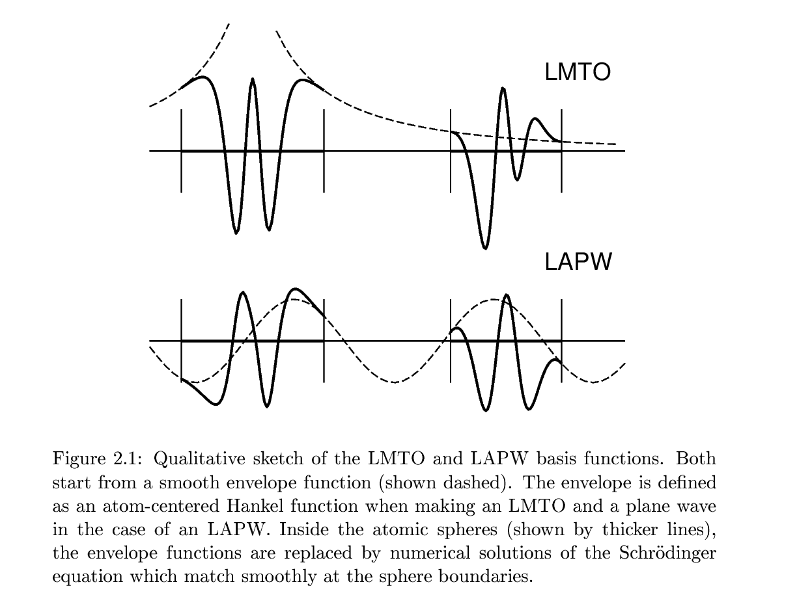
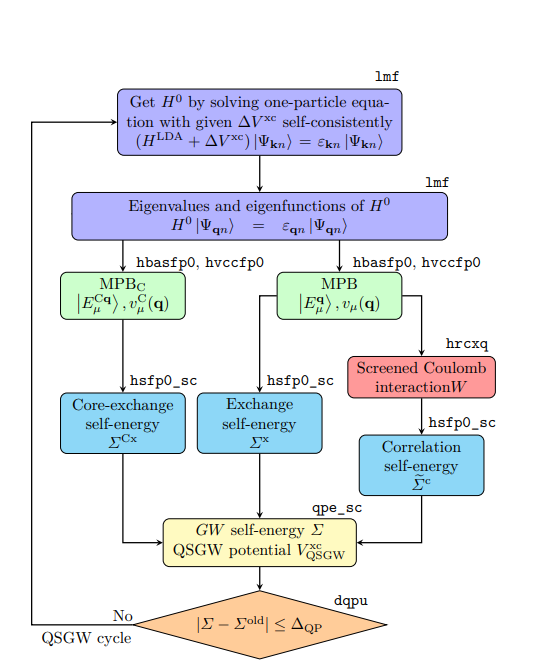
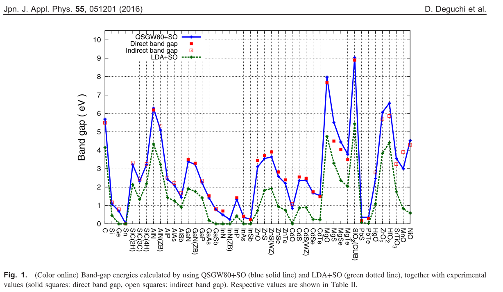
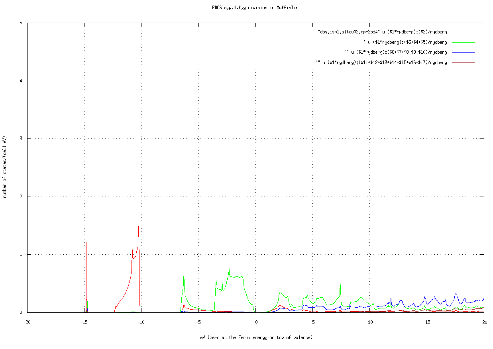
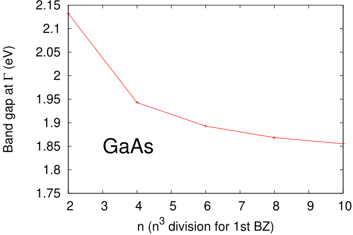

# ecalj main document {#ecalj-maindocument}

> English version of the page [manual/README_tutorial](../../manual/README_tutorial.md). The pages at the top of ecaljdoc are the reference; this one was made from manual/README_tutorial.md of commit 296542c3a (source blob ed1e22e5cb0d).
**This is the main document of ecaljdoc. It describes the features of ecalj, an overview of QSGW, and the first calculation (GetStarted). Follow the menu on the left to the other pages.**

* Here we explain [GetStarted](#getstarted), together with the installation and an overview of QSGW.
* [UsageDetails](./UsageDetailed.md) is in a separate file.
* [The Japanese article on Qiita](https://qiita.com/takaokotani/items/9bdf5f1551000771dc48) may also help, but most of it is written here.
* If a link is broken, download from https://github.com/tkotani/ecalj.
* Let an AI do the installation and guide you (have the AI read [GetStarted with AI](./getstartedAI)). The documents on the installation procedure are [install](../install/install.md) and [Installation at ISSP](../install/installISSP.md).
* License: AGPLv3 (applies to AI without exception). See the [License](./license) page.

## Features of the ecalj package {#features-of-ecalj-package}

1. **All-electron full-potential PMT method**
   The PMT method is a mixed-basis method with two kinds of augmented waves, namely APW+MTO.
   In other words, PMT method = linearized (APW+MTO) method. Except for [Questaal](https://www.questaal.org/), which has the same origin as ecalj, no other method like it exists. MTO and APW work complementarily in representing the wave functions. They correspond to the localized and the extended nature of the eigenfunctions, respectively.

   See Fig. 1.<br>
   For MTO and APW, the envelope functions outside the MT (dashed lines in the figure) have opposite curvature. The sign of the curvature is determined by the sign of the local $V-E$ ($\nabla^2\psi/\psi = (2m/\hbar^2)(V-E)$). For $E>V$ they oscillate (APW), and for $E<V$ they decay (MTO). The eigenvalues of localized states such as 3d lie below the effective potential outside the MT (including the centrifugal term $l(l+1)/r^2$). On the other hand, the eigenvalues of extended states such as Na 3s lie above it. In short, the curvature of the wave functions in solids can be plane-wave-like (oscillating) or localized (decaying) even in the region outside the MT. The basis functions corresponding to these are APW and MTO.
   Combining localized MTOs (decay factor $\exp(-\kappa r)$, $\kappa \sim 1\,{\rm bohr}^{-1}$; that is, they reach only the nearest-neighbor atoms) with APWs (cutoff $\approx 3$ Ry) gives sufficient convergence. Since APWs are included, scattering states are also described very well. This is difficult with, e.g., Gaussians. On the other hand, it is thanks to the MTOs that atomic wave functions close to core-like shapes, such as 3d, can be described even with extremely few APWs. Relaxation of atomic positions at the GGA/LDA level is also possible.
   

   *Fig. 1*. MTO and APW (from the [nfp manual](../../presentations/nfpmanual.pdf) by M. Methfessel and M. van Schilfgaarde).

   The present formulation of PMT is given in the following.

   [1][KotaniKinoAkai2015, PMT formalism](../../presentations/KotaniKinoAkai2015FormulationPMT.pdf)

   [2][KotaniKino2013, PMT applied to diatomic molecules](../../presentations/KotaniKino2013PMTMolecule.pdf).

   However, various settings and detailed improvements have been added. In particular, it is important that the setting of the MTOs is automated. In the usual LMTO method, setting the MTO parameters was difficult, and the method was rather hard to use.
   The parameters of the basis functions are set automatically, so you do not need to worry about setting them. Adding APWs to the MTOs considerably reduced the dependence on the MTO parameters. In the conventional MTO-only methods, it was also necessary to include very long-range (nearly 1/r-type) basis functions. All the calculation needs is the crystal structure (POSCAR).
   <!-- In principle, it is possible to perform reasonable calculations just from crystal structures and very minimum setting.  -->
    * PMT began with https://journals.aps.org/prb/abstract/10.1103/PhysRevB.81.125117 .
    * PMT uses the smooth Hankel functions of [the paper on smooth Hankel functions by E. Bott, M. Methfessel, W. Krabs, and P. C. Schmidt](../../presentations/Bott1988.pdf). They were used in [B][the nfp paper by M. Methfessel, M. van Schilfgaarde, and R.A. Casali](../../presentations/nfp.pdf), and our PMT is built on top of it.
   *  In addition to the PMT basis, local orbitals are also used together.
   * The cutoff $\approx 3$ Ry may sound surprisingly small. Note, however, that in plane-wave methods the high-energy part is used only to represent the core-like shapes of the eigenfunctions, where the curvature of the radial functions becomes negative. Moreover, plane waves have the difficulty that they do not satisfy the periodic gauge ([arXiv:2010.03959](https://arxiv.org/pdf/2010.03959)). In ecalj, thanks to the MTOs, a method corresponding to the maximally localized Wannier method ([MLO modeling](./mlo)) can be carried out in a simple way. On the other hand, methods with localized bases such as LMTO or Gaussians are poor at treating vacuum regions. This can be a problem, e.g., in treating surfaces.

2. **PMT-QSGW method**

   The QSGW method is a method to compute an effective one-body Hamiltonian that gives the quasiparticle bands accurately.
   PMT-QSGW means `the Quasiparticle self-consistent GW method (QSGW) based on the PMT method`, that is, QSGW based on the PMT method. The key to performing QSGW on top of PMT is the development in [3]. Magnetic metals can also be treated. ecalj is implemented on GPUs, so about 40 atoms can be treated with 4 GPUs.
   [3][Kotani2014, Formulation of PMT-QSGW method](../../presentations/Kotani2014QSGWinPMT.pdf)
   [4][D.Deguchi PMT-QSGW applied to a variety of insulators/semiconductors](../../presentations/deguchi2016.pdf)
   [5][M.Obata GPU implementation](https://arxiv.org/abs/2506.03477). Here Type II GaSb/InAs (40 atoms) is treated with 4 GPUs.
   Band plots can be drawn easily without interpolation such as Wannier. This is because a mechanism for interpolating the self-energy is built in.
   This is very important for computing physical quantities from the eigenfunctions on top of the QSGW ground state.
   (The QSGW method based on MLO ([MLO-gwsc](./mlo_gwsc)) also works, but has not yet been tested.)

   Since all electrons are treated, there is no trouble with the ambiguities of pseudopotentials.

3. **Dielectric functions and susceptibilities**
    Quantities related to GW, such as dielectric functions, spectral functions of the Green's function, and magnetic fluctuations, can be computed. This is because QSGW can produce eigenfunctions and eigenvalues at arbitrary k points.

4. **Model Hamiltonians by MLO**
   Effective models are made with MLO (muffin-tin based localized orbitals): the model Hamiltonian, and the effective interactions v, W, and cRPA W between the MLOs
   (`job_mlo`, `job_mloW --crpa`; [MLO](./mlo)).
   * Until 2026-10-02, ecalj had maximally localized Wannier functions with cRPA (the formulation of the Juelich group). The maximally localized Wannier function part
     started from the code by Miyake, Sakuma, Kino, et al. (a paper using it: [Phys. Rev. B 108, 035141](https://journals.aps.org/prb/abstract/10.1103/PhysRevB.108.035141)).
     MLO has replaced it. The original is at the git tag `last-wannier`.

5. **The singleton pattern in Fortran**
   The main part of the code is in Fortran. The code has an object-oriented structure based on the singleton design pattern. This structure has the advantage that it is easy for AI to understand and hard to get wrong. Each piece of data is placed in only one module, and where it is used is made explicit by `use ..., only:`, so the data flow is easy to follow and copies never disagree.

## Overview of QSGW {#overview-of-qsgw}

* Band calculations (at the LDA level) are done with the program `lmf`. The initial setting file is `ctrlg.<sname>.toml` (`<sname>` is the extension for the material chosen by the user; the old form is `ctrl.<sname>`). Before `lmf`, `lmfa` needs to be run. This is a calculation of spherical atoms that determines the initial condition of the electron density (`lmfa` finishes in a few seconds).
* The file `sigm.<sname>` is the key to the QSGW calculation. `sigm.<sname>` contains the nonlocal potential $\Delta V_{\rm xc}=V_{\rm xc}^{\rm QSGW}-V_{\rm xc}^{\rm LDA}$. Adding this potential term to the usual LDA calculation performed by `lmf` gives the QSGW calculation. See the figure below.
* The question is how to make $V_{\rm xc}^{\rm QSGW}({\bf r},{\bf r}')$. It is computed from the self-energy $\Sigma({\bf r},{\bf r}',\omega)$ calculated in the GW approximation. Roughly speaking, $V_{\rm xc}^{\rm QSGW}({\bf r},{\bf r}')$ is obtained by removing the omega dependence of $\Sigma({\bf r},{\bf r}',\omega)$.
* Thus the calculation of $V_{\rm xc}^{\rm QSGW}$ is the main part of the QSGW cycle, computed in a double loop. That is, there is the inner loop of `lmf`, and the outer loop that computes $V_{\rm xc}^{\rm QSGW}$ using the eigenfunctions given by `lmf`. The outer loop can be run with a python script called gwsc (which runs the Fortran programs). The computation time of QSGW is much longer than that of LDA.
As a rough guide, one QSGW iteration takes about 10 hours for 20 atoms
(it depends on the number of electrons; for systems larger than about 10 atoms per cell we recommend using GPUs). However, with mixed-precision computation on GPUs it should be about 30 minutes or less.
* The following is the QSGW cycle shown in Figure 1 of https://arxiv.org/abs/2506.03477 . MPB is the mixed product basis for expanding products of eigenfunctions.

* There is [GPU acceleration of QSGW](https://arxiv.org/abs/2506.03477). This paper also explains the basics of QSGW. The QSGW algorithm fits GPU computation very well. With 4 GPUs, systems of 40 atoms per cell can be computed (in the lmf part, GPUs are not yet used efficiently). With PMT, large vacuum regions of slab models can also be treated.
* QSGW can be performed almost automatically, without setting parameters by hand. For this reason, we think ecalj is one of the easiest packages for performing GW/QSGW. For a database of QSGW bands, see [DOSnpSupplement](https://github.com/tkotani/DOSnpSupplement).

 This figure is taken from [4][D.Deguchi](../../presentations/deguchi2016.pdf).

Compared with LDA, QSGW shows the following differences.
* Band gaps. QSGW tends to be slightly larger than experiment. This looks systematic, as in the figure above.
* Band widths. Usually sp bands become wider (except for very low-density cases like Na).
    This is consistent with the case of the homogeneous electron gas.
    Localized bands such as 3d electrons become narrower.
* Relative positions of bands, e.g., O(2p) and Ni(3d).
More localized bands tend to become deeper.
The exchange splitting between up and down becomes larger (as in LDA+U).
In cases like NiO, the magnetic moment becomes larger and closer to the experimental value.
* Hybridization of the 3d bands with other bands. QSGW tends to localize the eigenfunctions.

In reality, however, things are complicated and not always so simple.

<!--
### Basic knowledge check
* Flow of an LDA calculation
* MT division of space
* Basis functions MTO and APW (augmentation and atomic wave functions inside the MT). They have three components: envelope + true - counter
* Band calculation method PMT=LMTO+LAPW method. The charge is also represented by three components. The unsatisfactory part of the space spanned by the MTOs is supported by APWs of about 3 Ry or less.
* What is the independent-particle approximation
* The Hartree-Fock (HF) approximation solves hydrogen H properly. For the homogeneous gas, the density of states becomes zero at the Fermi surface.
* LDA solves the homogeneous gas properly, but the band gap of H is quite small.
* LDA and HF are at opposite extremes. In HF the band gap of Si is more than 10 eV (why?). Hybrid method HSE. Self-interaction.
* Importance of the exchange term. To distinguish bonding and antibonding of H2, the Fock term, which acts as a projector onto the occupied states, is important.
* GW approximation. The correlation term in addition to the Fock term. The time-dependent potential felt by a charged particle moving in a polarizable medium. Screened HF + Coulomb hole.
  Band gaps, positions of d bands, effect of U
* QSGW method. A special exchange-correlation term made by somewhat forcibly removing the time dependence from the self-energy in the GW approximation.
* (If possible, basics of linear response theory, Fourier transform of the step function, Green's function (linear response function) for a classical damped oscillator.)

### What can ecalj do?

* LDA calculations
VWN, PBE-GGA, LDA+U can be chosen.
Structural relaxation (lattice changes by hand), collinear, SOC (the axis can be chosen), AF symmetry can be included.
Slab calculations with the ESM method. Not fully optimized, so at present it has no advantage for structural relaxation etc.

* QSGW calculations:
Self-consistent GW method. It can be said to be a calculation that makes a special exchange-correlation term.
Self-energy spectrum plots.
Impact ionization rates (lifetimes due to Auger).
GPU acceleration, automated settings.
Band plots directly in the GW method are possible.
QSGW currently cannot compute total energies. Only band structures (eigenvalues, wave functions).
* Calculations such as linear response.
Dielectric constants in RPA, spin fluctuation calculations (room for improvement; works for metals too; Drude weight (q→0))
Modeling by MLO (model Hamiltonian, v, W, cRPA; replaced the maximally localized Wannier on 2026-10-02). Some parts are not fully automated yet.
It should be applicable to other physical quantities as well.
* Automatic calculation is possible to a large extent. In QSGW, about 1500 structure files are taken from Materials Project and computed automatically with QSGW,
almost without problems. There is no need to tweak the settings by hand individually (for 4f, 5f the automation is not set up yet, but it is basically possible).
Band plots, including the symmetry lines, are automated. The data are plotted with gnuplot etc., so they are easy to read. For crystal structures there are converters to and from POSCAR.
ecalj_auto, for computing many POSCARs at once, is also bundled (being developed). -->


## Let's get started (GetStarted) {#getstarted}
Here we explain DFT/QSGW calculations with ecalj. After that we explain how to draw band plots. For simplicity, we treat the paramagnetic case (nsp=1), without 4f and without SOC.
We explain step by step.

> **Worked example** — In all the Steps below we use **GaAs** (material name sname `gaas`) as the example.
> The minimal seed (`ctrls.gaas` and the generated `ctrlg.gaas.toml`) is in
> [`Samples/GetStarted/GaAs/`](https://github.com/tkotani/ecalj/tree/main/Samples/GetStarted/GaAs).
> Copy it to your working place as in Step 0, and follow Steps 1-6. The sequence of commands that reproduces it in one go is in its
> [README](https://github.com/tkotani/ecalj/blob/main/Samples/GetStarted/GaAs/README.md)
> .

Details are explained in [UsageDetailed](./UsageDetailed.md).

### Step 0. Prepare a POSCAR {#step-0-get-poscar}
For the GaAs example, copy the sample directory to a working place **outside** your clone of ecalj, and compute there (so that the files made by the calculation are not scattered inside the clone).
```bash
mkdir -p ~/work
cp -r ecalj/Samples/GetStarted/GaAs ~/work/gaas    # ecalj is where your clone is
cd ~/work/gaas
```
This already contains `ctrls.gaas` (the structure file made in Step 1) and `ctrlg.gaas.toml` (the input file made in Step 2).

For your own material, start from a POSCAR (crystal structure in the VASP format).
Examples of POSCARs from Materials Project (MP) are in ecalj/ecalj_auto/INPUT/testSGA/POSCARALL (the list of materials is `joblist` in the same place).
```bash
cat ecalj/ecalj_auto/INPUT/testSGA/joblist
mkdir -p ~/work/mp-2534
cp ecalj/ecalj_auto/INPUT/testSGA/POSCARALL/POSCAR.mp-2534 ~/work/mp-2534/
```

For example, the POSCAR of GaAs, mp-2534, is as follows.
```
Ga1 As1
1.0
   3.5212530000000002    0.0000000000000000    2.0329969999999999
   1.1737510000000000    3.3198690000000002    2.0329969999999999
   0.0000000000000000    0.0000000000000000    4.0659929999999997
Ga As
1 1
direct
   0.0000000000000000    0.0000000000000000    0.0000000000000000 Ga
   0.2500000000000000    0.2500000000000000    0.2500000000000000 As

```
This lattice constant is 5.75 Å, larger than the experimental value of 5.65 Å. This is because MP relaxes structures with PBE (GGA tends to give larger lattice constants).
The `ctrls.gaas` of the example uses the experimental value a=5.65325 Å.

If you want to convert a cif to a `POSCAR`, do as follows.
`cif2cell foobar.cif -p vasp --vasp-cartesian --vasp-format=5`


### Step 1. Convert the POSCAR to ctrls {#step-1-convert-poscar-to-ctrls}
Next, convert the POSCAR to ctrls with vasp2ctrl.
ctrls is the structure file used in ecalj. In the GaAs example `ctrls.gaas` already exists, so this Step is not needed.

When you start from `POSCAR.foo`, do as follows. `foo` becomes the material name (sname), used in the commands that follow.
```
vasp2ctrl POSCAR.foo
mv ctrls.POSCAR.foo.vasp2ctrl ctrls.foo
```

For example, for mp-2534, do `vasp2ctrl POSCAR.mp-2534` and then `mv ctrls.POSCAR.mp-2534.vasp2ctrl ctrls.mp-2534`.
ctrls.mp-2534 contains the same crystal structure as the POSCAR.
```
STRUC
     ALAT=1.8897268777743552
     PLAT=       3.52125300000       0.00000000000       2.03299700000  
                 1.17375100000       3.31986900000       2.03299700000 
                 0.00000000000       0.00000000000       4.06599300000 
SITE
     ATOM=Ga POS=     0.00000000000       0.00000000000       0.00000000000 
     ATOM=As POS=     1.17375100000       0.82996725000       2.03299675000 
```
Indentation is needed to indicate the blocks of categories such as STRUC and SITE.
The `ctrls.gaas` of the example ([`Samples/GetStarted/GaAs/ctrls.gaas`](https://github.com/tkotani/ecalj/blob/main/Samples/GetStarted/GaAs/ctrls.gaas)) is an example of a ctrls written by hand.

```
%const bohr=0.529177 a=5.65325/bohr
STRUC
     ALAT={a}
     PLAT=0 0.5 0.5 0.5 0 0.5 0.5 0.5 0
SITE
    ATOM=Ga POS=0.0 0.0 0.0
    ATOM=As POS=0.25 0.25 0.25
```
ctrls.srtio3:
```
%const au=0.529177
%const a0=2*1.95/au v=a0^3 a1=v^(1/3)
STRUC ALAT={a1}
   PLAT=1 0 0 0 1 0 0 0 1
SITE
   ATOM=Sr POS=1/2 1/2 1/2
   ATOM=Ti POS= 0 0 0
   ATOM=O POS=1/2 0 0
   ATOM=O POS= 0 1/2 0
   ATOM=O POS= 0 0 1/2
```

A `%const` line defines variables that `ctrlgenToml.py` expands. You may write several definitions
on one line. Operators (`+ - * / ** ^`) and `sin / cos / log / sqrt / pi`
are evaluated. What is defined earlier is visible to later definitions (therefore,
since `au` is defined on the previous `%const` line,
`a0=2*1.95/au` can be used). `1/3` is floating-point division (Python 3), so
`v^(1/3) ≡ v**(1/3)` is the cube root.

> **Pitfall** — Do **not use** empty placeholders without a value,
> such as `%const x= y=...`. An item without a right-hand side sticks to the next word,
> and the rest of the line is silently broken (so `y`, `z`, ... are not defined).
> Remove the empty item or put in an actual value
> (`%const x=0 y=...`).

The default names of the atomic species are shown by `ctrlgenToml.py --showatomlist`.
Instead of the default symbols, you can use your own symbols as follows.
```
SITE
   ATOM=M1 POS=1/2 1/2 1/2
   ATOM=M2 POS= 0 0 0
   ATOM=O POS=1/2 0 0
   ATOM=O POS= 0 1/2 0
   ATOM=O POS= 0 0 1/2
SPEC
   ATOM=M1 Z=38
   ATOM=M2 Z=22
   ATOM=O Z=8
```
In this case SPEC is needed. Using this, antiferromagnetic NiO is as follows.
```
%const bohr=0.529177 a=7.88
STRUC 
   ALAT={a} PLAT= 0.5 0.5 1.0 0.5 1.0 0.5 1.0 0.5 0.5
SITE 
   ATOM=Niup POS= .0 .0 .0
   ATOM=Nidn POS= 1.0 1.0 1.0
   ATOM=O POS= .5 .5 .5
   ATOM=O POS= 1.5 1.5 1.5
SPEC
   ATOM=Niup Z=28 MMOM=0 0 1.2 0
   ATOM=Nidn Z=28 MMOM=0 0 -1.2 0
   ATOM=O Z=8 MMOM=0 0 0 0
```
If you want to use the antiferromagnetic symmetry (compute only the up bands and generate the down bands from them),
see [AFsymmetry](./UsageDetailed.md#antiferro-symmetry-without-soc). MMOM is the initial condition of the magnetic moment of each site.
The value (here 1.2) need not be very accurate (an integer or so is enough).
Examples are in [Samples/MATERIALS](#samples-materials-lda-and-mlo-samples-of-65-materials). Start with simple materials first. However,
reproducing the results of VASP or MP from your own POSCAR is not that difficult.


- Notes:
    - `ctrl2vasp ctrls.gaas` converts back to a VASP file. Check it with VESTA. viewvesta (converts and launches VESTA) can also be used.
    - Many files that you do not use are created (you need not worry about them).
    - You can use any names for sites, [such as Niup](./UsageDetailed.md#antiferro-symmetry-without-soc). In that case the SPEC category also needs to be set. [Z need not be an integer.](./Memo_bgcharge.md#background-charge-and-fractional-z) Learn this later.
    - Old ctrls may have NL, NBAS, NSPEC, but they are not needed now.

### Step 2. Make `ctrlg.<sname>.toml` from ctrls {#step-2-get-ctrlg-sname-toml-from-ctrls}

`ctrlg.<sname>.toml` is, since 2026-05, the only input file that the Fortran programs (`lmf`, `lmfa`, `lmchk`, `gwsc`, ...)
read. It is made from the ctrls of Step 1 with **`ctrlgenToml.py`**.

```bash
ctrlgenToml.py gaas
```

This command does the following.

1. It fills the top level (`symgrp` / `verbose` / `time`) and `[struc] / [[site]] / [[spec]]` with the
   default values of the periodic table (the `atomlist` table, `SRC/exec/pylib/atomlist.py`).
2. It internally runs `lmfa → lmf --jobgw=0 → gwinit` and
   fills `[gw] / [mlo] / [blocks] / [product_basis]` (the last one
   includes the per-atom tables `nlx` / `valence` / `core`).
3. It writes `ctrlg.<sname>.toml` and finishes.

When it finishes successfully, the end looks like this.

```text
ctrlgenToml: wrote ctrlg.gaas.toml (2 spec, 2 sites)
ctrlgenToml: running lmfa -> lmf --jobgw=0 -> gwinit  to fill GW sections
ctrlgenToml: done. ctrlg.gaas.toml has top-level/[struc]/[[site]]/[[spec]]/...
             plus [gw]/[mlo]/[blocks]/[product_basis] (incl. nlx/valence/core).
```

The file
[`ctrlg.gaas.toml`](https://github.com/tkotani/ecalj/blob/main/Samples/GetStarted/GaAs/ctrlg.gaas.toml)
in the example directory was made this way. Rerunning rewrites the whole file from ctrls (the previous file
is moved to `ctrlg.<sname>.toml.bakup`, but only one generation of backup is kept).

**Recommended procedure**: run `ctrlgenToml.py <sname>` **without other flags** to
get the default values, and **then edit `ctrlg.<sname>.toml`**.
The file carries explanatory comments and TOML types, so editing it in place with an editor is the natural way.
The flags shown by `ctrlgenToml.py --help` are for baking such edits in beforehand (convenient when making many materials at once); they are not required.
The tables `nlx` / `valence` / `core` at the end of `[product_basis]` are used only in GW calculations. Usually they are not edited by hand.

Things often edited in `ctrlg.<sname>.toml`:

1. `[bz].nkabc` — k-point mesh (LDA).
2. `[ham].nspin` — 2 for magnetic, 1 for nonmagnetic.
3. `[ham].so` — 0 / 1 (full L·S) / 2 (Lz·Sz only). Requires `nspin = 2`.
   `so=1` does not yet support QSGW. For QSGW + SOC, run with `so=0`
   or `so=2` to get `sigm.<sname>`, and then set `so=1`.
4. `[ham].xcfun` — 1 = VWN (default), 2 = Barth-Hedin, 103 = PBE-GGA.
5. `[ham].scaledsigma` — QSGW mixing. `1.0` = full QSGW, `0.8` = QSGW80.
   If the file `sigm.<sname>` exists, `(scaledsigma) × (V_xc^QSGW − V_xc^LDA)` is added to the
   Hamiltonian of lmf.
6. `[gw].n1n2n3` — k-point mesh for GW. Make it smaller than `[bz].nkabc` (1/2 or 2/3).
7. LDA+U: add the arrays `idu / uh / jh` in `[[spec]]`.
   See [the LDA+U section of `lmf.md`](./lmf).

There is [a detailed explanation of all keys](./lmf).
For `--skipgw` when not using GW, `--addgw` to add the GW sections later while keeping your hand edits,
and `--ctrlg:<section.key>=<value>` to change a key for one run only (e.g. `lmf gaas --ctrlg:bz.nkabc=[8,8,8]`; the old `-v` form stops the programs),
see [Input files](./toml_migration).

* `lmchk gaas --ctrlg:verbose=60` lets you check the recognized symmetry (the old `lmchk --pr60 gaas` has been abolished).

Here you can check the following by eye.

* `SiteInfo.lmchk` — MT radii, atomic positions
* `PlatQlat.chk` — primitive lattice vectors (plat) and reciprocal lattice (qlat)

#### Step 2-Migration. Existing `ctrl.<sname>` (and `GWinput`, if any) {#step-2-migration-existing-ctrl-sname-and-optional-gwinput}

Directories from before 2026-05 with a hand-edited `ctrl.<sname>` (and `GWinput`, if any) are not remade from ctrls; convert them in place to `ctrlg.<sname>.toml` with `Legacy2toml.py <sname>`.
For the diagnostic output and the correspondence of keys, see [Input files](./toml_migration#migration-of-an-existing-legacy-directory).

#### Install VESTA {#install-vesta}
VESTA is convenient for viewing crystal structures.
There is a command 'viewvesta' in ecalj/StructureTool/.
Try the following.
```
viewvesta ctrlg.gaas.toml
viewvesta ctrls.gaas
```
Now you can view the structure with VESTA. The conversion programs `vasp2ctrl` / `ctrl2vasp` (also in `/StructureTool`) likewise accept input in the TOML / ctrls / ctrl forms.
<small>(There is also ~/ecalj/GetSyml/README.md, but users need not read it.)</small>


### Step 3. LDA calculation {#step-3-lda-calculation}
The outputs shown in this Step (the `conf` table, the energies of the iterations, the `bndfp` lines) are from a run with mp-2534 (lattice constant 5.75 Å). For gaas the numbers differ slightly.

1. First run lmfa. It computes the electron densities of the spherical atoms contained in the crystal. lmfa finishes in a few seconds.
   ```bash
   lmfa gaas
   ```
   performs the calculation of the spherical atoms for initialization. `lmfa`
   reads `ctrlg.gaas.toml` (if there is exactly one `ctrlg.*.toml` in the cwd,
   it is found automatically even if you omit the name), and makes the files needed by `lmf`
   below.
   Check the `conf ` part of the console output as follows.
   ```bash
   lmfa gaas |grep conf
   ```
   This shows the atomic configurations (running `lmfa` any number of times has no side effects).
   ```
   conf:------------------------------------------------------
   conf:SPEC_ATOM= Ga : --- Table for atomic configuration --- (n and nz are Pr. Quantum numbers for valence) 
   conf:  isp  l    n nz    Qval     Qcore   CoreConf 
   conf:    1  0    4  0    2.000    6.000 => 1,2,3,
   conf:    1  1    4  0    1.000   12.000 => 2,3,
   conf:    1  2    4  3   10.000    0.000 => 
   conf:    1  3    4  0    0.000    0.000 => 
   conf:    1  4    5  0    0.000    0.000 => 
   conf: Species  Ga       Z=  31.00 Qc=  18.000 R=  2.230000 Q=  0.000000 nsp= 1 mom=  0.000000
   conf: rmt rmax a=  2.230000  49.011231  0.015000 nrmt nr= 661 867
   conf: Core rhoc(rmt)= 0.001940 spillout= 0.001839
   conf:------------------------------------------------------
   conf:SPEC_ATOM= As : --- Table for atomic configuration --- (n and nz are Pr. Quantum numbers for valence) 
   conf:  isp  l    n nz    Qval     Qcore   CoreConf 
   conf:    1  0    4  0    2.000    6.000 => 1,2,3,
   conf:    1  1    4  0    3.000   12.000 => 2,3,
   conf:    1  2    4  0    0.000   10.000 => 3,
   conf:    1  3    4  0    0.000    0.000 => 
   conf:    1  4    5  0    0.000    0.000 => 
   conf: Species  As       Z=  33.00 Qc=  28.000 R=  2.330000 Q=  0.000000 nsp= 1 mom=  0.000000
   conf: rmt rmax a=  2.330000  49.695135  0.015000 nrmt nr= 675 879
   conf: Core rhoc(rmt)= 0.011286 spillout= 0.017467
   ```
   From this table, the numbers of valence electrons of the initial condition for Ga are 2, 1, 10 for 4s, 4p, 4d+3d (using local orbitals), respectively.
   The core configurations and charges are also shown. Q=0 means that charge neutrality is satisfied.
   * lmfa computes the spherical atoms (effectively up to $r \to \infty$), computes the logarithmic derivatives at the MT boundaries, and saves them in `atmpnu.*`.
   * The initial electron density of lmf is the superposition of the densities of the spherical atoms given by lmfa.
   * When [`[ham].readp = true`](./lmf.md#readp-option) (set by default by `ctrlgenToml.py`; the old `READP=T` was the same), the logarithmic derivatives of the radial wave functions at the MT boundaries are kept fixed.

2. After `lmfa`, run the LDA calculation as follows (`tee` also writes the console output to `llmf`).

   ```bash
   mpirun -np 8 lmf gaas | tee llmf
   ```
   It finishes in a few seconds. Then the following is shown.
   ```bash
   it 10  of 80    ehf=   -8398.499465   ehk=   -8398.499466
   From last iter    ehf=   -8398.499464 ehk=   -8398.499465
   diffe(q)= -0.000001 (0.000004)    tol= 0.000010 (0.000010)   more=F
   c ehf(eV)=-114268.304015 ehk(eV)=-114268.304037 sev(eV)
   ```
   Here `c ` is the mark that `diffe(q)`, which shows the changes in energy and charge from the previous iteration, is smaller than the criterion, i.e., that it has converged. You can see that it took 10 iterations to converge. [Two energies](./lmf.md#q-should-the-harris-foulkes-and-hohenberg-kohn-sham-functionals-agree-at-self-consistency) are shown; they should be the same (but differ slightly).
   * `llmf` contains information on the iterations. Check the eigenvalues, the Fermi energy, and the band gap.
   * `rst.gaas` is made. It contains the self-consistent charge.
   * `save.gaas` contains the history of lmfa and lmf. Each time a program starts, it writes the command line (including options) in a `Start` line, and lmf writes one line per iteration.
     The first character of an iteration line shows the status. `c` is converged, `x` means the iteration limit was reached without convergence, `i` is in the middle of the iterations, `h` is the first iteration (the Harris energy from the superposition of free-atom densities), and `C` is convergence of structural relaxation.
   * When you run lmf again, it reads the rst file automatically. Therefore it should already be converged. To confirm that, it stops after 2 iterations.
   * The lattice constant can be changed by editing `[struc].alat` (a.u.) in `ctrlg.gaas.toml`.
     Operators in TOML values
     are not evaluated. Write the computed value (e.g., `alat = 10.6818`), or
     use `--ctrlg:struc.alat=10.6818` at run time. Calculations with `%const` in ctrls or the old `ctrl.<sname>`
     (such as `1.8897268777743552*5.65/5.75`) are
     turned into values and written by `ctrlgenToml.py` or `Legacy2toml.py`.
   * The intermediate file `ctrlp.<sname>` of old versions (made by `ctrl2ctrlp.py`) no longer exists. Fortran reads `ctrlg.<sname>.toml` directly.
   * SiteInfo.lmchk : information on the sites
   * PlatQlat.chk : information on the lattice
   * efermi.lmf: Fermi energy
   * estaticpot.dat : electrostatic potential of the smooth part.
   * __mixm* are mixing files containing the history of the iterations.

Note the definition of the zero of the one-body potential. The average of the electrostatic potential at the MT boundaries is set to zero.
`__*` are temporary files and may be deleted.
In the console output you see things like the following.
```
...
 bndfp: kpt     1 of    29 k=  0.0000  0.0000  0.0000 ndimh = nmto+napw =    82   55   27
 bndfp: kpt     2 of    29 k=  0.0355 -0.0126  0.0000 ndimh = nmto+napw =    79   55   24
 bndfp: kpt     3 of    29 k=  0.0710 -0.0251  0.0000 ndimh = nmto+napw =    82   55   27
 bndfp: kpt     4 of    29 k=  0.1065 -0.0377  0.0000 ndimh = nmto+napw =    83   55   28
 bndfp: kpt     5 of    29 k=  0.1420 -0.0502  0.0000 ndimh = nmto+napw =    89   55   34
 bndfp: kpt     6 of    29 k=  0.0355  0.0251  0.0000 ndimh = nmto+napw =    78   55   23
 bndfp: kpt     7 of    29 k=  0.0710  0.0126  0.0000 ndimh = nmto+napw =    80   55   25
...
```
Here you can see the dimension of the Hamiltonian. When `[ham].pwmode = 11` (the default), the energy cutoff of the APWs is `|q+G|^2 < pwemax` (`[ham].pwemax`, Ry) and depends on q (the code uses Rydberg units $2m=\hbar=e^2/2=1$).

* Note: with the default values of ctrlgenToml.py, all calculations use the following settings.
   >No empty spheres are placed.
   >EH=-1,EH=-2, and the MT radii are -3% so that they do not touch.
   >RSMH=RSMH2=R/2

   We do not claim that this setting is the best. However, nonlinear optimization is very troublesome. We do not want to optimize one by one.
   Changing this setting might require a large-scale systematic study.

#### job_tdos, job_pdos {#job-tdos-job-pdos}
The total DOS can be computed as follows.
```
job_tdos gaas -np 8
gnuplot -persist tdos.gaas.glt
```
PDOS is done as follows.
```
job_pdos gaas -np 8
```
`job_pdos` does not use symmetry, so it is a somewhat heavy calculation. When it finishes, `gnuplot -p pdos.site001.gaas.glt` shows the PDOS decomposed into $lm$ channels of real spherical harmonics
(the channels are shown at the end of `job_pdos`).
The following figure is the PDOS at the As site of mp-2534.

Mind the number of k points. For an accurate DOS / PDOS, the mesh may need to be
made larger. Pass it on the command line, in the TOML path notation,
as follows.
`job_tdos gaas -np 8 --ctrlg:bz.nkabc=[10,10,10]`
Check with `grep '^bz.nkabc\|^nkabc' llmf_tdos`, and look at `save.gaas` too.

### Step 4. Make the k path for the band plot and the Brillouin zone {#step-4-create-k-path-and-brillouin-zone-for-band-plot}
After `lmf` has converged, draw the band plot with `job_band` in Step 5. The band plot lets you check whether the band calculation is sane (for magnetic systems, also check the total magnetic moment and the magnetic moment of each site).

Before `job_band`, make the symmetry-line file [`syml.<sname>`](./syml) with `getsyml` (`gaas` is the `<sname>` of `ctrlg.<sname>.toml`).
```
getsyml gaas
```
Install missing packages with pip. It uses spglib and seekpath by Togo. When it finishes, look at BZ.html. It shows the k path in the BZ.
It is an interactive figure written with plotly, so you can read off coordinate values.
Examples of BZ.html by getsyml can be seen at https://ecalj.sakura.ne.jp/BZgetsyml/ (the figure for ba2pdo2cl2 is in [the case study below](#a-case-study-of-ba2pdo2cl2)).


### Step 5. Band plot {#step-5-band-plot}
```
job_band gaas -np 8
```

A gnuplot script `bandplot.isp1.glt` (and `bandplot.isp2.glt` if there are two spins) is made. If necessary, edit it and redraw with `gnuplot -persist bandplot.isp1.glt`. By editing `syml.gaas` before `job_band`, you can adjust the symmetry lines and the mesh sizes.
The names of the symmetry points can be checked in BZ.html and `syml.<sname>`. 0 eV is the Fermi energy.

* Overrides for lmf can be appended at the end of `job_band`. For example, `--ctrlg:ham.so=1 --ctrlg:ham.nspin=2` gives bands with SOC included as a perturbation.

* In ecalj, the k-point mesh of `lmf` (`[bz].nkabc` in `ctrlg.<sname>.toml`) and the k-point mesh of GW (`[gw].n1n2n3`) can be different. The former does not affect the LDA wall time much, but the latter affects it a lot (so we want `[gw].n1n2n3` small).

* In the band-plot mode of ecalj, bands that are theoretically degenerate by symmetry at the BZ boundary are not degenerate. This is because the number of APW basis functions is limited. So draw band plots with, e.g., pwemax=4 (`job_band gaas -np 8 --ctrlg:ham.pwemax=4`) (a temporary solution; we want to automate it).


#### job_tdos, job_fermisurface, job_pdos {#job-tdos-job-fermisurface-job-pdos}
`job_pdos` computes the PDOS, `job_tdos` the total DOS, and `job_fermisurface` draws Fermi surfaces with Xcrysden.
`job_fermisurface` can also be used to draw the shape of the bottom of the CBM of Si as an ellipsoid.


### Step 6. QSGW calculation {#step-6-qsgw-calculation}

Now we run the QSGW calculation. QSGW is computationally very heavy, so
we recommend running a small system first.

The GW settings are in the sections `[gw]`, `[mlo]`, `[blocks]`, `[product_basis]` of the same `ctrlg.<sname>.toml`, and `ctrlgenToml.py` (Step 2) writes default values.
For conversion from old inputs and how to add the GW sections later, see [Input files](./toml_migration).

`[gw]` has two temperatures in kelvin: `t_sigmaw` (the Fermi-Dirac width of the levels in the self-energy)
and `t_tetrakbt` (how $\chi_0$ is
smeared; **required**, the programs stop without it). In the generated file
both are 300 K, and for insulators and semiconductors you can leave them as they are ([kBT](./kBT) §7). For metals see [kBT](./kBT).
The `ctrlg.gaas.toml` of the example was converted from an old input and has `t_tetrakbt = 0` (tetrahedron method at T=0), `t_sigmaw = 262`.

The key most often adjusted before starting QSGW is the GW
k-point mesh `[gw].n1n2n3`. It strongly affects the wall time, so
keep it smaller than `[bz].nkabc` (usually 1/2 or 2/3 of it).

```toml
[bz]
nkabc = [12, 12, 12]      # LDA k-mesh

[gw]
n1n2n3 = [6, 6, 6]        # GW k-mesh (smaller -> faster)
```

The `ctrlg.gaas.toml` of the example has `nkabc = [8, 8, 8]`, `n1n2n3 = [4, 4, 4]`.
For Si, `n1n2n3 = [6, 6, 6]` is enough. For nonmagnetic semiconductors, there is hardly any need to touch the other keys
of `[gw]`. The keys of `[gw]` are explained in [GW settings](./gwinput).
The following is the convergence of the band gap of GaAs, taken from Ref.[3].
 
From this figure, if ~0.1eV accuracy is enough, 4 4 4 seems not bad. 6 6 6 is enough. Larger than 8 8 8 is for numerical checks (no practical gain).


#### Flow of the QSGW calculation with the script gwsc {#flow-of-qsgw-calculation-with-the-script-gwsc}
QSGW calculations are run with gwsc. For semiconductors, a few QSGW iterations are enough to get sufficiently close to the final result.
What QSGW gives is the band structure (one-body Hamiltonian); total energies are not yet available.

The `QPU` file contains the diagonal elements of the GW calculation.
The mixed product basis (`Mixed Product basis`) is a key technique of the GW calculation.
```
gwsc -np NP [-np2 NP2] [--gpu] [--prec=tf32|fp32|fp64] nloop extension
```
(`--gpu` uses the GPU programs, and `--prec` selects their precision; see [gwsc](./gwsc).
If you want to use the same basis for up and down in magnetic materials,
set `[ham] phispinsym = true` in `ctrlg.<sname>.toml`, or pass
`--ctrlg:ham.phispinsym=true` at run time.)

For the GaAs example, do as follows (1 is the number of QSGW iterations).
```
gwsc -np 8 1 gaas
```

The console output of `gwsc` looks like this (an example for Si).
```text
--- Start gwsc ---
option= []
gwsc: using ctrlg.si.toml (TOML mode)
### START gwsc: ITERADD= 1, MPI size=  2, 2 TARGET= si
===== Ititial band structure ====== 
--> No sigm. LDA caculation for eigenfunctions 
00:00:00.007   mpirun -np 1 /home/takao/bin/lmfa si stdout='llmfa'  Elap. 1.5s
00:00:01.481   mpirun -np 2 /home/takao/bin/lmf si --ctrlg:iter.b=0.5 stdout='llmf_lda'  Elap. 6.1s
lmf successful with b=0.5
Removing __mixm.si
00:00:07.563   mpirun -np 2 /home/takao/bin/lmf si --jobgw=0 stdout='llmfgw00'  Elap. 1.8s
00:00:09.335   mpirun -np 1 /home/takao/bin/qg4gw si --job=1 stdout='lqg4gw'  Elap. 1.0s
===== QSGW iteration start iter 1 === (GW precision fp64)
00:00:10.381   mpirun -np 2 /home/takao/bin/lmf si --jobgw=1 stdout='llmfgw01'  Elap. 3.7s
00:00:14.042   mpirun -np 1 /home/takao/bin/heftet si --job=1 stdout='leftet'  Elap. 1.1s
00:00:15.193   mpirun -np 1 /home/takao/bin/hbasfp0 si --job=3 stdout='lbasC'  Elap. 1.4s
00:00:16.570   mpirun -np 2 /home/takao/bin/hvccfp0 si --job=3 stdout='lvccC'  Elap. 1.4s
00:00:17.966   mpirun -np 2 /home/takao/bin/hsfp0_sc si --job=3 stdout='lsxC'  Elap. 1.9s
00:00:19.862   mpirun -np 1 /home/takao/bin/hbasfp0 si --job=0 stdout='lbas'  Elap. 2.1s
00:00:21.973   mpirun -np 2 /home/takao/bin/hvccfp0 si --job=0 stdout='lvcc'  Elap. 2.5s
00:00:24.472   mpirun -np 2 /home/takao/bin/hgw si --jobgw=1 stdout='lgw'  Elap. 4.8s
00:00:29.276   mpirun -np 1 /home/takao/bin/hqpe_sc si stdout='lqpe'  Elap. 1.5s
Using cached b-value 0.5 for /home/takao/bin/lmf
00:00:30.814   mpirun -np 2 /home/takao/bin/lmf si --ctrlg:iter.b=0.5 stdout='llmf'  Elap. 8.0s
lmf successful with b=0.5
===== QSGW iteration end   iter 1 ===
OK! ==== All calclation finished for  gwsc ====
```
... 

The console output is written to the log files `l*`. `lsxC` is the exchange self-energy due to the core. `lgw` is from the program `hgw`, which computes the valence exchange self-energy, the screened Coulomb interaction $W$, and the correlation self-energy in one go ($W$ is kept in memory). `lvcc` is for the Coulomb matrix.
In this calculation `gwsc -np 2 1 si` is run. 1 is the number of QSGW iterations.
Repeating gwsc adds QSGW iterations on top of the previous calculation.

##### The case of La2CuO4 {#a-case-of-la2cuo4}
For La2CuO4 it went as follows (the log of 2025-06 is shown as it is. With the old form `-vssig=0.8`
recorded below, the programs now stop. The equivalent override is
`--ctrlg:ham.scaledsigma=0.8`. Also, the three stages `hsfp0_sc --job=1`, `hrcxq`,
`hsfp0_sc --job=2` are now one stage `hgw --jobgw=1`).
```
2025-06-27 19:09:01.465241   mpirun -np 1 echo --- Start gwsc ---
--- Start gwsc ---
option=   -vssig=0.8 
### START gwsc: ITERADD= 5, MPI size=  32, 32 TARGET= lcuo
===== Ititial band structure ====== 
---> We use existing sigm file
0:00:00.041902   mpirun -np 32 /home/takao/bin/lmf lcuo   -vssig=0.8  >llmf_start
We found QPU.5 -->start to generate QPU.6...
===== QSGW iteration start iter 6 ===
0:00:18.111042   mpirun -np 1 /home/takao/bin/lmf lcuo   -vssig=0.8  --jobgw=0 >llmfgw00
0:00:18.233440   mpirun -np 1 /home/takao/bin/qg4gw   -vssig=0.8 --job=1 > lqg4gw
0:00:18.488197   mpirun -np 32 /home/takao/bin/lmf lcuo   -vssig=0.8  --jobgw=1 >llmfgw01
0:00:40.910973   mpirun -np 1 /home/takao/bin/heftet --job=1   -vssig=0.8 > leftet
0:00:41.052760   mpirun -np 1 /home/takao/bin/hbasfp0 --job=3   -vssig=0.8 >lbasC
0:00:43.290214   mpirun -np 32 /home/takao/bin/hvccfp0 --job=3   -vssig=0.8 > lvccC
0:01:00.327823   mpirun -np 32 /home/takao/bin/hsfp0_sc --job=3   -vssig=0.8 >lsxC
0:01:45.547149   mpirun -np 1 /home/takao/bin/hbasfp0 --job=0   -vssig=0.8 > lbas
0:01:46.806858   mpirun -np 32 /home/takao/bin/hvccfp0 --job=0   -vssig=0.8 > lvcc
0:01:59.034735   mpirun -np 32 /home/takao/bin/hsfp0_sc --job=1   -vssig=0.8 >lsx
0:02:45.526614   mpirun -np 32 /home/takao/bin/hrcxq  -vssig=0.8 > lrcxq
0:06:51.996781   mpirun -np 32 /home/takao/bin/hsfp0_sc --job=2   -vssig=0.8 > lsc
0:23:31.022636   mpirun -np 1 /home/takao/bin/hqpe_sc   -vssig=0.8 > lqpe
0:23:33.062303   mpirun -np 32 /home/takao/bin/lmf lcuo   -vssig=0.8  >llmf
===== QSGW iteration end   iter 6 ======== QSGW iteration start iter 7 ===
0:24:12.969096   mpirun -np 1 /home/takao/bin/lmf lcuo   -vssig=0.8  --jobgw=0 >llmfgw00
...
```
This is without GPUs. One QSGW iteration takes 24 minutes (the start time is shown at the beginning of each line).
Since the 5th QSGW iteration had already finished (confirmed by the presence of QPU.5run), it starts from the 6th iteration.


##### A case study of ba2pdo2cl2 {#a-case-study-of-ba2pdo2cl2}

This is a record of a calculation of ba2pdo2cl2 (the times, figures and numbers below are those at the time of recording, not rerun with the present code).
The POSCAR is as follows. Write it to `POSCAR.ba2pdo2cl2`.
```
POSCAR_ba2pdo2cl2
1.0
-2.06443 2.06443 8.40383 
2.06443 -2.06443 8.40383 
2.06443 2.06443 -8.40383 
Ba Pd O Cl 
2 1 2 2 
Cartesian
0.0 0.0 6.5153213224
0.0 0.0 10.2923386776
0.0 0.0 0.0
0.0 2.06443 0.0
2.06443 0.0 0.0
0.0 0.0 3.1625293056
0.0 0.0 13.6451306944
```

Proceed to the LDA bands by the same flow as Steps 1-5.
```bash
vasp2ctrl POSCAR.ba2pdo2cl2
mv ctrls.POSCAR.ba2pdo2cl2.vasp2ctrl ctrls.ba2pdo2cl2
ctrlgenToml.py ba2pdo2cl2
lmfa ba2pdo2cl2
mpirun -np 8 lmf ba2pdo2cl2 | tee llmf
getsyml ba2pdo2cl2
job_band ba2pdo2cl2 -np 8
```

* The BZ.html made by getsyml is as follows.


* The following figure shows the LDA bands of the default calculation (the names of the symmetry points can be checked in BZ.html; see also `syml.ba2pdo2cl2`). 0 eV is the Fermi energy. It is a metal, so there is no band gap.


The keys you usually need to look at before running QSGW are
`t_tetrakbt` (see above) and the GW k-point mesh.

```toml
[gw]
n1n2n3 = [4, 4, 4]   # smaller than [bz].nkabc; 1/2 or 2/3 of it works
```

For nonmagnetic semiconductors, there is hardly any need to pay attention
to the other keys of `[gw]`.

Run the QSGW calculation as follows.
```
gwsc -np 32 1 ba2pdo2cl2
```
Here 1 is the number of QSGW iterations. QSGW iterations take considerable time. The help shown by `gwsc` is minimal (for the options see [gwsc](./gwsc)).

The results of the iterations are kept in `rst.<sname>` (electron density) and `sigm.*` (vxcqsgw).
(If you want to start over from the beginning, delete the *run files and directories in addition to these files.)

* One QSGW iteration takes 53 minutes.

* job_band ba2pdo2cl2 -np 32 gives the following figure. In the first QSGW iteration, the band structure near Ef changes from that of LDA. But it is still a metal, without a band gap.


* To continue the QSGW iterations, run the following.
```
gwsc -np 32 nx ba2pdo2cl2
```
Since one iteration has already been done, you get the result of 1+nx QSGW iterations.

* For ba2pdo2cl2, after 8 iterations the band gap became 2.1 eV. The band gap appeared after the 4th iteration.

* For comparison with experiment, we recommend using QSGW80
(set `[ham].scaledsigma = 0.8` in `ctrlg.<sname>.toml`).

* Spin-orbit coupling. After obtaining `sigm.<sname>`, set `[ham].so = 1` (the L·S scheme; requires `[ham].nspin = 2`) and run lmf. This includes the effect of SOC. `so = 1`
is not implemented for the whole gwsc cycle, so SOC needs to be included only at the last stage (SOC is included after VxcQSGW is fixed).

* If you run the following
```
gwsc -np 32 5 ba2pdo2cl2 --ctrlg:ham.scaledsigma=0.8
```
the `[ham] scaledsigma` of `ctrlg.ba2pdo2cl2.toml` is overridden in the lmf calculations (check it in save.ba2pdo2cl2 and at the beginning of `llmf`).

##### The case of KTaO3 {#a-case-of-ktao3}
An example of QSGW for KTaO3 (perovskite, mp-3614)


### lmchk {#lmchk}
  ```
  lmchk gaas
  ```
  checks the symmetry of the crystal. It also determines the MT radii and checks the MT overlaps. The default setting is -3% overlap (no overlap).

  - Symmetry
  - MT overlaps
For magnetic systems whose symmetry is lower than that of the lattice,
the symmetry of the crystal needs to be set by hand.

This is done by writing the generators of the space-group symmetry operations in `symgrp` of `ctrlg.<sname>.toml` (instead of `find`).
Care is needed on this point in the case of SOC.

#### How to write space-group operations {#how-to-write-space-group-operation}
For example, r3x means a 3-fold axis around the x axis. How space-group operations are written in ecalj is explained in [the SYMGRP section of lmf.md](lmf.md#symgrp).


### How to start calculations over {#how-to-start-over-calcualtions}
Delete rst* (the mixing file `__mixm.<sname>` of the previous run is discarded by `lmf` when it starts).
If you changed the MT radii, start over from lmfa (delete the atm* files).

- If it has converged, there is no problem.
- Care is needed when there are bands entangled like 3d spaghetti at Ef.


## Samples/MATERIALS: LDA and MLO examples of 65 materials {#samples-materials-lda-and-mlo-samples-of-65-materials}
In ecalj's `Samples/MATERIALS/` there is one directory per material: 62 simple materials (Si, GaAs, ZnO, MgO, SrTiO3, NiO, EuO, Bi2Te3, ...)
plus La2CuO4, a 16-atom InAs/GaSb superlattice, and BaTiO3. Each has `ctrls.<sname>` and `ctrlg.<sname>.toml`.
These are examples of LDA calculations and MLO models. The LDA bands and MLO models of all 65 materials were
computed and compared on 2026-10-01 (how the MLO models are chosen and the results: [mlo](./mlo) §9; the list of materials: ecalj's
[Samples/MATERIALS/README.md](https://github.com/tkotani/ecalj/blob/main/Samples/MATERIALS/README.md)). They are not tests.

For example, run Si (first copy the directory).
  ```
  cp -r ~/ecalj/Samples/MATERIALS/Si ~/work/ && cd ~/work/Si
  mpirun -np 1 lmfa si
  mpirun -np 8 lmf si
  ```
(Until 2026-10-01, these inputs were made on the spot by `jobmaterials.py` from `Materials.ctrls.database` in the top-level `MATERIALS/`.
That directory no longer exists. Its contents are described in ecalj's `MD/past_log.md` §9.)

* The main input files are
```ctrls.si,ctrlg.si.toml```
. See the sections below. ```rst.si``` contains the self-consistent electron density. Check the iterations in the output file `save.si`. The console output of lmf is in llmf. You do not need to know all of the console output.

* Before QSGW, it is good to confirm that the calculation at the LDA level has no problems. Band plots are convenient for checking.
A band plot needs symmetry lines such as `syml.si`, which
can be made as follows.
    ```
    getsyml si
    ```
  Then run
  ```
  job_band si -np 8
  ```
  and a band plot is shown with gnuplot.


-----

This is the end of GetStarted. Proceed to [UsageDetailed](./UsageDetailed.md).
