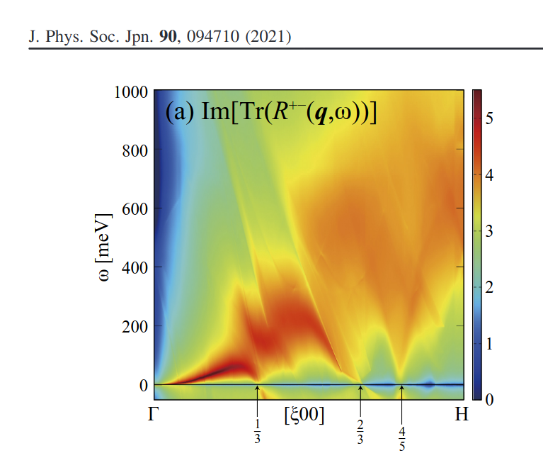

# Other notes {#usagedetailed}

> English version of the page [manual/UsageDetailed](../../manual/UsageDetailed.md). The pages at the top of ecaljdoc are the reference; this one was made from manual/UsageDetailed.md of commit 2d93c9ead (source blob db0ba4b9df32).

The samples named below are listed in [Samples](./samples).

## Spin polarized case without SOC {#spin-polarized-case-without-soc}
To treat magnetic systems, we have to set `mmom` (initial condition of spin
magnetic moments, per `[[spec]]`) in addition to `[ham].nspin = 2` in
`ctrlg.<sname>.toml`. The spin magnetic moments are specified as the
difference of number of electrons between spin channels, `isp=1` and `isp=2`.

For example, copy `ctrlg.nio.toml` of `ecalj/Samples/TestInstall/nio_gwsc/` to a new directory and run 
```
lmfa nio
mpirun -np 8 lmf nio
```
Try `cat save.nio`. It shows iteration history of lmf. Last line in save.nio
is like `c mmom= 0.0000 ehf(eV)=-86704.349038 ehk(eV)=-86704.348942 sev(eV)=-142.498970` (the energies depend on the settings). `c ` means converged.
ehf and ehk are [total energies by two formulas](./lmf#q-should-the-harris-foulkes-and-hohenberg-kohn-sham-functionals-agree-at-self-consistency).
Note that total energy is not meaningful in QSGW (see [`save.<sname>`](./lmf#save-sname)).

Look into `ctrlg.nio.toml`. It contains 
```toml
[[site]]
atom = "Niup"                 # ← Niup site
pos  = [0.0, 0.0, 0.0]
[[site]]
atom = "Nidn"                 # ← Nidn site
pos  = [1.0, 1.0, 1.0]
[[site]]
atom = "O"
pos  = [0.5, 0.5, 0.5]
[[site]]
atom = "O"
pos  = [1.5, 1.5, 1.5]

[[spec]]
atom   = "Niup"
z      = 28
r      = 2.12
mmom   = [0.0, 0.0, 1.2, 0.0]      # ← initial spin
# rsmh, eh, rsmh2, eh2, lmx, lmxa, nmcore, kmxa follow
[[spec]]
atom   = "Nidn"
z      = 28
r      = 2.12
mmom   = [0.0, 0.0, -1.2, 0.0]     # ← initial spin
```
Here we have two sites named Niup and Nidn. `mmom = [0.0, 0.0, 1.2, 0.0]` means initial spin moment within MTs: that is `mmom = [s, p, d, f]`, where `s, p, d, f` are number of spin moments for each $l$ at atomic sites.
In addition, we set `nspin = 2` in `[ham]`.

Calculated spin moments within MT are at 'true mm' column in the console output, and shown in the `mmom.nio.chk` as
```
# Qtrue    MagMom(up-dn) Rmt   MT
1 8.527587  1.200085  2.120000 Niup    
2 8.527604 -1.200081  2.120000 Nidn    
3 5.380352 -0.000002  1.700000 O       
4 5.380352 -0.000002  1.700000 O    
```
Note it is overwritten at every iteration. Atomic site index are given in `SiteInfo.lmchk`. Total Magnetic Moments are shown as
```
 Magnetic moment=     2.241805 !this is a case of bulk Fe
```

With the GW driver settings (the `[gw]` / `[mlo]` / `[blocks]` / `[product_basis]` sections of `ctrlg.<sname>.toml`; [GW settings](./gwinput)), we can run gwsc as
```
gwsc -np 32 5 nio 
```
I needed 275 sec with 32 MPI per QSGW cycle. I used this qsub script.
```
#!/bin/sh
#$ -N NioTest
#$ -pe smp 32
#$ -cwd
#$ -M <your e-mail>
#$ -m be
#$ -V
#$ -S /usr/bin/bash
export OMP_NUM_THREADS=1
EXEPATH=/home/takao/bin/
$EXEPATH/gwsc -np 32 5 nio >& lgwsc
```
After calculations, remove temporary files with `rm __*` or `cleargw .`.
You can run `job_band` and so on in the same manner of DFT with nspin=1.

* Even when you use `[bz].fsmommethod` /= 0 in `ctrlg.<sname>.toml` for `gwsc`,
  you need to set `fsmommethod = 0` (or remove the key) when you run `job_band`.
  If you run `job_band` with `fsmommethod` /= 0, it makes a shift (adding bias magnetic field).
* We can effectively use [antiferro symmetry for calculation (only for so=0,2)](#antiferro-symmetry-without-soc).

## Orbital moments
When so=1, orbital moments within MTs are shown in the console output (from the line `IORBTM:`) and in the file `orbitalmom.chk` as
```
IORBTM:  orbital moments :
 ibas  Spec        spin   Moment decomposed by l ...
    1    Pr           1    0.000000   -0.011483   -0.010535   -4.881144    0.000234
    1    Pr           2    0.000000    0.012332    0.003604    0.000373   -0.000090
 total orbital moment   1:   -4.886708
    2    N            1    0.000000   -0.004174    0.001584    0.000291    0.000129
    2    N            2    0.000000    0.004622    0.000236    0.000045    0.000006
 total orbital moment   2:    0.002738
```

## Antiferro symmetry without SOC {#antiferro-symmetry-without-soc}
We can perform LDA/QSGW calculation with the AF symmetry (not for so=1).
Only up spin are calculated. Then charge density and eigenvalues are
symmetrized for the antiferro symmetry.

See the samples of the antiferromagnetic symmetry (NiO and NiSe). The meanings of the keys `symgrpaf` and `af` are in [lmf](./lmf#symgrp). The steps are as follows.

1. Write `symgrpaf = "find"` at the top level of `ctrlg.<sname>.toml` (spglib finds the operations; 2026-10-02).
   With `symgrp` of generators (to lower the symmetry), `"find"` is not possible, so write the AF generators.
   Example for NiO: `symgrpaf = "i:( 1 1 1 )"` (`g = i:(1,1,1) * $i \sigma_y$` generates the magnetic space group; `i:(1,1,1)` is inversion with translation).
2. Specify the antiferro pairs with `af`.
   ```toml
   [[site]]
   atom = "Niup"
   pos  = [0.0, 0.0, 0.0]
   af   = 1                  # Antiferro pair
   [[site]]
   atom = "Nidn"
   pos  = [1.0, 1.0, 1.0]
   af   = -1
   ```
3. Use `pwmode = 11` (the plane waves |q+G|). The spin-2 functions are made by rotating those of spin 1, which needs the G set of each q.
   With `pwmode = 1` it stops with `rotwave: q+G rotation error` at some k meshes (NiO 4x4x4; 3x3x3 passes by chance).

There is also an example for NiSe (`symgrpaf = "find"`; with the old search `"r2z:( 0 0 0.5 )"`). Give `af = 1` and `af = -1` to the two Ni sites at (0, 0, 0) and (0, 0, 0.5).

### Holding the AF moment at a given value (`mmtarget.aftest`)
Opposite fields on the two sites of an AF pair, readjusted every iteration, hold the moment $(m_1-m_2)/2$ at a target value.
Useful for an AF metal whose moment is unstable in QSGW, or for the total energy as a function of the moment, $E(m)$.
Example: `Samples/AFfixMMOM` of ecalj (NiO, target 1.6 $\mu_B$, with and without `symgrpaf`; the two agree within $10^{-6}$ eV).

* Put a file `mmtarget.aftest` holding one number, the target moment ($\mu_B$), in the working directory. Its presence switches the mode on.
* The field goes into the LDA+U potential (`vorb`), so the two sites of the pair need LDA+U blocks. `idu = 1` with `uh = jh = 0` makes the
  blocks without changing the LDA result. With `sigm` (QSGW) the blocks stay, so it works there too.
* The pair is the sites 1 and 2 (LDA+U blocks 1 and 2); with six blocks (NiSe), the blocks 1-3 and 4-6.
* lmf writes `mmagfield.aftest` (the field `uhx` and the moments) and `mixmag.aftest` (the mixing history of the field). Remove both to start again.
  Every start of lmf (also in `job_band`) advances the field by one step and rewrites `mmagfield.aftest`.
* In the output, `mmaftest:` lines give the iteration, `uhx` (Ry), $m_1$, $m_2$, ...; `mmhist:` lines the history.
* `ehk` is the total energy under the constraint, with $dE/dm_d = 2\,u_{hx}$ ($m_d$: the d moment of `dmats`).
* Lowering the moment (NiO 1.28 to 1.0) converges slowly (about 70 iterations; the gain of the field update is fixed).
* With `symgrpaf`, use `pwmode = 11` (see above).

## Spin-orbit coupling {#spin-orbit-coupling}
We have a switch `so` in `[ham]` of `ctrlg.<sname>.toml`.

* For LDA/GGA, set `nspin = 2` and `so = 1`. Then we can perform calculations including SOC. so=1 is for soc included; so=2 is for LzSz mode neglecting LxSx+LySy.
* In the case of semiconductors such as GaAs, we need to include so=1 to see the band structure at the top of valence.
* Currently, QSGW can not be performed with so=1. So we first have to run gwsc with
  so=0 or 2. After we get sigm file, we run lmf with `--ctrlg:ham.so=1` (nit=1 can be fine) as a perturbation.
  The procedure combined with 80% QSGW is in "80% QSGW + 20% LDA, and SO setting" of [gwsc](./gwsc).

* We can treat only colinear spins. Spin axis is along (0,0,1) as default. We can choose other direction with `[ham] socaxis`. See the samples of SOC (magnetic anisotropy of FePt and MnGa). Not checked completely, but it seems work well.

### Band plot with spin orbit coupling
* method 1: only apply SOC for band plot
  ```bash
  job_band mp-2534 -np 8 --ctrlg:ham.so=1 --ctrlg:ham.nspin=2
  ```
  Caution: when you set nspin=2, the size of rst is doubled. No way to move it back to rst for nspin=1. So you may need to keep rst.

* method 2: single iteration with `[ham].so = 1`
  ```bash
  mpirun -np 8 lmf mp-2534 --ctrlg:ham.so=1 --ctrlg:ham.nspin=2 --ctrlg:iter.nit=1
  ```
  Then we have revised `rst.<sname>`. Then run `job_band mp-2534 -np 8 --ctrlg:ham.so=1 --ctrlg:ham.nspin=2`.

* method 3: full iteration with `[ham].so = 1`
  ```bash
  mpirun -np 8 lmf mp-2534 --ctrlg:ham.so=1 --ctrlg:ham.nspin=2
  ```
  Then run `job_band mp-2534 -np 8 --ctrlg:ham.so=1 --ctrlg:ham.nspin=2`

Effective masses: the sample `Samples/EffectiveMass/GaAs` (QSGW bands with SOC, the mass mode of `syml.<sname>`).

## Fermi surface
See the sample of the Fermi surface (Cu).
Run `job_fermisurface cu -np 4 -vnk1=10 -vnk2=10 -vnk3=10` after `lmf cu` converged (`-vnk1` etc. are options of the script `job_fermisurface`). This write down all band energies (around
Ef) for 10x10x10 in BZ. Then we can view it with xcrysden as `xcrysden --bxsf fermiup.bxsf`.
With `--allband` option to `job_fermisurface`, we have all the bands. Then we can see iso-energy surface at any energy.

## PROCAR mode {#procar-mode}
See a sample at ecalj/Samples/PROCAR/MgO_PROCAR.
We can generate PROCAR file containing the size of eigenfunctions**2. 
The sample (`testecalj MgO_PROCAR`; the steps are in its `test.py`) generates a pdf file showing fat band of O2p components.
Steps: after `job_band mgo`, `lmf --mkprocar --band mgo` writes PROCAR (vasp format) per rank (`PROCAR.UP.<rank>`); they are joined in k order into `PROCAR.UP`,
the weights are extracted by the script `BandWeight.py` in the sample directory (`bw.dat`), and `gnuplot bnds.gnu.mgoW` draws them.

## LDA+U
We have the LDA+U sample `Samples/LDAU/ReN` (GdN and PrN; U on 4f, `so = 2`, starting occupations `occnum.<sname>`), and the test target `TestInstall/gdn`.

The meanings of the `[[spec]]` keys `idu`, `uh`, `jh` are in [LDA+U in lmf](./lmf#lda-u-toml). Example (Pr of PrN): `idu = [0, 0, 0, 2]` (FLL), `uh = [0.0, 0.0, 0.0, 0.535]`, `jh = [0.0, 0.0, 0.0, 0.0692]` (Ry).

## Spin fluctuation
The calculation of spin fluctuations has been advanced recently; please contact us.
`~/ecalj/Samples/Magnon` (test target `Fe_mlo_magnon`; `README.md` there gives the steps of `job_mlo_magnon`).
The model is the [MLO](./mlo) model (no windows and no iteration). The sample compares it with the maximally localized
Wannier functions of the version before 2026-10-02 (git tag `last-wannier`). Here is a figure (this is on top of LDA) for the spin fluctuation of Fe in [Okumura2021](../../presentations/okumura2021.pdf).


## 4f and 5f atoms
We need special care to treat atoms where 4f and 5f are fractionally filled.
The atomlist defaults for 4f atoms were updated 2025-08-21 (5f not yet);
the same defaults are used by `ctrlgenToml.py` (the table `SRC/exec/pylib/atomlist.py`). Only limited tests yet —
make sure by yourself.

Here is the setting for rare-earth rocksalt nitrides ReN such as ErN (from an earlier calculation; the tested ones are GdN and PrN of `Samples/LDAU/ReN`, set up the same way).
1. Set `[ham].nspin = 2`, `[ham].so = 2` (since QSGW cannot treat `so=1` now).
   If necessary, set `so=1` after `gwsc` finished.
   You may use `ctrlgenToml.py gd2pdo4 --so=2 --nspin=2`, or simply edit
   `ctrlg.<sname>.toml` after generation.
2. `symgrp = "r4z"`. This is needed since we have lower symmetry rather than the lattice. It fixes the direction of spins and orbital moments.
3. Our setting in `ctrlg.ern.toml` is
    ```toml
    [[spec]]
    atom   = "Er"
    z      = 68
    r      = 2.58
    pz     = [0.0, 5.0, 0.0, 5.0]
    idu    = [0, 0, 0, 12]
    uh     = [0.0, 0.0, 0.0, 0.773]
    jh     = [0.0, 0.0, 0.0, 0.0945]
    mmom   = [0.0, 0.0, 0.0, 3.0]
    rsmh   = [1.29, 1.29, 1.29, 1.29]
    eh     = [-1.0, -1.0, -1.0, -1.0]
    rsmh2  = [1.29, 1.29, 1.29, 1.29]
    eh2    = [-2.0, -2.0, -2.0, -2.0]
    lmx    = 3
    lmxa   = 6
    nmcore = 1
    kmxa   = 5
    # ([ham] pwemax = 2, [bz] nkabc = [8, 8, 8] was used)

    [gw]
    n1n2n3 = [6, 6, 6]

    [product_basis]
    pb_tolerance = [1e-2]
    pb_lcutmx    = [6, 2]
    ```
    Here `pz` is the principal quantum number of local orbitals. This sets 5p and 5f as local orbitals. Run `lmfa ern|grep conf` to check atomic configuration.
    * `idu`, `uh`, `jh` are the LDA+U parameters. When `idu` is 10+2, we skip U effect when sigm exists.
    * `mmom` is the initial magnetic moments.
    * `lmxa = 6` to expand augmented waves is needed.
    * Make sure `[ham] readp = true`.

**Caution**: when `idu` > 10, LDA+U is used only for the initial condition of QSGW. Thus the QSGW results do not depend on `jh` and `uh`.

With these settings, we can perform series of calculations finished for 4f ReN.
Input files are available from [here](../../data/RENctrlGWinput.tar.gz). Ask us when you like to use them.
