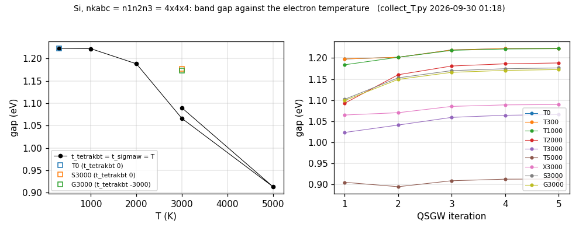

# kBT — finite temperature and smearing (`t_tetrakbt` / `t_sigmaw` / `wcsmear`)

> English version of the page [manual/kBT](../../manual/kBT.md). The pages at the top of ecaljdoc are the reference; this one was made from manual/kBT.md of commit 8e38c105c (source blob 06c1fce5bb69).

This page explains the `[gw]` keys that set the electron temperature and the numerical smearing in GW and QSGW. The $W$ side ($\chi_0$) and the $\Sigma$ side ($G$) have separate keys (Table 4).
On the $\Sigma$ side, `t_sigmaw` is a numerical width that is always active. On the $\chi_0$ side, `t_tetrakbt` is mandatory: positive means a physical electron temperature,
negative means the width (written as a temperature) of a Gaussian that smears $\mathrm{Im}\chi_0$, and 0 means no smearing.

This page describes the current specification. For the history of the keys, needed when reading old inputs and records, see Table 2 in §2.5. The history of 2026-06 to 09 and the explanation of the calculations of that time are in
<del class="clfix">`MD/kBT/history.md`</del><span class="clfix">a development note (MD/kBT/history.md in the repository, not on this site)</span>.

**Table 4**. Keys in `[gw]` (temperatures in K)

| Key | Where it acts | Default |
|---|---|---|
| `t_tetrakbt` (mandatory) | selects the smearing of $\chi_0$ by its sign (0: no smearing, $T>0$: finite-temperature tetrahedron, $-T$: Gaussian; Table 1 in §2) | none (stops if absent) |
| `t_sigmaw`<span class="clfix"> (required)</span> | width of the Fermi-Dirac kernel that smears the intermediate levels in $\Sigma_x=Gv$ and $\Sigma_c=G(W-v)$ (§3) | <del class="clfix">1000</del><span class="clfix">none (required since 2026-11-14; the code default until then was 1000)</span> |
| `wcsmear` | in the real-axis pole term of $\Sigma_c$, integrates $W_c$ with the same kernel also over the pole position (§3.5) | true |
| `chi0_skip_window` = [emin, emax] (eV) | removes from $\chi_0$ the band pairs whose both ends lie in this window (cRPA-like; under test) | off |

The gwinit template (also used by `ctrlgenToml.py`) writes `t_tetrakbt = 300` and `t_sigmaw = 300`.

**Which to use**

- Insulators and semiconductors: the template as it is (§4).
- To see effects of the electron temperature: `t_tetrakbt = t_sigmaw = T` (Si in §5.1, Fe in §5.2).
- Metals where the bands become rough depending on the iteration or the k mesh (plasmon pole of $W$, §3.5): `wcsmear` (default) and `t_sigmaw = 1000`.
  To smear $\chi_0$ while keeping T=0, make `t_tetrakbt` negative.

**Settings for LiTi₂O₄**: $\chi_0$ is the T=0 tetrahedron with $\mathrm{Im}\chi_0$ smeared by a Gaussian, `t_tetrakbt = -992.4`
(same width as Fermi-Dirac at 992.4 K, standard deviation 0.155 eV), `t_sigmaw = 1000`, `wcsmear = true`, `mixbeta = 0.5`.
With this, $6^3$ converges in 8 iterations (change of QP energies from iteration 7 to 8: max 10, mean 2 meV), and the one-shot difference between $6^3$ and $9^3$ is at most 13 meV in `dSEnoZ`<span class="clfix"> (the `QPU` column: the diagonal $\langle\Sigma-V_{\rm xc}\rangle$ without the $Z$ factor; [gwsc](./gwsc))</span>.
The MLO-QSGW calculation (§5.3, ecalj `Samples/kBT/LiTi2O4`) uses the same settings.

---

## 0. What changes between T=0 and finite temperature (overview)

The temperatures on the $\chi_0$ side and on the $\Sigma$ side are independent keys. If you use `t_tetrakbt > 0`, it is natural to set `t_sigmaw` on the $\Sigma$ side to the same T
(not mandatory). The LiTi₂O₄ settings keep $\chi_0$ at T=0 and smear it with the Gaussian of `t_tetrakbt < 0` ("Settings for LiTi₂O₄" at the top).

### $\chi_0$ side (hx0fp0 / W-build of hgw)

The differences among the 3 cases of `t_tetrakbt` (0, $T>0$, $-T$) are in Table 1 of §2 and Eqs. (3)–(8). In every case `chi0_skip_window = [emin, emax]`
(eV; removes from $\chi_0$ the band pairs whose both ends lie in the window; under test) can be used.

### $\Sigma$ side ($\Sigma_c$ of hsfp0_sc / hgw, $\Sigma_x$ of hsfp0)

On the $\Sigma$ side there is no distinction between "T=0 and finite temperature". The kernel is always Fermi-Dirac with width `t_sigmaw`.
The only thing tied to the temperature on the $\chi_0$ side is the Fermi level.

**Table 5**. What on the $\Sigma$ side is tied to the temperature of $\chi_0$ and what is not

| | `t_tetrakbt` ≤ 0 | `t_tetrakbt > 0` |
|---|---|---|
| Fermi level | determined by counting the levels on the k mesh smeared with a Gaussian of width $k_BT$ (`t_sigmaw`) (`efsimplef2ax`; determined separately from the `EFERMI` used by $\chi_0$) | `EFERMI_kbt` (stops if absent) |
| Occupation kernel of levels (weights of $\Sigma_x$, window weights of the pole term) | Fermi-Dirac, width $k_BT$ = `t_sigmaw` | same |
| Position where the pole term picks up $W_c$ | `wcsmear = true` (default): integrates $W_c$ with the FD kernel. `false`: mean $\bar\omega$ (3-point interpolation) | same |
| Candidate window of intermediate states, margin of the $\omega$ mesh | $E_F \pm 15\,k_BT$ (`sig_window`) | same |
| Imaginary-axis integral, $W_c$ itself, mixing of sigm (`mixbeta`) | common | common |

- `t_sigmaw` is a numerical width, not the full finite-temperature self-energy (Bose term, §8.7).
  The standard deviation of the kernel $-\partial f/\partial\varepsilon$ is $\pi k_BT/\sqrt3 \simeq 1.81\,k_BT$ (0.156 eV at 1000 K).
- `wcsmear` is not a temperature switch but a switch to "use the same distribution as the occupation kernel also for the pole position" (§3.5).
- On the $\chi_0$ side, T=0 means a truly sharp $\theta$, so a width appears only when `t_tetrakbt` is nonzero.

---

## 1. Why it is needed

There are two uses.

1. **Physics of the electron temperature**. For $T>0$ the occupations near the Fermi level follow the Fermi-Dirac distribution, and in semiconductors carriers thermally excited
   across the gap join the screening. This is handled by `t_tetrakbt = T` on the $\chi_0$ side (§2.3) and `t_sigmaw = T` on the $\Sigma$ side (§3).
   In Si an electron temperature of 3000 K shrinks the gap by 0.16 eV (§5.1).
2. **Numerical stabilization of QSGW for metals**. In metals $W_c(\omega)$ at small $q$ has a sharp plasmon pole, and when the real-axis pole term of $\Sigma_c$
   picks it up at a single point, the value changes strongly with the k mesh and with each iteration (§3.5). This is smoothed by `wcsmear` and `t_sigmaw` on the $\Sigma$ side,
   and by `t_tetrakbt < 0` (Gaussian, §2.4) on the $\chi_0$ side. The temperature here is a numerical width, not a physical temperature.

---

## 2. $\chi_0$ side — `t_tetrakbt`

`[gw] t_tetrakbt` (K) is **mandatory** (stops if absent). Its sign selects the smearing of $\chi_0$ (Table 1).
The gwinit template writes `t_tetrakbt = 300`. The name and meaning of the key changed several times, so when reading old inputs and records see Table 2 in §2.5.

**Table 1**. The 3 cases of `t_tetrakbt`

| `t_tetrakbt` | Occupation difference $f_a-f_b$ | $\mathrm{Im}\chi_0$ along $\omega$ | Fermi level of $\chi_0$ (for $\Sigma$ see Table 5 in §0) | Use |
|---|---|---|---|---|
| 0 | sharp step, Eq. (3) | as is | `EFERMI` | insulators, semiconductors |
| $T>0$ | Fermi-Dirac at temperature $T$, Eqs. (4)(5) | as is | `EFERMI_kbt`, Eq. (6) | physics of the electron temperature (§1, §5.1) |
| $-T$ | sharp step, Eq. (3) | smeared by a Gaussian, Eqs. (7)(8) | `EFERMI` | metals where the plasmon pole of $W$ causes roughness (§3.5) |

```toml
[gw]
t_tetrakbt = 0        # (K) mandatory. 0: no smearing. T > 0: finite-temperature tetrahedron at T. -T: smear Im chi0 with a Gaussian
```

### 2.1 Common — histogram of $\mathrm{Im}\chi_0$ and Hilbert transform

In every case, $\chi_0$ is first built as a **histogram** of $\mathrm{Im}\chi_0$ for $\omega>0$, and from it the real part on the real axis and
the values on the imaginary axis are obtained by a Hilbert transform. Bin $j$ is $[\omega_j,\omega_{j+1}]$, with center $\bar\omega_j$ and width $\Delta_j=\omega_{j+1}-\omega_j$
(`frhis`; an exponential mesh set by `HistBin_dw` and `HistBin_ratio`, wider for larger $\omega$). The bin weight accumulated by the tetrahedron method for transitions from level $e_a$ at $\mathbf k$ to
level $e_b$ at $\mathbf k+\mathbf q$ is

$$
h_j \propto \sum_{\mathbf k}\sum_{a,b}\int_{\omega_j}^{\omega_{j+1}}\!d\omega\;
\bigl|M_{ab}\bigr|^2\,\bigl(f_a-f_b\bigr)\,\delta\bigl(\omega-(e_b-e_a)\bigr),
\qquad f_a=f(e_a)
\tag{1}
$$

($M_{ab}$ is the matrix element with the product basis; prefactors and the spin sum are omitted). The tetrahedron method interpolates levels and matrix elements
linearly inside a tetrahedron and, within that, integrates the $\delta$ function over the bin exactly. $h_j/\Delta_j$ is the average of $\mathrm{Im}\chi_0$ over bin $j$.
Since $\mathrm{Im}\chi_0$ is an odd function of $\omega$ ($\mathrm{Im}\chi_0(-\omega)=-\mathrm{Im}\chi_0(\omega)$), only $\omega>0$ is kept;
the bin averages are connected piecewise linearly between the centers, and

$$
\chi_0(z)=\frac1\pi\int_{-\infty}^{\infty}\!d\omega'\,\frac{\mathrm{Im}\chi_0(\omega')}{\omega'-z}
\tag{2}
$$

is integrated analytically bin by bin (`hilbertmat`, `dpsion_init` and `dpsion_chiq_*` in `dpsion5.f90`). On the real axis, the real part at $z=\omega+i0$
is $\mathrm{Re}\chi_0(\omega)$, and the bin average is used as is for the imaginary part. On the imaginary axis $z=i\nu$, and the value is real because of the oddness.
The 3 cases differ only in the occupation difference $f_a-f_b$ in Eq. (1) and in the treatment of $h_j$ before passing it to Eq. (2).

### 2.2 `t_tetrakbt = 0` — T=0 tetrahedron

The occupation is a step at the Fermi level $E_F$ (`EFERMI`), and the occupation difference in Eq. (1) is

$$
f_a-f_b\;\to\;\theta(E_F-e_a)\,\theta(e_b-E_F)
\tag{3}
$$

(`lindtet6`; transitions from occupied $a$ to empty $b$, which fall at $\omega=e_b-e_a>0$).

### 2.3 `t_tetrakbt = T > 0` — finite-temperature tetrahedron (method B′)

<span class="clfix">“Method B′” is the name used during development: averaging the T=0 tetrahedron weights over the Fermi level with the thermal kernel, as in Eq. (5).</span>

The finite-temperature occupation difference equals the step of Eq. (3) averaged over the Fermi level $E$ with the thermal kernel $-f'$. With $f(x)=1/(e^{x/k_BT}+1)$,

$$
\int dE\,\bigl(-f'(E-\mu)\bigr)\,\theta(E-e_a)\,\theta(e_b-E)=f(e_a-\mu)-f(e_b-\mu)\qquad(e_a<e_b)
\tag{4}
$$

Since Eq. (1) is linear in $f_a-f_b$, the finite-temperature bin weight is the T=0 weight $h^{(0)}_j(E)$ with the Fermi level placed at $E$,
averaged over $E$. Setting $E=\mu+2k_BT\,t$ gives $(-f')\,dE=\tfrac12\,\mathrm{sech}^2t\,dt$, which is integrated with 20 points:

$$
h_j(T)=\sum_{i=1}^{20}c_i\,h^{(0)}_j\bigl(\mu+2k_BT\,t_i\bigr),\qquad
c_i=\frac{w_i\,\tfrac12\mathrm{sech}^2t_i}{\sum_{i'}w_{i'}\,\tfrac12\mathrm{sech}^2t_{i'}}
\tag{5}
$$

The nodes $t_i$ and weights $w_i$ are 5-point Gauss-Legendre on each of the 4 intervals $[-6,-1],[-1,0],[0,1],[1,6]$ into which $t\in[-6,6]$ (i.e. $|E-\mu|\le12\,k_BT$) is divided
(`gausq_fd`). The $c_i$ are normalized to sum to 1, so the total occupation is conserved even though the region outside is cut.
When at the 4 vertices of a tetrahedron both $a$ and $b$ lie together outside one side of the window $|e-\mu|\le12\,k_BT$ (occupation flat within the window), the result is the T=0 value
itself, so the 20 evaluations are skipped (`lindtet6_kbt`, `tetwt5.f90`). Eq. (5) only swaps the order of the $\mathbf k$ integral and the $E$ integral;
the only error is that of the numerical $E$ integration (§7.1, §7.2). The resulting numerator is the Adler–Wiser $f_a-f_b$, not $f_a(1-f_b)$
(this is the correct one for a response function; for what is dropped on the $\Sigma$ side see §7.4).

$\mu$ = `EFERMI_kbt` is obtained by `heftet`, which smears the tetrahedron number of states $N(E)$ with the same thermal kernel and solves

$$
\sum_{i=1}^{20}c_i\,N\bigl(\mu+2k_BT\,t_i\bigr)=N_{\rm val}
\tag{6}
$$

by bisection, and writes it to the file `EFERMI_kbt` (`fermi_kbt_tetra`, `main_heftet.f90`). For $T\to0$ it returns to the tetrahedron $E_F$.
When the solution is an interval inside the gap (the left-hand side is flat at $N_{\rm val}$ across the gap), the center of the interval is taken (item 2 of §9).
For `t_tetrakbt > 0`, both $\chi_0$ and $\Sigma$ use this, and the program stops if the file is absent (§0, §3). For `t_tetrakbt` ≤ 0, $\chi_0$ uses the tetrahedron `EFERMI` of `heftet`, and $\Sigma$ uses the Fermi level counted on the k mesh (Table 5 in §0).

Check in the output (standard output of `heftet`):

```
tetrakbt_init: T[K], kbt[Ry], kbt[eV]  2000  0.12667E-01 0.17234E+00
```

### 2.4 `t_tetrakbt = -T` — smearing $\mathrm{Im}\chi_0$ with a Gaussian

Occupations and the Fermi level stay at T=0 (Eq. (3), `EFERMI`), and before passing to Eq. (2) the bin weights $h_j$ are smeared along $\omega$ with a Gaussian.
The standard deviation of the Gaussian is matched to that of the Fermi-Dirac kernel $-f'$ at temperature $T$:

$$
\sigma=\Bigl[\int dx\,x^2\bigl(-f'(x)\bigr)\Bigr]^{1/2}=\frac{\pi k_BT}{\sqrt3}\simeq1.81\,k_BT
\tag{7}
$$

($\sigma=0.1563$ eV $=0.005744$ Ha at $T=1000$ K). The smearing is

$$
\tilde h_i=\sum_j G_{ij}\,h_j,\qquad
G_{ij}=\frac{\bigl[K(\bar\omega_i-\bar\omega_j)-K(\bar\omega_i+\bar\omega_j)\bigr]\,\Delta_i}{\sum_{i'}K(\bar\omega_{i'}-\bar\omega_j)\,\Delta_{i'}},\qquad
K(x)=e^{-x^2/2\sigma^2}
\tag{8}
$$

where all sums run over the bins with $\omega>0$ (`gaussianfilterhis` and `smearx0_apply`, `dpsion5.f90`). Column $j$ redistributes the weight of bin $j$
to the surrounding bins with a Gaussian:

- $\Delta_i$ in the numerator (width of the destination bin): this makes it a Gaussian convolution of the average $h/\Delta$ even on an exponential mesh with varying widths
- second term $-K(\bar\omega_i+\bar\omega_j)$ in the numerator: extension to an odd function. The part spilling to negative $\omega$ is folded back with its sign reversed.
  $\tilde h$ goes to 0 for $\omega\to0$
- denominator: the sum of the symmetric kernel over $\omega>0$. For $\bar\omega_j\gg\sigma$ it becomes $\sqrt{2\pi}\,\sigma$, and Eq. (8) becomes the continuous formula

$$
\widetilde{\mathrm{Im}\chi_0}(\omega)=\int_0^\infty\!d\omega'\,\bigl[g_\sigma(\omega-\omega')-g_\sigma(\omega+\omega')\bigr]\,\mathrm{Im}\chi_0(\omega'),
\qquad g_\sigma(x)=\frac{e^{-x^2/2\sigma^2}}{\sqrt{2\pi}\,\sigma}
\tag{9}
$$

  i.e. the convolution of $g_\sigma$ with $\mathrm{Im}\chi_0$ extended as an odd function. Eq. (9) conserves the f-sum $\int_0^\infty\omega\,\mathrm{Im}\chi_0\,d\omega$
  (the sum of the weights over $\omega>0$ decreases by the part folded back near 0). For $\bar\omega_j\lesssim\sigma$ only part of the Gaussian lies at $\omega>0$,
  so the denominator is smaller than $\sqrt{2\pi}\,\sigma$ and Eq. (8) deviates from Eq. (9)
- when both $\pm\omega$ are kept (`npm = 2`, e.g. $\chi^{+-}$ for magnons): a symmetric kernel without folding is applied separately to $\omega>0$ and $\omega<0$

Since the real part and the imaginary-axis values are built from the smeared $\tilde h_j$ via Eq. (2), the real-axis $W(\omega)$, the imaginary-axis $W(i\nu)$ and the static $W(0)$ all come from the same
smeared $\mathrm{Im}\chi_0$.

$-T$ is only a convention for writing the Gaussian width as a temperature; it is different from the finite-temperature $\chi_0$ (Eq. (5)). Eq. (5) smears the occupations of the levels,
Eq. (8) smears the distribution of transition energies $e_b-e_a$.

The input value is converted by `m_GWinput` into $\sigma$ (Ha; internal variable name `SmearX0`), and the following line appears in the output:

```
 SmearX0 (Ha) =   5.7438E-03  : Gaussian smearing of Im chi0 along omega ([gw] t_tetrakbt < 0)
```

### 2.5 History of the keys

**Table 2**. History of the inputs for the smearing of $\chi_0$ and $\Sigma$

| Period | Smearing of $\chi_0$ | Width of levels in $\Sigma$ (§3) |
|---|---|---|
| until 2026-06 | `GaussianFilterX0` (GWinput, Gaussian of $\mathrm{Im}\chi_0$) | `esmr` (Ry, Gaussian) |
| 2026-06 to 09-18 | finite temperature by the logical key `tetrakbt = true` and `t_tetrakbt` (K). Gaussian by `SmearX0` (Ha, $\sigma$; renamed from `GaussianFilterX0`) | `esmr`, or `t_sigmakbt` (K, Fermi-Dirac) |
| 09-19 to 09-27 | finite temperature by `t_tetrakbt > 0` alone (default 0 = no smearing). From 09-20 `SmearX0` is exclusive with `t_tetrakbt > 0` | from 09-20 `t_sigmaw` (K, Fermi-Dirac). `esmr` and `t_sigmakbt` are read with conversion |
| from 09-28 <span class="clfix">to 11-13</span> | `t_tetrakbt` is mandatory, 3 cases by its sign (Table 1). `SmearX0` is not read (stops if written) | `t_sigmaw`<span class="clfix"> (if absent, `esmr` / `t_sigmakbt` converted, else 1000 K)</span> |
| <span class="clfix">from 11-14</span> | <span class="clfix">same</span> | <span class="clfix">`t_sigmaw` is required; `esmr` and `t_sigmakbt` are not read (`ctrlg_update.py` writes `t_sigmaw` from them)</span> |

- `SmearX0 = s` and `t_tetrakbt = -T` give the same calculation when $s\,[\mathrm{Ha}]=\pi k_BT/\sqrt3$ by Eq. (7) (0.0057 Ha and $-992.4$ K).
  `ctrlg_update.py ctrlg.<sname>.toml` rewrites with this conversion, and adds 0 (the former default) to files without `t_tetrakbt`
- `esmr` = $e$ (Ry, standard deviation of the Gaussian) and `t_sigmaw` = $T$ give the same width when $e=\pi k_BT/\sqrt3$ (0.003 Ry and 262 K, 0.01 Ry and 872 K<span class="clfix">; the code rounds $\pi/\sqrt3$ to 1.81, which gives these values; without the rounding they are 261 K and 870 K</span>).
  <del class="clfix">If an input without `t_sigmaw` has `esmr` or `t_sigmakbt`, `esmr` is read as `t_sigmaw` with this conversion, and `t_sigmakbt` with its value unchanged</del><span class="clfix">Since 2026-11-14 `esmr` and `t_sigmakbt` are not read; `ctrlg_update.py` writes `t_sigmaw` from `esmr` with this conversion, and from `t_sigmakbt` with its value unchanged</span>
- The gwinit template wrote `tetrakbt = true`, `t_tetrakbt = 300` from 2026-06 to 09-16 (removed on 09-17). Since 2026-09-28, when `t_tetrakbt` became required, it writes `t_tetrakbt = 300` again (`main_gwinit.f90`).
  From 09-28 it writes `t_tetrakbt = 300`, `t_sigmaw = 300`

---

## 3. $\Sigma$ side — `t_sigmaw`

The intermediate levels of $\Sigma$ (poles of $G$) are smeared with a Fermi-Dirac kernel. Its width is `t_sigmaw` (K), and
the same kernel is used for all of: the occupation weights of $\Sigma_x = Gv$, the window weights of the real-axis pole term of $\Sigma_c = G(W-v)$, and the distribution of pole positions in `wcsmear`.

```toml
[gw]
t_sigmaw   = 1000.0   # (K) width of the FD kernel smearing the levels in Sigma (required; the default until 2026-11-13 was 1000)
t_tetrakbt = 1000.0   # if chi0 is also at finite temperature. The Fermi level of Sigma becomes EFERMI_kbt
```

The window weight is the cumulative Fermi–Dirac distribution

$$
\Phi(x)=\frac{1}{1+e^{-x/k_BT}},
\qquad
w(e_l,e_h;\varepsilon_k)=\Phi(e_h-\varepsilon_k)-\Phi(e_l-\varepsilon_k)
\tag{10}
$$

**The same kernel also enters the imaginary-axis integral of $\Sigma_c$**
— the pole term and the imaginary-axis integral are two halves of one contour, and unless the smearing of levels enters both with the same kernel,
$\Sigma_c$ breaks. This is an important point and is written separately in [§3.6](#_3-6-contour-decomposition-of-and-consistency-of-level-smearing).
The candidate window of intermediate states and the margin of the real-axis $\omega$ mesh
are the tail of the kernel $E_F \pm 15\,k_BT$ (`sig_window`), and widen automatically when `t_sigmaw` is raised (§7.3).

### Choosing the temperature

- Insulators: no effect if well below the gap (<span class="clfix">according to earlier records, </span>in Si the difference between 262 K and 1000 K is a few meV<span class="clfix">; not re-checked with the present code</span>).
- Metals: in principle the limit $n_1n_2n_3 \to \infty$, `t_sigmaw` → 0, but a width comparable to the level spacing of the k mesh
  at the Fermi surface is needed. 300–1000 K, chosen per material. 1000 K for LiTi₂O₄ $9^3$.
- When using `t_tetrakbt`, the same temperature is natural (not mandatory).

### Check in the output

```
    t_sigmaw =   1000.0 K  (Sigma kernel width kBT =    0.006333 Ry)
 sigmaw_setup: Sigma kernel Fermi-Dirac, t_sigmaw[K]=  1000.0  ef: counted on the k mesh (efsimplef2ax); chi0 at T=0
```

For `t_tetrakbt > 0`, `ef<-EFERMI_kbt=...`. In this case the program aborts if `EFERMI_kbt` (written by `heftet`) is absent.

---

## 3.5 The origin of roughness in metals and `wcsmear`

In QSGW for metals, the bands may become rough by tens of meV depending on the k mesh and the iteration, and one-shot GW from LDA may produce eV-size spikes near $E_F$
(LiTi₂O₄ at 1000 K and below: at $9^3$ the bottom of the O 2p band is rough by 30–100 meV, and one-shot GW gives spikes of <del class="clfix">−2 to −3 eV</del><span class="clfix">−2.5 to −3.4 eV ($6^3$, 500 K and 1000 K)</span>). The cause is as follows
(record of the investigation in ecalj <del class="clfix">`MD/research_kotani_log.md`</del><span class="clfix">development notes (MD/research_kotani_log.md in the repository, not on this site)</span>, 2026-09-18 to 19).

- **The culprit is the real-axis pole term of $\Sigma_c$** (cutting it changes the anomalous off-diagonal ⟨48|Σc|33⟩ from −13 to −0.35 eV<span class="clfix">. ⟨48|Σc|33⟩ is the off-diagonal element $\langle 48|\Sigma_c(\varepsilon_{48})|33\rangle$ between bands 48 ($E_F$+3.7 eV) and 33 at $\mathbf q=(-\tfrac16,\tfrac16,\tfrac16)$ in one-shot GW from LDA for LiTi₂O₄ $6^3$ at 1000 K; the same below</span>).
  The imaginary-axis integral, the mixing of sigm, the offset-Γ head and the $\omega$ interpolation are unrelated.
- What the pole term hits is the **t2g plasmon pole** in $W_c(q,\omega)$ at $q$ of the first shell
  ($\omega_p \simeq 1.78$ eV, width ≈ 0.1 eV; confirmed directly with `--dumpW`). For each intermediate state
  $n'$ the pole term picks up $W_c(\mathbf k,\, \varepsilon_{\mathbf q n} - \varepsilon_{\mathbf q-\mathbf k, n'})$ at
  one point, so a term whose $\varepsilon$ falls within ±0.1 eV of the pole receives <del class="clfix">±50 a.u.</del><span class="clfix">a value of $W_c$ of about ±50 a.u. (at the pole $\mathrm{Re}\,W_c$ jumps from −54 to +4 a.u. between neighbouring bins)</span>,
  and each time the eigenvalues move during the iterations it crosses to the other side of the pole (seesaw).
- It vanishes monotonically with temperature: ⟨48|Σc|33⟩ = −27 / −13 / −3.2 / −1.9 eV (500 / 1000 / 1500 / 2000 K).
  This is why runs at 2000 K and above had no accidents.

**Remedy `wcsmear = true`** (default): the approach of PRB 76, 165106 Eq. 58 (`wcsmear = false`) uses the smearing kernel $g$ of the intermediate levels (Fermi-Dirac
$-\partial f/\partial\varepsilon$, width `t_sigmaw`) only for the window weight $w_{n'} = \int g$, and evaluates $W_c$ at
one point, the mean energy $\bar\omega$. As a discretization of the $k$ integral it is consistent to use the same kernel for the weights and for the pole positions, so

$$
\Sigma^{\rm pole}_{nn''} = \sum_{\mathbf k n'} s\,M^{*}_{n'n}
\left[\int_{e_l}^{e_h} de\; g(e-\varepsilon')\,W_c(\mathbf k,\,\omega-e)\right] M_{n'n''}
\tag{11}
$$

integrates the $W_c$ side (Eq. (11)). If $W_c$ is smooth within the kernel width, this agrees with the one-point evaluation (at most 77 meV in Si,
a few meV for low-lying states), and the pole is smoothed over the kernel width (Table 6).

**Table 6**. Effect of `wcsmear`

| LiTi₂O₄ 1000 K | `wcsmear = false` | `wcsmear = true` |
|---|---|---|
| $6^3$ one-shot, spike on Γ–L | −3.4 eV | disappears |
| $6^3$ one-shot, O 2p roughness | 12.2 meV | 7.2 meV |
| $9^3$ iter 2→3, O 2p roughness (no mixing) | 47.8 meV | 12.7 meV |
| Cost of the real-axis pole term | — | ×6.7 (overall $6^3$ +7 %, $9^3$ +26 %) |

```toml
[gw]
t_sigmaw   = 1000.0   # the default until 2026-11-13. wcsmear = true is the default
t_tetrakbt = 1000.0   # if the chi0 side is also at finite temperature
```

Notes: (1) Conceptually, this carries through the whole pole term the approximation of "treating the poles of G as spectral functions of width $k_BT$";
the edges of the contour (E_F and ω) stay sharp. (2) Using the Fermi-Dirac $-\partial f/\partial\varepsilon$ at finite temperature
as the distribution of pole positions is a heuristic regularization (the exact finite-temperature formula only replaces θ → f with the levels kept sharp).
The proper width should come from the $k$ integral (tetrahedron). (3) Implemented in the pole term of the QSGW path (`hsfp0_sc` / `hgw`)
and of one-shot GW `hsfp0` (`sxcf_fal2`, `gw_lmfh`).

**Limitation**: `wcsmear` smooths the roughness of states that "pick up the pole across it" (O 2p, the one-shot spike),
but it cannot remove the off-diagonal
$\tfrac12[\Sigma(\varepsilon_i)+\Sigma(\varepsilon_j)]_{ij}$ of **pairs with a plasmon pole between the 2 levels**, such as a level just below $E_F$ and a level at +3 eV (for pairs straddling
a region where $\Sigma(\omega)$ changes abruptly, the premise of the static approximation breaks). For LiTi₂O₄ $9^3$ at 1000 K, spikes of this type remain near $E_F$
from iteration 2 on. As long as the RPA $W$ has sharp undamped poles, this is a limit of applicability of static QSGW;
they do not appear at 1500 K and above (the poles are Landau damped).

`wcsmear = false` returns to the one-point evaluation (differences of a few meV in insulators, tens of meV in metals). Building the weights of the pole term with the same tetrahedron
integration as $\chi_0$ is not implemented.

---

## 3.6 Contour decomposition of $\Sigma_c$ and consistency of level smearing

The kernel of `t_sigmaw` is not only about "occupation numbers". In the contour decomposition that splits $\Sigma_c = G(W-v)$ into the imaginary-axis integral and the real-axis pole term,
**unless the kernel smearing the intermediate levels enters both terms in the same form, the steps do not cancel for levels near $\omega$,
and an error of order $|M|^2 W_c(0)$ (eV order) appears**. Whenever changing the kernel or trying another kernel, always come back here.

### Formula for sharp levels

For a single intermediate level $\varepsilon'$, with $w_e \equiv (\omega-\varepsilon')/2$ (Hartree), omitting the matrix elements $|M|^2$ of $W_c$
(skeleton of PRB 76, 165106 Eq. 57–58):

$$
\Sigma_c^{(\varepsilon')}(\omega)
= \underbrace{-\frac{1}{\pi}\int_0^\infty d\omega'\,\frac{w_e\,W_c(i\omega')}{w_e^2+\omega'^2}}_{I(w_e)\ \text{imaginary-axis integral}}
\;+\;\underbrace{\theta\bigl[(\varepsilon'-\omega)(\varepsilon'-E_F)<0\bigr]\; s\,W_c(|w_e|)}_{P(w_e)\ \text{real-axis pole term}}
\tag{12}
$$

($s=\pm1$ for $\omega \gtrless E_F$, $W_c$ in $P$ is the real-axis value, $\theta$ means "the level lies between $\omega$ and $E_F$").
For $w_e \to 0$ there is a **step** $I \to -\tfrac12\,\mathrm{sign}(w_e)\,W_c(0)$, which exactly cancels the step where $P$ jumps $0 \to W_c(0)$ at the edge of the pole-term window
($\varepsilon'=\omega$), so the sum is a continuous function of $\omega$.
The code splits $W_c(i\omega')$ into $W_c(0)\,e^{-(u_a\omega')^2}$ and the remainder, and writes the former, which contains the step, analytically as

$$
I(w_e) = -\frac1\pi\int_0^\infty d\omega'\,\frac{w_e\,[W_c(i\omega')-W_c(0)e^{-(u_a\omega')^2}]}{w_e^2+\omega'^2}
\;-\;\frac12\,\mathrm{sign}(w_e)\,e^{a^2}\mathrm{erfc}(a)\,W_c(0),\qquad a=u_a|w_e|
\tag{13}
$$

(`wintz_npm`, the branch for core levels in m_sxcf_sc). The remainder is smooth, so Gauss–Legendre with `niw` points suffices.

### Gaussian kernel (code until 2026-09-19, `esmr`)

For valence levels, instead of (13), the integrand with a piece of a 2D Gaussian removed,

$$
\frac{w_e}{w_e^2+\omega'^2}\;\to\;\frac{w_e\bigl(1-e^{-(w_e^2+\omega'^2)/2\sigma^2}\bigr)}{w_e^2+\omega'^2},
\qquad \sigma = \texttt{esmr}/2\ [\mathrm{Ha}]
\tag{14}
$$

was used. The analytic integral of the removed piece is $+\tfrac12\mathrm{sign}(w_e)\,e^{a^2}\mathrm{erfc}\bigl(\sqrt{a^2+w_e^2/2\sigma^2}\bigr)W_c(0)$, and
combined with the step term of (13) in the limit $u_a \to 0$ it gives

$$
-\tfrac12\,\mathrm{sign}(w_e) + \tfrac12\,\mathrm{sign}(w_e)\,\mathrm{erfc}\!\Bigl(\frac{|w_e|}{\sqrt2\sigma}\Bigr)
= -\tfrac12\,\mathrm{erf}\!\Bigl(\frac{w_e}{\sqrt2\sigma}\Bigr)
\tag{15}
$$

— **the step on the imaginary-axis side smeared with a Gaussian (standard deviation $\sigma$)**. Since the window weight (10) on the pole-term side was also the Gaussian cumulative $\Phi_G$
with the same $\sigma$, the two sides were consistent and gave "$\Sigma_c$ of Gaussian-smeared levels".
That is, <del class="clfix">`sig` in Eq. 57</del><span class="clfix">`sig` in PRB 76, 165106 Eq. 57 ($\sigma$ of Eq. (14))</span> was not a numerical regularization but **the level smearing itself**.

### What happens if only the pole-term kernel is changed

If the pole-term weights are changed to Fermi–Dirac $\Phi_{FD}$ while the imaginary-axis side stays as (14), for each level
$[\Phi_{FD}-\Phi_G](\varepsilon'-\omega)\times|M|^2 W_c(0)$ remains uncancelled. It acts only on levels with $|\varepsilon'-\omega|$ of
a few $k_BT$, but since the $q\to0$ head $W_c(0)$ multiplies it, its size can reach the eV order.
Measured (NiO 2³, O 2s pair at L, 70 meV apart in LDA, `t_sigmaw = 262 K`):

**Table 7**. $\Sigma_c$ when the kernel is changed on one side only (NiO 2³, O 2s pair at L)

| SEc [eV] (state 1 / 2) | Gaussian on both sides | FD only in the pole term | FD on both sides (current), wcsmear=false | FD on both sides, wcsmear=true 30 / 262 / 473 K |
|---|---|---|---|---|
| | 10.523 / 10.541 | 9.909 / 10.992 | **10.523 / 10.541** (QSGW eigenvalues also agree) | 10.495 / 10.503 / 10.510 ; 10.524 / 10.528 / 10.533 |

With FD only in the pole term, ±0.6 eV (anticorrelated), 0.47 eV in the QSGW eigenvalues, and strongly dependent on the width
(10.54/10.48/10.31/9.91/9.72 eV at 30/100/150/262/473 K). Aligning both sides almost removes the width dependence.

### Current formula — average both sides with the FD kernel

$\Sigma_c$ of levels smeared with the kernel $g(x) = -\partial f/\partial x$ (width $k_BT$ = `t_sigmaw`) is

$$
\bar\Sigma_c(\omega) = \int dx\,g(x)\,\Sigma_c^{(\varepsilon'+x)}(\omega)
= \int dx\,g(x)\,I\!\Bigl(\tfrac{\omega-\varepsilon'-x}{2}\Bigr)
+ \int dx\,g(x)\,P\!\Bigl(\tfrac{\omega-\varepsilon'-x}{2}\Bigr)
\tag{16}
$$

averaged **in both terms**. The second term is `wcsmear` (window weight $\Phi_{FD}$, $W_c$ integrated with the kernel, §3.5).
The first term uses the sharp formula (13), and only the discontinuous $-\tfrac12\mathrm{sign}(w_e)$ is replaced analytically by

$$
\int dx\,g(x)\Bigl[-\tfrac12\,\mathrm{sign}(\omega-\varepsilon'-x)\Bigr]
= -\tfrac12\bigl[2\,\Phi_{FD}(\omega-\varepsilon')-1\bigr],\qquad
\Phi_{FD}(y) = \frac{1}{1+e^{-y/k_BT}}
\tag{17}
$$

while the continuous remainder ($-\tfrac12\mathrm{sign}(w_e)\,(e^{a^2}\mathrm{erfc}(a)-1)$ and the numerical part) is averaged with the midpoint rule at
$x_j = k_BT\ln\frac{u_j}{1-u_j}$, $u_j = (j-\tfrac12)/40$
(the FD cumulative distribution is the measure, so $u$ is uniform). For levels with $|\omega-\varepsilon'| > 30\,k_BT$ the integrand is smooth, so
the sharp formula is used at one point. Core levels ($k_BT = 0$) stay with (13). `sig` is gone.
Implementation: the `CorrelationSelfEnergyImagAxis` block in `m_sxcf_sc.f90` (QSGW), `wintzsg_npm` in `wintzsg.f90` (one-shot GW).

Notes:
- With `wcsmear = false` the second term becomes "only the weights averaged with the kernel, $W_c$ at one point, the mean energy", so it is not the exact
  average of (16) (difference $O(k_BT^2\,W_c'')$). The cancellation of the steps is determined by the weights alone, so it is not broken.
- The separation $W_c(i\omega') \simeq W_c(0)e^{-(u_a\omega')^2}$ and the accuracy with `niw` points are as before.
- The cost of the quadrature is $40\times$`niw` scalar operations per (itp, it) pair (CPU side, before GPU transfer). A few seconds per rank even for 9³ LiTi₂O₄.
- **Rule when changing the kernel**: the occupation weights (`wfacx`), the window weights of the pole term (`wfacx2` / `pole_weights`) and the imaginary-axis step (17),
  these 3 places must refer to the same $\Phi$. To go back to the Gaussian, revert all 3 as in (14)–(15).

History and numbers: <del class="clfix">`MD/research_kotani_log.md`</del><span class="clfix">development notes (MD/research_kotani_log.md in the repository, not on this site)</span> 2026-09-20 12:17 / 13:10.

---

## 4. Choosing the width and temperature

- **Insulators and semiconductors**: if the gap is much larger than $k_BT$, the width does not affect the results. The template's 300 K is fine
  (Si: the gap difference between `t_tetrakbt` = 0 and 300 K is below 0.001 meV, −1 meV at 1000 K; Table 9 in §5.1).
- **`t_sigmaw` for metals**: in principle what is sought is the limit $n_1n_2n_3\to\infty$, `t_sigmaw` → 0, but on a finite k mesh
  a width at least comparable to the level spacing of the mesh near the Fermi surface is needed. A rough guide is

$$
k_BT \gtrsim \frac{v_F \cdot (\text{size of the BZ})}{N}
\tag{18}
$$

  ($N$ is the number of mesh divisions along one direction). For LiTi₂O₄ $6^3$ and $9^3$, 1000 K ($k_BT = 0.086$ eV).
- **`t_tetrakbt`**: to see the physics of the electron temperature, use a positive value and set `t_sigmaw` to the same temperature. To merely smooth the poles of $W$ numerically, use a negative value
  (Gaussian). In that case the Fermi level and occupations stay at T=0.
- Check that the target quantity is converged with respect to the width, and if possible that 2 k meshes agree at the same width.
- The electron temperature enters only $\chi_0$ and $\Sigma$. The density made by `lmf` keeps the T=0 occupations (tetrahedron method), and the lattice temperature (phonons) is not included either.

---

## 5. Samples — `Samples/kBT/`

They are in ecalj `Samples/kBT/` (Table 8). All numbers and figures, and how to run, are in the README of each directory.

**Table 8**. Samples

| Directory | Contents | Time |
|---|---|---|
| `scanT/` | temperature scan. `scan_T.sh` runs QSGW with the same input changing only `t_tetrakbt` and `t_sigmaw`, and `collect_T.py` makes tables and figures. Si, GaAs (§5.1) and bcc Fe, fcc Cu (§5.2) | 2–10 min per setting |
| `LiTi2O4/` | MLO-QSGW of the metallic spinel LiTi₂O₄ (§5.3) | 21 min per iteration of $9^3$ (RTX 5090 × 2) |
| `scanT/Si`, `Samples/TestInstall/fe_kbt` | `testecalj` tests (Si and Fe at 3000 K, 1 iteration) | 20–40 s |

In all samples the electron temperature enters only $\chi_0$ and $\Sigma$ (§4). `scanT` uses coarse k meshes and few iterations, so
the numbers are for seeing the change with temperature, not converged values.

### 5.1 Si and GaAs — gap and electron temperature

`nkabc` = `n1n2n3` = $4^3$, QSGW 5 iterations from LDA. `t_tetrakbt = t_sigmaw = T`.

**Table 9**. Gap of Si (minimum on the SCF k mesh; after 5 QSGW iterations)

| `t_tetrakbt` (K) | `t_sigmaw` (K) | Gap (eV) | Change from $T=0$ (meV) |
|---|---|---|---|
| 0 | 300 | 1.223 | 0 |
| 300 | 300 | 1.223 | 0 |
| 1000 | 1000 | 1.222 | −1 |
| 2000 | 2000 | 1.188 | −35 |
| 3000 | 3000 | 1.066 | −157 |
| 5000 | 5000 | 0.913 | −310 |
| 3000 | 300 | 1.090 | −133 |
| 0 | 3000 | 1.176 | −46 |
| −3000 | 3000 | 1.173 | −50 |



**Fig. 1**. Left: gap of Si versus electron temperature (`t_tetrakbt = t_sigmaw = T`). Right: gap per iteration

- At 300 K nothing changes from $T=0$ (difference below 0.001 meV). The shrinking becomes visible from 2000 K, and at 3000 K the gap shrinks by 0.16 eV.
- The shape of the valence band hardly changes; the conduction band moves down as a whole relative to the valence band.
- The main cause of the shrinking is the $\chi_0$ side (of −157 meV at 3000 K, setting only $\chi_0$ to 3000 K gives −133 meV, only $\Sigma$ gives −46 meV).
  Carriers thermally excited across the gap join the screening, and $W$ becomes smaller.
- `t_tetrakbt = -3000` (Gaussian) gives nearly the same as the $\Sigma$-only case (−50 meV). The Gaussian does not change the occupations, so carrier screening is not included (§2.4).
- GaAs ($4^3$, 5 QSGW iterations, direct gap 1.415 eV) shows the same trend: no change at 300 K, −4 meV at 1000 K, −20 meV at 2000 K, −95 meV at 3000 K,
  −267 meV at 5000 K. At 3000 K, $\chi_0$ alone gives −83 meV and $\Sigma$ alone −39 meV (numbers and figures in Table 3 of `Samples/kBT/scanT/README.md`).

### 5.2 bcc Fe and fcc Cu — bands and magnetic moment of metals

`nkabc` = $7^3$, `n1n2n3` = $5^3$, spin-polarized, QSGW 3 iterations from LDA.

**Table 10**. bcc Fe (after 3 QSGW iterations). The exchange splitting is the difference between spin 2 and spin 1 of the d bands at Γ (bands 5 and 6)

| `t_tetrakbt` (K) | `t_sigmaw` (K) | Magnetic moment ($\mu_B$) | `EFERMI_kbt` − `EFERMI` (eV) | Exchange splitting (eV) |
|---|---|---|---|---|
| 0 | 300 | 2.429 | — | 2.619 |
| 300 | 300 | 2.426 | +0.006 | 2.604 |
| 1000 | 1000 | 2.443 | +0.045 | 2.688 |
| 3000 | 3000 | 2.420 | +0.272 | 2.492 |
| 5000 | 5000 | 2.252 | +0.279 | 1.842 |
| 3000 | 300 | 2.441 | +0.258 | 2.676 |
| 0 | 3000 | 2.409 | — | 2.450 |
| −1000 | 1000 | 2.443 | — | 2.685 |

- At 300 K almost nothing changes from $T=0$ (band differences at symmetry points at most 14 meV).
- Up to 1000 K the bands move by at most 63 meV, non-monotonically in temperature. On a $5^3$ mesh, this much movement comes from which states near $E_F$ become fractionally occupied
  (item 1 of §9).
- From 3000 K the exchange splitting and the moment decrease. In metals the $\Sigma$ side matters: the change of the exchange splitting at 3000 K, −0.13 eV, is close to that with only $\Sigma$ at 3000 K (−0.17 eV),
  while $\chi_0$ alone gives +0.06 eV. The opposite of Si.
- `t_tetrakbt = -1000` (Gaussian) and `t_tetrakbt = 1000` (finite temperature) give almost the same results at this temperature (band differences at most 7 meV).
- In nonmagnetic fcc Cu (`nkabc` = $8^3$, `n1n2n3` = $6^3$, 3 QSGW iterations), the bands move by 11 meV or less up to 1000 K. From 3000 K the d bands approach $E_F$
  (d bands at Γ around +61 meV at 3000 K and +130 meV at 5000 K). $\chi_0$ alone gives +46 meV and $\Sigma$ alone +24 meV, so both matter
  (Table 4 of `Samples/kBT/scanT/README.md`).

### 5.3 LiTi₂O₄ — MLO-QSGW

The metallic spinel LiTi₂O₄ (14 atoms) was run from LDA up to 40 iterations with the "Settings for LiTi₂O₄" at the top, by QSGW interpolating $\Sigma$ with MLO ([mlo_gwsc](./mlo_gwsc)).
Summary in ecalj `Samples/kBT/LiTi2O4/README.md`.

- The differences of the MLO bands due to the precision of the GPU matrix products (tf32, fp32, fp64) are a few meV or less.
- At $6^3$ the bands are smooth up to 10 iterations; from 20 iterations a shoulder appears in the occupied bands, which remains at 40 iterations.
- At $9^3$ the wiggles between mesh points decrease slowly, but by 40 iterations the bands are fairly smooth. The interpolated curve connecting mesh points looks slightly wavy.

---

## 6. Where it is implemented

**Table 3**. Implementation of finite temperature and smearing (`SRC/subroutines/`)

| File | Role |
|---|---|
| `m_GWinput.f90` | reads `t_tetrakbt` (mandatory, Table 1), `t_sigmaw`, `wcsmear` in `[gw]`. Converts `t_tetrakbt < 0` into $\sigma$ (internal `SmearX0`, Ha) (Eq. (7)) |
| `tetwt5.f90` | tetrahedron weights of $\chi_0$. `lindtet6` (Eq. (3)) and `lindtet6_kbt` (Eq. (5)) |
| `fpiint.f90` | `gausq_fd`: 20 points of the thermal kernel (Eqs. (5)(6)) |
| `main_heftet.f90` | `fermi_kbt_tetra`: `EFERMI_kbt` (Eq. (6)) |
| `m_tetwt.f90` | uses `lindtet6_kbt` and `EFERMI_kbt` if `t_tetrakbt > 0` |
| `dpsion5.f90`, `hilbertmat.f90` | Hilbert transform (Eq. (2)) and Gaussian (`gaussianfilterhis`, `smearx0_apply`, Eq. (8)) |
| `genallcf_mod.f90` | `sigmakbt_setup`: Fermi level of $\Sigma$ (`EFERMI_kbt` if `t_tetrakbt > 0`; stops if absent) |
| `wfacx.f90` | Fermi–Dirac kernel on the $\Sigma$ side (`fd_cdf`, `fd_iav`; width `t_sigmaw`, Eq. (10)) |
| `m_sxcf_sc.f90`, `sxcf_fal2.f90` | real-axis pole term of $\Sigma_c$ and `wcsmear` (§3.5, §3.6) |

---

## 7. Verification and limitations of the implementation

What was confirmed by rereading the implementation, and the remaining limitations. The contour identity on the $\Sigma$ side (imaginary axis + pole term) is in
[§3.6](#_3-6-contour-decomposition-of-and-consistency-of-level-smearing).

### 7.1 The identity is exact (confirmed)

Method B′ in `lindtet6_kbt` (`tetwt5.f90`) uses Eq. (4) (§2.3) **inside the k integral**. The $E$ integral and the $k$ integral
commute, so it is exact. The resulting numerator is the Adler–Wiser $f_a-f_b$, not $f_a(1-f_b)$
— this is the correct one for a response function.

Confirmed individually:

- **Gate** (at the beginning of `lindtet6_kbt`) — all cases where a/b are flat outside the window were traced;
  all agree with the $T=0$ value
- **node zero-skip** (the $E$ loop of `lindtet6_kbt`) — exactly the condition under which `lindtet6` is identically 0.
  `knorm` is normalized over all nodes, so skipping is consistent
- (4) holds even when `efermia` ≠ `efermib` (it becomes $f$ at each Fermi level)
- **`EFERMI_kbt`** (`fermi_kbt_tetra`, `main_heftet.f90`, Eq. (6))
  — convolves the NOS with the thermal kernel and bisects. For $T\to0$ it returns exactly to the tetrahedron $E_F$.
  The χ0 side also reads this (`m_tetwt`)

### 7.2 Limitation — quadrature of the $E$ integral

The $E$ integral of Eqs. (5)(6) uses 20 points: 5-point Gauss-Legendre on each of the 4 intervals $[-6,-1],[-1,0],[0,1],[1,6]$ of $t\in[-6,6]$
(`gausq_fd`). The node closest to $E_F$ is at $|t|=0.047$ ($|E-E_F|=0.094\,k_BT$). With $\Delta$ the band width inside a tetrahedron,
the worst-case error of the occupation factor was measured as in Table 11.

**Table 11**. Quadrature of the $E$ integral and worst-case error of the occupation factor

| Quadrature | Nodes | $\Delta=0.4k_BT$ | $1k_BT$ | $2k_BT$ | $4k_BT$ | $8k_BT$ |
|---|---|---|---|---|---|---|
| **current implementation**: 4 intervals $[-6,-1,0,1,6]$ × GL5 | 20 | 2.9e-2 | 1.6e-2 | 4.8e-3 | 2.6e-3 | 1.3e-3 |
| 6 intervals × GL4 | 24 | 2.9e-2 | 1.1e-2 | 2.8e-3 | 1.7e-3 | 9.6e-4 |
| 2 intervals $[-6,0,6]$ × GL10 | 20 | 5.5e-2 | 1.9e-2 | 1.1e-2 | 3.8e-3 | 1.9e-3 |
| 1 interval $[-6,6]$ × GL20 (code until 2026-09-26) | 20 | 1.7e-1 | 9.7e-2 | 2.3e-2 | 1.3e-2 | 6.8e-3 |

For strongly dispersive bands the error is small. With flat bands, band edges or van Hove singularities at $E_F$, the occupation factor is off by 0.01–0.03.
Increasing the number of nodes reduces the error only as $1/N$; how the intervals are cut matters more. Cutting the intervals at the kinks of the integrand (<del class="clfix">the energies of the 8 corners of the tetrahedron</del><span class="clfix">the 8 energies $e_a$, $e_b$ at the 4 corners of the tetrahedron</span>)
is the proper way, but it is not implemented. The error of `EFERMI_kbt` for Fe at 3000 K, $5^3$ (against a 600-point quadrature) is 1.2 meV.

### 7.3 Window of states on the $\Sigma$ side

The candidate window of intermediate states and the margin of the real-axis $\omega$ mesh are set by the tail of the kernel $E_F\pm15\,k_BT$ ($k_BT$ from `t_sigmaw`, `sig_window`).
The truncated occupation is $f(15)=3\times10^{-7}$, and raising `t_sigmaw` widens the window too. The center of the window and the center of the weights are the same Fermi level
(`EFERMI_kbt` if `t_tetrakbt > 0`). In the code until 2026-09-19 the window was set by `esmr`, and occupations were truncated at high temperature
(<del class="clfix">`MD/kBT/history.md` §4</del><span class="clfix">the window was $E_F\pm10\,$`esmr`; for example, at 2000 K with `esmr` = 0.002 Ry, 17 % of the occupation is cut off. Development note MD/kBT/history.md §4 in the repository, not on this site</span>).

### 7.4 Scope — $\Sigma$ needs the "sum", not the "difference"

Making $\chi_0$ finite-temperature alone does not make $\Sigma$ consistent. The reason fits in one line.

For an intermediate particle-hole pair $(2,3)$ with $\omega'=\varepsilon_2-\varepsilon_3>0$,

**Table 12**. Weights of particle-hole pairs

| | Weight |
|---|---|
| **create** a pair | $f_3(1-f_2)$ |
| **destroy** an existing pair | $f_2(1-f_3)$ |

$\mathrm{Im}\,\chi_0$ holds the **difference** $f_3(1-f_2)-f_2(1-f_3)=f_3-f_2$, but
the weight of the intermediate states of $\Sigma$ is the **sum** (both have the same denominator).
The current implementation takes the difference from $\mathrm{Im}W$ and multiplies by the outer $f_j$, so
**the $f_2(1-f_3)$ part is dropped.** From detailed balance $f_2(1-f_3)/f_3(1-f_2)=e^{-\beta\omega'}$,

$$
f_2(1-f_3)=\bigl(f_3-f_2\bigr)\,n_B(\omega')
\tag{19}
$$

so this is what is usually called the Bose factor. **But its origin is the Fermi
occupation numbers**; no bosonic heat bath was introduced from outside. For the derivation see
[§8](#_8-appendix-—-a-formulation-without-imaginary-time). The physics is simple: for $T>0$
particle-hole pairs are already thermally excited and an electron can absorb them, that is all.

**Size.** $f_2(1-f_3)$ is exponentially small for $\omega'\gg k_BT$, so only
the particle-hole continuum at $\omega'\lesssim k_BT$ contributes. In a metal with
$\mathrm{Im}W_c\simeq c\,\omega'$,

$$
\int_0^\infty\!\! d\omega'\,\mathrm{Im}W_c(\omega')\,n_B(\omega')
= c\,(k_BT)^2\frac{\pi^2}{6}
\tag{20}
$$

At 2000 K $(k_BT)^2=0.029$ eV², and with $\omega-\varepsilon_j\sim1$ eV this is a few meV to tens of meV.

**This is not a defect but a definition.** The ecalj scheme is "an effective one-body Hamiltonian built from
the occupation numbers at temperature $T$", the same standpoint as Mermin's finite-temperature DFT, which
closes with Fermi occupation numbers alone. QSGW builds not a dynamical $\Sigma$ but a **static Hermitian**
one-body Hamiltonian, and since what is dropped is mainly the detailed-balance (= lifetime) side,
the impact is much milder than when computing spectral functions in one-shot GW.
Only if one wants the $\Sigma$ of equilibrium many-body perturbation theory is (19) needed.

### 7.5 Exchange with the core (CoreEx)

For the exchange with the core (`hsfp0_sc --job=3`), even at finite temperature the Fermi level is placed below the bottom of the valence states so that only the core states enter the sum.
The core levels are much deeper than $k_BT$, so the result is the T=0 value regardless of temperature.

**Note on finite-temperature results of the code from 2026-06-26 to 09-27**: the code of this period had 2 errors in CoreEx, and
in systems where the number of core states $n_\mathrm{ctot}$ is smaller than the number of occupied bands (e.g. compounds of light elements whose only core is 1s), part of the
valence states entered the exchange with the core. This can be judged by comparing `CoreEx mode: ef nspin nctot=` in `lsxC` with `valn=` (number of valence electrons)
(note that systems with semicore states in the valence have fewer core states). Fe ($n_\mathrm{ctot}=9$) and LiTi₂O₄ ($n_\mathrm{ctot}=46$) are not affected.
<del class="clfix">Details of the errors are in `MD/kBT/history.md` §5.</del><span class="clfix">The errors were that the Fermi level of CoreEx was overwritten by `EFERMI_kbt`, so that occupied valence states entered the sum, and an index shift in `sxs_ekc` (both fixed on 2026-09-27). Development note MD/kBT/history.md §5 in the repository, not on this site.</span>

---

## 8. Appendix — a formulation without imaginary time

Where $n_B$ comes from becomes clear without going through the Matsubara formalism. In fact
that route shows better that **everything comes from the Fermi occupation numbers**.
Textbooks often treat the closed time path and equilibrium separately,
so it is written here in one go.

Below $\hbar=1$, and energies are measured from $\mu$.
$f(\varepsilon)=1/(e^{\beta\varepsilon}+1)$, $n_B(\omega)=1/(e^{\beta\omega}-1)$.

### 8.1 Why the $T=0$ argument cannot be used as is

Real-time perturbation theory at $T=0$ relies on Gell-Mann–Low. When the interaction is switched on adiabatically,
$U(\infty,-\infty)|\Phi_0\rangle = e^{i\theta}|\Phi_0\rangle$, i.e.
**the ground state returns to itself up to a phase**, so the $+\infty$ side can be
replaced by the $-\infty$ side and

$$
\langle\Psi_0|T\{\cdots\}|\Psi_0\rangle
=\frac{\langle\Phi_0|T\{S\cdots\}|\Phi_0\rangle}{\langle\Phi_0|S|\Phi_0\rangle}
\tag{21}
$$

can be written as a one-way time-ordered product.

For $T>0$ this cannot be used. $\rho_0=e^{-\beta(H_0-\mu N)}/Z_0$ is not an eigenstate, and
even under adiabatic evolution **the weights stay those of the noninteracting system** ($e^{-\beta E_n^{(0)}}$, not
$e^{-\beta E_n}$), so the $+\infty$ side cannot be identified with the $-\infty$ side.
The essence of the problem is that the counterpart of the denominator of (21) cannot be written.

### 8.2 Closed time path — go and come back

So **no state at $+\infty$ is used at all**. Taking the path $C$ that goes
$-\infty\to+\infty\to-\infty$ and back, as long as no operator is inserted,

$$
\mathrm{Tr}\bigl[\rho_0\,U(-\infty,+\infty)\,U(+\infty,-\infty)\bigr]
=\mathrm{Tr}\,\rho_0 = 1
\tag{22}
$$

holds **identically**. No denominator is needed. This is all there is to the closed time path (Keldysh).

With the path-ordered product $T_C$ (the return branch comes after the outgoing branch),

$$
G(1,2)=-i\,\mathrm{Tr}\Bigl[\rho_0\,T_C\Bigl\{
e^{-i\int_C dt\,H_1(t)}\;\psi(1)\psi^\dagger(2)\Bigr\}\Bigr]
\tag{23}
$$

The fields are in the interaction picture of $H_0$. Real time instead of $\tau$; the only change is that the $T$ product became the $T_C$ product.
Placing $1,2$ on either branch gives 4 components, of which 2 are independent; below
we use

$$
G^<(1,2)=+i\langle\psi^\dagger(2)\psi(1)\rangle,\qquad
G^>(1,2)=-i\langle\psi(1)\psi^\dagger(2)\rangle
\tag{24}
$$

### 8.3 Wick's theorem — the only input is $f$

$\rho_0$ is Gaussian with respect to $H_0$, so Wick's theorem holds as is, and
the contractions become free path propagators. For a level of energy $\varepsilon_j$,

$$
g_j^<(\omega)=2\pi i\,f_j\,\delta(\omega-\varepsilon_j),\qquad
g_j^>(\omega)=-2\pi i\,(1-f_j)\,\delta(\omega-\varepsilon_j)
\tag{25}
$$

**This is the only place where temperature enters, and what enters is only the Fermi distribution.**
At this stage the Bose distribution appears nowhere.

### 8.4 Writing GW on the path

With path arguments, the form is the same as at $T=0$:

$$
\chi_0(1,2)=-i\,G(1,2)G(2,1),\qquad
W=v+v\chi_0 W,\qquad
\Sigma(1,2)=i\,G(1,2)W(2,1)
\tag{26}
$$

To reduce to real-time components, use the Langreth rules. For a product with the same arguments
$C(1,2)=A(1,2)B(2,1)$,

$$
C^{\gtrless}(1,2)=A^{\gtrless}(1,2)\,B^{\lessgtr}(2,1)
\tag{27}
$$

The key point is that **$\gtrless$ is flipped**.

### 8.5 $\gtrless$ components of $\chi_0$ — here $n_B$ appears

From (26)(27) and (25), using time-translation symmetry,

$$
\chi_0^>(\omega)=-2\pi i\sum_{23} f_3(1-f_2)\,\delta(\omega-\varepsilon_2+\varepsilon_3)
$$
$$
\chi_0^<(\omega)=-2\pi i\sum_{23} f_2(1-f_3)\,\delta(\omega-\varepsilon_2+\varepsilon_3)
\tag{28}
$$

$\chi_0^>$ is the process that **creates a pair**, $\chi_0^<$ the process that **destroys an existing pair**.
For $\omega>0$, $\varepsilon_2>\varepsilon_3$.

The spectral function is the difference,

$$
\chi_0^>-\chi_0^< \;\propto\; f_3(1-f_2)-f_2(1-f_3)=f_3-f_2
\;=\;2i\,\mathrm{Im}\chi_0^R
\tag{29}
$$

This is the quantity the $T=0$ code computes. On the other hand, the ratio of (28) is, just by substituting
$f_j=1/(e^{\beta\varepsilon_j}+1)$,

$$
\frac{\chi_0^<(\omega)}{\chi_0^>(\omega)}
=\frac{f_2(1-f_3)}{f_3(1-f_2)}=e^{-\beta\omega}
\tag{30}
$$

and using $1/(1-e^{-\beta\omega})=1+n_B(\omega)$,

$$
\chi_0^>=\bigl(1+n_B\bigr)\bigl(\chi_0^>-\chi_0^<\bigr),\qquad
\chi_0^<=n_B\,\bigl(\chi_0^>-\chi_0^<\bigr)
\tag{31}
$$

**$n_B$ appears here for the first time. It is not an assumption but a consequence of the Fermi distribution in (25).**
A Bose distribution appears without any bosonic heat bath having been introduced, because
$\chi_0$ is a bosonic correlation function ((30) is exactly the bosonic KMS condition).

Dressing with RPA does not change the ratio. Since $W^{\gtrless}=\epsilon^{-1,R}\,v\chi_0^{\gtrless}v\,
\epsilon^{-1,A}$ with $\epsilon^{-1,A}=(\epsilon^{-1,R})^\dagger$,
(30) is inherited as is by $W^{\gtrless}$.

### 8.6 $\gtrless$ components of $\Sigma$

From (26)(27), $\Sigma^{\gtrless}(t)=i\,G^{\gtrless}(t)\,W^{\lessgtr}(-t)$,
and in frequency

$$
\Sigma^{\gtrless}(\omega)=i\sum_j\int\!\frac{d\nu}{2\pi}\,
g_j^{\gtrless}(\nu)\,W^{\lessgtr}(\nu-\omega)
\tag{32}
$$

Inserting (25), and with $B(\Omega)\equiv W^>(\Omega)-W^<(\Omega)=2i\,\mathrm{Im}W^R(\Omega)$,
$W^>=(1+n_B)B$, $W^<=n_B B$,
from $2i\,\mathrm{Im}\Sigma^R=\Sigma^>-\Sigma^<$,

$$
\mathrm{Im}\,\Sigma^R(\omega)=\sum_j
\mathrm{Im}W^R(\varepsilon_j-\omega)\;
\bigl[\,n_B(\varepsilon_j-\omega)+f_j\,\bigr]
\tag{33}
$$

Splitting by the sign of $\varepsilon_j-\omega$ and using $n_B(-\Omega)=-(1+n_B(\Omega))$,
this gives the familiar emission factor $1-f_j+n_B$ and absorption factor $f_j+n_B$. The real part is
determined by Kramers–Kronig.

Check of $T\to0$: $n_B(\Omega>0)\to0$, $n_B(\Omega<0)\to-1$, $f_j\to\theta(-\varepsilon_j)$.
For a quasiparticle with $\omega>0$, if $j$ is occupied $[-1+1]=0$ (Pauli blocking),
<del class="clfix">if $j$ is empty $[-1+0]=-1$ and it contributes.</del><span class="clfix">if $j$ is empty with $0<\varepsilon_j<\omega$, $[-1+0]=-1$ and it contributes (decay); if $\varepsilon_j>\omega$, $[0+0]=0$ (no final state).</span> This returns to the conventional $T=0$ GW.

### 8.7 What the current implementation keeps and what it drops

What ecalj computes is $\mathrm{Im}W^R$, i.e. the **difference** of (29).
When building $\Sigma$, only the outer $f_j$ is made finite-temperature, and $n_B$ of (33) is not included.
That is,

$$
\Sigma^{\text{ecalj}}:\quad n_B\to 0,\qquad f_j\to f_j(T)
$$

This breaks the detailed balance of $\Sigma$

$$
\Sigma^<(\omega)=-e^{-\beta\omega}\,\Sigma^>(\omega)
\tag{34}
$$

((34) follows from (32) and (30) only when **both** are kept).
Therefore the resulting $\Sigma$ is, strictly, not that of an equilibrium state at any temperature $T$.

On the other hand this is mild in QSGW. What QSGW builds is a **static Hermitian** one-body
Hamiltonian, and $\mathrm{Im}\Sigma$ is discarded from the start.
The breaking of (34) is mainly about the lifetime side, and the effect on
$\mathrm{Re}\,\Sigma(\varepsilon_j)$ used by QSGW stays at the $O((k_BT)^2)$ of (20).

### 8.8 Note on initial correlations

In <del class="clfix">8.2</del><span class="clfix">8.1–8.2</span> it was said that the interaction is switched on adiabatically from $\rho_0$ (noninteracting thermal equilibrium), but
this **drops initial correlations**. Strictly, one uses the Kadanoff–Baym path, which adds an imaginary-time vertical branch
$[t_0,\,t_0-i\beta]$ to the path and puts the initial correlations there
(Danielewicz). In the equilibrium and adiabatic case the vertical branch decouples from the real-time part,
and the result agrees with the Matsubara formalism.

Here $\tau$ shows up **only to specify the initial condition**;
the perturbation expansion itself remains in real time. It has nothing to do with whether $n_B$ appears —
as seen in 8.5, that comes only from the Fermi distribution in (25).

---

## 9. Open issues

1. **Verification of the choice of `t_sigmaw` in metals**. A few states within $\pm k_BT$ of $E_F$ become fractionally occupied, and their SEx and SEc move by eV amounts and
   cancel each other. On coarse meshes this is sensitive to "which states cross $E_F$", so the convergence with respect to the mesh ($5^3\to9^3$) needs to be pinned down numerically
   (temperature dependence of Fe in §5.2).
2. **`EFERMI_kbt` for insulators**. When the solution is an interval inside the gap, the center of the interval is returned. Physically, the intrinsic $E_F$ determined by the asymmetry of the density of states should be returned;
   the result depends on the relation between the window of `fermi_kbt_tetra` ($E_F\pm60\,k_BT$) and the reach of the thermal kernel ($\pm12\,k_BT$) (GaAs at 300 K: 0.15345 Ry, T=0 center 0.15221 Ry).
3. **The $O((k_BT)^2)$ Bose term** (§7.4, §8.7). $f_2(1-f_3)=(f_3-f_2)\,n_B$ is dropped. Whether it matters at 3000 K has not been estimated.
4. **Cutting the $E$ integral at the kinks of the integrand** (§7.2).
5. **Off-diagonal elements of pairs with a plasmon pole between the 2 levels** (limitation in §3.5). Not removed by `wcsmear`.
6. **The density of `lmf` keeps the T=0 occupations** (§4). The contribution of thermally excited carriers to the density at high temperature is not included.
7. **LiTi₂O₄ $9^3$ at 3000 K**: there is no calculation that follows the iterations.
8. **The Fermi level of $\Sigma$ for `t_tetrakbt` ≤ 0** is determined by Gaussian counting (Table 5 in §0), while the kernel smearing the levels is Fermi-Dirac.
   They are not aligned to the same kernel.

---

## 10. About gwkbt-dev

Everything on this page is in `main`. There is no need to switch branches.
The separate `gwkbt-dev` is a half-built finite-temperature $\Sigma$ with a different design (gwkbt Stage A/B), and is not usable.
It is different from `t_sigmaw` on this page.

---

## Related

- [QSGW calculation (gwsc)](./gwsc)
- Samples `ecalj/Samples/kBT/` (§5)
- <del class="clfix">`MD/kBT/history.md`</del><span class="clfix">development note (MD/kBT/history.md in the repository, not on this site)</span>: history of 2026-06 to 09, explanation of the calculations of that time, errors that were fixed
- [The `[gw]` section of `ctrlg.<sname>.toml`](./lmf#file-structure-sections)
- For one-shot GW QP energies, evaluation along arbitrary k lines, and diagnostics of $W$ and the real-axis integral,
  see ecalj <del class="clfix">`MD/past_log.md` §5</del><span class="clfix">development notes (MD/past_log.md §5 in the repository, not on this site)</span> (the essentials of the 2026-06 guide `FiniteT_and_QPE_HOWTO.md`; this page develops its §1)
