# MLO — an automatic modelling method in place of maximal localization and the like

> English version of the page [manual/mlo](../../manual/mlo.md). The pages at the top of ecaljdoc are the reference; this one was made from manual/mlo.md of commit 8ef3c4868 (source blob 49972c435714).

ecalj branch `mlo3` / 2026-09-16 17:02 JST

**MLO (MTO-based Localized Orbitals) is a localized basis used in place of maximally localized Wannier functions
(MLWF).**

**Since 2026-10-02, modelling in ecalj is done with MLO only.** The maximally localized Wannier path (`genMLWFx`, `hmaxloc`, `wanplot`, the Wannier magnons,
AHC) has been removed. The model Hamiltonian, v, W and cRPA (`job_mloW`), the spread (`mlo_spread.py`) and the magnons (`job_mlo_magnon`) are all computed in the MLO basis.
The version before the removal is in the git tag `last-wannier`. Statements about "Wannier" below are a past record kept for comparison (Table M7 of §6, and so on).

MLWF is obtained by nonlinear optimization of a unitary transformation under the condition "minimize the spread".
It is powerful, but a person must supply the initial guess (projection), convergence depends on the initial values,
and for entangled bands the disentanglement window must also be chosen by hand.
**Whether it works depends on human tuning**; that is its weak point.

MLO does no optimization. Starting from the resolution of the identity of the PMT basis,
**once you give in which $lm$ channels to build the model (`mlo_lm`), the weights $\theta$ are fixed by
a single formula** (§1). There is no iteration and no initial guess, the result is unique, and there are zero
material-specific tuning parameters. Localization is not the outcome of an optimization; it follows naturally from
using MTOs as the seed.

`mlo_lm` itself **can in principle be automated**. The rule is just one: "take only the channels that put bands into
the target window", and which $lm$ of which atom has weight in the window is a quantity that comes out of the
calculation (§1). The default is written by `gwinit` (§1, criteria 1 and 2 of §9); automatic selection by the weight in the window does not exist yet,
but it is something that is **determined by reading it off**, not by tuning.

There are two main uses, and **they are measured differently**:

1. **Minimal model** — reproduce **all** first-principles bands in the region containing $E_F$.
   Semiconductors, metals and Al₂O₃:Cr (Cr d in the gap + band edges) all belong here (§2).
2. **Model that takes part of the bands** — extract only d, or only 4f. In MLWF terms this corresponds to
   the use where one aimed at them with the projection (§3).

FeMgO is a slab with a vacuum layer and needs empty spheres. It has **its own section, §5**.

**The numbers in §1–§8 are measured values for the 18 samples in `Samples/MLOsamples/`** (§9 uses the 65 materials of `Samples/MATERIALS`),
and all samples are unified to the defaults of `mlo_method = 4` (2026-09-16). The numbers and band counts in §2, §3 and §7 are from that time,
before the 2026-10-01 rule for local orbitals of semicore states (Table M1) (for example GaAs had 18 bands; now Ga 3d is added and it has 23. Table M2 of §4 follows the present rule).
The figures are in `ecalj/Samples/MLOsamples/plots/`
and can be regenerated with `SRC/exec/mlo_bandplot.py <sample dir>` (the figures on this page are copies of them).
The loss numbers come from `SRC/exec/mlo_losscheck.py <sample dir>`.

| | | |
|---|---|---|
| §1 | [**Final form**](#_1-final-form) | Formulas and defaults. If you read only one part, read this |
| §2 | [**Minimal model**](#_2-minimal-model-—-reproduce-the-region-containing) | Take all bands in the window. Measurements and band plots for 11 systems |
| §3 | [**Model that takes part of the bands**](#_3-model-that-takes-part-of-the-bands-—-d-only-4f-only) | d only / 4f only. The window-type loss cannot be used |
| §4 | [**SOC**](#_4-spin-orbit-coupling-—-job-mlo-soc) | `job_mlo_soc`. Added afterwards as a perturbation |
| §5 | [**FeMgO**](#_5-femgo-—-empty-spheres-in-a-vacuum-slab) | Empty spheres in a vacuum slab |
| §6 | [**Effective interaction $W$**](#_6-effective-interaction-—-job-mlow) | `job_mloW`. The quantity corresponding to the $U$ of the model |
| §7 | [Measuring the error](#_7-measuring-the-error-—-not-fixed-by-one-direction) | Not fixed by one direction |
| §8 | [Remaining problems](#_8-remaining-problems) | |
| §9 | [**Choosing the model**](#_9-choosing-the-model-—-criteria-1-2-3) | Criteria 1, 2, 3 and the present best choice. The 65 materials of `Samples/MATERIALS` |
| <del class="clfix">`MD/mlo_backup.md`</del><span class="clfix">development note (MD/mlo_backup.md in the repository, not on this site)</span> | History and work log (backup) | |

---

## 1. Final form

MLO is built from the resolution of the identity of the PMT basis, through the eigenstates
$\Psi^{\mathrm{MTO}}$ of the chosen MTO subspace:

$$
|F^{\mathrm{MLO}}_{\mathbf{k}n}\rangle
=\sum_{n'n''}|\Psi^{\mathrm{PMT}}_{\mathbf{k}n'}\rangle\;
A^{\mathbf{k}}_{n'n''}\;
\langle\Psi^{\mathrm{MTO}}_{\mathbf{k}n''}|F^{\mathrm{MTO}}_{\mathbf{k}n}\rangle
\tag{1}
$$

Here $S$ is the overlap of the PMT eigenstates and the MTO eigenstates:

$$
S^{\mathbf{k}}_{n'n''}=\langle\Psi^{\mathrm{PMT}}_{\mathbf{k}n'}|\Psi^{\mathrm{MTO}}_{\mathbf{k}n''}\rangle
\tag{2}
$$

With $A=S$ the sum in Eq. (1) becomes the projection operator onto the MTO subspace itself,
and we would be back at $F^{\mathrm{MLO}}=F^{\mathrm{MTO}}$. So a weight $\theta$ is applied:

$$
A^{\mathbf{k}}_{n'n''}=S^{\mathbf{k}}_{n'n''}\,\theta^{\mathbf{k}}_{n'n''}
\tag{3}
$$

**How to choose this $\theta$ is the whole problem**, and the answer to <del class="clfix">task 1</del><span class="clfix">use 1 (the minimal model)</span> is Eq. (4).

$$
\boxed{\;
\begin{aligned}
\theta^{\mathbf{k}}_{n'n''}&=\sigma\Bigl(\frac{\varepsilon_{n'}-e^{\mathrm{cut}}_{n''}}{w}\Bigr),
\qquad \sigma(x)=\frac{1}{1+e^{x}}\\[2pt]
e^{\mathrm{cut}}_{n''}&=\max\bigl(\varepsilon_{\mathrm{CBM}}+\Delta,\;\varepsilon^{\mathrm{MTO}}_{n''}\bigr)
\end{aligned}
\;}
\tag{4}
$$

$\varepsilon_{\mathrm{CBM}}$ is the **global** conduction-band minimum ($E_F$ in metals).
There are only two parameters, $\Delta$ and $w$ (**all in eV**), and nothing is tuned per material.

$$
\boxed{\;\Delta = 2.0\ {\rm eV},\qquad w = 2.0\ {\rm eV}\;}
\tag{5}
$$

Their roles are clearly different. **$\Delta$ is a declaration of "how far you want to fit"**, not
a fitting parameter. It means that a range $\Delta$ above the band edge is required,
so **it is set to the same value as the upper end of the window used for the evaluation** (both 2 eV by default).
**$w$ is the only tuning knob**; it is what you move when the residual is large (§7).

**Implemented as `mlo_method = 4`.** The global conduction-band edge does not have to be computed anew;
lmf already finds it in the BZ integration of the SCF and writes it to `efermi.lmf`
(`evtop` = VBM, `ecbot` = CBM. In metals it is the level just above $E_F$, so
**one quantity covers both metals and insulators**).
`m_readqplist` reads it and, to be robust against shifts of the origin, adds the difference
$(\varepsilon_{\mathrm{ecbot}}-E_F)$ to `eferm`
(because `qplist.dat` may use `estaticav` as its zero).
Without `efermi.lmf` it falls back to $E_F$.

The **tuning parameters** written per material are now **zero**. There is no longer any need to switch `mlo_emax` between 0 / 5 / 7 / auto.
**`mlo_method = 4` is the default, so you do not even have to write it.**

### `mlo_lm` — can in principle be automated

`mlo_lm` (in `[mlo]`; which lm channels make up the MTO subspace. Until 2026-09-17 it was
called `mlo_lm` in `[blocks]`, and the old place and name are still read) is written per
material. **It is not a tuning knob but the definition of the model itself**, and MLO always
needs it, whatever the method.

**The default written by `gwinit`** (from 2026-09-25. Before that every line was commented out with `!`. f and `mlo_lm2` from 2026-10-01):

| Atom | Default lm |
|---|---|
| Z ≤ 10 (H..Ne) | `1 2 3 4` (s, p) |
| Z ≥ 11 (Na and beyond) | `1 2 3 4 5 6 7 8 9` (s, p, d) |
| Atoms with 4f valence (La–Lu, and from Hf on those whose basis f is 4f) | `1 2 … 16` (s, p, d, f) |

For HfO₂ the VBM is off by 0.057 eV with s, p, d only, and by 0.000 eV when f is added (2026-10-01).

`mlo_lm2` (the EH2 seed, criterion 2 of §9) is written **with `!`** as an s,p line (`! 1 Ga   1 2 3 4`) for the cations (atoms other than N, O, F, P, S, Cl, As, Se, Br, Sb, Te, I), excluding the transition metals Sc–Cu, Y–Ag, La–Au and
Ac and beyond. Lines with `!` are not read, so **doing nothing gives criterion 1, removing the `!` gives criterion 2**.
For Zn, Cd and Hg the line is written (ZnTe 0.038 → 0.004 eV). After removing the `!` you only have to rerun `job_mlo` (EH2 is already in the basis).

The d of oxygen is a polarization function, not a valence orbital, so it is left out of the default.
Putting an MLO there only adds directions that are almost in the null space.

**This default is a model that "takes all the valence electrons"**, matched to uses like [MLO-gwsc](./mlo_gwsc) (QSGW that interpolates the self-energy in the MLO
representation), where **the size of the subspace matters for the accuracy**. It can be used as it is.

**When you want a minimal model** (the original use of MLO: reproducing the bands with a few orbitals),
this is too wide. **Restrict it to the channels that put bands into the target window.**
The actual samples look like this:

| System | `mlo_lm` |
|---|---|
| Si, GaAs | all atoms 1–9 (sp³d⁵) |
| NiO | Ni **5–9 (d only)**, O **2–4 (p only)** |
| SrTiO₃ | **Sr empty**, Ti 5–9, O 2–4 |
| RuO₂ | Ru 5–9, O 2–4 |
| Al₂O₃:Cr | Al 1–9, Cr 5–9, O 2–4 |

The rule for a minimal model is just one: **take only the channels that put bands into the target window**. For oxides these are
O 2p and the transition-metal 3d; the cation s,p and the O s,d lie outside the window, so they
are not taken. That is why Sr in SrTiO₃ is empty. In sp semiconductors both the valence band and the
conduction band are carried by sp³d⁵, so all are taken.

The numbers follow the order of the real harmonics that `job_band` writes to PROCAR, numbered consecutively shell by shell:

| $l$ | lm | Contents |
|---|---|---|
| s | 1 | s |
| p | 2, 3, 4 | py, pz, px |
| d | 5, 6, 7, 8, 9 | dxy, dyz, dz², dxz, dx²−y² |
| f | 10 – 16 | f−3 … f3 |

**You can also take only part of a shell.** For example only the t2g of Cu is `5 6 8`
(dxy, dyz, dxz), and it does give a 3-orbital model.

::: danger As a rule at most one MLO per (atom, lm) (the exception is criterion 2 of §9: EH2 for the cation s,p)
Do not add `mlo_lm2` (the second radial function EH2) to an lm already written in `mlo_lm`.
An MLO is a fixed MTO seed **projected onto the band manifold**, so if the window contains only one band
of that character, giving two seeds **collapses them to the same function by the projection**.
When EH2 was added to the d of Ni in NiO, the condition number of the MLO overlap matrix $O^{\rm MLO}$
went from $1.3\times10^2 \to 7.4\times10^4$ and the conduction band moved by 1 eV
(2026-09-24, <del class="clfix">`MD/research_kotani_log.md`</del><span class="clfix">development note (MD/research_kotani_log.md in the repository, not on this site)</span>).
If you really need two, the only way is to widen the window so that the second band lies inside it.

The exception is when the window really **contains a second band of the same character**. In open structures (zinc-blende MgS, MgSe, MgTe, CdTe, ZnTe and
wurtzite AlN) the bottom of the conduction band is an s,p-like state spread into the voids, and adding EH2 as a seed to the cation s,p (`mlo_lm2`, criterion 2 of §9) makes it fit.
For SiO₂ EH2 is not enough and empty spheres are needed (criterion 3). Adding it to transition-metal or 4f atoms breaks the model: Cu and Ni collapse at particular k, and EuO
stops with `Hreduction: PMT completeness loss too large` (§9). After adding it, always compare the bands (`mlo_bandcheck.py`).
:::

::: warning Partial shells have no effect in binaries before 2026-09-17
The selection loop of `m_HamPMT.f90` had a bug: if the **first lm of a shell (1 / 2 / 5 / 10) was written it took the
whole shell, if not, none of it**, and it ignored the other numbers
(`lold` was not updated, so $m$ was always stuck at $-l$).
The usual way of listing complete shells from their first entry is not affected, but partial shells could not be chosen,
and a list missing the first entry (e.g. `11 12 13 14 15 16`) **silently dropped the whole shell**.
The f entries of Fe/Mg that remained for a long time in the `mlo_lm` of FeMgO were exactly that:
f was in the basis but never entered the model.
:::

**This decision can in principle be automated.** "Which $lm$ channel of which atom has weight in the bands
inside the window" is a quantity that comes out of the calculation; the projection weights that `lmf --mkprocar`
writes (the ones used for fat bands) are exactly that. One only has to fix a threshold
and pick them up. **That is not implemented yet, though.** The default is written by `gwinit` from the atomic number (table above).

You have to write it by hand when you **narrow it on purpose** beyond that:

- extracting d only or 4f only (§3), deliberately discarding other bands in the window
- adding empty spheres to a slab with a vacuum layer (§5); this puts basis functions where there are no atoms, so
  it does not follow from the structure

### Input keys

The defaults are written out explicitly in the **`[mlo]` section** of the `ctrlg.<sname>.toml` that `gwinit` generates
(until 2026-09-17 they were in `[gw]`; the old place is still read,
with a one-line notice):

```toml
[mlo]
mlo_method = 4      # theta = sigma((eps - ecut_j)/mlo_w),
                    #   ecut_j = max(CBM + mlo_delta, eps^MTO_j)
mlo_delta  = 2.0    # (eV) how far above the band edge (EF in metals) the
                    #   model must be accurate. A statement of what you want,
                    #   not a fitting parameter: match it to your target window.
mlo_w      = 2.0    # (eV) width of the fall-off above that floor. THIS is the
                    #   knob to turn if the residual is too large. Measured
                    #   optima: semiconductors ~2, Fe/Cu-like metals ~11.
```

$\Delta$ is `mlo_delta` and $w$ is `mlo_w`, **all in eV**
(`mlo_emax` was in eV from the start, so the `mlo_*` keys agree). `mlo_lm`, which fixes the channels of the model, is also
in the same `[mlo]` (until 2026-10-02 the Wannier-function code `hmaxloc` read it too).

The **k mesh on which MLO is built must be written as `[mlo] mlo_nkabc`** (2026-09-17, no default):

```toml
mlo_nkabc = [10, 10, 10]   # k mesh the MLO Hamiltonian is built on; required
```

`lmf --writeham --mlo` writes the PMT Hamiltonian at all BZ points of this mesh, and `mlo`
builds the real-space representation from it. Without it `lmf` stops on the spot (it does not silently reuse
the SCF `[bz] nkabc` — what the model was built on should be written in the input). It acts only on
the `--writeham --mlo` path; SCF and band plots use `[bz] nkabc`, and $W$ uses `[gw] n1n2n3`.
`gwinit` writes the same value as `[bz] nkabc`, so normally you can leave it as it is.

The number `nskip` of the lowest PMT states left out of the projector (deep semicore LOs (top of the band below $E_F-17$ eV), and low bands that do not belong to the model, such as O 2s)
is set automatically: at each k, count "the number of lowest states whose weight in the model subspace is below 1/2",
and use its **minimum over all k** for all k (2026-09-18). Choosing it per k swaps the projector between k where,
as in the d model of Cu, the s band is the lowest and k where it is not, and kinks appear in the bands.
The manual setting `mlo_nskip` has been removed.
<span class="clfix">With the former per-k choice, the kink of the d model of Cu did not go away when `mlo_nkabc` went from 10³ to 16³ (rms of the d bands 98 → 90 meV; development note (MD/mlo_notes/mlo_nskip_cu_problem.md in the repository, not on this site)).</span>

When an (atom, l) given in `mlo_lm` has a **semicore local orbital** (`pz`, e.g. `pz = 3.9` for Ga 3d), whether it becomes a seed of the model is also decided automatically
(criterion 1 of §9). It is decided by the highest energy $E^{\rm top}$ of the band of that LO (the occupied states whose projection weight on the subspace of the LOs **of all atoms of the same species** exceeds 1/2):

| $E^{\rm top}-E_F$ | Treatment of the LO | Examples | Shown by `lmlo` |
|---|---|---|---|
| above −8 eV (in the window; the LO is the valence shell itself) | **replaces** the EH function | Ni 3d of NiO (+0.7 eV), Zn 3d of ZnO–ZnTe (−2.7 to −6.5 eV) | `IN THE WINDOW: LO replaces the EH function` |
| −17 to −8 eV (semicore below the window) | **added** to the EH function | Ga 3d of GaN (−11.8), Ga 3d of GaAs (−14.8), Eu 5p of EuO (−13.5), La 5p of La₂CuO₄ (−13.9) | `SHALLOW: LO added to the model` |
| below −17 eV | left out (the state is removed from the projector by `nskip`) | | `deep: LO skipped` |

−8 eV is aligned with the lower end of the evaluation window (Eq. (9) of §9). If two seeds, LO and EH, are attached to an LO band inside the window, then for a model that takes only that band
(the partial-band model of §3; Ni d + O p of `Samples/MLOsamples/NiO666lda`) the cut of `nskip` runs through the O 2s band and breaks it.
If only EH is kept for the semicore below the window (before 2026-10-01), the semicore that mixes with O or N 2p drops out of the model and the 2p bands shift by 0.05–0.6 eV (§9).
Extended LOs above the valence shell (`pz > pnu`) are not covered. To put an LO in regardless of the rule, write its lm in `mlo_lm3` (in the form `1 Ga   5 6 7 8 9`;
that atom is taken as written, and EH also stays as given in `mlo_lm`).

**Table M1**. History of the treatment of shallow local orbitals

| Period | Threshold | Treatment of shallow LOs | How the band is identified |
|---|---|---|---|
| 2026-09-18 to 2026-10-01 | $E_F-10$ eV | replace EH | LO subspace of one atom |
| 2026-10-01 15:0x to 19:2x | $E_F-17$ eV | added to EH | LO subspace of all atoms of the same species |
| 2026-10-01 19:2x on | $E_F-17$ eV and $E_F-8$ eV | above −8 eV replace, −17 to −8 eV add | LO subspace of all atoms of the same species |

**Local orbitals are not written in the input (automatic).** Deciding whether to include them needs the band positions computed by the SCF, which `gwinit` (run before the SCF)
cannot know. In return, the input does not tell whether a local orbital entered the model, so check it with the
`local orbital atom ...` lines of `lmlo` (the messages in the table above). Atoms written in `mlo_lm3` skip the automatic decision and use the LO as a seed as written.
In an MLO-QSGW chain (the model frozen in `HamRsMLO`), the decision made at the start of the chain is kept.

Summary of what decides the seeds of the model:

- `mlo_lm`: EH (the first smooth Hankel function). Written by `gwinit` (table above)
- `mlo_lm2`: EH2 (the second smooth Hankel function). `gwinit` writes the cation s,p lines with `!`. **Doing nothing gives criterion 1, removing the `!` gives criterion 2** (§9)
- semicore local orbitals (`pz` of `[[spec]]`): automatic (rule above). Override with `mlo_lm3`
- empty spheres: put them in `[[site]]` and `[[spec]]` and write a line in `mlo_lm` (criterion 3, §5, §9). The basis changes, so rerun from `lmfa`

<del class="clfix">For the d model of Cu, going from 10³ to 16³ changes the rms of the d bands from 98 to 90 meV
(`MD/mlo_notes/mlo_nskip_cu_problem.md`).</del><span class="clfix">(this sentence was moved to the `nskip` paragraph above)</span>

**Normally it can be used as it is.** All 18 samples of `Samples/MLOsamples` use these defaults
($\Delta=w=2.0$ eV), unchanged per material (§2). All three are defaults,
so you do not need to write them at all.

However, **$w$ leaves room for adjustment by system.** It is the one to move when the residual is large;
the measured optimum is $\sim2$ eV for semiconductors and $\sim11$ eV for single-element transition metals such as Fe and Cu,
a factor of 6 apart (§7). For Fe, setting $w$ to 11 eV halves the error in the window,
19.8 → 9.7 meV (§2). **Do not move $\Delta$** — it is
a declaration of "how far above the band edge you want to fit", not something to fit.

---

## 2. Minimal model — reproduce the region containing $E_F$

There are two main uses of MLO, and **they are measured and evaluated differently**.

| | What is taken | Examples | How it is measured |
|---|---|---|---|
| **Minimal model** (this section) | **all** first-principles bands in the window | Si, GaAs, Fe, NiO, Al₂O₃:Cr, FeMgO … | window-type loss (§7) |
| **Partial-band model** (§3) | **only** particular channels | only the d of Cu, only 4f | overlap of levels |

This section is about the former. If the window contains $N$ first-principles bands, the model also has $N$,
and one measures how well they overlap. **There is no per-material tuning** — `mlo_lm` is needed, but
it is the definition of the model, not tuning; one just takes the channels with weight in the window (§1).

### Measurements — with the defaults

Measured with the defaults of `mlo_method = 4` ($\Delta=2.0$ eV, $w=2.0$ eV).
**All 18 samples of MLOsamples are unified to this setting** (2026-09-16).
The only per-material input is `mlo_lm`; `mlo_emax` has disappeared from every sample.

The table has these five columns (definitions in §7):

| Column | Quantity | Unit | Range |
|---|---|---|---|
| window | ΔE rms | **meV** | VBM−2 to CBM+2 eV (E_F±2 eV for metals) |
| occupied | ΔE rms | **meV** | E_F−12 to E_F−2 eV |
| dispersion | relative error of the slope along the path | dimensionless | same as the window |
| gap | band-gap error (signed) | **meV** | insulators only |
| m\* ratio | m\*(MLO) / m\*(DFT). **1.00 means agreement** (a ratio, not an error) | dimensionless | insulators only |

#### List of errors

| System | window (meV) | occupied (meV) | dispersion | gap (meV) | m\* ratio |
|---|---:|---:|---:|---:|---:|
| FeMgO (76) | **2.5** | **0.5** | **0.006** | — | — |
| Al₂O₃:Cr (50) | 7.2 | 2.2 | 0.004 | +1 | 1.04 |
| FeCo (18) | 8.3 | 4.7 | 0.021 | — | — |
| GaAs (18) | 8.5 | 1.9 | 0.008 | +6 | 0.82 |
| SrTiO₃ (14) | 8.9 | 5.5 | 0.009 | +9 | 1.03 |
| RuO₂ (22) | 9.9 | 9.4 | 0.048 | — | — |
| NiO (16) | 15.4 | 18.5 | 0.071 | +8 | 1.10 |
| C (spd, 18) | 16.6 | 4.8 | 0.013 | −1 | 1.05 |
| Fe (spd, 9) | 19.8 | 12.9 | 0.057 | — | — |
| Si $6^3$ (18) | 20.0 | 9.7 | 0.019 | +38 | 1.41 |
| C.sp (sp only, 8) | 26.7 | 8.0 | 0.021 | −39 | 0.65 |
| **median** | **9.9** | **5.5** | **0.019** | | |

**The best is FeMgO at 2.5 meV**, a 76-orbital model with empty spheres in the vacuum layer (§5).
The worst are C.sp at 26.7 meV (8 orbitals, sp only) and Si on $6^3$.
Both go down when $w$ is moved (§7).

- **Si on $6^3$ and on $8^3$ are different things** (window 20.0 → 7.1 meV, gap +38 → +3 meV,
  $m^*$ 1.41 → 1.03). The $6^3$ values include interpolation noise. The sample stays at $6^3$.
- **The occupied side of NiO, 18.5 meV,** is larger than the 15.4 meV in the window. Looking only at the window you would
  miss this kind of error.

### Representative figures — Si and Fe

Gray lines are the first-principles PMT bands, red × the MLO model. Both relative to $E_F$.
All 38 figures (18 systems × window/full range + 2 comparing $w$ for Fe) are in
`ecalj/Samples/MLOsamples/plots/` and can be regenerated with `SRC/exec/mlo_bandplot.py <sample dir>`.

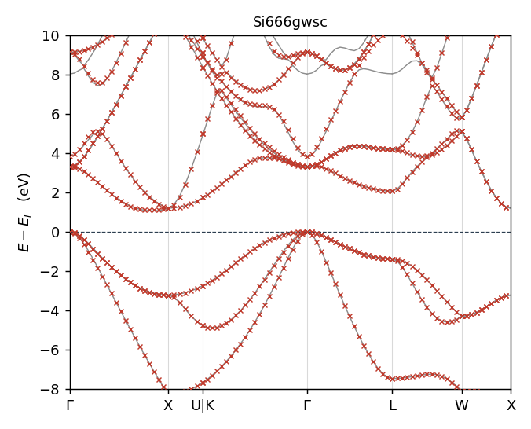

Si (**QSGW**, 18 MTOs = 2 atoms × sp³d⁵). From the valence band up to <del class="clfix">conduction band +5 eV</del><span class="clfix">the floor (about +3 eV)</span> the
red × lie exactly on the gray lines.

---

The figure does not draw a band for the "target window". What $\Delta$ fixes is
**only the upper floor** of $e^{\rm cut}_{n''}=\max(\varepsilon_{\rm CBM}+\Delta,\ \varepsilon^{\rm MTO}_{n''})$;
the lower bound is only a matter of the evaluation. Moreover the second argument
$\varepsilon^{\rm MTO}_{n''}$ differs from orbital to orbital, so **it cannot be drawn as one horizontal line**.

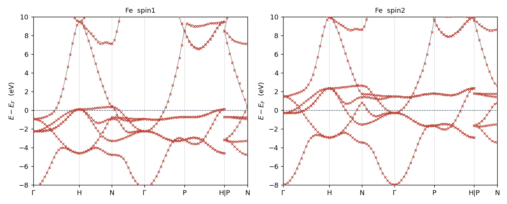

Fe (DFT, 9 MTOs = sp³d⁵). Majority and minority side by side. **Both spins fit equally well**.
FeCo is the same, and NiO has equal values for both spins: **in the magnetic systems there is no bias by spin.**

---

### $w$ matters — the example of Fe

With the default $w=2.0$ eV, Fe cannot be fitted fully. Raising only $w$ to 11 eV gives:

| Fe | window (meV) | occupied (meV) | dispersion |
|---|---:|---:|---:|
| $w=2.0$ (default) | 19.8 meV | 12.9 meV | 0.057 |
| **$w=11$** | **9.7 meV** | **9.0 meV** | **0.024** |

The error in the window drops to less than half. **But the band plots look the same side by side** —
the difference is on the meV scale and is squashed by the vertical axis of the plot. To see where it acts,
the error of each level has to be sorted by its first-principles energy:


**It acts only above $E_F$.** From $0$ to $+5$ eV it improves by a factor of 2–3, while
below $E_F$ it wins some and loses some; for minority at $-7.5$ eV and $-2.5$ eV
$w=2.0$ is better. This is natural, since the floor $\varepsilon_{\rm CBM}+\Delta$ lies above $E_F$
and $w$ fixes how the weight falls off above it.
It should be read **not as "raising $w$ makes it better" but as "$w$ fixes how well it fits above the floor"**,
and that is also why $\delta E_{\rm occ}$ is kept as a separate quantity (§7).

---

### The high-energy side — the truncation is smooth

An MLO model has only as many bands as the dimension of the MTO subspace, so somewhere it leaves the first-principles bands.
To see whether it leaves them with ringing, the plots are drawn **as far as the MLO bands extend**
(`<system>_full.png`). Measured upper limits:

| System (number of MTOs) | upper limit of the MLO bands (eV) | upper limit of first principles (eV) |
|---|---:|---:|
| NiO (16) | 1.6 eV | 141.8 eV |
| RuO₂ (22) | 5.5 eV | 146.9 eV |
| SrTiO₃ (14) | 8.4 eV | 153.6 eV |
| C.sp (sp only, 8) | 16.8 eV | 124.5 eV |
| FeMgO (76) | 29.7 eV | 152.0 eV |
| Si (18) | 28.8 eV | 108.3 eV |
| GaAs (18) | 31.6 eV | 116.5 eV |
| FeCo (18) | 31.8 eV | 142.6 eV |
| Al₂O₃:Cr (50) | 32.0 eV | 141.1 eV |
| Fe (spd, 9) | 32.8 eV | 124.6 eV |
| C (spd, 18) | 86.1 eV | 151.4 eV |

**The upper limit is not proportional to the number of orbitals.** NiO with 16 orbitals reaches only 1.6 eV,
while Fe with 9 orbitals reaches 32.8 eV. It is decided by which channels are taken
(NiO only Ni d and O p, Fe includes the strongly dispersive sp).
**This does not affect the target window (around $E_F$).**

Above the floor too the MLO bands are continuous curves, with no kinks or oscillations. It was also checked numerically
— the median of $|d^2E/dx^2|$ along the bands (eV; in parentheses the same quantity for first principles):

| System / range of $E-E_F$ (eV) | −10..0 | 0..3 | 3..8 | 8..15 | 15..25 | 25..40 |
|---|---|---|---|---|---|---|
| Si | 7.9 (8.1) | 12.5 (9.2) | 15.9 (14.2) | 24.2 (21.8) | 30.3 (45.1) | 20.4 (45.9) |
| Fe | 12.4 (10.2) | 45.8 (20.4) | 37.8 (24.5) | 41.3 (36.3) | 94.2 (54.8) | **216.3 (79.4)** |
| GaAs | 7.6 (6.5) | 15.7 (11.4) | 13.8 (13.4) | 24.4 (20.7) | 46.2 (37.4) | 36.4 (59.5) |
| Al₂O₃:Cr | 207.6 (138.2) | — | 62.8 (42.1) | 367.2 (216.7) | 307.7 (240.6) | 338.5 (586.1) |

For Si, GaAs and Al₂O₃:Cr **the curvature of MLO on the high-energy side is below that of first principles**
(Si: 20 against 46). Far from ringing, it is smoother than the original bands.
**Only Fe, above 25 eV, gives 216 against 79, a factor of 2.7.** This is the region where a model with only 9 spd orbitals
is stretched up to 33 eV, beyond the capacity of the model.


Si (QSGW) — agrees exactly up to the floor (+3 eV), and above it leaves the bands while extending smoothly to 29 eV.

---

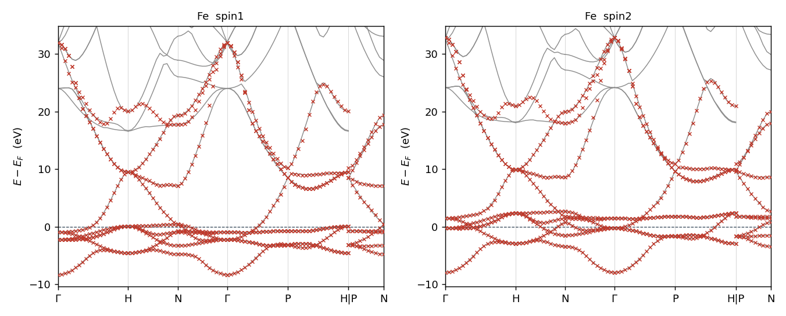

Fe — the sp band crossing $E_F$ is followed up to 33 eV at the zone boundary.

---

### About the reference bands

The comparison in every system is with the **first-principles bands solved in the PMT basis**, not with experiment.
Of these, **Si, Al₂O₃:Cr, RuO₂<span class="clfix">, GaAsSoc</span> and GdION are QSGW** (they have `sigm.<sname>`),
the rest DFT. What is written "$\Delta E$" on this page is the difference between the MLO model and
these first-principles bands, and the denominator of the $m^*$ ratio is the same.

### Band plots of all samples (gray: first-principles PMT, red ×: MLO)

**<del class="clfix">Task (1)</del><span class="clfix">Use 1 (the minimal model)</span> — models around $E_F$**


Al₂O₃:Cr (50 orbitals) — **this system is the key point of the final form**. The O 2p valence band (−2 to −4 eV),
the Cr d levels in the gap (around $E_F$), the CBM (+6.5 eV) and the bands above all fit.
Putting the floor at $E_F+\Delta$ leaves the CBM unconstrained and the gap shrinks by 128 meV.
The hand setting `mlo_emax = 7 eV` used to be there to catch this CBM,
and $\varepsilon_{\rm CBM}+\Delta$ of method 4 hits it automatically. Window 7.2 meV.

---


FeMgO (76 orbitals) — **the best of the table, window 2.5 meV**. A Fe/MgO slab with 7 empty spheres
in the 30.5 a.u. vacuum layer. The 78-orbital model without empty spheres gave 126.9 meV,
so with almost the same size it is 51 times smaller. Details in §5.

---

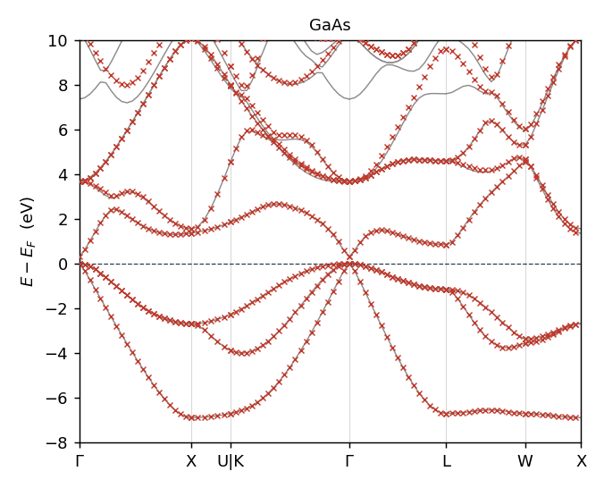

GaAs (18 orbitals) — agrees including the strongly dispersive conduction band at Γ. Window 8.5 meV, gap +6 meV.

---


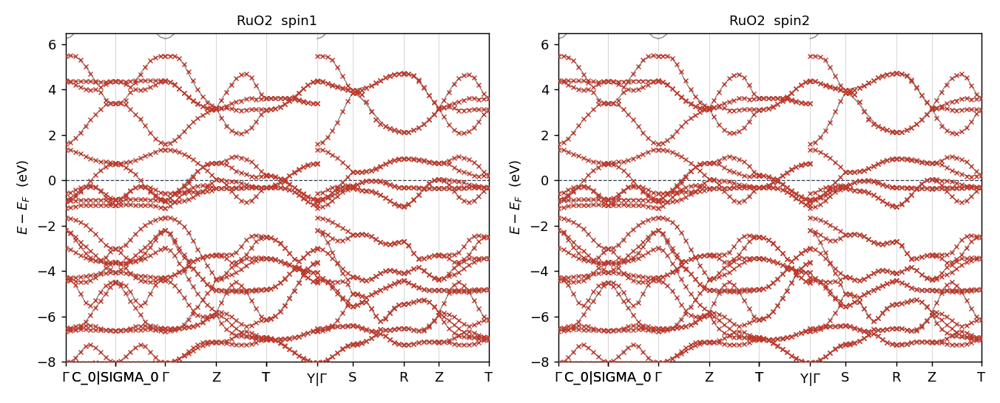

SrTiO₃ (14 orbitals, window 8.9 meV) and RuO₂ (22 orbitals, window 9.9 meV).

---


NiO (LDA, 16 orbitals) — a system where sp and localized d coexist. Against 15.4 meV in the window, **the occupied side is 18.5 meV**,
the other way round, and looking only at the window you would miss it.

---

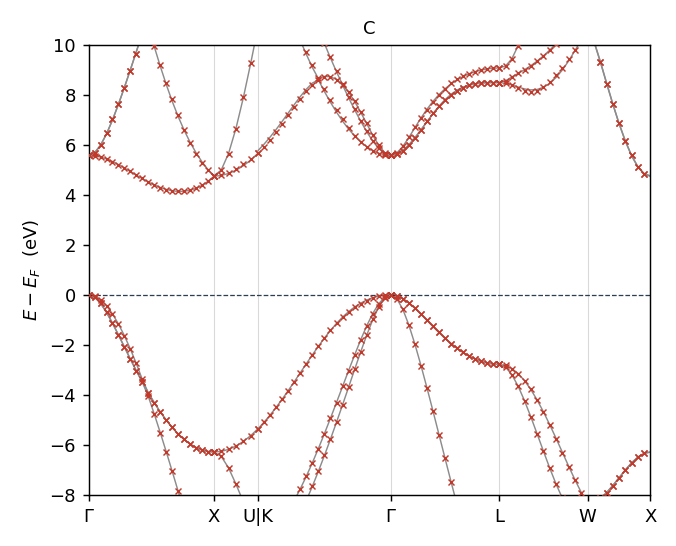
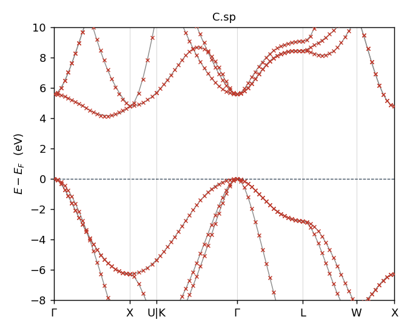

Diamond C — spd with 18 orbitals (window 16.6 meV) and sp only with 8 orbitals (window 26.7 meV).
In the latter, part of the conduction band lies outside the MTO subspace: $m^*$ ratio 0.65, gap −39 meV.

---


FeCo (18 orbitals, window 8.3 meV) — a magnetic metal; both spins fit well.

---

---

### MLO fits — all samples

All 25 systems of `Samples/MLOsamples` (gray: first-principles PMT bands, red ×: MLO). The same inputs and references as
`testecalj` runs. The figures are regenerated with `SRC/exec/mlo_bandplot.py <sampledir>_work`.
The last 7 systems of the table take the Materials Project structure through `ctrlgenToml.py` as it is,
put s,p,d of all atoms in `mlo_lm`, and run with the defaults ($\Delta = w = 2$ eV)
(2026-09-18, <del class="clfix">development record `MD/mlo_notes/mp_20260918/`</del><span class="clfix">development note (MD/mlo_notes/mp_20260918/ in the repository, not on this site)</span>).

| Semiconductors, insulators | | | |
|---|---|---|---|
| Si (QSGW) | GaAs <del class="clfix">(QSGW)</del><span class="clfix">(DFT)</span> | GaAs+SOC<span class="clfix"> (QSGW)</span> | C (diamond) |
|  |  |  |  |
| C.sp | SrTiO3 | Al2O3:Cr (QSGW80) | NiO (LDA, AFM) |
|  |  |  |  |

| Metals, magnets | | | |
|---|---|---|---|
| Cu (d only) | Fe | Fe+SOC | FeCo |
|  |  |  |  |
| RuO2 (QSGW) | GdCo5 (4f) | GdION (4f, QSGW) | SmP (4f, so=2) |
|  |  |  |  |

| Slab | |
|---|---|
| FeMgO + empty spheres (76 MLO) | FeMgO+SOC |
|  | 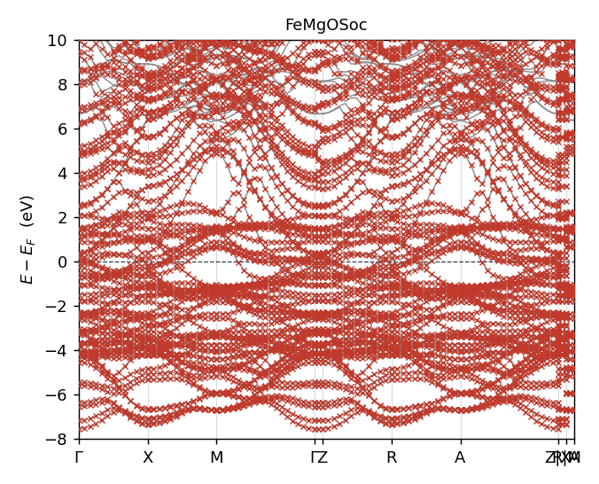 |

| Materials Project, defaults (DFT) | | | |
|---|---|---|---|
| Ag | Al | NaCl | SiC (3C) |
| 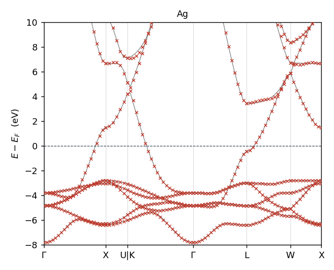 | 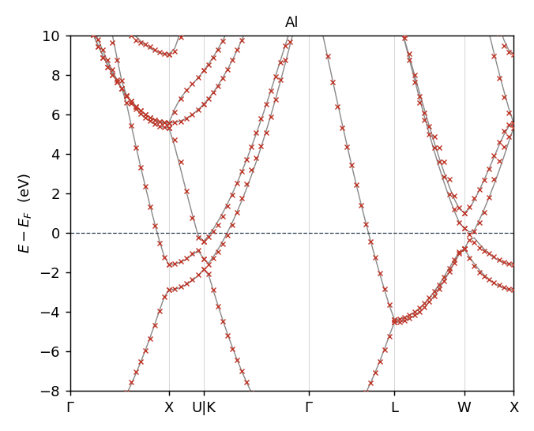 | 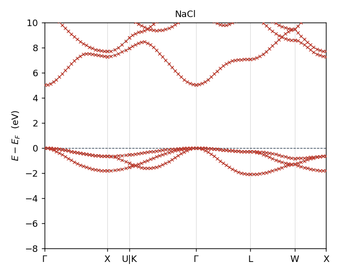 |  |
| CdTe | ZnO (Zn 3d LO in the model) | TiO2 (rutile) | |
|  | 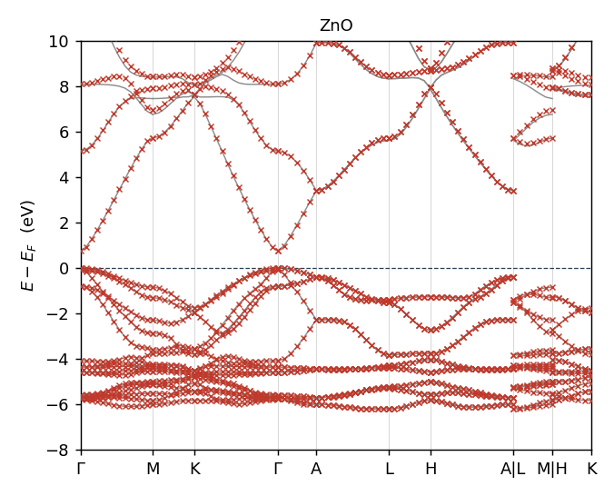 | 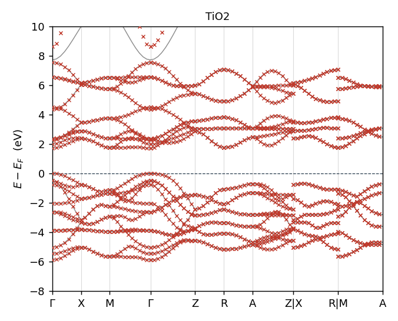 | |

rms in the window for the 7 MP systems (the 2026-09-18 evaluation; metals [E_F−8, +2], insulators [E_F−8, CBM+3] eV, which differs from the window of the present `mlo_bandcheck.py` (Eq. (9) of §9)): Ag 15, Al 74 (the free-electron band is
outside the window), NaCl 2.9, SiC 3.3, CdTe 28, ZnO 0.8, TiO2 0.8 meV.

## 3. Model that takes part of the bands — d only / 4f only

This is a model that **takes only some of the bands from the start**: the 5 d bands of Cu,
the 7 4f bands, and so on; most of the first-principles bands in the window are not in the model.
**The window-type loss of §7 cannot be used here** — it would count what is not there as
"not reproduced".

| System | `mlo_lm` | window-type loss (meV) | Is this a failure? |
|---|---|---:|---|
| Cu | lm 5–9 of Cu (d only) | 147.8 meV | **No**. The model just does not have the sp bands |
| SmP | 10–16 of Sm (4f only), P empty | 121.3 meV | **No**. It does not have the valence band |
| GdION | 10–16 of Gd (4f only) | 0.2 meV | Only 4f is in the window, so here the window loss happens to work (the small value is not a real test) |
| GdCo5 | only 10–16 of Gd, the 5 Co sites empty | (not enough data) | same as above |

(Until 2026-10-01 this said "the window of `GaAsSoc`, 105.9 meV, is the same kind of artefact — the comparison is with 2N spinors and the band counts do not match".
In fact it was being compared with DFT without SOC. See the warning and Table M2 of §4.)

### 4f models — measured by the overlap of levels

A model that extracts only 4f is measured by "whether the 7 bands of the model lie on the first-principles 4f levels".
At each k point, the distance from each MLO level to the nearest first-principles level (meV):

| System | spin | method 0, old (meV) | **method 4** (meV) |
|---|---|---|---|
| GdION | 1 | rms 0.19 / max 0.49 | **rms 0.19 / max 0.49** |
| | 2 | rms 1.76 / max 8.62 | **rms 1.85 / max 9.30** |
| GdCo5 | 1 | rms 10.99 / max 44.79 | **rms 12.46 / max 52.67** |
| | 2 | rms 13.78 / max 106.25 | **rms 14.43 / max 104.21** |
| SmP | 1 | rms 71.57 / max 265 | **rms 76.30 / max 278** |
| | 2 | rms 76.29 / max 273 | **rms 75.04 / max 275** |

**For all three systems method 4 is as good as method 0**, and the 4f bands fit.

However, **$\Delta$ has no effect here.** The 4f levels $\varepsilon^{\rm MTO}_{n''}$ lie far below
the floor $\varepsilon_{\rm CBM}+\Delta$, so $e^{\rm cut}_{n''}$ always takes the floor,
and in GdION the floor is at $E_F+23.9$ eV (the huge gap of the Gd ion), <del class="clfix">above everything, so
$\theta\approx1$, that is, it goes back to $A\approx S$ (the bare projection).</del><span class="clfix">far above the majority 4f ($-0.06$ eV), so for the majority $\theta\approx1$, that is, it goes back to $A\approx S$ (the bare projection). The minority 4f ($+23.8$ eV) lie only 0.1 eV below the floor, so there $\theta\approx\sigma(-0.05)\approx1/2$, not the bare projection.</span>
**A 4f model has no requirement at a band edge in the first place, so the meaning of $\Delta$, "how far you want to fit",
disappears** — method 4 does not break it, but it does not act either.

**The rms of 70–76 meV for SmP was there from the start.** The median is 6–13 meV, so most levels fit,
and some (max 275 meV) are off. Sm 4f hybridizes with P 3p, yet `mlo_lm` takes no
P channel at all; that is probably the reason. It is not a problem of the method.

**Models that take only part of the bands** (§3)


Cu — a model of **only the 5 d orbitals**. The model does not have the sp band that crosses $E_F$, so
the window-type loss is 147.8 meV, but **the d bands themselves fit** (see the figure).

**Partly because no effective lower energy limit is cut on the PMT bands, it is somewhat
not smooth.** The $\theta$ of Eq. (4) has only the upper floor $e^{\rm cut}_{n''}$ and
no lower limit, so PMT states far below the d band come in with weight 1.
Varying $\Delta$ and $w$ in both directions does not make the scatter better than the defaults; the maximum error of
1.0–1.2 eV remains with every setting. It is also a limit on the side of the model space: at the $\mathbf{k}$ where sp enters the d band,
the first-principles side has 6 bands but the model can hold only 5.

---


GdION (single Gd ion, QSGW) — **the occupied and unoccupied 4f are drawn in separate windows**.
The 7 majority bands are just below $E_F$ ($-0.06$ eV), the 7 minority bands at
**$+23.8$ eV**, almost $24$ eV apart, which does not fit on one vertical axis.
In both the red × lie right on the gray lines (rms 0.19 / 1.85 meV, table above).
The gray lines at $+22.2$ to $+23.0$ eV below the minority are bands that are not 4f;
the model does not take them, so there are no red ×.

**This huge gap is also why $\Delta$ has no effect in 4f models.**
The floor $\varepsilon_{\rm CBM}+\Delta$ is put at $E_F+23.9$ eV, <del class="clfix">above almost all
the 4f levels, so $\theta\approx1$ and it goes back to the bare projection.</del><span class="clfix">so $\theta\approx1$ (the bare projection) for the majority 4f, and $\theta\approx1/2$ for the minority 4f just below the floor.</span>

---


GdCo5 has the 5 Co sites empty and only Gd 4f; SmP has P empty and only Sm 4f.
The results measured by the overlap of levels are in the table above.

---

---

---

## 4. Spin-orbit coupling — `job_mlo_soc`

SOC is **added afterwards as a perturbation, without rebuilding the MLO**. $V_{\rm SO}$ is projected onto the MLO model built
in the scalar-relativistic approximation and added, and the problem is solved again as $2N\times2N$
spinors. There is no need to redo self-consistency with SOC.

```bash
job_mlo_soc <sname> -np <N>
```

### How the model is built — the MLO are the same for up and down

For a material with SOC, the MLO are built in this order (`job_mlo_soc`, checked in the code on 2026-10-01):

1. up and down are computed in **the same PMT basis** (`nspin = 2` at every stage, `phispinsym = true`: the radial functions are averaged over up and down and shared).
   What is solved is the scalar-relativistic $H$ (stage 2 below, `so = 0`)
2. The MLO are built for up and down with **the same seeds and the same number** (`Hreduction` of `m_HamPMT` is called for each spin). The number is counted as
   $N_{\rm MLO}$ of Eq. (8) of §9 (23 for GaAs, 45 for Bi₂Te₃; `ndimMTO` of `lmlo` is this number too). In non-magnetic materials (GaAs, Bi₂Te₃)
   the $H$ for up and down are the same, so **the MLO themselves are identical**
3. $H_{\rm SO}$ is added to the $H$ of those MLO, and the problem is diagonalized in the $2N_{\rm MLO}$ dimensions of up and down together (stage 3, `calc_ham_eigen` of `m_mlo_ham`):
   the diagonal blocks ↑↑ and ↓↓ are the MLO $H$ of each spin plus the ↑↑ and ↓↓ parts of $H_{\rm SO}$, the off-diagonal block is the ↑↓ part.
   The overlap matrix is block diagonal in up and down, and it is solved as a generalized eigenvalue problem. The result is $2N_{\rm MLO}$ bands, all written to `band_MLO_spin1.dat`

So **the number of model orbitals is counted as without SOC**; only the dimension of the matrix diagonalized as spinors doubles.

Note: when $H_{\rm SO}$ is projected onto the MLO, the MLO coefficients (`zMLO`) of one spin (down, the last spin) are used (`m_HamPMT`).
This assumes that the MLO for up and down are identical; it is exact for non-magnetic materials and an approximation for the up block in magnets (FeSoc).

### The three stages

| Stage | Command | What it does |
|---|---|---|
| 1 | `lmf --quit=band --ctrlg:ham.so=1 --efermi=efermi_soc` | solves full-LS spinors on the whole BZ mesh, fixes **the $E_F$ with SOC**, and writes it directly to `efermi_soc` (does not touch `efermi.lmf`) |
| 1b | `lmf --band --ctrlg:ham.so=1 --efermi=efermi_soc` | under the same conditions writes **the DFT bands (with spin-orbit)** on the symmetry lines to `bnd*.spin1`, the reference for comparing with the MLO (from 2026-10-01). The `bnd*` and `band_MLO_spin2.dat` of an earlier run are deleted first (`mlo` writes an empty spin2 again in stage 3; plotting and evaluation skip it) |
| 2 | `lmf --writeham --socmatrix --ctrlg:ham.so=0` | writes the scalar-relativistic $H$ to `__HamiltonianPMT` and **the SOC matrix to a separate file, `__HamiltonianPMTsoc`** |
| 3 | `mlo --socmatrix --efermi=efermi_soc` | after the PMT→MLO reduction, projects the SOC matrix onto the MLO and diagonalizes $2N\times2N$ on the symmetry lines. The window reference is `efermi_soc` (the value with SOC) |

All of them get `--ctrlg:ham.nspin=2 --ctrlg:ham.phispinsym=true`.
`phispinsym` (spin-averaged radial functions) is needed <del class="clfix">because $\langle\uparrow|L_z|\uparrow\rangle$ is used
in place of $\langle\uparrow|L_z|\downarrow\rangle$.</del><span class="clfix">so that the radial integrals $\langle\varphi_\uparrow|\xi(r)|\varphi_\downarrow\rangle$ of the spin-flip part ($L_\pm S_\mp$) can be taken with a single spin-averaged $\varphi$.</span>

~~Note that **stage 1 overwrites `efermi.lmf` with the SOC value**. If you continue non-SOC calculations
in the same directory, save `efermi.lmf` first
(the samples include the non-SOC version).~~
→ Since 2026-09-26 `efermi.lmf` is not rewritten (stage 1 writes directly to `efermi_soc`, and stage 3 reads that).

::: warning Compare the SOC MLO with DFT with spin-orbit
The MLO bands of `job_mlo_soc` include spin-orbit, so the DFT bands they are compared with must include spin-orbit too. Compared with
`job_band` without spin-orbit (`so = 0` in ctrlg), they appear off by the rise of the top of the valence band by $\Delta_{\rm SO}/3$ (in GaAs the CBM looks 0.10 eV
low, rms 0.12 eV). For this reason, from 2026-10-01 `job_mlo_soc` draws its own reference in stage 1b. `mlo_bandcheck.py` prints a `WARNING` when it is asked to compare
MLO with spin-orbit against DFT without spin-orbit (`HAM_SO` of `llmf_band`, or `so` of ctrlg if that is absent).
The window reference of the MLO ($E_F$ and CBM) is taken from the file given by `--efermi=` (`efermi_soc` with SOC, otherwise `efermi.lmf`). Until the night of 2026-10-01
only $E_F$ was taken from the first line of `qplist.dat` (written by the last band calculation), and the SOC MLO used the $E_F$ of an earlier non-SOC `job_band`
(for GaAsSoc 0.0082 Ry lower than the $E_F$ with SOC). The value in `qplist.dat` is now used only for the zero of the plots (the same reference as the DFT `bnd*`).
:::

### Implementation points

- **Symmetrization is done for spinors.** SOC is $\mathbf{L}\cdot\mathbf{S}$, so
  rotations of the little group and the rotation $\mathbf{k}_{\rm IBZ}\to\mathbf{k}_{\rm BZ}$
  act as the tensor product of the orbital part $R$ and the spin part $D^{1/2}(R)$ (SU(2)),
  $(R\otimes D)\,V_{\rm SO}\,(R\otimes D)^\dagger$
  (`so3_to_su2`, `spinor_rotate` in `m_HamPMT.f90`)
- **Match the basis of the projection.** `cmlo` is in the basis of PMT *eigenstates*, `hammhsop` in the basis of
  PMT *basis functions*, so first convert to the latter with $z_{\rm MLO}=z_{\rm PMT}\,c_{\rm MLO}$, then
  $H^{\rm MLO}_{\rm SO}=z_{\rm MLO}^\dagger\,H_{\rm SO}\,z_{\rm MLO}$
- `--skiphammsoc` is a flag that keeps SOC out of $H$ even with `lso=1` (so that the perturbation can be
  applied at the later stage)

### Results — as good as without SOC

**Table M2**. Errors of the SOC models (eV). With `mlo_bandcheck.py` (Eqs. (9)–(11) of §9, window [VBM − 8, CBM + 2]); the DFT also with spin-orbit (stage 1b)

| System (number of MLO) | gap error | rms MLO → DFT / DFT → MLO | same system without SOC (`job_mlo`) |
|---|---:|---:|---|
| GaAsSoc (23) | +0.010 | 0.010 / 0.010 | GaAs: +0.007, 0.007 / 0.007 |
| FeSoc (9) | metal | 0.017 / 0.017 | Fe: 0.016 / 0.016 |
| FeMgOSoc (76) | metal | 0.003 / 0.003 | FeMgO: 0.001 / 0.001 |

As good as without SOC: **adding SOC does not degrade it**. The three stages also go through without problems for the model with empty spheres (§5).
(Until 2026-10-01 this said FeMgOSoc 3.9 and FeSoc 21.9 meV from the window-type loss (`mlo_losscheck.py`). The DFT it was compared with
had no spin-orbit, so that was withdrawn.)


From the top: FeMgOSoc, FeSoc, GaAsSoc. Gray lines are DFT with spin-orbit (stage 1b), red × the MLO.
The splitting $\Delta_{\rm SO}$ at the top of the valence band of GaAs is 0.337 eV in DFT and 0.335 eV in MLO.

---

> **Note**: compare the SOC MLO ($2N_{\rm MLO}$ bands) with DFT with spin-orbit (warning above). Do not compare it with the non-SOC DFT left in the
> `bnd*` of the sample (the reference of Test 1 of `GaAsSoc`). The reference of the test is `band_MLO_spin1.soc.dat`.
> (Until 2026-10-01 this said "the window-type loss of `GaAsSoc` comes out as 105.9 meV only because the band counts do not match". In fact it was compared with non-SOC DFT.)

---

## 5. FeMgO — empty spheres in a vacuum slab

For a long time this was "the outlier that does not fit however $\theta$ is changed". The cause was
neither $\theta$ nor the method but that **there was a region where the model had nothing**.
The same pitfall exists for any slab with a vacuum layer, so it has its own section.

### What was happening

First, the structure had been misunderstood. It is not a Fe/MgO **interface** but a **slab with a 30.5 a.u.
vacuum layer** (3 Fe layers + 3 MgO layers, $c=47.8$ a.u.). The residual concentrated at $E_F+0.7$ to $1.0$ eV
was not an interface state but a **surface/vacuum state**, and since there was not a single basis function in the vacuum region
**it could in principle not be represented by site-centred MTOs**. However $\theta$ is made,
what is not there cannot be made.

### How to place the empty spheres

Seven layers of empty spheres ($Z=0$) were placed in the vacuum. **Choose the radius yourself**:

- with $R=1.9$ a.u. they touch neither the surface O ($R=1.75$) nor Fe ($R=2.28$), and
  the overlap reported by `lmchk` is 0%
- the layers are spaced evenly, keeping a margin from the surface
- in-plane positions alternate between $(0,0)$ and $(\tfrac12,\tfrac12)$ (continuing the stacking of the slab)

```toml
[[site]]
atom = "E"          # empty sphere
xpos = [0.0, 0.0, 0.3]
[[spec]]
atom = "E"
z    = 0
r    = 1.9          # choose it yourself; check the overlap with lmchk
lmx  = 2            # give s,p,d on the DFT side (below)
lmxa = 2
```

**`r = 0.0` means a floating orbital without an MT sphere**, so write the radius explicitly if you want a sphere.

### Effect — adding empty spheres gains an order of magnitude

Errors in the window for majority / minority (meV):

| Model | number of MLO | window (meV) |
|---|---:|---:|
| without empty spheres | 78 | 126.9 / 73.5 |
| ES with s only<span class="clfix"> (d of Mg, O kept)</span> | 85 | 2.2 / 1.1 |
| <span class="clfix">ES with s only + d of Mg, O removed</span> | <span class="clfix">55</span> | <span class="clfix">3.1 / — (majority only, table below)</span> |
| **ES with s,p + d of Mg, O removed (adopted)** | **76** | **2.5 / 1.3** |
| ES with s,p | 106 | 1.8 / 1.1 |
| ES with s,p,d | 141 | 1.6 / 0.9 |

**Just adding one s per empty sphere, 7 in total, gives 126.9 → 2.2 meV** (a factor of 58).
The MLO go from 78 to 85, only 9% more. This is where the largest effect is.


The 4 columns are the models, the upper row around $E_F$, the lower row the wide range. **Look at the top left (without empty spheres)** —
above $E_F$, from $+0.5$ to $4$ eV, **gray lines without red ×** remain. These are
surface states leaking into the vacuum. The valence band ($-6$ to $0$ eV, Fe 3d and O 2p) fits
even without empty spheres; **what was missing were only the states on the vacuum side**.

The three on the right ($141$ / $85$ / $55$ bands) **can hardly be told apart in the upper row**.
In the lower wide-range row, only the smallest model leaves a gap above $+20$ eV — the removed d of Mg, O and
the p,d of the empty spheres were carrying that region.

---

### Give the empty spheres up to p

The table above makes s alone look almost sufficient, but **looking closely above $E_F$,
p is needed**. The window-type loss (window $E_F\pm2$ eV) just does not measure there.

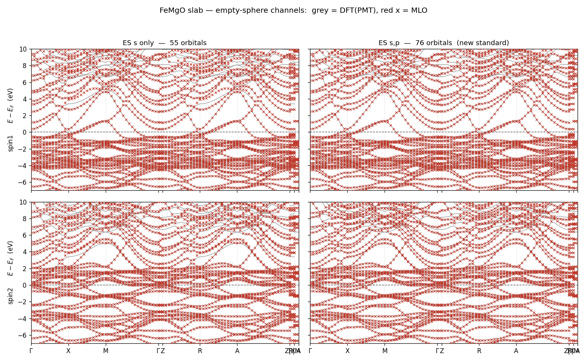

Left: ES with s only<span class="clfix"> (+ d of Mg, O removed)</span> (55 bands); right: s,p (76 bands). Drawn from $-7$ to $+10$ eV,
**the left leaves gray lines without red × at $+5$ to $+10$ eV**, while the right is filled.


Sorting the error of each level by its first-principles energy shows where it acts:

| Region | ES s only<span class="clfix"> (+ d of Mg, O removed)</span> (55) | ES s,p (76) |
|---|---|---|
| $-7$ to $-1.5$ eV (valence band) | 0.3–0.7 meV | **the same** |
| $E_F$ to $+2$ eV | a little worse | a little better |
| **$+2$ to $+6$ eV** | 20–170 meV | **3–5 times better** |

In the overall numbers too:

| | orbitals | window (meV) | occupied (meV) | dispersion | per-level mean (meV) | max (meV) |
|---|---:|---:|---:|---:|---:|---:|
| ES s only<span class="clfix"> (+ d of Mg, O removed)</span> | 55 | 3.1 | 0.6 | 0.008 | 15.9 / 11.4 | 860 |
| **ES s,p (adopted)** | **76** | **2.5** | **0.5** | **0.006** | **8.3 / 6.0** | **294** |

The window-type loss gives a modest 3.1 → 2.5 meV, but **level by level the mean halves and
the maximum drops to a third, 860 → 294 meV**. The improvement is outside the window, so it hardly shows in
window-type measures. This is what §7 means by "not fixed by one direction".

### The adopted model — 76 orbitals

`Samples/MLOsamples/FeMgO` and `FeMgOSoc` use this **76-orbital** model and share
the whole input (`mlo_lm`: 9 for Fe (s,p,d), 4 for Mg (s,p), 3 for O (p),
4 for the empty spheres (s,p): 3×9 + 3×4 + 3×3 + 7×4 = 76). The basis of Fe and Mg also has
f MTOs, but they are not in the model.

The original model without empty spheres had 78 orbitals, so **with almost the same size the error in the window
goes 126.9 → 2.5 meV (a factor of 51)**.


The use is the calculation of magnetic fluctuations, which needs the region around $E_F$. For that alone 55 orbitals would be
enough (table above), but **if you use it up to +10 eV, it is better to include p**.
It costs only 7 sites × 3 = 21 more.

### Two pitfalls

**(a) Narrow only `mlo_lm`. Keep `lmx` of `[[spec]]` at 2.**
Removing $l$ channels from a $Z=0$ sphere on the DFT side makes the radial equation diverge and `lmf` crashes:

| E in `[[spec]]` | Result |
|---|---|
| `lmx=2, lmxa=2` | **converges** |
| `lmx=1, lmxa=1` | `lmf` rc=11. The radial solution diverges to $-20$ Ry |
| `lmx=1, lmxa=2` | same |
| `lmx=1, lmxa=2` + explicit `p` | same. `q` overflows at $e=+20$ Ry |

In the working case the pnu of the empty sphere are 1.509 / 2.256 / 3.150 (s/p/d), and giving these as `p`
does not fix it. It is the same symptom as the known runaway of `yh3fcc_gwsc666`.
**Give DFT s,p,d and make the MLO selection with `mlo_lm`**: that is the consistent way.

<div class="clfix-old">

**(b) A vacuum slab needs ESM. Do not forget to write `[esm]`.**
With a vacuum layer, the zero of energy is fixed by how the $G=0$ component of the Coulomb interaction is treated.
Without `[esm]`, `lmf` solves with ordinary periodic boundaries and **only prints a one-line warning without stopping**.
For FeMgO $E_F$ shifted by **4.4155 eV**. The total energy, `Vesav` and the magnetic moments agree to
8–13 digits, so nothing looks wrong until the Fermi energies are compared.

```toml
[esm]
boundary  = "vac/slab/vac"   # vacuum(-z)/slab/vacuum(+z)
origin    = -8.63717         # (a.u.)
shiftmode = 0
zb        = [23.907104, -23.907104]   # (a.u.)
potential = [0.0, 0.0]       # (Ry)
field     = [0.0, 0.0]       # (Ry/a.u.)
```

**`esm_input.dat` has been retired (2026-09-16).** The settings are written in the
`[esm]` section of `ctrlg.<sname>.toml`. Fortran reads nothing but `ctrlg` (2026-09-17), so
if `esm_input.dat` is left, `lmf` **stops** and points to `ctrlg_absorb.py <sname>`
(abort rather than ignore, so that it does not silently run without ESM):

| Situation | What `ctrlg_absorb.py` does |
|---|---|
| `ctrlg` **has** `[esm]` | that one is used. `esm_input.dat` is moved to **`esm_input.dat.bk`**, and the head of `.bk` records "this setting was not used" |
| `ctrlg` **has no** `[esm]` | converts `esm_input.dat` and writes `[esm]` into `ctrlg` (before the GW sections), and moves the original to **`esm_input.dat.bk`** (the head of `.bk` names where it went) |

`Legacy2toml.py` converts by the same rule. Details in
[ESM](./esm).

</div>

<div class="clfix">

**(b) A vacuum slab needs ESM; do not forget `[esm]`.** Without `[esm]`, `lmf` solves with periodic boundaries and only prints a one-line warning. The zero of energy shifts (4.4 eV in $E_F$ for FeMgO). The settings and the conversion from `esm_input.dat` are on [ESM](./esm).

</div>

> This cost a long detour. Seeing a different $E_F$ come from the same `rst` on another machine,
> we suspected the compiler and MPI, and ruled out in turn the binary compatibility of rst, `atmpnu`, negative charge density and nondeterminism,
> but the truth was only that `esm_input.dat` had not been copied when the new sample was assembled.
> Once `Vesav` agreed to 13 digits the density side was known to be innocent, so **the SCF logs should have been diffed first.**

---

---

## 6. Effective interaction $W$ — `job_mloW`

Once the MLO model reproduces the bands, what is needed next is **the electron-electron interaction within that model**:
the Hubbard $U$ put on the model Hamiltonian, or the interaction used in the calculation of magnetic fluctuations.
In cRPA terms it is "the screened interaction projected onto the model space", and
`job_mloW` evaluates it in the MLO basis.

<span class="clfix">(Equation numbers renumbered: the equations of this section are now numbered in order of appearance. Old → new: (7a) → (7a), (7f) → (7b), (7) → (7c), (7b) → (7d), (7c) → (7e), (7d) → (7f), (7e) → (7g). (6) and (8)–(12) of §9 are unchanged)</span>

### What is computed

For MLO orbitals $i,j,k,l$, lattice vectors $\mathbf{R}$ and frequencies $\omega$,

$$
V_{ijkl}(\mathbf{R})=\langle ij|v|kl\rangle,
\qquad
W_{ijkl}(\mathbf{R},\omega)=\langle ij|W(\omega)|kl\rangle
\tag{6}
$$

are computed, and **$V$ and $W-V$ are written to separate files**. The on-site diagonal elements
$i=j=k=l$, $\mathbf{R}=0$, $\omega=0$ are the quantity corresponding to the $U$ of the model.

```bash
job_mloW <sname> -np <N>
```

It runs lmfa → lmf → `--jobgw=0/1` → `qg4gw` → `heftet` → `hbasfp0` → `mlo` →
`hvccfp0` → `hwmatK_MPI` → `hx0fp0` → `hwmatK_MPI` in this order.
**It is heavier than the MLO band calculation (`job_mlo`)** — because it goes through the whole set of GW parts.

### Normalization of the MLO — square integral 1 in real space

An MLO is built at each $\mathbf{k}$ as a weighted sum of PMT eigenstates, so as it stands its length is not 1.
To read $U$ and $J$ as "values for orbitals of length 1", **the real-space MLO** is normalized.
The square integral of the real-space MLO $F_{i\mathbf{0}}=N_k^{-1}\sum_{\mathbf{k}}F_i(\mathbf{k})$, made from the MLO Bloch functions $F_i(\mathbf{k})$
on the $\mathbf{k}$ mesh ($N_k$ points), is

$$
N_i=\int|F_{i\mathbf{0}}(\mathbf{r})|^2d\mathbf{r}
=\frac{1}{N_k}\sum_{\mathbf{k}}O_{ii}(\mathbf{k})=O_{ii}(\mathbf{R}=\mathbf{0})
\tag{7a}
$$

that is, the $\mathbf{R}=0$ diagonal element of the overlap matrix of the model of the raw MLO. `mlo`, which defines the model (`job_mlo`, `lmf --mlo`), first sets
$F_i\to F_i/\sqrt{N_i}$ (**a constant independent of $\mathbf{k}$**), and then orthogonalizes at each $\mathbf{k}$ by Eq. (7b) of the next subsection. The result of the Löwdin orthogonalization
depends on the scale of the input orbitals (it chooses the orthonormal set closest to the input, so the lengths of the orbitals are made equal first). $N_i$ is written at the end of `HamRsMLO`, and every later place that builds MLO
(`__cmlo` of `job_mloW`, sugw and `m_sigmlo` of MLO-QSGW) divides by the same constants and then applies the same orthogonalization (2026-10-02).

- $N_i$ of the raw MLO is much smaller than 1: 0.38 for the d of Ni, 0.18 for the t₂g of SrVO₃, 0.21–0.33 for the d of bcc Fe, 0.01–0.02 for s and p
  (because the weight falls off above the window). Without normalization the $U$ from $V$ takes values like 3.4 eV for Ni (24 eV normalized)
- **Do not divide by <del class="clfix">$1/\sqrt{O_{ii}(\mathbf{k})}$</del><span class="clfix">$\sqrt{O_{ii}(\mathbf{k})}$ (multiply by $1/\sqrt{O_{ii}(\mathbf{k})}$)</span> per $\mathbf{k}$** (the former `--mlo_diagnorm`, removed). The factor depends on $\mathbf{k}$, so the shape of the orbital in real space changes and
  the MLO bands at $\mathbf{k}$ off the mesh move (0.74 eV for C, 0.10 eV for Al)
- `hwmatK_MPI` prints $N_i$ measured on the GW mesh as a check (`square integral of the real-space MLOs on the GW mesh` in `lwmatK1`).
  The model mesh (`mlo_nkabc`) and the GW mesh differ, so it deviates slightly from 1. If the GW mesh is coarse, the orbital overlaps its own images in the periodic box and the deviation is large
  (SrVO₃, 1.06 on 2³; Ni, 0.999 on 4³). The deviation enters $U$ squared

### The standard MLO: functions orthogonalized by Löwdin (projected Wannier)

The MLO are not orthogonal at each $\mathbf{k}$. The functions obtained at each $\mathbf{k}$ by

$$
|\tilde F(\mathbf{k})\rangle=|F(\mathbf{k})\rangle\,O(\mathbf{k})^{-1/2},\qquad O_{ij}(\mathbf{k})=\langle F_i(\mathbf{k})|F_j(\mathbf{k})\rangle
\tag{7b}
$$

are orthonormal localized functions spanning the same subspace as the MLO, the projected Wannier functions of the MLO subspace. In real space, they are the MLO minus half of the overlap with
the neighbouring overlapping orbitals, $\tilde w_j=\varphi_j-\tfrac12\sum\Delta\,\varphi+\cdots$ ($\Delta$ is the off-diagonal of the real-space overlap).
Since $O(g\mathbf{k})=D(g)O(\mathbf{k})D(g)^\dagger$, they rotate in the same representation as the original MLO and keep the orbital names (t₂g, e_g, ...) and the symmetry.

**From 2026-10-02 the MLO of ecalj are these functions.** The model is held only as $\tilde H(\mathbf{R})$ ($\tilde O(\mathbf{R})=\delta_{\mathbf{R}0}$),
and bands off the $\mathbf{k}$ mesh are obtained by diagonalizing the Fourier sum of $\tilde H(\mathbf{R})$. The spin-orbit matrix, `__cmlo` ($V$, $W$, cRPA, magnons) and
the $\Sigma$ of MLO-QSGW are all in this basis. The bands on the mesh are the same as before the orthogonalization. `job_mlo <sname> --mlo_raw` (passed to lmf) builds the earlier
model without orthogonalization (the pair $H(\mathbf{R})$ and $O(\mathbf{R})$). It is an option only for comparison; later programs choose the same basis from the mark written in `HamRsMLO`.

The orthogonalized functions oscillate on the neighbouring atoms because of the orthogonality, but they are more concentrated at the centre (spread $\Omega$: 1.72 → 1.46 bohr² for the t₂g of bcc Fe, 9.88 → 9.42 for the d of Ni<span class="clfix">, summed over the 5 d orbitals</span>).
The matrix elements of the model are also smaller at long range (bcc Fe at $|\mathbf{R}|=5a$: $\max|H|$ 2.9×10⁻³ Ry and $\max|O|$ 2.8×10⁻³ against $\max|\tilde H|$ 4.3×10⁻⁴ Ry).
The interpolation off the mesh is as in Table M8; near $E_F$ the orthogonalized version is better.

*Table M8*. Errors of the bands off the mesh for the model $(H,O)$ of the raw MLO and the orthogonalized model $\tilde H$ (63 materials, the same DFT and path as the check of §9, eV).
"Near $E_F$" is $[{\rm VBM}-1,{\rm CBM}+1]$ ($E_F\pm1$ for metals)

| | raw $(H,O)$ | orthogonalized $\tilde H$ |
| --- | --- | --- |
| materials passing the check of §9 | 53 | 55 |
| whole window: median of rms / median of max | 0.0050 / 0.035 | 0.0040 / 0.030 |
| near $E_F$: median of rms / median of max | 0.0048 / 0.019 | 0.0032 / 0.011 |

- Much better near $E_F$: Cu 0.107 → 0.008, Ni 0.054 → 0.010, C 0.078 → 0.031 (gap error −0.038 → −0.013). Worse: 2H-SiC 0.035 → 0.051,
  MnO 0.007 → 0.030. Over the whole window only the bottom of the 4s band of bcc Fe ($E_F-8$ to $-3$ eV) goes 0.03 → 0.10
- Since the overlap of the model is 1, the smallest eigenvalue of the overlap in the check of §9 (check item 3 until 2026-10-02) has lost its meaning and was replaced by the spikes of the band (Eq. (12)). The line
  `Smallest eigenvalue of the normalized raw overlap` in the output of `mlo` (`lwriteham`) is the value on the mesh before the orthogonalization (0.22–0.31 over 63 materials)

- The orthogonalization gathers the contribution of the overlap of the tails to the centre, and the on-site $U$ grows (d of bcc Fe, default window, $\omega=0$: 1.564 → 1.704 eV).
  The $W$ between densities on nearest-neighbour sites is 2 % of $U$ and does not depend on the basis
- The magnons (which use $W$ with full screening) become almost independent of the window (`mlo_delta`, `mlo_w`). With the raw MLO they moved a lot with the window, and the factor $\eta$ for the Goldstone condition
  also moved, 0.78–1.18, with the window. With Löwdin: Fe 1.23–1.24, FeCo 1.26–1.28, Ni 1.75–1.77. The magnons agree with the earlier calculation using Wannier functions
  within 0.01 eV for FeCo and Ni, and almost coincide for q ≥ 0.5 in Fe (README of `Samples/Magnon/Fe_mlo_magnon`)
- Maximal localization (Marzari–Vanderbilt) can be put on top, but without constraints s, p and e_g turn into hybrid orbitals shifted toward the bonds and lose their names.
  With point-group constraints (Sakuma, PRB 87, 235109) the spread of the t₂g of Fe shrinks only 7 % more than with Löwdin. It is not made the default (prototype in ecalj: `TOOLS/gadget/mlo_maxloc.py --sym`)

### Reading the output

Two files per spin. The unit is **eV**.

| File | Contents |
|---|---|
| `Coulomb_v.UP` / `.DN` | $V_{ijkl}(\mathbf{R})$ |
| `Screening_W-v.UP` / `.DN` | $W_{ijkl}(\mathbf{R},\omega)-V_{ijkl}(\mathbf{R})$ |

The columns follow the format of `main_wannier_hwmatK.f90` exactly:

```
 Wannier  ir1 irws1  Rx Ry Rz  is i j k l  [omega omega2]  Re  Im
```

`Coulomb_v` does not have the two $\omega$ columns, `Screening_W-v` does.
**What you want is the real part at $\mathbf{R}=0$, $i=j=k=l$, $\omega=0$**;
`_parse_diag()` in `Samples/MLOsamples/Fe/test.py` is an example of extracting it.

$$
W_{\rm onsite} = V + (W-V)
\tag{7c}
$$

They are added this way.

### $V$ and $W-V$ cancel hugely

d orbitals of Fe (bcc, 9 sp³d⁵ orbitals), majority spin:

| d orbital (lm) | $V$ (eV) | $W-V$ (eV) | $W$ (eV) |
|---|---:|---:|---:|
| 5, 6, 8 ($xy$, $yz$, $xz$) | 22.91 | −21.40 | **1.510** |
| 7, 9 ($3z^2-1$, $x^2-y^2$) | 22.90 | −21.24 | **1.661** |

(2026-10-02, normalization of Eq. (7a)<del class="clfix">. The expected values of `Samples/MLOsamples/Fe/test.py`</del><span class="clfix">, values for the raw MLO (`--mlo_raw`). The expected values of the current `Samples/MLOsamples/Fe/test.py` are in the Löwdin basis: for the majority d, $V$ 24.52 / 24.18 and $W$ 1.66 / 1.79 eV</span>)

**$V\approx23$ eV and $W-V\approx-22$ eV cancel to $W\approx1.6$ eV.**
$W$ is only 7% of $V$. Therefore:

- **Do not discuss $V$ or $W-V$ on its own.** A small change in how the model is built
  moves both by 1–2 eV, but 90% of that cancels
- **The relative error of $W$ is the relative error of $V$ amplified 14 times.** If $V$ is off by 1%,
  $W$ is off by 14%

### How much $W$ depends on how the model is built

Mean $W$ (eV) of the d orbitals of Fe. This table is from the measurement of 2026-09-16, when the MLO were normalized per $\mathbf{k}$ (the former `--mlo_diagnorm`).
With the normalization of Eq. (7a) the values move by 1–6 % (table above), but the discussion of the size of the dependence on how the model is built still holds:

| Model | $W_{\rm UP}$ (eV) | $W_{\rm DN}$ (eV) |
|---|---:|---:|
| method 0 (old samples) | 1.6684 | 1.5972 |
| method 4, $w=2.0$ (default) | 1.5815 | 1.4248 |
| method 4, $w=11$ | 1.6308 | 1.5546 |

The d part of $V$ moves from method 0 to 4 by $-0.9$ eV for UP and $-1.7$ to $-2.1$ eV for DN, but
by the cancellation above **the change left in $W$ is $-5.2$% for UP and $-10.8$% for DN**.
The minority d lies above $E_F$, close to the floor $\varepsilon_{\rm CBM}+\Delta$, so
it moves about twice as much as the majority.

Raising $w$ brings $W$ back (with $w=11$, UP $+3.1$%, DN $+9.1$%).
The bands also fit better with $w=11$ (§2).

> **Which $W$ is correct is not settled here.**
> What was checked is only that "**$W$ depends on how the model is built at the 10% level**".
> The bands fit better with $w=11$, but that is about the region above the floor;
> $W$ was not verified directly. That the value of method 0 is close to $w=11$ is also
> no reason to take method 0 as the reference.
>
> In practice, then, **if you use $W$, check its dependence on $w$ for your system.**
> Whether you can use the defaults as they are and not worry about 10% depends on the use.
> All 18 samples are unified to the defaults.

### cRPA — `job_mloW --crpa`

$W$ with the screening inside the model removed (constrained RPA). How much the band $n$ at each $\mathbf{k}$ lies in the MLO subspace is measured by

$$
p_{\mathbf{k}n}=\big[C\,(C^\dagger C)^{-1}C^\dagger\big]_{nn},\qquad
|F_j(\mathbf{k})\rangle=\sum_n|\psi_{\mathbf{k}n}\rangle C_{nj}
\tag{7d}
$$

(the diagonal of the projection onto the MLO subspace; $0\le p_{\mathbf{k}n}\le1$, $\sum_n p_{\mathbf{k}n}$ = number of MLO), and each transition
$\mathbf{k}n\to\mathbf{k}+\mathbf{q}\,n'$ in $\chi_0$ is multiplied by

$$
1-p_{\mathbf{k}n}\,p_{\mathbf{k}+\mathbf{q}\,n'}
\tag{7e}
$$

(the weighting scheme, Şaşıoğlu–Friedrich–Blügel, PRB 83, 121101). $p$ is a projection, so it does not depend on the MLO normalization (7a).
`job_mloW <sname> --crpa` runs, after v and $W-V$, `hwmatK_MPI --mlo` (10011: Eq. (7d) to `pkm4crpa`) → `hx0fp0` (10011) →
`hwmatK_MPI --mlo` (100), and writes `Screening_W-v_crpa.UP/DN` (same format as `Screening_W-v`). The model subspace is `mlo_lm` itself;
models of d only (Ni) or t₂g only (SrVO₃, lm = 5 6 8 in `mlo_lm`) are built and used. The tests are `TestInstall/ni_crpa` and `srvo3_crpa`.

**Table M7**. Comparison of MLO and Wannier functions (the maximal localization that was in ecalj until 2026-10-02, `genMLWFx`). On-site means at $\omega=0$ (eV),
$U=(ii|ii)$, $J=(ij|ji)$. $\Omega$ is the spread of Eq. (7g) (bohr²; in parentheses the Marzari–Vanderbilt form)

| System (GW k mesh) | Method | $\Omega$ | $U$ of $V$ | $U$ of RPA | $U$ of cRPA | $J$ of cRPA |
|---|---|---:|---:|---:|---:|---:|
| SrVO₃ t₂g (4³) | MLO | 7.51 | 15.77 | 0.715 | 3.125 | 0.437 |
| SrVO₃ t₂g (4³) | Wannier | 6.37 (6.13) | 15.99 | 0.730 | 3.149 | 0.444 |
| Ni d (4³) | MLO | t₂g 2.02, e_g 1.90 | 23.80 | 1.405 | 2.838 | 0.645 |
| Ni d (4³) | Wannier | t₂g 1.47, e_g 1.58 (1.44, 1.54) | 26.00 | 1.575 | 3.779 | 0.768 |

- For SrVO₃, where the t₂g are isolated, the cRPA $U$ agrees within 1 %
- For Ni, where d mixes with s, the d of MLO is wider (by 20–40 % in $\Omega$) and cRPA removes less screening ($(U_{\rm cRPA}-U_{\rm RPA})/V$ is 0.060 against 0.085).
  The d subspace of the Wannier functions is built from a wide window ($E_F\pm10$ eV) and also lies on s,p-like bands, so Eq. (7e) also removes part of the d ↔ s,p transitions.
  Neither is the correct one; it is a difference in how the subspace is taken
- If the GW k mesh is coarse, the normalization of Eq. (7a) deviates from 1 on the GW mesh (SrVO₃, 1.06 on 2³), and $U$ is off by 10 %. If you use $U$, use 4³ or more
- The numbers of the comparison and the working directories are in <del class="clfix">the research log, 2026-10-02 00:32</del><span class="clfix">a development note (MD/research_kotani_log.md in the repository, 2026-10-02 00:32, not on this site)</span>. The Wannier path is in the commit of the git tag `last-wannier`
- The MLO of Table M7 are raw MLO values. In the Löwdin basis (the standard from 2026-10-02) the cRPA $U$ of the d of Ni (4³) is 2.90 eV (raw 2.84, Wannier 3.78), and
  the RPA $U$ is 1.434 eV. Widening the window moves the cRPA $U$ to 3.13 for (4, 2) and 3.30 eV for (6, 2), while the RPA $U$ moves little, 1.43–1.52 eV.
  cRPA removes "the screening inside the model subspace", so it depends directly on how the subspace is taken (in systems with entangled bands also on the choice between weighting and projection schemes, the disentanglement window
  of Wannier and the like). The RPA $W$ with full screening depends on it only through the shape of the orbitals

### Spread of the MLO — `mlo_spread.py`

```bash
mlo_spread.py <sname> -np <N>        # after job_mloW (uses __cmlo, the GW eigenfunctions, HamRsMLO, QBZ.chk)
```

For the vectors $\mathbf{b}$ joining neighbouring points of the GW k mesh (shells added from the nearest until $\sum_b w_b b_\alpha b_\beta=\delta_{\alpha\beta}$),
$M_{ij}(\mathbf{k},\mathbf{b})=\langle u_{i\mathbf{k}}|u_{j\mathbf{k}+\mathbf{b}}\rangle$ is made by `huumat --dwnb=mlo --job=2`, and for each MLO

$$
\langle\mathbf{r}\rangle_i=-\frac{1}{N_k}\sum_{\mathbf{k},\mathbf{b}}w_b\,\mathbf{b}\,{\rm Im}\,M_{ii}(\mathbf{k},\mathbf{b})
\tag{7f}
$$

$$
\langle r^2\rangle_i=\frac{2}{N_k}\sum_{\mathbf{k},\mathbf{b}}w_b\big[O_{ii}(\mathbf{k})-{\rm Re}\,M_{ii}(\mathbf{k},\mathbf{b})\big],
\qquad \Omega_i=\langle r^2\rangle_i-|\langle\mathbf{r}\rangle_i|^2
\tag{7g}
$$

are printed in bohr. Eq. (7g) is the sum of $|u(\mathbf{k}+\mathbf{b})-u(\mathbf{k})|^2$ and does not assume length 1 at each $\mathbf{k}$ (the MLO of Eq. (7a) are not 1 at each $\mathbf{k}$).
The difference from the $\ln M$ form of Marzari–Vanderbilt is smaller for smaller $|\mathbf{b}|$; <del class="clfix">on coarse meshes (2³–4³) it comes out 4–10 % larger</del><span class="clfix">on 4³ it comes out 2–4 % larger</span> (parentheses in Table M7). Both approach the second real-space moment as the mesh is refined.

### Regression test

`Samples/MLOsamples/Fe` checks the 9 on-site diagonal elements of this $V$ and $W-V$ × 2 spins
**written directly in `test.py`, not in a reference file** (tolerance 0.05 eV).
Changing how the model is built moves the values, so update the expected values when you change it.

---

## 7. Measuring the error — not fixed by one direction

### Definitions — keep the raw quantities as a vector

Which direction matters depends on the use, so **keep them as a vector instead of collapsing them to a scalar**.
No normalization and no squaring: it is better to be able to read off directly how far off it is.
The implementation is `SRC/exec/mlo_losscheck.py`.

| Quantity | Meaning | Unit |
|---|---|---|
| $\delta E_{\rm win}$ | $\Delta E$ rms in the window $\mathrm{VBM}-2$ to $\mathrm{CBM}+2$ eV (metals $E_F\pm2$ eV) | meV |
| $\delta E_{\rm occ}$ | $\Delta E$ rms on the occupied side, $E_F-12$ to $E_F-2$ eV | meV |
| $\delta v/v$ | relative error of the dispersion (slope along the path) | dimensionless |
| $\delta E_{\rm gap}$ | band-gap error (signed, insulators only) | meV |
| $m^*$ ratio | $m^*_{\rm MLO}/m^*_{\rm DFT}$ (insulators only) | dimensionless |

The $m^*$ ratio is **a ratio, not an error**. 1.00 is agreement; 1.18 means the MLO mass is 18% heavier.
$v=\partial\varepsilon/\partial x$ is the slope with respect to the path coordinate $x$ along the symmetry lines, and
the denominator of $\delta v/v$ is the rms of the first-principles slope in the window.
Levels are matched by an order-preserving optimal assignment (dynamic programming), which copes with degeneracies, crossings and different numbers of bands.

$\delta E_{\rm occ}$ is kept separate because **looking only at the window misses the degradation of the deep valence band**
(for Si, raising $w$ <del class="clfix">leaves the window almost unchanged, while</del><span class="clfix">improves only the bin just below $E_F$ ($-2..0$ eV) slightly, while</span>
$-12..-9$ eV gets worse, 2.5 → 10.7 meV<span class="clfix">; table in "Behaviour below $E_F$" below</span>).

### Each quantity with the defaults

The measurements with the defaults $\Delta=w=2.0$ eV are as in the table of §2. What stands out is
**the difference between $6^3$ and $8^3$ for Si** ($\delta E_{\rm win}$ 20.0 → 7.1 meV,
$\delta E_{\rm gap}$ +38 → +3 meV, $m^*$ ratio 1.41 → 1.03);
the $6^3$ values include interpolation noise. **For Si take $8^3$ as the reference.**

### Optimal $w$ for each direction

With $\Delta$ fixed, $w$ is scanned, and **the $w$ (eV) that minimizes each quantity** is listed. In parentheses the value there
(ΔE in meV, $\delta v/v$ and the $m^*$ ratio dimensionless):

| System | window | occupied | dispersion | gap | m\* ratio |
|---|---|---|---|---|---|
| Fe (9) metal | 10.9 (5.2) | 10.9 (4.5) | 10.9 (0.012) | — | — |
| Cu (9) metal | 10.9 (8.5) | 10.9 (2.7) | 10.9 (0.027) | — | — |
| RuO₂ (22) metal | 1.8 (8.1) | 2.7 (9.5) | 1.8 (0.030) | — | — |
| Si $8^3$ (18) insulator | 1.8 (5.7) | 2.7 (2.8) | 2.0 (0.005) | 2.0 (+2) | 2.7 (1.00) |
| GaAs (18) insulator | 1.8 (7.4) | 2.0 (1.5) | 2.0 (0.008) | 1.4 (+1) | 2.0 (1.02) |
| Al₂O₃:Cr (50) insulator | 2.0 (6.7) | 2.0 (2.2) | 2.0 (0.003) | 1.8 (+1) | 1.8 (1.03) |
| C.sp (8) insulator | 2.7 (14.9) | 3.4 (2.7) | 3.4 (0.005) | 3.4 (−4) | 4.1 (0.83) |

**Within a system the quantities agree well** (within $\pm0.7$ eV). They split **across systems**:
10.9 eV for Fe and Cu against 1.8–2.7 eV for the semiconductors, a factor of 6. So optimizing $w$ per system
is well-posed, and no single fixed value satisfies all systems.

### The limit of large $w$ is penalized by the error itself

$\theta=\sigma((\varepsilon-e^{\rm cut})/w)$ goes to $\sigma\to1/2$ for $w\to\infty$,
that is, $A\propto S$ and $F^{\rm MLO}\to F^{\rm MTO}$:
**the limit of diagonalizing in the MTO subspace alone** is reached. That limit is indeed bad:

| $w$ (eV) | 10.9 | 27 | 68 | 272 |
|---|---:|---:|---:|---:|
| Fe | **7.8** | 39.8 | 151 | 309 |
| Cu | **7.8** | 44.7 | 148 | 367 |
| Si $8^3$ | 546 | 1230 | 2704 | 2854 |

($\Delta E$ rms in the wide window $E_F-12$ to $+5$ eV, meV)

**The MTO-only limit is off by 309 meV even for Fe.** So there is no need to impose from outside the constraint
"do not go back to MTO"; the error itself gives the upper limit. The optimum $w=10.9$ eV for Fe and Cu
is not because it is close to the trivial limit, but because it is a finite optimum.

### Below $E_F$ the behaviour goes opposite ways in different systems

$\Delta E$ rms binned by the first-principles band energy (meV):

| Fe / $E-E_F$ (eV) | $-9..-6$ | $-6..-4$ | $-4..-2$ | $-2..0$ | $0..+2$ |
|---|---:|---:|---:|---:|---:|
| $w=1.8$ eV | 37.2 | 20.2 | 14.6 | 21.2 | 53.2 |
| $w=10.9$ eV | **6.6** | **4.5** | **4.1** | **3.2** | **9.9** |

| Si $8^3$ / $E-E_F$ (eV) | $-12..-9$ | $-6..-4$ | $-4..-2$ | $-2..0$ | $0..+2$ |
|---|---:|---:|---:|---:|---:|
| $w=1.8$ eV | **2.5** | **3.6** | **4.4** | 5.2 | **4.2** |
| $w=4.1$ eV | 10.7 | 7.2 | 6.8 | **3.3** | 57.8 |

For Fe, raising $w$ **improves every bin**, but for Si it is the opposite: only just below $E_F$ gets slightly better, and
**the deep valence band and the conduction band get worse**. Looking only around $E_F$ tempts one to raise $w$,
but looked at widely it is a loss — that is why $\delta E_{\rm occ}$ is kept separate.

### Mesh — do not decide the $m^*$ ratio and the gap on a coarse mesh

$\Delta=2.45$ eV fixed, Si. Each cell is $\delta E_{\rm win}$ (meV) / $\delta E_{\rm gap}$ (meV) / $m^*$ ratio:

| $w$ (eV) | $6^3$ | $8^3$ | $10^3$ |
|---|---|---|---|
| 1.8 | 20.7 / +50 / 1.64 | **5.6 / +3 / 1.05** | **3.7 / −5 / 0.93** |
| 2.0 | 18.3 / +39 / 1.42 | 6.8 / +2 / 1.02 | 5.8 / −3 / 0.95 |
| 2.7 | 19.4 / +25 / 1.18 | 14.8 / +5 / 1.00 | 14.3 / +3 / 0.96 |
| 4.1 | 45.3 / +50 / 1.02 | 44.6 / +40 / 0.96 | 44.4 / +38 / 0.93 |

<del class="clfix">$6^3$ says $w=3.4$ eV is best, but $8^3$/$10^3$ say $2.0$ eV.</del><span class="clfix">$6^3$ says $w=3.4$ eV (0.25 Ry) is best, but $8^3$/$10^3$ say $2.0$ eV (0.15 Ry). This is the best by the single loss $L$ used for a while on 2026-09-13 (the sum of squares of the window error, velocity, gap and $m^*$ ratio, each divided by a reference value; later replaced by the per-quantity tables): on $6^3$, $L$ is 17.9 / 13.1 / 30.6 at $w=$ 2.7 / 3.4 / 4.1 eV, and on $8^3$ its minimum is 0.4 at 2.0 eV (MLO_minimal.md of ecalj commit 03854f228). The triples of the table above are not recorded for $w=3.4$ eV, so no row is added</span>
**$6^3$ systematically makes large $w$ look good.**
The sign of the gap error differs between $8^3$ and $10^3$ ($+3$ / $-5$ meV at $w=1.8$ eV)
because of the supercell dependence of the truncation of $H(\mathbf{R})$, so **the range where the two meshes agree** is taken.

### Usage — simple rules

1. **$\Delta$ is a declaration, not a tuning knob.** Write "how many eV above the band edge
   you want to fit". Make it equal to the upper end of the evaluation window. Default **2.0 eV**.
2. **Compute first with the default $w=2.0$ eV.**
3. **If the residual is large, move only $w$.** One dimension is enough. The measured optima are
   about 2.0 eV for semiconductors, 11 eV for single-element transition metals such as Fe and Cu, 1.8 eV for RuO₂.
4. **Judge semiconductors on a mesh of $8^3$ or more.** On $6^3$ interpolation noise rides on the $m^*$ ratio and the gap
   and systematically makes large $w$ look good. Si on $8^3$ is the reference.

> The default of `mlo_w` is **method dependent**: 2.0 eV for `mlo_method = 4`,
> 2.72 eV (= the traditional 0.2 Ry) for the old methods 0/1/2/3. This is to leave unchanged the results and reference files of
> existing samples that use the old methods; if `mlo_w` is written explicitly,
> that value is used for any method.

$\Delta$ acts much more weakly than $w$. Varying $\Delta$ from 1 to 4 eV changes the error by
tens of percent, but for Si $8^3$ just changing $w$ from 1.8 eV to 4.1 eV makes the window error
5.6 → 44.6 meV, 8 times larger. **Moving $w$ is enough.**

The basis for changing the defaults from $\Delta=2.45$ / $w=2.72$ eV to $2.0$ / $2.0$ eV
(mean over all 12 systems, raw errors<span class="clfix">. The 12 systems are the rows of the error table of 2026-09-13: the table of §2 without FeMgO, plus Cu (spd, 9) and Si $8^3$ (Si counted separately on $6^3$ and $8^3$). The means of the new-default values of that table were checked to be 15.0 meV (window) and 7.4 meV (occupied) (MLO_minimal.md of ecalj commit 9d063df33). The §2 table later gained FeMgO and lost Cu and Si $8^3$, hence 11 rows</span>):

| Default | $\delta E_{\rm win}$ | $\delta E_{\rm occ}$ | \|$\delta E_{\rm gap}$\| |
|---|---:|---:|---:|
| old $\Delta=2.45$, $w=2.72$ eV | 16.9 meV | 11.6 meV | 16 meV |
| **new $\Delta=w=2.0$ eV** | **15.0 meV** | **7.4 meV** | **13 meV** |

What helped were the occupied side of SrTiO₃, 52.9 → 5.5 meV, and the window of Al₂O₃:Cr, 17.5 → 7.2 meV.
What got worse was C.sp (14.9 → 26.7 meV), a system on the side that wants a larger $w$ (<del class="clfix">§4</del><span class="clfix">the table of optimal $w$ above</span>).

---

## 8. Remaining problems

All of the following were measured again with `mlo_method = 4` (the final form of §1).

### Solved

- **The gap of Al₂O₃:Cr** — with the implementation of <del class="clfix">Appendix D (c)</del><span class="clfix">D (c) of §2 of a development note (MD/mlo_backup.md in the repository, not on this site)</span>, **−128 → +7 meV** ($m^*$ ratio 0.58 → 1.08).<span class="clfix"> (values of that time; with the defaults, the table of §2 gives +1 meV and 1.04)</span>
- ~~**Adding FeMgO to the samples is on hold** — because a machine dependence remains.~~
  **Solved (2026-09-15). It was not a machine dependence; I had simply forgotten to copy `esm_input.dat`
  to the new sample `FeMgO_ES`.**

  FeMgO is a slab with a 30.5 a.u. vacuum layer, so the existing `Samples/MLOsamples/FeMgO/` has had
  **`esm_input.dat`** (ESM = Effective Screening Medium) since February.
  It was dropped when `FeMgO_ES` was assembled from it.
  Without the file, `lmf` solves the electrostatic potential with ordinary periodic boundaries and
  **does not stop**, writing only one line to the log:

  ```
  local  : esmsmves: ESM is not turned on, you need esm_input.dat for ESM mode
  kt1     : effective screening medium method jesm=  1
            system : vaccum(-z)/slab/vaccum(+z)
  ```

  In a slab containing vacuum the treatment of the $G=0$ component of the Coulomb interaction fixes the zero of energy, so
  the eigenvalues shift as a whole depending on whether ESM is on. Measured:

  | Quantity | local (without ESM) | local (with ESM) | kt1 |
  |---|---|---|---|
  | $E_F$ (Ry) | $-0.05833040$ | $-0.3828614963792108$ | $-0.3828614963782127$ |
  | mmom | 8.419083 | 8.4130803741493 | 8.4130803741352 |
  | sev (eV) | $-1241.428$ | $-1544.360816089$ | $-1544.360816089$ |
  | `val*vef` (Ry) | $-253.66$ | $-257.64$ | $-257.64$ |

  Just putting `esm_input.dat` in place makes **$E_F$ agree to 12 digits**.
  The bands themselves also agree with kt1 (`bnd001`, 4563 points):

  | | max difference | rms |
  |---|---|---|
  | spin1 | $4.8\times10^{-8}$ eV | $2.5\times10^{-9}$ eV |
  | spin2 | $5.1\times10^{-8}$ eV | $2.6\times10^{-9}$ eV |

  Against the `testecalj` tolerance of 0.001 eV there is a margin of 5 digits. **There is no machine dependence.**
  The way it fails is bad: in ecalj's `SRC/subroutines/esmsmves.f90` ([GitHub](https://github.com/tkotani/ecalj/blob/main/SRC/subroutines/esmsmves.f90)),
  `open(...,status='old',err=201)` leaves `jesm=0`, writes one line and `return`s when the file is missing,
  and **does not abort**. A vacuum-slab calculation silently becomes something else.

  The shift is $0.3245311$ Ry $=4.4155$ eV, exactly the quantity measured earlier as
  "$H$ shifted proportionally to $c\,O$ with $c=0.342$ Ry".

  **Measures taken afterwards (2026-09-16)**

  1. `esm_input.dat` was retired and moved into the **`[esm]` section** of `ctrlg.<sname>.toml`.
     At first Fortran converted it on the spot, but the next day, 09-17, it was unified to "Fortran reads nothing but
     ctrlg": if the file is left, it aborts and points to `ctrlg_absorb.py`.
     The conversion is done by `ctrlg_absorb.py` / `Legacy2toml.py`: if `[esm]` already exists, that one is
     kept; if not, it is converted and written to ctrlg with an explanation. In both cases the original is moved to
     `esm_input.dat.bk`, whose head names where it went (or "the TOML side was used").
     A warning is also printed if $c/a>3$ and there is no `[esm]`.
  2. **`FeMgOSoc` had the same disease.** It is the same slab as `FeMgO`, with `ctrlg` and `rst.femgo`
     identical to the byte, but `esm_input.dat` was not in place, so
     $E_F$ was $+0.07203343$ Ry (without ESM) against $-0.25231238$ Ry (with ESM), a
     difference of $4.4129$ eV. The reference was an `rst` converged with ESM, expanded without ESM.
  3. **The samples were unified to the 55-orbital model with empty spheres.**<span class="clfix"> (State of 2026-09-16. Later replaced by the 76-orbital model with s,p on the ES, §5. The 113.3 meV of the old model in the table below is a different measurement from the 126.9 meV of the table of §5)</span>
     The old 78-orbital model without empty spheres (`mlo_method=0`, `mlo_emax=5`) was removed, and
     `FeMgO` and `FeMgOSoc` now share the whole input. Measured locally:

     | | orbitals | dE_win | dE_occ | dv/v |
     |---|---|---|---|---|
     | old (without empty spheres) | 78 | 113.3 meV | 7.7 meV | 0.270 |
     | **new (with empty spheres)** | **55** | **3.1 meV** | **0.6 meV** | **0.008** |

     The old model was the worst of all samples. The test passed only because it reproduced its own reference,
     which says nothing about the accuracy of the model.
     With empty spheres too, the three stages of `job_mlo_soc` go through without problems,
     and the $E_F$ with SOC is $-0.3826348900$ Ry (shifted by 3.1 meV from non-SOC).
  4. In the process **a silent fallback in `readbandedge`** was found.
     Without `efermi.lmf`, `ecbot` falls back to $E_F$, so the floor of method 4 becomes
     $E_F+\Delta$ instead of $\varepsilon_\mathrm{CBM}+\Delta$.
     For FeMgO the difference $\varepsilon_\mathrm{CBM}-E_F=0.0148$ eV went through θ and moved the
     MLO bands by $2.2$ meV, beyond the tolerance $7.4\times10^{-5}$ Ry.
     A warning is now printed, and `efermi.lmf` is included in the samples.
     For an insulator it would miss by the whole gap, so this was a hole with real consequences.

  > **Too much time went into isolating it.** Binary compatibility of rst, `atmpnu`/`__atm`,
  > the warning about negative density, nondeterminism — all were ruled out, and all were innocent.
  > Once `Vesav` agreed to 13 digits the density side was known to be innocent, so
  > **`llmf_ef` (the output of the first stage of SCF/band) should have been diffed first.**
  > It says `ESM is not turned on` in one line.
  > The guess "empty spheres are the trigger" was also wrong; the trigger was only whether `esm_input.dat` was there.

- **The residual of Cu (spd)** — there was nothing real; **two artefacts of the evaluation were piled up**.
  1. Only **21 of the 92 k points** fall in the window $E_F\pm1.5$ eV. All d bands of Cu are
     below $-1.5$ eV, and only the steep sp band is in the window.
     The error concentrates at points with local slopes of 10–14 eV/x; **restricted to slopes $<5$ eV/x
     the rms is 0.051 → 0.017 eV**, like the other systems. On a band with slope 13 eV/x,
     0.05 eV is only a shift of 0.004 in the path coordinate.
  2. "The gap error of $-76$ meV" was **Cu misjudged as an insulator**: the difference of 0.1995 eV between the highest occupied
     first-principles level, $-0.077$ eV, and the lowest unoccupied, $+0.122$ eV, exceeded the threshold of 0.15 eV. Cu is a metal.
     Fixed by changing the test to "whether the number of occupied bands is constant over $\mathbf{k}$"
     (Cu 5/6, Fe 5–9, RuO₂ 18–21, while Si/GaAs/Al₂O₃/NiO are constant).

### Still open

- **A fixed $w$ cannot satisfy semiconductors and metals at the same time.** As in <del class="clfix">§3</del><span class="clfix">§7</span> the optimal $w$ is
  <del class="clfix">0.13–0.20 for semiconductors and 0.80 for Fe and Cu</del><span class="clfix">1.8–2.7 eV for semiconductors and 10.9 eV for Fe and Cu</span>, a factor of 6, and both are finite optima.
  Optimizing per system is well-posed, but **no single fixed value satisfies all systems**.
  <del class="clfix">There is room to lower the default from $0.20$ to $0.15$, toward the semiconductors (not changed;
  changing it requires regenerating the MLO reference files of testecalj).</del><span class="clfix">The default was lowered toward the semiconductors, to 2.0 eV (formerly 2.72 eV) (§7).</span>

- **The $m^*$ of Si on $6^3$ cannot be trusted.** On $6^3$ the gap is +25 meV and $m^*$ 1.18,
  on $8^3$ +5 meV and 1.00 (<del class="clfix">§2</del><span class="clfix">the mesh table of §7, $w=2.7$ eV</span>). The swing is interpolation noise, not a defect of the model.
  **Do not tune parameters with the $m^*$ of $6^3$** (the mesh item of <del class="clfix">§3</del><span class="clfix">§7</span>).

### Measures that must not be used (record)

During the study the rms in $E_F\pm1.5$ eV was used, but **it is invalid for wide-gap systems**.
The zero of the band file is taken at the VBM, so $E_F$ comes near the top of the valence band and
only the valence side is seen. Widening $w$ for C.sp from <del class="clfix">0.20 to 0.80</del><span class="clfix">2.7 to 10.9 eV</span>,
$E_F\pm1.5$ responds sluggishly, 0.0064 → 0.0170, while the gap error runs away, $-18$ → $+822$ meV.
The present measures (<del class="clfix">§3</del><span class="clfix">§7</span>) do not use this one.

---

---

## 9. Choosing the model — criteria 1, 2, 3

`Samples/MATERIALS` of ecalj is **a set of samples for LDA and MLO calculations**: 62 materials (expanded from a structure database) plus
inputs for La₂CuO₄, an InAs/GaSb superlattice (16 atoms) and BaTiO₃. For those 65 materials, after a self-consistent LDA calculation (LDA+U for the Eu compounds),
MLO models were built and compared with the DFT bands on the symmetry lines (2026-10-01). GaAs_so and Bi₂Te₃, which include spin-orbit, use `job_mlo_soc` (§4).

### The three criteria

**Table M3**. The three criteria of the MLO model

| Criterion | MLO seeds | Where it is written |
|---|---|---|
| criterion 1 | EH of `mlo_lm` (s,p for H–Ne, s,p,d from Na on, plus f for atoms with 4f valence) and local orbitals (replacing EH if the top of the band is above $E_F-8$ eV, added to EH for $E_F-17$ to $-8$ eV) | the local orbitals are automatic (`m_HamPMT`, §1; the decision is shown by `lmlo`) |
| criterion 2 | criterion 1 + an EH2 (second smooth Hankel function) seed for the cation s,p. Transition metals and 4f/5f atoms are excluded from the cations | `mlo_lm2` |
| criterion 3 | criterion 1 + s,p seeds of empty spheres ($z=0$) placed in the voids | `[[site]]`, `[[spec]]`, `mlo_lm`. The basis changes, so rerun from `lmfa` (placement in §5) |

The semicore band of criterion 1 is identified by the occupied states whose weight on **the subspace of the local orbitals of all atoms of the same species** exceeds 1/2
(La 5p of La₂CuO₄ spreads half and half over the two La and is not found looking at one atom at a time). Semicore states that mix with O or N 2p, such as Ga 3d, In 4d, Eu 5p, La 5p and Sr 4p,
enter the model, and those 2p bands then fit.

The EH2 of criterion 2 represents the bottom of the conduction band spread into the voids of open structures (zinc-blende MgX, CdTe, ZnTe, wurtzite AlN).
It is the exception to "at most one MLO per (atom, lm)" of §1 (the window contains a second band of the same character).

**The number of MLO** is the number of seeds, summed over atoms $a$ (an empty sphere counts as one atom):

$$
N_{\rm MLO}=\sum_{a}\Big(N^{\rm EH}_a+N^{\rm EH2}_a+N^{\rm LO}_a\Big),\qquad
N^{\rm EH}_a=\sum_{l\in L_a}(2l+1),\quad
N^{\rm LO}_a=\sum_{l\in L^{\rm LO}_a}(2l+1)
\tag{8}
$$

$L_a$ are the $l$ on the line of atom $a$ in `mlo_lm` (<span class="clfix">$N^{\rm EH}_a$ is </span>4 for s,p, 9 for s,p,d, 16 for s,p,d,f; for a partial shell, the number of lm written), $N^{\rm EH2}_a$ is the number of lm on the line of `mlo_lm2`
(4 for s,p; 0 for a line with `!`), and $L^{\rm LO}_a$ are the $l$ of the local orbitals **added** to EH (the `SHALLOW: LO added` lines of `lmlo`; for atoms written in `mlo_lm3`, the number of lm given there).
An $l$ where the local orbital replaces EH (`IN THE WINDOW`) is counted on the side of $L_a$ (the number does not change).
A spin-polarized system has $N_{\rm MLO}$ for each spin. Materials with spin-orbit are counted the same way (the MLO are identical for up and down; adding $H_{\rm SO}$ and
diagonalizing in $2N_{\rm MLO}$ dimensions is described in §4). The line
`Dim of |MLO1>based Hamiltonian HamRsMTO=` of `lmlo` is $N_{\rm MLO}$ of Eq. (8). Examples:

- GaAs: criterion 1 is Ga 9 + As 9 + LO of Ga 3d 5 = 23, criterion 2 adds the EH2 of Ga, 4, giving 27
- MgTe: criterion 1 is Mg 9 + Te 9 = 18 (the semicore LOs are deep), criterion 2 gives 22
- ZnTe: criterion 1 is Zn 9 + Te 9 = 18 (the LO of Zn 3d at −6.5 eV replaces EH), criterion 2 gives 22
- NiO (antiferromagnetic, 2 Ni and 2 O): 9×2 + 4×2 = 26 (per spin)
- La₂CuO₄ (2 La, 1 Cu, 4 O): 16×2 + 9 + 4×4 + LO of La 5p 3×2 = 63
- SiO₂ (β-cristobalite, 2 Si and 4 O): 9×2 + 4×4 = 34; criterion 3 adds s,p of two empty spheres, giving 42
- Bi₂Te₃ (2 Bi and 3 Te, SOC): 9×5 = 45 (MLO identical for up and down; §4)

### The present best choice

- Build with criterion 1 first. **If criterion 1 is not satisfactory, try criterion 2.** In criterion 2, transition metals and 4f/5f atoms are excluded from the cations that get EH2
  (putting it there breaks the model: Cu, Ni and EuO of Table M5).
- **If criterion 1 is not satisfactory and there are geometric voids** (layered materials, SiO₂, etc.), **try adding empty spheres (criterion 3)**.
  Criteria 2 and 3 may also be used together. Whether there are voids can be roughly predicted from the structure, so an automatic decision should be possible (not yet).
- If anything, `mlo_delta` and `mlo_w` (§1) could also be moved. But there is no point in fine-tuning them.

### Measuring the error — shifts of the eigenvalues in the window

The tool is `SRC/exec/mlo_bandcheck.py <dir> ...`. It compares the DFT bands of `job_band` (`bnd*`; for materials with SOC the bands with spin-orbit drawn in stage 1b of `job_mlo_soc`, §4) with
the MLO bands (`band_MLO_spin*.dat`)
at the same $\mathbf{k}$ on the symmetry lines (not over the whole BZ). The window is

$$
W=[\,E_{\rm VBM}-8\ {\rm eV},\ E_{\rm CBM}+\Delta\,]
\tag{9}
$$

with $\Delta$ = `mlo_delta` (default 2 eV). $\Delta$ is the upper end of the range in which the model is fitted, so the evaluation uses the same range. For metals
$E_{\rm VBM}=E_{\rm CBM}=E_F$. The shift of the eigenvalues in the window is measured in two directions:

$$
\delta_{\rm M\to D}=\Big[\frac{1}{N_{\rm M}}\sum_{(\mathbf{k}n):\ \varepsilon^{\rm M}_{\mathbf{k}n}\in W}
\min_{m}\big|\varepsilon^{\rm M}_{\mathbf{k}n}-\varepsilon^{\rm D}_{\mathbf{k}m}\big|^2\Big]^{1/2}
\tag{10}
$$

$N_{\rm M}$ is the number of MLO points in the window. $\delta_{\rm D\to M}$ is Eq. (10) with M and D exchanged. $\delta_{\rm M\to D}$ picks up bands that DFT does not have (extra bands),
$\delta_{\rm D\to M}$ bands missing from the model. The error of each material (the largest error) is

$$
\delta=\max\big(\delta_{\rm M\to D},\ \delta_{\rm D\to M},\ |E_g^{\rm M}-E_g^{\rm D}|\big)
\tag{11}
$$

and $\delta\le0.02$ is called good, $\le0.05$ fair, $\le0.1$ marginal, and above that poor (eV). $E_g$ is the gap on the symmetry lines.
A material is treated as an insulator only when, on the SCF k mesh (`efermi.lmf`), $E_F$ is at the top of the valence band with a gap larger than 0.05 eV,
and the gap on the symmetry lines is also larger than 0.05 eV.

Note: bands are matched as "the nearest band at the same $\mathbf{k}$", so where bands are dense a band can pair with another one and the error can be underestimated.
The maximum shift at single points is not in $\delta$ (it is about 10 times the rms; it is looked at in the check below). This is a different tool from the quantities of §7 (`mlo_losscheck.py`, `Samples/MLOsamples`).

### Checking that the model is not broken

The rms dilutes cases where the model breaks at only a few $\mathbf{k}$ (Cu and Ni with criterion 2, Table M5). So `mlo_bandcheck.py` reports
**FAIL** for any of the following (`job_mlo` and `job_mlo_soc` run it automatically at the end and print `CHECK PASS / FAIL`; it is skipped if there are no DFT bands):

1. **Largest shift**: the maximum of the shift at single points in the window (9) (both directions of Eq. (10)) exceeds 0.1 eV (`--fail-max`)
2. **Jump along a line**: the shift of a DFT band (by band index of `bnd*`) changes by more than 0.1 eV between neighbouring $\mathbf{k}$ on the symmetry lines (`--fail-jump`)
3. **Spikes in a band** (loss of linear independence): the second difference of each band $n$ of the model at three neighbouring points $\mathbf{k}_-,\mathbf{k},\mathbf{k}_+$ on the symmetry lines

$$
\Delta_n(\mathbf{k})=\Big|\,\varepsilon_n(\mathbf{k})-\tfrac12\big[\varepsilon_n(\mathbf{k}_-)+\varepsilon_n(\mathbf{k}_+)\big]\Big|
\tag{12}
$$

   exceeds 2 eV in the window $[{\rm VBM}-3,\ {\rm CBM}+2]$ eV (`--fail-spike`; the bands are sorted at each $\mathbf{k}$). When the MLO approach linear dependence, a band jumps at just that
   $\mathbf{k}$ (from 2026-10-02). This can be judged from the model alone, without DFT bands

Rough values of Eq. (12) (2026-10-02): for healthy models, at most 0.56 eV (2H-SiC) over the 63 materials of criterion 1, median about 0.1 eV (corners at band crossings).
Broken models (the model of raw MLO with EH2 of criterion 2 added to Cu and Ni) give 24 eV and 926 eV.

**Check item 3 until 2026-10-02** was that the smallest eigenvalue $\min\,\mathrm{eig}\,O^{\rm MLO}(\mathbf{k})$ of the MLO overlap matrix on the symmetry lines is 0 or below, or below 1/100 of the median
(`MLO_ovlpmin.dat` written by `mlo`). Now that the model consists of orthogonalized MLO (Eq. (7b) of §6) and $O^{\rm MLO}=1$, it is not used. The values then: over the 63 materials of criterion 1
the minimum was 0.20–0.42 (after normalization in real space); with criterion 2 it dropped through the overlap of EH and EH2 (median $3\times10^{-4}$ for Cu), and for the broken Cu and Ni it was negative (the Fourier sum of the overlap
truncated in real space was no longer positive definite). The value on the mesh before the orthogonalization can now be seen in the output of `mlo` (`Smallest eigenvalue of the normalized raw overlap`; 0.22–0.31 over the 63 materials of criterion 1).

**Results of the check** (models of orthogonalized MLO, 2026-10-02; the same DFT as Table M8 of §6): PASS for 55 of the 63 materials of criterion 1. The 8 FAIL materials (AlN, AlSb, InSb, MgS, MgSe, MgTe, Sn, SiO₂)
also FAIL with the same values for the raw model; with criterion 2 (EH2 on the cations) AlN, AlSb, InSb, MgS, MgSe, MgTe and Sn PASS (largest shift 0.007–0.049 eV), and SiO₂ gives 0.005 eV with criterion 3 (empty spheres).
Criterion 2 for Cu and Ni, which broke with the raw model, PASSES with the orthogonalized model (0.045, 0.055 eV): the overlap is not interpolated, so the collapse above does not happen. Criterion 2 for EuO stops where the model is built
(the normalization check of `Hreduction`, as before). The tally with the raw model on 2026-10-01 (65 materials: 55 PASS for criterion 1, 59 PASS for criterion 2) is in <del class="clfix">the research log, 2026-10-01</del><span class="clfix">a development note (MD/research_kotani_log.md in the repository, 2026-10-01, not on this site)</span>.

### Results

**Table M4**. Numbers of judgements by Eq. (11) (65 materials)

| Model | materials | good | fair | marginal | poor |
|---|---:|---:|---:|---:|---:|
| old default (until 2026-10-01; shallow local orbitals only above $E_F-10$ eV, replacing EH) | 65 | 44 | 7 | 5 | 9 |
| criterion 1 | 65 | 53 | 7 | 1 | 4 |
| criterion 2 (at that time also put on transition metals and 4f atoms) | 64 | 59 | 2 | 0 | 3 |
| criterion 3 | 1 (SiO₂) | 1 | 0 | 0 | 0 |
| best for each material | 65 | 63 | 2 | 0 | 0 |

**Table M5**. Materials for which criterion 1 is not good, and materials where changing the criterion caused problems (eV). The gap is that of DFT (the smaller of the k mesh and the symmetry lines),
$\Delta E_g=E_g^{\rm M}-E_g^{\rm D}$, $\delta$ is Eq. (11)

| Material | gap | criterion 1: $\Delta E_g$ | criterion 1: $\delta$ | criterion 2: $\Delta E_g$ | criterion 2: $\delta$ | criterion 3: $\delta$ | $N_{\rm MLO}$ (criterion 1 / 2 / 3) |
|---|---:|---:|---:|---:|---:|---:|---:|
| MgS | 3.327 | +0.115 | 0.115 | −0.000 | 0.003 | | 18 / 22 |
| MgSe | 2.498 | +0.152 | 0.152 | +0.000 | 0.005 | | 18 / 22 |
| MgTe | 2.304 | +0.287 | 0.287 | +0.002 | 0.006 | | 18 / 22 |
| ZnTe | 1.033 | +0.038 | 0.038 | +0.001 | 0.004 | | 18 / 22 |
| CdTe | 0.516 | +0.037 | 0.037 | +0.000 | 0.003 | | 18 / 22 |
| AlN (wz) | 4.335 | +0.011 | 0.052 | +0.000 | 0.008 | | 26 / 34 |
| 2H-SiC | 2.154 | +0.021 | 0.021 | +0.000 | 0.010 | | 26 / 42<span class="clfix"> (42 is right: C is not in the anion list, so it is treated like a cation and the EH2 s,p go on all 4 atoms, Si and C: 26 + 4×4. The `mlo_lm2` of `Samples/MATERIALS/2hSiC` also has 4 rows)</span> |
| AlSb | 1.148 | +0.009 | 0.020 | +0.002 | 0.008 | | 18 / 22 |
| Sn (metal in LDA) | metal | | 0.024 | | 0.006 | | 18 / 26 |
| C | 4.156 | −0.038 | 0.038 | −0.008 | 0.024 | | 8 / 16 |
| Bi₂Te₃ (SOC) | metal | | 0.026 | | 0.021 | | 45 / 53 |
| SiO₂ (β-cristobalite) | 5.437 | +4.055 | 4.055 | +0.729 | 0.729 | 0.001 | 34 / 42 / 42 |
| Cu | metal | | 0.010 | | **0.794** | | 9 / 13 |
| Ni | metal | | 0.008 | | **0.315** | | 9 / 13 |
| EuO | 1.232 | −0.000 | 0.002 | stopped | | | 23 / — |

- **Criterion 2 helps** the s,p compounds with large voids (MgX, ZnTe, CdTe, AlN, 2H-SiC, AlSb, Sn). C goes 0.038 → 0.024 and does not reach good.
  Bi₂Te₃ is fair with both criterion 1 and 2, but there are no missing or extra bands; the shift is just spread thinly over the whole band, which is not a problem.
- **SiO₂ needs criterion 3** (Fig. M1). The Si of β-cristobalite forms an open diamond network, and the bottom of the conduction band is a state spread into the voids of the network.
  Functions on the atoms (EH of criterion 1, EH2 of criterion 2) cannot represent it fully, and the bottom of the conduction band drops out of the model (with criterion 2 the MLO conduction band floats about 0.7 eV higher).
  Placing empty spheres of $r=2.6$ a.u. at the two voids (½(111) and ¾(111) in cubic units, void radius 4.3 a.u.) and adding their s,p to the seeds gives 0.001 eV.
- **Cases where changing the criterion caused problems** (Cu, Ni, EuO), with EH2 also put on transition metals and 4f atoms in criterion 2:
  for Cu and Ni, at only 2–3 points of $\mathbf{k}$ on Γ–X the MLO bands gather at $E_F+0.3$ eV and the DFT bands at those $\mathbf{k}$ drop out of the model (Fig. M3).
  For EuO, `Hreduction` of `job_mlo` stops with `PMT completeness loss too large`. When both EH and EH2 of the same atom are seeds,
  the PMT eigenvectors drop directions close to linear dependence (the oveps of `zhev_tk4`), so the norm of the seeds decreases. If the decrease exceeds 1 %, it stops
  (NormalizationCheck of `m_hreduction`; below 1 % it renormalizes and continues). In all cases **the cause is probably that the linear independence of the bands built from the MLO seeds of the basis
  breaks down** (for EuO the stop shows it; for Cu and Ni it is not confirmed). That is why transition metals and 4f/5f atoms are excluded in criterion 2.

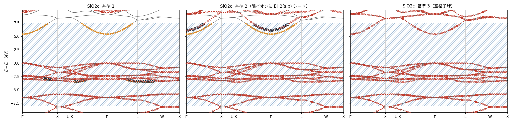

**Fig. M1**. SiO₂ (β-cristobalite). From the left, criterion 1, criterion 2, criterion 3. Gray lines are DFT, red × MLO, the hatched area the window of Eq. (9).
Orange points are DFT points with no MLO band within 0.1 eV (bands missing from the model), black dots are MLO points with no DFT band within 0.1 eV (extra bands). The numbers drawn in Figs. M1–M3 are in the `.npz` of the same name (`mlo/MATERIALS_*.npz`, written by `Samples/MATERIALS/mlocheck/gallery.py` of ecalj).


**Fig. M2**. MgTe (zinc blende). Left criterion 1, right criterion 2. With criterion 1 the bottom of the conduction band floats (black dots) and DFT bands are missing (orange). Symbols as in Fig. M1.


**Fig. M3**. Cu. Left criterion 1, right criterion 2 (with EH2 on Cu). Only 2–3 points of $\mathbf{k}$ in the middle of Γ–X collapse. Symbols as in Fig. M1.

### Record — the old default and models with hand-added functions

**Table M6** (record). Models with the old default (the treatment until 2026-10-01 in Table M1) and models with radial functions added by hand (2026-10-01, LDA, `Samples/MATERIALS`). The `mlo_lm3` lines are now automatic in criterion 1. The gap difference is MLO − DFT (eV),
rms is MLO → DFT / DFT → MLO (eV). The window is [VBM − 8, CBM + 3] for MLO → DFT and [VBM − 8, CBM + 1] eV for DFT → MLO (the evaluation until 2026-10-01 17:54; the present `mlo_bandcheck.py` uses [VBM − 8, CBM + mlo_delta] for both). The table for all materials is `Samples/MATERIALS/MLOcheck_20261001*.tsv` of ecalj

| Material | default: gap difference | default: rms | what was added | after: gap difference | after: rms |
|---|---|---|---|---|---|
| GaN (wz) | +0.334 | 0.164 / 0.175 | `mlo_lm3` Ga 3d | +0.000 | 0.008 / 0.002 |
| InN (wz, metal in LDA) | — | 0.234 / 0.255 | `mlo_lm3` In 4d | — | 0.003 / 0.002 |
| EuO | +0.020 | 0.049 / 0.055 | `mlo_lm3` Eu 5p | −0.000 | 0.004 / 0.001 |
| LaGaO₃ | +0.079 | 0.073 / 0.101 | `mlo_lm3` Ga 3d, La 5p | −0.005 | 0.003 / 0.003 |
| SrVO₃ (metal) | — | 0.060 / 0.074 | `mlo_lm3` Sr 4s, 4p, V 3p | — | 0.003 / 0.001 |
| MgTe | +0.287 | 0.091 / 0.069 | `mlo_lm2` s,p of all atoms | +0.000 | 0.004 / 0.001 |
| AlN (wz) | +0.011 | 0.061 / 0.038 | `mlo_lm2` s,p of all atoms | −0.000 | 0.011 / 0.008 |
| SiO₂ (β-cristobalite) | +4.055 | 0.028 / 0.695 | `mlo_lm2` s,p of all atoms | +0.045 | 0.047 / 0.015 |

### How to reproduce

- Input: `Samples/MATERIALS/<material>/ctrlg.<sname>.toml` of ecalj (Table 1 of the [README](https://github.com/tkotani/ecalj/tree/main/Samples/MATERIALS))
- How to run: `Samples/MATERIALS/mlocheck/`. `prep.py` writes `[mlo]`, and `run_one.sh` runs `lmfa` → `lmf` → `job_band` → `job_mlo` (`run_soc.sh` for SOC)
- Evaluation: `mlo_bandcheck.py <dir> ... --json out.json` (Eqs. (9)–(11))
- Summary page (Tables M4, M5 and the band figures of all materials): `Samples/MATERIALS/mlocheck/gallery.py <output dir>`. The numbers drawn in the figures are written to `page_data/*.npz`

### The standard recipe for GW1500 — models for QSGW80

MLO models are built with the same recipe for all materials of the GW1500 database (QSGW80 bands). Nothing is tuned by hand per material; everything is fixed by the following rules.

**<del class="clfix">Table M7</del><span class="clfix">Table M12</span>**. Rules of the standard recipe

| | What is decided | Rule | Reason |
|---|---|---|---|
| 1 | empty spheres (ES) | if the maximum of the void radius (distance to the surface of the nearest MT sphere) is 3.0 a.u. or more (2.0 a.u. or more for molecular crystals), ES are placed before the calculation. They are placed for whole Wyckoff orbits (without lowering the symmetry), with radius 0.9 times the void (at most 3.5 a.u., and at most the distance within the orbit and half the shortest lattice vector), and only those that do not overlap. Basis s,p for radius 3.0 a.u. or more, s only below. **Slabs (structures with a vacuum layer, from 2026-10-08, rule es-d)**: in addition to ES extending the stacking by one layer outside both surfaces, the vacuum is filled with layers of ES (gaps between layers about 2 a.u. or less). All ES of a slab are s,p | states spread into voids, connected to the vacuum level, cannot be represented by functions on the atoms. With ES of 3.9 a.u. or more there were cases where LDA broke. If ES overlap each other, the overlap matrix of the product basis is no longer positive definite and GW stops. Breaking the symmetry makes GW heavy and the band plots go wrong. The number of orbitals fixes the computing time, so no d is attached. The basis changes, so rerun from LDA |
| 2 | criterion 1 | `[mlo]` of `gwinit` (s,p up to Ne, s,p,d from Na, f for 4f atoms, s,p for ES) | |
| 3 | semicore local orbitals | added to the model if the top of the band is above $E_F-17$ eV, or if a band of the model lies below it. A d in the window (above $E_F-8$ eV) replaces the EH function | `nskip` can drop only bands below every band of the model. Semicore s,p in the window (Cs 5p) are kept because EH (Cs 6p) makes the conduction band |
| 4 | adding basis functions | if criterion 1 does not PASS, also build a version with EH2 s,p added to the cations and a version with it added to all atoms other than transition metals and 4f/5f. If that still does not PASS and the material contains K, Ca, Rb, Sr, Cs, Ba, Cu, Ag or Au, build a third version that adds, besides the EH2 s,p of all atoms, EH2 d to K–Ba and EH2 s,p to Cu, Ag, Au. The version with the better judgement is taken (if equal, the simpler one; among FAILs, the one with the smaller shift) | the conduction band of strongly ionic materials is a state spread outside the cations (and anions), and one set of MTOs is not enough. For K–Ba the empty d appears widely in the conduction band (Cs₂S₂ 0.44 → 0.05 eV). In the noble metals d sinks and the conduction band is s,p (CsCu₃O₂ 0.30 → 0.01 eV). The better one is taken, so materials that break (metallic Cu, etc.) do not get worse |
| 5 | judgement | PASS: largest shift ≤ 0.1 eV in the window $[{\rm VBM}-8, {\rm CBM}+2]$ eV (no jumps or broken bands). OK: PASS up to CBM + 1.5 eV, and ≤ 0.2 eV over the whole window. FAIL: otherwise<span class="clfix">. A FAIL whose largest shift is 0.3 eV or less is shown as FAIR in the database (from 2026-10-07)</span> | strongly dispersive bands enter near the upper end of the window and shift easily |

The values of the GW1500 database were computed with the MT-radius upper limits of that time (no limit for H, 2.8 a.u. for Rb and Cs). From 2026-10-07 `ctrlgenToml.py` limits H to 1.4 and Rb and Cs to 2.4 a.u., so
rerunning with the present ecalj shifts the materials containing H, Rb or Cs (135) slightly (gap differences of 0.014 eV or less in the LDA test; spurious levels like that of Rb₂Sc₂O₄ disappear). Examples of spurious levels (bands without a degenerate partner) and how the limits are chosen: [mtradius.md](./mtradius.md).

The GW k points are planned to have three levels by a spacing rule (low, middle, high corresponding to 4×4×4, 6×6×6, 8×8×8 for Si, `ctrlgenToml.py --gwk`) (the GW1500 rerun of 2026-10-05 used 4×4×4 throughout).

A molecular crystal is a structure in which, following bonds up to 1.2 times the sum of covalent radii, there is no infinitely connected cluster and no isolated atom (`ecalj_auto/gw1500_molecular.py`).

How to run:

1. QSGW80: [`ecalj_auto/gw1500_rerun.sh`](https://github.com/tkotani/ecalj/tree/main/ecalj_auto/gw1500_rerun.sh)
   (POSCAR → `ctrlgenToml.py --ssig=0.8` → ES by `gw1500_addes.py` if `ES_RMIN=auto` → `gwscconv` → `job_band`).
   ES that the rule cannot place are placed by hand: if the `[[site]]` and `[[spec]]` of E* are written in `ctrlg.<mpid>.toml` of `ES_CUSTOM_DIR`, `gw1500_addes.py` uses them.
   Voids are searched with `ctrlg_addes.py <sname> --rmin <a.u.> [--rfloor <a.u.>] [--rsp <a.u.>] --dry-run` (`--rfloor`: lower limit of the radius of the ES placed per orbit, default 1.5 a.u.;
   orbits whose ES would be smaller than this are not placed even if there is a void, and then the number and size of the voids are printed). For slabs (rule es-d), from an input with the ES "E" outside the surfaces and the ES "E2" in the middle of the vacuum
   placed by hand, `ecalj_auto/gw1500_es_slab_layers.py <in> <out> [--r 2.6] [--nlayer 1]` adds the layers "E3" and makes all ES s,p (check the overlaps)
2. MLO: [`ecalj_auto/gw1500_mlo_std.sh`](https://github.com/tkotani/ecalj/tree/main/ecalj_auto/gw1500_mlo_std.sh) `<src> <out> [np]`.
   `<src>` is the `PlotBand/` of step 1 plus the last `efermi.lmf` of QSGW. For each version it runs `gw1500_mlo.sh` (rewrites `[mlo]` with the present `gwinit`,
   `job_mlo`, `mlo_bandcheck.py`, `gw1500_mlo_grade.py`) and writes the chosen version and judgement to `best.txt`. `[ham] scaledsigma = 0.8` of ctrlg makes it a model for QSGW80
3. The model matrices (`HamRsMLO`, `__HamiltonianPMT`) are several hundred MB per material, so they are not put in the database. Rerunning step 2 gives the same thing

### Results and evaluation for GW1500 (2026-10-07)

**QSGW80**: 1545 of the 1546 materials have values (N 1297, E 240, R 7, M 1; the symbols are the "Conditions" on the cover page of the database). The one without a value is
Rb₈ (mp-1179832; atoms placed with spacing in a large cell, too large). When the conditions are right, there is no material for which QSGW80 itself failed.
The failures of the previous round came from the TF32 precision of May, the k points, and overlapping or too large ES.

**ES**: placed for 240 materials by rule 1 of <del class="clfix">Table M7</del><span class="clfix">Table M12</span>. The rule changed twice along the way, so the rule of the time is recorded for each value (Table M9).
For all inputs, the ES do not overlap other spheres (checked on 2026-10-07). The 7 materials where the rule did not work were placed by hand (Table M10).
<del class="clfix">Turning into rules the structures of slabs and vacuum (extending the stacking just outside the surface and also placing ES in the middle of the vacuum) and of molecular crystals (small ES of 2.2–2.5 a.u.) is still to be done.</del><span class="clfix">Building the slab rule es-d (Table M9) into `ctrlg_addes.py`, and a rule for molecular crystals (small ES of 2.2–2.5 a.u.), are still to be done.</span>

*Table M9*. Versions of the ES rule (the version column of `gw1500db.tsv` of the database)

| Version | From | Contents | materials |
|---|---|---|---|
| es-a | 2026-10-05 00:00 | per Wyckoff orbit, 0.9 times the void (at most 4.0 a.u.). Distances measured by folding each fractional coordinate (could overlap in oblique cells) | 63 |
| es-b | 2026-10-06 12:12 | distances measured to the nearest image, also limited by the shortest lattice vector | 4 |
| es-c | 2026-10-06 13:09 | es-b with the upper limit of the radius at 3.5 a.u. | 171 |
| es-d | 2026-10-07 23:50 | slabs: ES outside the surfaces and layers of ES filling the vacuum (gaps about 2 a.u. or less), all s,p. Placed by hand for now (es_custom; the layers by `ecalj_auto/gw1500_es_slab_layers.py`). Putting it into `ctrlg_addes.py` is still to be done | 2 |

*Table M10*. Materials with ES placed by hand (`es_custom/ctrlg.<mpid>.toml`, taken in by `gw1500_addes.py`)

| Material | Placement | Why |
|---|---|---|
| C₃N₄ mp-570572 | `ctrlg_addes.py --rmin 1.8`, three between the layers (2.96, 2.54, 2.30 a.u.) | the rule placed none, and the model could not take the state at Γ at the upper end of the window |
| N₈ mp-154 | 2.5 a.u., s only | with the 3.45 a.u. of the rule no gap appeared in 10 iterations |
| C₄O₄ mp-11875 | 2.5 a.u., s only | with the 3.5 a.u. of the rule the gap swung between 7.7 and 9.6 eV |
| K₄BeP₂ mp-9872 | one of 2.2 a.u. | with the 2.9 a.u. of the rule LDA broke between the large K spheres |
| PbS mp-726184 (slab) | just outside both surfaces (2.6 a.u.) and in the middle of the vacuum (2.9 a.u.) | the middle of the vacuum alone could not take the state at the bottom of the conduction band (which leaks just outside the surface) |
| SnS mp-554134 (slab, rule es-d) | outside both surfaces (1.9 a.u.), two more layers on each side (1.9 a.u., small because the pairs of surface ES are close), two in the middle of the vacuum (2.65 a.u.), 14 in all, all s,p | only outside the surfaces and in the middle (s) gave FAIR 0.24 eV; es-d gives PASS 0.007 eV |
| PbS mp-561320 (slab, rule es-d) | outside both surfaces (2.35 a.u.), one more layer on each side (2.6 a.u.), in the middle of the vacuum (3.0 a.u.), 9 in all, all s,p | only outside the surfaces and in the middle (s), the model could not take one band spread over the empty layer of vacuum (about 4 Å) (0.38 eV). Table M11 |

**MLO**: of 1546 materials, PASS 1539, FAIR 3, OK 2, SKIPPED 2 (2026-10-09). The chosen versions are <del class="clfix">b1 989, b2 420, b2all 107, b2d 28 and one handmade</del><span class="clfix">b1 991, b2 420, b2all 105, b2d 28 and one handmade, 1545 in all (the mlo_variant column of `gw1500db.tsv` of the database QSGW80_20261009; 989 and 107 were earlier counts. The 1545 include the SKIPPED Sr (b2); only Rb₈ has no version)</span> (for solid H₂,
`x_s_only`: only H s, EH2 s and ES s; with the EH2 p of the recipe the MLO overlap matrix became singular). FAIR (largest shift 0.3 eV or less,
a category only for the database display; fine to present) are H₂ 0.11, H₈ 0.15 and BN mp-685145 0.24 eV (placing a small ES of 1.25 a.u. in the 2.56 a.u. void between the sheets made the valence band off by 0.55 eV instead; 2026-10-09). There is no FAIL.
SKIPPED are Rb₈ and Sr (mp-1056418, a 462 ų cell with one atom).

*Table M11*. How ES are put into a slab, and MLO (PbS mp-561320, vacuum 19.4 Å. QSGW80, b1 of the standard MLO recipe. The outlier is one vacuum band at CBM + 1.8 eV, 2026-10-08)

| ES | QSGW80 gap (eV) | largest MLO shift (eV) |
|---|---|---|
| 4 outside the surfaces (2.35 a.u.) and 1 in the middle (3.0 a.u.), s only | 4.152 | 0.377 FAIL |
| same positions, all s,p | 4.151 | 0.330 FAIL |
| layers filling the vacuum added on both sides, 9 in all, s only | 4.150 | 0.033 PASS |
| the same 9, all s,p (chosen version) | 4.149 | 0.006 PASS |

What matters is filling the vacuum with layers of ES; p alone does not fix it. With the layers in place, adding p gains another order of magnitude (the states outside the surface have the shape along the surface normal, p_z).
The gap does not depend on how the ES are put in. SnS mp-554134 of the same type (vacuum 19.5 Å) also goes FAIR 0.24 → PASS 0.007 eV with this rule (2026-10-09).

Most of the models that did not work had problems on the side of the QSGW80 bands they were compared with: states spread into vacuum and voids without ES, and
spurious levels of large MT spheres (Rb₂Sc₂O₄, [mtradius.md](./mtradius.md)). It was not that the basis was insufficient.

**Notes for reading**: rhombohedral graphite-like carbon and the like have a gap on the 8×8×8 mesh but are semimetals whose bands cross on the band path (`path-metal`, 5 materials).
For materials whose band edges are not on the mesh (53), the true gap is close to the gap on the path (`path<mesh(mesh)`). Values whose difference between conditions exceeds 0.2 eV (`CHECK`, 100) are
kept for reference. Most are differences from the May value M. Until 2026-10-07 the DOS column of the figures was shifted by $E_F$ (figures of the version published on 10-03; the gaps and bands are correct).

---

## History (record)

The history leading to this method — that the five `mlo_method`s were in fact one and the same formula,
what the original samples did, the intermediate stage with the floor at $E_F+\Delta$,
the measured grounds for the three design decisions that led to the final form, and the bugs found along the way in the evaluator and
in `m_hreduction.f90` — is collected on a separate page:

**<del class="clfix">`MD/mlo_backup.md`</del><span class="clfix">development note (MD/mlo_backup.md in the repository, not on this site)</span>**

It is not needed for reading the conclusions of this page, but look there when you doubt why the formula is this one.
