# MLO — an automatic modeling method in place of maximal localization and similar methods

> English version of the page [manual/mlo](../../manual/mlo.md). The pages at the top of ecaljdoc are the reference; this one was made from manual/mlo.md of commit 7a24dfdf0 (source blob 3a99ea57d1dd).

ecalj branch `mlo3` / 2026-09-16 17:02 JST

**MLO (MTO-based Localized Orbitals) is a localized basis used in place of maximally localized Wannier functions
(MLWF).**

**Since 2026-10-02, model construction in ecalj is done only with MLO.** The maximally localized Wannier function path (`genMLWFx`, `hmaxloc`, `wanplot`, Wannier magnons,
AHC) has been removed. The model Hamiltonian, v, W and cRPA (`job_mloW`), the spread (`mlo_spread.py`) and magnons (`job_mlo_magnon`) are all computed in the MLO basis.
The version before the removal is in the git tag `last-wannier`. The statements about "Wannier" below are past records kept for comparison (Table M7 in §6, etc.).

MLWF is obtained by nonlinear optimization of a unitary transformation under the condition "minimize the spread".
It is powerful, but a person has to give the initial guess (projection), convergence depends on the initial values,
and for entangled bands the disentanglement window has to be chosen by hand as well.
**Whether it works depends on how the person tunes it**; that is the drawback.

MLO does no optimization. Starting from the resolution of the identity in the PMT basis,
**once you give the $lm$ channels with which to build the model (`mlo_lm`), the weight $\theta$ is
fixed by a single formula** (§1). There is no iteration and no initial guess, the result is unique, and the number of
per-material tuning parameters is zero. Localization is not the result of an optimization; it comes naturally from
using MTOs as the seed.

That `mlo_lm` itself **can in principle be automated**. The rule is a single one, "take only the channels that put
bands in the target window", and which $lm$ of which atom has weight in the window is
a quantity that comes out of the calculation (§1). The default is written by `gwinit` (§1, criteria 1 and 2 in §9); automatic selection by the weight in the window does not exist yet,
but it is of the kind that is **determined by reading it off**, not by tuning.

There are two main ways of use, and **they are measured differently**:

1. **Minimal model** — reproduces **all** of the first-principles bands in the region containing $E_F$.
   Semiconductors, metals and Al₂O₃:Cr (Cr d in the gap + band edges) are all of this kind (§2).
2. **Model taking a subset of bands** — extracts only d, or only 4f. In MLWF terms, this corresponds to
   the use where one targeted bands with the projection (§3).

FeMgO is a slab with a vacuum layer and needs empty spheres. **§5 is a separate section** for it.

**The numbers in §1–§8 are measured values for the 18 samples in `Samples/MLOsamples/`** (§9 is the 65 materials of `Samples/MATERIALS`),
and all samples are unified to the defaults of `mlo_method = 4` (2026-09-16). The numbers and band counts in §2, §3 and §7 are from that time,
before the rule for local orbitals of semicore states of 2026-10-01 (Table M1) (for example GaAs had 18 bands; now Ga 3d is added and it is 23. Table M2 in §4 follows the current rule).
The figures are in `ecalj/Samples/MLOsamples/plots/`
and can be regenerated with `SRC/exec/mlo_bandplot.py <sample dir>` (the figures on this page are copies of them).
The loss numbers come from `SRC/exec/mlo_losscheck.py <sample dir>`.

| | | |
|---|---|---|
| §1 | [**Theory of MLO**](#mlo-final) | Formulas and defaults. If you read anything, this alone is enough |
| §2 | [**Minimal model**](#mlo-minimal) | Take all bands in the window. Measurements and band plots for 11 systems |
| §3 | [**Model taking a subset of bands**](#mlo-partial) | Only d / only 4f. The window-type loss cannot be used |
| §4 | [**SOC**](#mlo-soc) | `job_mlo_soc`. Added afterwards as a perturbation |
| §5 | [**FeMgO**](#mlo-femgo) | Place empty spheres in the vacuum slab |
| §6 | [**Effective interaction $W$**](#mlo-w) | `job_mloW`. The quantity corresponding to the model $U$ |
| §7 | [How to measure the error](#mlo-error) | Not determined from one direction |
| §8 | [Remaining problems](#mlo-problems) | |
| §9 | [**How to choose the model**](#mlo-choice) | Criteria 1, 2, 3 and the current best choice. The 65 materials of `Samples/MATERIALS` |
| Development record (MD/mlo_backup.md in the repository, not on the site) | History and work record (backup) | |

---

## Theory of MLO {#mlo-final}

The PMT basis consists of MTOs and APWs ($F_i$ of Eq. (1) in [Band-structure method of ecalj](../theory/pmt.md)). Symbols in this section:

- $|F^{\mathrm{MTO}}_{\mathbf{k}n}\rangle$: the Bloch sums of the MTOs chosen for the model out of the PMT basis (the channels of `mlo_lm`; $n$ numbers the orbitals).
  The space they span is called the **MTO subspace**
- $|\Psi^{\mathrm{PMT}}_{\mathbf{k}n'}\rangle$: the eigenstates solved in the whole PMT basis (the first-principles bands), with energies $\varepsilon_{n'}$
- $|\Psi^{\mathrm{MTO}}_{\mathbf{k}n''}\rangle$: the eigenstates solved only within the MTO subspace, with energies $\varepsilon^{\mathrm{MTO}}_{n''}$
- $|F^{\mathrm{MLO}}_{\mathbf{k}n}\rangle$: the MLOs to be made, one for each $|F^{\mathrm{MTO}}_{\mathbf{k}n}\rangle$

MLO is built from the resolution of the identity by the PMT eigenstates, $\sum_{n'}|\Psi^{\mathrm{PMT}}_{\mathbf{k}n'}\rangle\langle\Psi^{\mathrm{PMT}}_{\mathbf{k}n'}|=1$,
through the MTO eigenstates $\Psi^{\mathrm{MTO}}$:

$$
|F^{\mathrm{MLO}}_{\mathbf{k}n}\rangle
=\sum_{n'n''}|\Psi^{\mathrm{PMT}}_{\mathbf{k}n'}\rangle\;
A^{\mathbf{k}}_{n'n''}\;
\langle\Psi^{\mathrm{MTO}}_{\mathbf{k}n''}|F^{\mathrm{MTO}}_{\mathbf{k}n}\rangle
\tag{1}
$$

Here let $S$ be the overlap between the PMT eigenstates and the MTO eigenstates:

$$
S^{\mathbf{k}}_{n'n''}=\langle\Psi^{\mathrm{PMT}}_{\mathbf{k}n'}|\Psi^{\mathrm{MTO}}_{\mathbf{k}n''}\rangle
\tag{2}
$$

With $A=S$ the sum in Eq. (1) becomes the projection operator onto the MTO subspace itself,
and we get back $F^{\mathrm{MLO}}=F^{\mathrm{MTO}}$. So we multiply by a weight $\theta$:

$$
A^{\mathbf{k}}_{n'n''}=S^{\mathbf{k}}_{n'n''}\,\theta^{\mathbf{k}}_{n'n''}
\tag{3}
$$

**How to determine this $\theta$ is the whole problem**, and the answer for use 1 (minimal model) is Eq. (4).

$$
\boxed{\;
\begin{aligned}
\theta^{\mathbf{k}}_{n'n''}&=\sigma\Bigl(\frac{\varepsilon_{n'}-e^{\mathrm{cut}}_{n''}}{w}\Bigr),
\qquad \sigma(x)=\frac{1}{1+e^{x}}\\[2pt]
e^{\mathrm{cut}}_{n''}&=\max\bigl(\varepsilon_{\mathrm{CBM}}+\Delta,\;\varepsilon^{\mathrm{MTO}}_{n''}\bigr)
\end{aligned}
\;}
\tag{4}
$$

$\varepsilon_{\mathrm{CBM}}$ is the conduction band minimum of the system ($E_F$ in metals).
There are only two parameters, $\Delta$ and $w$ (**all in eV**), and they need not be tuned per material.

$$
\boxed{\;\Delta = 2.0\ {\rm eV},\qquad w = 2.0\ {\rm eV}\;}
\tag{5}
$$

Their roles are clearly different. **$\Delta$ is a declaration of "how far up you want agreement"**, not
a fitting parameter. It means that a range of $\Delta$ above the band edge is required,
so **set it to the same value as the top of the evaluation window** (both are 2 eV by default).
$w$ is the one that may be changed when the fitting residual is large (§7). Basically, however, it is not tuned.

The conduction band edge of the system does not need to be computed anew;
lmf has already obtained it in the BZ integration of the SCF and written it to `efermi.lmf`
(`evtop` = VBM, `ecbot` = CBM. In metals it becomes the level just above $E_F$, so
**one quantity covers both metals and insulators**).
`m_readqplist` reads it and, to be robust against a shift of the origin, adds it to `eferm` as the difference
$(\varepsilon_{\mathrm{ecbot}}-E_F)$
(because `qplist.dat` sometimes uses `estaticav` as the zero).
If `efermi.lmf` is absent it falls back to $E_F$.

The **per-material tuning parameters have become zero**
(to former users: this is implemented as `mlo_method = 4`, which is the default, so you do not even need to write it.
There is no longer any need to switch `mlo_emax` between 0 / 5 / 7 / auto).

### `mlo_lm` — can in principle be automated

`mlo_lm` is a key written in `[mlo]`; it sets which lm channels form the MTO subspace.
It is written per material. **It is not a tuning knob but the definition of the model itself**, and it is always needed for MLO
regardless of the method. Until 2026-09-17 it was put in `[blocks]`; the old location is still read.

**The default written by `gwinit`** (from 2026-09-25; before that all lines were commented out with `!`. f and `mlo_lm2` from 2026-10-01):

| Atom | Default lm |
|---|---|
| Z ≤ 10 (H..Ne) | `1 2 3 4` (s, p) |
| Z ≥ 11 (Na and beyond) | `1 2 3 4 5 6 7 8 9` (s, p, d) |
| Atoms with 4f in the valence (La–Lu, and Hf and beyond where the f of the basis is 4f) | `1 2 … 16` (s, p, d, f) |

For HfO₂, with only s,p,d the VBM is off by 0.057 eV; adding f makes it 0.000 eV (2026-10-01).

`mlo_lm2` (the EH2 seed, criterion 2 in §9) is written as an s,p line **with `!`** (`! 1 Ga   1 2 3 4`) for cations (atoms other than N, O, F, P, S, Cl, As, Se, Br, Sb, Te, I), excluding the transition metals Sc–Cu, Y–Ag, La–Au and
Ac and beyond. Lines with `!` are not read, so **doing nothing gives criterion 1, and removing the `!` gives criterion 2**.
Zn, Cd and Hg get the line (ZnTe 0.038 → 0.004 eV). After removing the `!`, just rerun `job_mlo` (EH2 is already in the basis).

The d of oxygen is a polarization function, not a valence orbital, so it is excluded from the default.
Putting MLOs there only adds directions that are almost in the null space.

**This default is a model that "takes all the valence electrons"**, matched to uses where **the size of the subspace affects the accuracy**, such as [MLO-gwsc](./mlo_gwsc) (QSGW
that interpolates the self-energy in the MLO representation). It can be used as it is.

**When you want to build a minimal model** (the original use of MLO, reproducing bands with a few orbitals),
this is too wide. **Narrow it down to only the channels that put bands in the target window.**
The actual samples look like this:

| System | `mlo_lm` |
|---|---|
| Si, GaAs | 1–9 for all atoms (sp³d⁵) |
| NiO | Ni **5–9 (d only)**, O **2–4 (p only)** |
| SrTiO₃ | **Sr empty**, Ti 5–9, O 2–4 |
| RuO₂ | Ru 5–9, O 2–4 |
| Al₂O₃:Cr | Al 1–9, Cr 5–9, O 2–4 |

The rule for the minimal model is a single one: **take only the channels that put bands in the target window**. For oxides,
these are O 2p and the transition-metal 3d; the s,p of the cations and the s,d of O are outside the window, so
they are not taken. That is why Sr in SrTiO₃ is empty. In sp semiconductors both the valence band and the
conduction band are carried by sp³d⁵, so everything is taken.

The numbers follow the order of the real harmonics that `job_band` writes to PROCAR, numbered consecutively shell by shell:

| $l$ | lm | Breakdown |
|---|---|---|
| s | 1 | s |
| p | 2, 3, 4 | py, pz, px |
| d | 5, 6, 7, 8, 9 | dxy, dyz, dz², dxz, dx²−y² |
| f | 10 – 16 | f−3 … f3 |

**You can also take only part of a shell.** For example, for only the t2g of Cu use `5 6 8`
(dxy, dyz, dxz), and it actually becomes a 3-orbital model.

::: danger As a rule at most one MLO per (atom, lm) (the exception is criterion 2 in §9: EH2 on the s,p of cations)
Do not add `mlo_lm2` (the second radial function EH2) to an lm already written in `mlo_lm`.
An MLO is a fixed MTO seed **projected onto the band manifold**, so if there is only one band of that character
in the window, giving two seeds **collapses them into the same function by the projection**.
When EH2 was added to the Ni d in NiO, the condition number of the MLO overlap matrix $O^{\rm MLO}$ worsened from
$1.3\times10^2 \to 7.4\times10^4$, and the conduction band moved by 1 eV
(2026-09-24, development record (MD/research_kotani_log.md in the repository, not on the site)).
If you really need two, the only way is to widen the window and bring the second band inside it.

The exception is when **a second band of the same character actually exists** in the window. In structures with large voids (zincblende MgS, MgSe, MgTe, CdTe, ZnTe,
wurtzite AlN), the bottom of the conduction band is an s,p-like state spread into the voids, and adding EH2 as a seed to the s,p of the cation (`mlo_lm2`, criterion 2 in §9) makes it agree.
For SiO₂, EH2 is not enough and empty spheres are needed (criterion 3). Adding it to transition-metal or 4f atoms breaks things: Cu and Ni collapse at particular k, and EuO
stops with `Hreduction: PMT completeness loss too large` (§9). After adding, always compare the bands (`mlo_bandcheck.py`).
:::

::: warning Partial shells do not work with binaries before 2026-09-17
The selection loop in `m_HamPMT.f90` had a bug: if the **first lm of a shell (1 / 2 / 5 / 10) was written,
it took the whole shell, otherwise none of the shell**, ignoring the other numbers
(`lold` was not updated, and $m$ was always stuck at $-l$).
The usual way of writing complete shells from the start is not affected, but partial shells could not be selected,
and a list missing the first one (e.g. `11 12 13 14 15 16`) **silently dropped the whole shell**.
The f specification for Fe/Mg that remained for a long time in the `mlo_lm` of FeMgO was exactly that:
f was in the basis but never once entered the model.
:::

**This decision can in principle be automated.** "Which $lm$ channel of which atom has weight
in the bands in the window" is a quantity that comes out of the calculation; the projection weights
output by `lmf --mkprocar` (the ones used for fat bands) are exactly that. One only has to fix a single
threshold and pick them up. **However, this is not implemented at present.** The default is written by `gwinit` from the atomic number (the table above).

You have to write it by hand only when you **narrow it down further on purpose**:

- Extract only d, or only 4f (§3). Other bands in the window are deliberately discarded
- Add empty spheres to a slab with a vacuum layer (§5). A basis is placed where there are no atoms, so
  it does not come out of the structure

### Input keys

In the **`[mlo]` section** of `ctrlg.<sname>.toml` generated by `gwinit`, the default values are
written out explicitly (until 2026-09-17 they were in `[gw]`. The old location is still
read, but a one-line notice is printed):

```toml
[mlo]
mlo_method = 4      # theta = sigma((eps - ecut_j)/mlo_w),
                    #   ecut_j = max(CBM + mlo_delta, eps^MTO_j)
mlo_delta  = 2.0    # (eV) how far above the band edge (EF in metals) the
                    #   model must be accurate. A statement of what you want,
                    #   not a fitting parameter: match it to your target window.
mlo_w      = 2.0    # (eV) width of the fall-off above that floor. THIS is the
                    #   knob to turn if the residual is too large. Measured
                    #   optima: semiconductors ~2, Fe/Cu-like metals ~11.
```

$\Delta$ is `mlo_delta` and $w$ is `mlo_w`, and **all are in eV**
(`mlo_emax` was in eV from the start, so the `mlo_*` keys are consistent). `mlo_lm`, which fixes the channels of the model, is
in the same `[mlo]` (until 2026-10-02 the Wannier function program `hmaxloc` also read it).

The **k mesh on which MLO is built must always be written in `[mlo] mlo_nkabc`** (2026-09-17, no default):

```toml
mlo_nkabc = [10, 10, 10]   # k mesh the MLO Hamiltonian is built on; required
```

`lmf --writeham --mlo` writes the PMT Hamiltonian at all BZ points of this mesh, and `mlo`
builds the real-space representation from it. Without it, `lmf` stops on the spot (it does not silently
reuse the SCF `[bz] nkabc` — what the model was built on should be written in the input). It affects only the
`--writeham --mlo` path; the SCF and band plots keep `[bz] nkabc`, and $W$ keeps `[gw] n1n2n3`.
`gwinit` writes the same value as `[bz] nkabc`, so usually it can be left as it is.

The number `nskip` of lowest PMT states excluded from the projector (deep semicore LOs (top of the band below $E_F-17$ eV), and low bands not carried by the model such as O 2s)
is determined automatically: at each k, count "the number of lowest states whose weight on the model subspace is less than 1/2",
and use **its minimum over all k** for all k (2026-09-18). If it is decided per k, then, as in the d model of Cu,
the projector switches between the k where the s band is lowest and the k where it is not, and kinks appear in the bands.
The manual setting `mlo_nskip` has been abolished.
With the old per-k scheme, the kinks in the d model of Cu did not go away even when `mlo_nkabc` was raised from 10³ to 16³ (the rms of the d band went 98 → 90 meV) (development record, MD/mlo_notes/mlo_nskip_cu_problem.md in the repository, not on the site).

When an (atom, l) specified in `mlo_lm` has a **semicore local orbital** (`pz`, e.g. `pz = 3.9` for Ga 3d), whether it is used as a seed of the model is also decided automatically
(criterion 1 in §9). It is decided by the highest energy $E^{\rm top}$ of the band of that LO (the occupied states whose projection weight on the subspace spanned together by the LOs **of atoms of the same species** exceeds 1/2):

| $E^{\rm top}-E_F$ | Treatment of the LO | Examples | Message in `lmlo` |
|---|---|---|---|
| Above −8 eV (inside the window; the LO is the valence shell itself) | **Replaces** the EH function | Ni 3d in NiO (+0.7 eV), Zn 3d in ZnO–ZnTe (−2.7 to −6.5 eV) | `IN THE WINDOW: LO replaces the EH function` |
| −17 to −8 eV (semicore below the window) | **Added** to the EH function | Ga 3d in GaN (−11.8), Ga 3d in GaAs (−14.8), Eu 5p in EuO (−13.5), La 5p in La₂CuO₄ (−13.9) | `SHALLOW: LO added to the model` |
| Below −17 eV | Excluded (that state is removed from the projector by `nskip`) | | `deep: LO skipped` |

The −8 eV is aligned with the bottom of the evaluation window (Eq. (9) in §9). If two seeds, LO and EH, are attached to an LO band inside the window, then in a model that takes only that band
(the partial-band model of §3; Ni d + O p in `Samples/MLOsamples/NiO666lda`), the cut of `nskip` passes through the O 2s band and breaks things.
If only the EH is kept for a semicore state below the window (before 2026-10-01), the semicore state that mixes with O or N 2p drops out of the model, and the 2p bands shift by 0.05–0.6 eV (§9).
Extended LOs above the valence shell (`pz > pnu`) are not covered. To include an LO regardless of the rule, write its lm in `mlo_lm3` (in the form `1 Ga   5 6 7 8 9`;
that atom is taken as written, and the EH also stays as in `mlo_lm`).

**Table M1**. Changes in the treatment of shallow local orbitals

| Period | Threshold | Treatment of shallow LO | How the band is identified |
|---|---|---|---|
| 2026-09-18 – 2026-10-01 | $E_F-10$ eV | Replaces EH | Subspace of the LO of one atom |
| 2026-10-01 15:0x – 19:2x | $E_F-17$ eV | Added to EH | Subspace spanned together by the LOs of atoms of the same species |
| 2026-10-01 19:2x – | $E_F-17$ eV and $E_F-8$ eV | Above −8 eV replaced, −17 to −8 eV added | Subspace spanned together by the LOs of atoms of the same species |

**Local orbitals are not written in the input (automatic).** Deciding whether to include them needs the band positions computed in the SCF, which `gwinit` (run before the SCF)
cannot decide. Instead, since you cannot tell from the input whether a local orbital entered the model, check it with the
`local orbital atom ...` lines of `lmlo` (the messages in the table above). For atoms written in `mlo_lm3` no automatic decision is made, and the LO is used as a seed as written.
In the MLO-QSGW chain (where the model is frozen with `HamRsMLO`), the decision at the start of the chain is kept.

Summary of what determines the seeds of the model:

- `mlo_lm`: EH (the first smooth Hankel function). Written by `gwinit` (the table above)
- `mlo_lm2`: EH2 (the second smooth Hankel function). `gwinit` writes the s,p lines of cations with `!`. **Doing nothing gives criterion 1, removing the `!` gives criterion 2** (§9)
- Semicore local orbitals (`pz` in `[[spec]]`): automatic (the rule above). Override with `mlo_lm3`
- Empty spheres: place them in `[[site]]` and `[[spec]]`, and write a line in `mlo_lm` (criterion 3, §5, §9). The basis changes, so rerun from `lmfa`


**Usually this can be used as it is.** All 18 samples in `Samples/MLOsamples` use these defaults
($\Delta=w=2.0$ eV) without per-material changes (§2). All three are defaults, so
you do not need to write them at all.

However, **$w$ leaves room for system-dependent tuning.** It is the one to change when the residual is large;
the measured optimum is $\sim2$ eV for semiconductors and $\sim11$ eV for single-element transition metals such as Fe and Cu,
a factor of 6 apart (§7). For Fe, setting $w$ to 11 eV halves the in-window error,
19.8 → 9.7 meV (§2). **Do not change $\Delta$** — it is a declaration of
"how far up from the band edge you want agreement", not something to fit.

---

## Minimal model — reproducing the region containing $E_F$ {#mlo-minimal}

There are two main ways to use MLO, and **they are measured and evaluated differently**.

| | What is taken | Examples | How it is measured |
|---|---|---|---|
| **Minimal model** (this section) | **All** first-principles bands in the window | Si, GaAs, Fe, NiO, Al₂O₃:Cr, FeMgO … | Window-type loss (§7) |
| **Partial-band model** (§3) | **Only** particular channels | Cu d only, 4f only | Overlap of levels |

This section is about the former. If there are $N$ first-principles bands in the window, the model also has $N$,
and we measure how well the two overlap. **There is no per-material tuning** — `mlo_lm` is needed, but
this is not tuning but the definition of the model; one only takes the channels that have weight in the window (§1).

### Measurements — with the defaults as they are

Measurements with the defaults of `mlo_method = 4` ($\Delta=2.0$ eV, $w=2.0$ eV).
**All 18 samples of MLOsamples are unified to this setting** (2026-09-16).
The only per-material input is `mlo_lm`, and `mlo_emax` has disappeared from every sample.

The table has the following five column headings (definitions in §7):

| Heading | Quantity | Unit | Range |
|---|---|---|---|
| Window | ΔE rms | **meV** | VBM−2 to CBM+2 eV (E_F±2 eV for metals) |
| Occupied | ΔE rms | **meV** | E_F−12 to E_F−2 eV |
| Dispersion | Relative error of the gradient along the path | Dimensionless | Same as the window |
| Gap | Band gap error (signed) | **meV** | Insulators only |
| m\* ratio | m\*(MLO) / m\*(DFT). **1.00 means agreement** (a ratio, not an error) | Dimensionless | Insulators only |

#### List of errors

| System | Window (meV) | Occupied (meV) | Dispersion | Gap (meV) | m\* ratio |
|---|---:|---:|---:|---:|---:|
| FeMgO (76) | **2.5** | **0.5** | **0.006** | — | — |
| Al₂O₃:Cr (50) | 7.2 | 2.2 | 0.004 | +1 | 1.04 |
| FeCo (18) | 8.3 | 4.7 | 0.021 | — | — |
| GaAs (18) | 8.5 | 1.9 | 0.008 | +6 | 0.82 |
| SrTiO₃ (14) | 8.9 | 5.5 | 0.009 | +9 | 1.03 |
| RuO₂ (22) | 9.9 | 9.4 | 0.048 | — | — |
| NiO (16) | 15.4 | 18.5 | 0.071 | +8 | 1.10 |
| C (spd, 18) | 16.6 | 4.8 | 0.013 | −1 | 1.05 |
| Fe (spd, 9) | 19.8 | 12.9 | 0.057 | — | — |
| Si $6^3$ (18) | 20.0 | 9.7 | 0.019 | +38 | 1.41 |
| C.sp (sp only, 8) | 26.7 | 8.0 | 0.021 | −39 | 0.65 |
| **Median** | **9.9** | **5.5** | **0.019** | | |

**The best is FeMgO at 2.5 meV**, a 76-orbital model with empty spheres in the vacuum layer (§5).
The worst are C.sp at 26.7 meV (sp only, 8 orbitals) and Si at $6^3$.
Both go down if $w$ is changed (§7).

- **Si at $6^3$ and $8^3$ are different things** (window 20.0 → 7.1 meV, gap +38 → +3 meV,
  $m^*$ 1.41 → 1.03). The $6^3$ values contain interpolation noise. The sample is kept at $6^3$.
- **The occupied side of NiO, 18.5 meV**, is larger than the in-window 15.4 meV. It is the kind of error
  you would miss if you looked only at the window.

### Representative figures — Si and Fe

Gray lines are the first-principles PMT bands, red × the MLO model. Both are relative to $E_F$.
All 38 figures (18 systems × window/full range + 2 for the $w$ comparison of Fe) are
in `ecalj/Samples/MLOsamples/plots/` and can be regenerated with `SRC/exec/mlo_bandplot.py <sample dir>`.


Si (**QSGW**, 18 MTOs = 2 atoms × sp³d⁵). From the valence band up to the floor (around +3 eV),
the red × lie exactly on the gray lines.

---

The "target window" band is not drawn in the figures. What $\Delta$ determines is
**only the upper floor** of $e^{\rm cut}_{n''}=\max(\varepsilon_{\rm CBM}+\Delta,\ \varepsilon^{\rm MTO}_{n''})$;
the lower limit is only a matter of convenience for the evaluation. Moreover, the second argument
$\varepsilon^{\rm MTO}_{n''}$ differs from orbital to orbital, so **it cannot be drawn as a single horizontal line**.


Fe (DFT, 9 MTOs = sp³d⁵). Majority and minority are shown side by side. **Both spins agree equally well**.
FeCo is similar, and NiO has identical values for both spins; **in the magnetic systems no spin-dependent bias appears.**

---

### $w$ matters — the example of Fe

Fe cannot be fitted fully with the default $w=2.0$ eV. Raising only $w$ to 11 eV gives:

| Fe | Window (meV) | Occupied (meV) | Dispersion |
|---|---:|---:|---:|
| $w=2.0$ (default) | 19.8 meV | 12.9 meV | 0.057 |
| **$w=11$** | **9.7 meV** | **9.0 meV** | **0.024** |

The in-window error drops to less than half. However, **putting the band plots side by side shows no difference** —
the difference is in the meV range and is squashed on the vertical axis of the figure. To see where it matters,
one has to look at the error of each level, sorted by the first-principles energy:

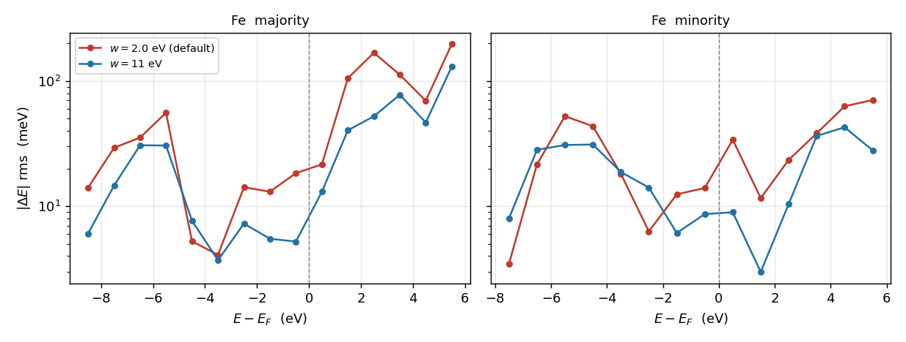

**It matters only above $E_F$.** From $0$ to $+5$ eV it improves by a factor of 2–3, while
below $E_F$ it sometimes wins and sometimes loses; at $-7.5$ eV and $-2.5$ eV in minority,
$w=2.0$ is better. This is natural, since the floor $\varepsilon_{\rm CBM}+\Delta$ lies above $E_F$
and $w$ determines how it falls off above it.
It should be read **not as "raising $w$ makes it better" but as "$w$ determines how well it fits above the floor"**,
and this is also why $\delta E_{\rm occ}$ is given separately (§7).

---

### The high-energy side — the truncation is smooth

The MLO model has only as many bands as the dimension of the MTO subspace, so it departs from the first-principles bands somewhere.
To see whether this departure produces ringing, the plots extend **as far as the MLO bands reach**
(`<system>_full.png`). Measured upper limits:

| System (number of MTOs) | Upper limit of the MLO bands (eV) | Upper limit of first principles (eV) |
|---|---:|---:|
| NiO (16) | 1.6 eV | 141.8 eV |
| RuO₂ (22) | 5.5 eV | 146.9 eV |
| SrTiO₃ (14) | 8.4 eV | 153.6 eV |
| C.sp (sp only, 8) | 16.8 eV | 124.5 eV |
| FeMgO (76) | 29.7 eV | 152.0 eV |
| Si (18) | 28.8 eV | 108.3 eV |
| GaAs (18) | 31.6 eV | 116.5 eV |
| FeCo (18) | 31.8 eV | 142.6 eV |
| Al₂O₃:Cr (50) | 32.0 eV | 141.1 eV |
| Fe (spd, 9) | 32.8 eV | 124.6 eV |
| C (spd, 18) | 86.1 eV | 151.4 eV |

**The number of orbitals and the upper limit are not proportional.** NiO, with 16 orbitals, reaches only 1.6 eV,
while Fe, with 9 orbitals, reaches 32.8 eV. It is determined by which channels are taken
(NiO only Ni d and O p, Fe includes the strongly dispersive sp).
**This does not affect the target window (near $E_F$).**

Even above the floor the MLO bands are continuous curves, with no visible kinks or oscillations. This was also checked numerically
— the median of $|d^2E/dx^2|$ along the bands (eV; in parentheses the same quantity for first principles):

| System / range of $E-E_F$ (eV) | −10..0 | 0..3 | 3..8 | 8..15 | 15..25 | 25..40 |
|---|---|---|---|---|---|---|
| Si | 7.9 (8.1) | 12.5 (9.2) | 15.9 (14.2) | 24.2 (21.8) | 30.3 (45.1) | 20.4 (45.9) |
| Fe | 12.4 (10.2) | 45.8 (20.4) | 37.8 (24.5) | 41.3 (36.3) | 94.2 (54.8) | **216.3 (79.4)** |
| GaAs | 7.6 (6.5) | 15.7 (11.4) | 13.8 (13.4) | 24.4 (20.7) | 46.2 (37.4) | 36.4 (59.5) |
| Al₂O₃:Cr | 207.6 (138.2) | — | 62.8 (42.1) | 367.2 (216.7) | 307.7 (240.6) | 338.5 (586.1) |

For Si, GaAs and Al₂O₃:Cr, **on the high-energy side the curvature of MLO is below that of first principles**
(Si: 20 vs 46). Far from ringing, they are smoother than the original bands.
**Only Fe, above 25 eV, gives 216 vs 79, a factor of 2.7.** This is the region where a model with only 9 spd orbitals
is stretched up to 33 eV, beyond the capacity of the model.

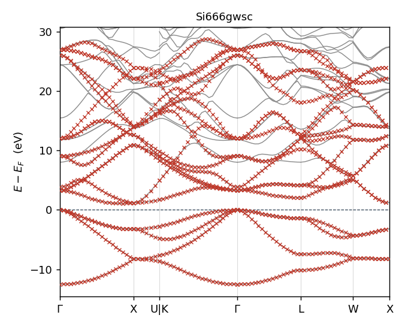

Si (QSGW) — agrees exactly up to the floor (+3 eV), and above it extends smoothly up to 29 eV while departing.

---


Fe — the sp band crossing $E_F$ is followed up to 33 eV at the zone boundary.

---

### About the reference bands

The reference in every system is **the first-principles bands solved in the PMT basis**, not experiment.
Of these, **Si, Al₂O₃:Cr, RuO₂, GdION and GaAsSoc are QSGW** (they have `sigm.<sname>`),
and the rest are DFT. What this page calls "$\Delta E$" is the difference between the MLO model and
these first-principles bands, and the denominator of the $m^*$ ratio is the same.

### Band plots of all samples (gray lines: first-principles PMT, red ×: MLO)

**Use 1 (minimal model) — models near $E_F$**

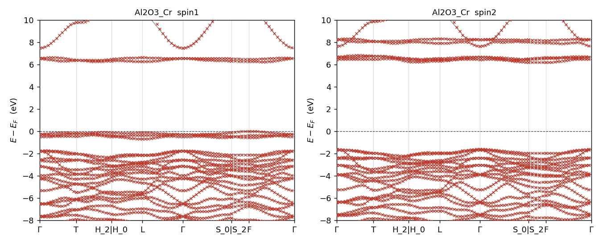

Al₂O₃:Cr (50 orbitals) — **this system is the key point of §1**. The O 2p valence band (−2 to −4 eV),
the Cr d levels in the gap (near $E_F$), the CBM (+6.5 eV) and the bands further above all lie on the reference.
If the floor is put at $E_F+\Delta$, the CBM is not constrained and the gap shrinks by 128 meV.
The hand-set `mlo_emax = 7 eV` was there to catch this CBM,
and $\varepsilon_{\rm CBM}+\Delta$ of method 4 hits it automatically. Window 7.2 meV.

---

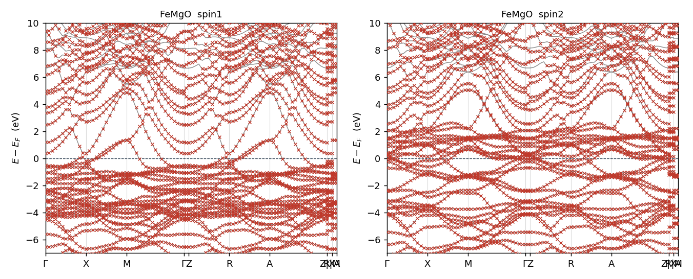

FeMgO (76 orbitals) — **the best in this table, window 2.5 meV**. An Fe/MgO slab with 7 empty spheres
in a 30.5 a.u. vacuum layer. The 78-orbital model without empty spheres gave 126.9 meV,
so with almost the same size it becomes 51 times smaller. Details in §5.

---


GaAs (18 orbitals) — agrees including the strongly dispersive conduction band at Γ. Window 8.5 meV, gap +6 meV.

---

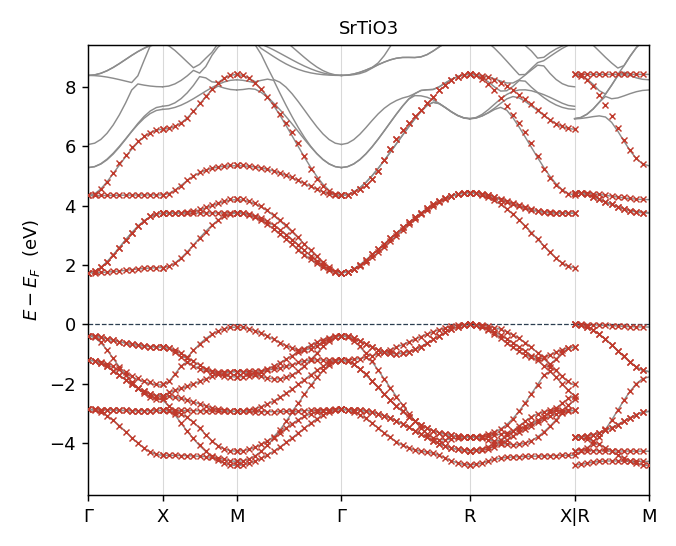


SrTiO₃ (14 orbitals, window 8.9 meV) and RuO₂ (22 orbitals, window 9.9 meV).

---

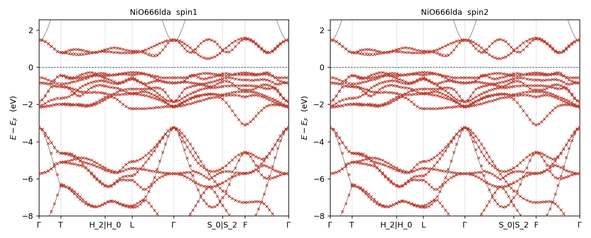

NiO (LDA, 16 orbitals) — a system where sp and localized d coexist. Against the window's 15.4 meV, **the occupied side is 18.5 meV**,
the reverse order; looking only at the window you would miss it.

---


Diamond C — spd with 18 orbitals (window 16.6 meV) and sp only with 8 orbitals (window 26.7 meV).
In the latter, part of the conduction band lies outside the MTO subspace; $m^*$ ratio 0.65, gap −39 meV.

---

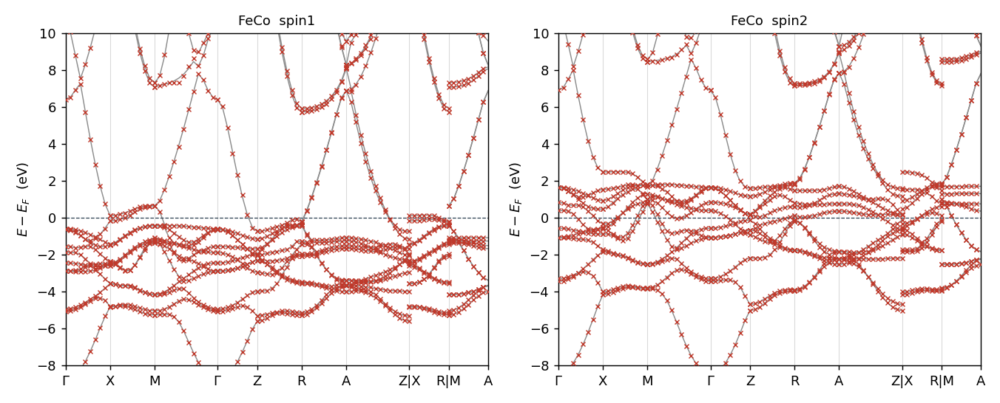

FeCo (18 orbitals, window 8.3 meV) — a magnetic metal; both spins fit well.

---

### MLO fitting overview — all samples

All 25 systems of `Samples/MLOsamples` (gray: first-principles PMT bands, red ×: MLO). Same inputs and same references as
those run by `testecalj`. The figures are regenerated with `SRC/exec/mlo_bandplot.py <sampledir>_work`.
The last 7 systems in the table are Materials Project structures passed as they are through `ctrlgenToml.py`,
run with the s,p,d of all atoms in `mlo_lm` and the defaults ($\Delta = w = 2$ eV)
(2026-09-18, development record (MD/mlo_notes/mp_20260918/ in the repository, not on the site)).

| Semiconductors and insulators | | | |
|---|---|---|---|
| Si (QSGW) | GaAs (DFT) | GaAs+SOC (QSGW) | C (diamond) |
|  |  | 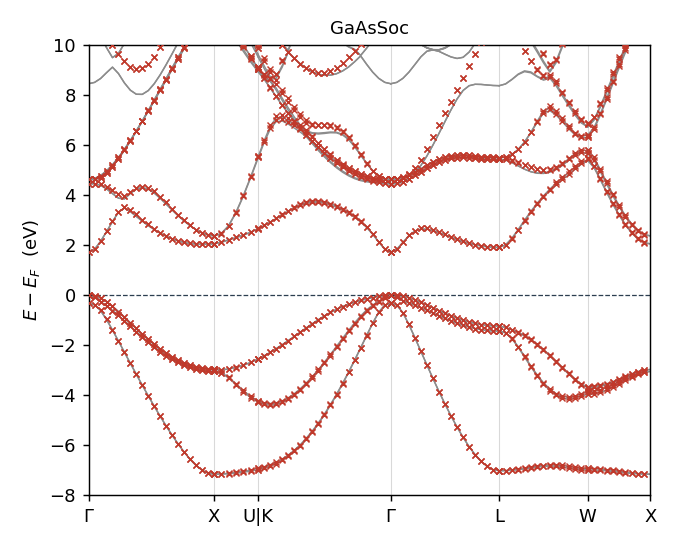 |  |
| C.sp | SrTiO3 | Al2O3:Cr (QSGW80) | NiO (LDA, AFM) |
|  |  |  |  |

| Metals and magnets | | | |
|---|---|---|---|
| Cu (d only) | Fe | Fe+SOC | FeCo |
| 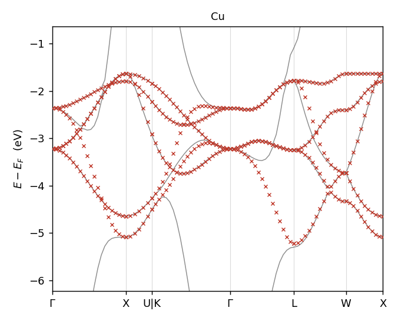 |  | 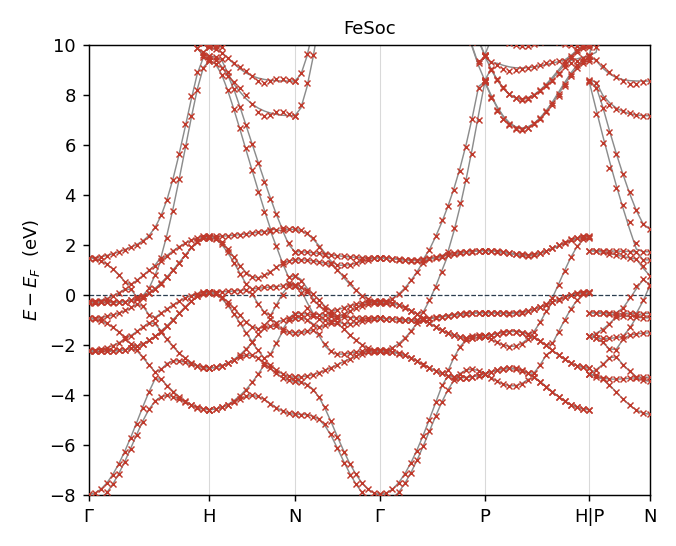 |  |
| RuO2 (QSGW) | GdCo5 (4f) | GdION (4f, QSGW) | SmP (4f, so=2) |
|  | 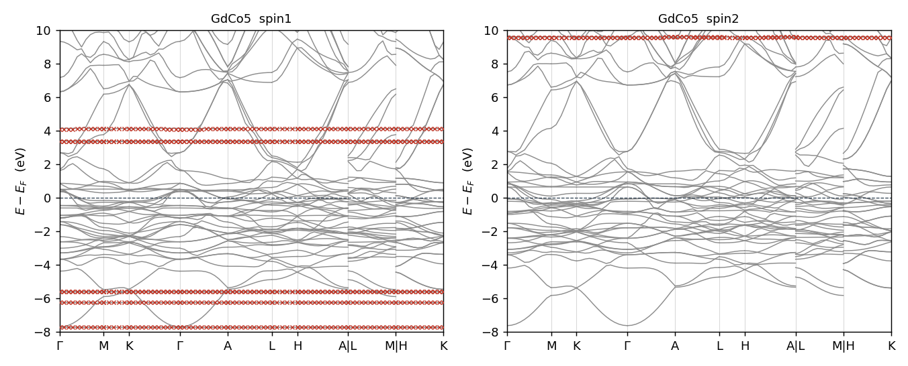 | 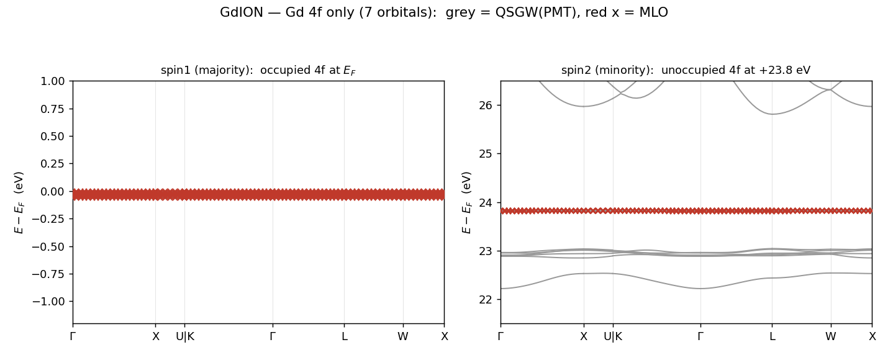 | 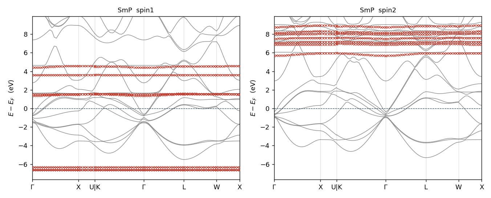 |

| Slab | |
|---|---|
| FeMgO + empty spheres (76 MLOs) | FeMgO+SOC |
|  |  |

| Materials Project, defaults as they are (DFT) | | | |
|---|---|---|---|
| Ag | Al | NaCl | SiC (3C) |
|  |  |  | 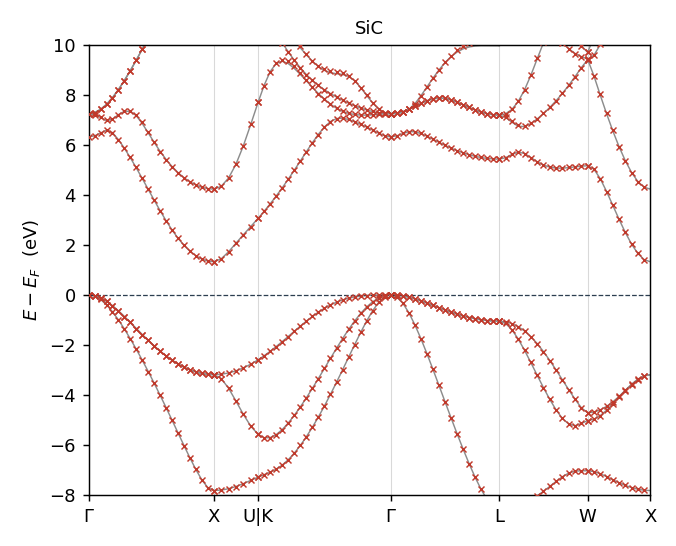 |
| CdTe | ZnO (LO of Zn 3d in the model) | TiO2 (rutile) | |
| 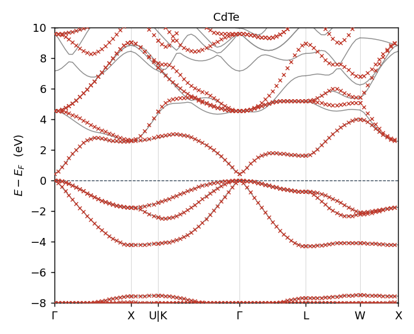 |  |  | |

In-window rms for the 7 MP systems (evaluation of 2026-09-18; [E_F−8, +2] eV for metals and [E_F−8, CBM+3] eV for insulators, which differ from the window of the current `mlo_bandcheck.py` (Eq. (9) in §9)): Ag 15, Al 74 (the free-electron band is
outside the window), NaCl 2.9, SiC 3.3, CdTe 28, ZnO 0.8, TiO2 0.8 meV.

## Model taking a subset of bands — only d / only 4f {#mlo-partial}

This is a model that **takes only some of the bands from the start**: 5 d bands of Cu,
7 4f bands, and so on; most of the first-principles bands in the window are not in the model.
**The window-type loss of §7 cannot be used here** — it would count what is absent as
"not reproduced".

| System | `mlo_lm` | Window-type loss (meV) | Is this a failure? |
|---|---|---:|---|
| Cu | lm 5–9 of Cu (d only) | 147.8 meV | **No**. The model just does not have the sp band |
| SmP | 10–16 of Sm (4f only), P empty | 121.3 meV | **No**. It has no valence band |
| GdION | 10–16 of Gd (4f only) | 0.2 meV | The window contains only 4f, so it can be measured, contrary to the others |
| GdCo5 | only 10–16 of Gd, the 5 Co sites empty | (insufficient data) | Same as above |

(Until 2026-10-01, this place said "the 105.9 meV window of `GaAsSoc` is also an artifact of the same kind — the reference has 2N spinors and the numbers of bands do not match".
In fact it was because it was compared with DFT without SOC. See the warning in §4 and Table M2)

### 4f model — measured by the overlap of levels

A model that extracts only 4f is measured by "whether the 7 bands of the model lie on the first-principles 4f levels".
At each k point, the distance from each MLO level to the nearest first-principles level (meV):

| System | spin | method 0, old (meV) | **method 4** (meV) |
|---|---|---|---|
| GdION | 1 | rms 0.19 / max 0.49 | **rms 0.19 / max 0.49** |
| | 2 | rms 1.76 / max 8.62 | **rms 1.85 / max 9.30** |
| GdCo5 | 1 | rms 10.99 / max 44.79 | **rms 12.46 / max 52.67** |
| | 2 | rms 13.78 / max 106.25 | **rms 14.43 / max 104.21** |
| SmP | 1 | rms 71.57 / max 265 | **rms 76.30 / max 278** |
| | 2 | rms 76.29 / max 273 | **rms 75.04 / max 275** |

**For all three systems method 4 is equivalent to method 0**, and the 4f bands lie on the reference.

However, **$\Delta$ has no effect here.** The 4f levels $\varepsilon^{\rm MTO}_{n''}$ are
far below the floor $\varepsilon_{\rm CBM}+\Delta$, so for $e^{\rm cut}_{n''}$ the floor side is always chosen,
and moreover in GdION the floor is at $E_F+23.9$ eV (the huge gap of the Gd ion) and comes far above the majority 4f ($-0.06$ eV), so for majority $\theta\approx1$, i.e. it falls back to $A\approx S$ (the bare projection). The minority 4f ($+23.8$ eV) is only 0.1 eV below the floor, so $\theta\approx\sigma(-0.05)\approx1/2$, which is not the bare projection.
**A 4f model has no requirement on the band edge at all, so the meaning of $\Delta$, "how far up you want agreement",
disappears** — method 4 does not break, but it has no effect either.

**The rms of 70–76 meV in SmP was there from the start.** The median is 6–13 meV, so most levels agree,
and some (max 275 meV) are off. Sm 4f hybridizes with P 3p, yet `mlo_lm` takes
not a single channel of P; this seems to be the reason. It is not a problem of the method.

**Models that take only a subset of bands** (§3)


Cu — a model of **only the 5 d orbitals**. The model does not have the sp band that runs through $E_F$, so
the window-type loss becomes 147.8 meV, but **the d bands themselves lie on the reference** (see the figure).

**Partly because no effective lower energy limit is applied to the PMT bands, it is somewhat
not smooth.** The $\theta$ of Eq. (4) has only the upper floor $e^{\rm cut}_{n''}$
and no lower limit, so PMT states far below the d band range also enter with weight 1.
Varying $\Delta$ and $w$ in both directions does not make the scatter better than the defaults, and a maximum error of
1.0–1.2 eV remains for every setting. It is also a limit on the side of the model space: at the $\mathbf{k}$ where sp enters the d band range, the first-principles side has
6 bands while the model can have only 5.

---


GdION (single Gd ion, QSGW) — **occupied and unoccupied 4f are drawn in separate windows**.
The 7 majority bands are just below $E_F$ ($-0.06$ eV), and the 7 minority bands are at
**$+23.8$ eV**, nearly $24$ eV apart, so they do not fit on the same vertical axis.
In both, the red × lie right on the gray lines (rms 0.19 / 1.85 meV, the table above).
The gray lines at $+22.2$ to $+23.0$ eV seen below the minority bands are non-4f bands;
the model does not take them, so there are no red ×.

**This huge gap is also the reason why $\Delta$ has no effect in the 4f model.**
The floor $\varepsilon_{\rm CBM}+\Delta$ is placed at $E_F+23.9$ eV, so for the majority 4f $\theta\approx1$ (the bare projection), and for the minority 4f just below the floor $\theta\approx1/2$.

---


GdCo5 takes only Gd 4f with the 5 Co sites empty, and SmP takes only Sm 4f with P empty.
The results measured by the overlap of levels are in the table above.

---

---

## Spin-orbit coupling — `job_mlo_soc` {#mlo-soc}

SOC is **added afterwards as a perturbation, without rebuilding the MLOs**. $V_{\rm SO}$ is projected onto the MLO model
built in the scalar-relativistic approximation and added, and the problem is solved again as $2N\times2N$
spinors. There is no need to redo self-consistency with SOC.

```bash
job_mlo_soc <sname> -np <N>
```

### How the model is built — the MLOs are identical for up and down

The MLOs of a material with SOC are built in the following order (`job_mlo_soc`, checked in the code on 2026-10-01):

1. Up and down are computed with **the same PMT basis** (`nspin = 2` in all stages, `phispinsym = true`: the radial functions are averaged over up and down and made common).
   What is solved is the scalar-relativistic $H$ (stage 2 below, `so = 0`)
2. The MLOs are built with **the same seeds and the same number** for up and down (`Hreduction` of `m_HamPMT` is called for each spin). The number is
   $N_{\rm MLO}$ of Eq. (8) in §9 counted as it is (23 for GaAs, 45 for Bi₂Te₃; `ndimMTO` in `lmlo` is also this number). For nonmagnetic materials (GaAs, Bi₂Te₃)
   the $H$ of up and down are the same, so **the MLOs themselves are also identical**
3. $H_{\rm SO}$ is added to the $H$ of these MLOs, and it is diagonalized in the $2N_{\rm MLO}$ dimensions combining up and down (stage 3, `calc_ham_eigen` in `m_mlo_ham`):
   the diagonal blocks ↑↑ and ↓↓ are the MLO $H$ of each spin plus the ↑↑ and ↓↓ components of $H_{\rm SO}$, and the off-diagonal blocks are the ↑↓ component.
   The overlap matrix is block diagonal in up and down, and it is solved as a generalized eigenvalue problem. The resulting bands are $2N_{\rm MLO}$, all in `band_MLO_spin1.dat`

That is, **the number of model orbitals is counted in the same way as without SOC**; only the dimension of the matrix diagonalized as spinors is doubled.

Note: when $H_{\rm SO}$ is projected onto the MLOs, the MLO coefficients (`zMLO`) of one spin (down, the last spin) are used (`m_HamPMT`).
The construction assumes that the MLOs of up and down are identical; it is exact for nonmagnetic materials and an approximation for the up block in magnets (FeSoc).

### The three-stage procedure

| Stage | Command | What it does |
|---|---|---|
| 1 | `lmf --quit=band --ctrlg:ham.so=1 --efermi=efermi_soc` | Solves the full-LS spinors on the full BZ mesh, determines **the $E_F$ with SOC**, and writes it directly to `efermi_soc` (does not touch `efermi.lmf`) |
| 1b | `lmf --band --ctrlg:ham.so=1 --efermi=efermi_soc` | Under the same conditions, writes **the DFT bands (with spin-orbit)** on the symmetry lines to `bnd*.spin1`. The reference to compare MLO with (from 2026-10-01). The `bnd*` and `band_MLO_spin2.dat` of the previous run are deleted first (`mlo` writes an empty spin2 again in stage 3; plotting and evaluation skip it) |
| 2 | `lmf --writeham --socmatrix --ctrlg:ham.so=0` | Writes the scalar-relativistic $H$ to `__HamiltonianPMT`, and **the SOC matrix to a separate file `__HamiltonianPMTsoc`** |
| 3 | `mlo --socmatrix --efermi=efermi_soc` | After the PMT→MLO reduction, projects the SOC matrix onto the MLOs and diagonalizes the $2N\times2N$ matrix on the symmetry lines. The reference of the window is `efermi_soc` (the value with SOC) |

`--ctrlg:ham.nspin=2 --ctrlg:ham.phispinsym=true` is added to all of them.
`phispinsym` (spin-averaged radial functions) is needed in order to take the radial integral $\langle\varphi_\uparrow|\xi(r)|\varphi_\downarrow\rangle$ of the spin-flip part ($L_\pm S_\mp$) with a single spin-averaged $\varphi$.

~~Note that **stage 1 overwrites `efermi.lmf` with the SOC value**. If you continue non-SOC calculations
in the same directory, save `efermi.lmf` beforehand
(the sample includes the non-SOC version).~~
→ From 2026-09-26 on, `efermi.lmf` is not rewritten (stage 1 writes directly to `efermi_soc`, and stage 3 also reads it).

::: warning Compare the SOC MLO with DFT with spin-orbit
The MLO bands of `job_mlo_soc` include spin-orbit, so the DFT bands they are compared with must also include spin-orbit. Compared with
`job_band` without spin-orbit (`so = 0` in ctrlg), they appear to disagree by the amount the top of the valence band rises, $\Delta_{\rm SO}/3$ (for GaAs the CBM looks 0.10 eV
lower, rms 0.12 eV). For this reason, from 2026-10-01 `job_mlo_soc` draws its own reference in stage 1b. `mlo_bandcheck.py` prints a `WARNING` when one tries to compare
an MLO with spin-orbit against DFT without spin-orbit (`HAM_SO` in `llmf_band`, or `so` in ctrlg if absent).
The reference of the MLO window ($E_F$ and CBM) is taken from the file given by `--efermi=` (`efermi_soc` for SOC, `efermi.lmf` otherwise). Until the night of 2026-10-01,
only $E_F$ was taken from the first line of `qplist.dat` (written by the band calculation run last), and the SOC MLO used the $E_F$ of the non-SOC `job_band` run before
(for GaAsSoc, 0.0082 Ry lower than the SOC $E_F$). The value of `qplist.dat` is now used only for the zero of the figures (the same reference as the DFT `bnd*`).
:::

### Implementation points

- **Symmetrization is done for spinors.** SOC is $\mathbf{L}\cdot\mathbf{S}$, so
  the rotations of the little group and the rotations $\mathbf{k}_{\rm IBZ}\to\mathbf{k}_{\rm BZ}$
  act as the tensor product of the orbital part $R$ and the spin part $D^{1/2}(R)$ (SU(2)),
  $(R\otimes D)\,V_{\rm SO}\,(R\otimes D)^\dagger$
  (`so3_to_su2`, `spinor_rotate` in `m_HamPMT.f90`)
- **Match the bases of the projection.** `cmlo` is in the PMT *eigenstate* basis and `hammhsop` is in the
  PMT *basis function* basis, so convert to the latter with $z_{\rm MLO}=z_{\rm PMT}\,c_{\rm MLO}$
  and then $H^{\rm MLO}_{\rm SO}=z_{\rm MLO}^\dagger\,H_{\rm SO}\,z_{\rm MLO}$
- `--skiphammsoc` is a flag for not adding SOC to $H$ even with `lso=1` (so that the perturbation
  is applied in a later stage)

### Results — comparable to non-SOC

**Table M2**. Errors of the SOC models (eV). With `mlo_bandcheck.py` (Eqs. (9)–(11) in §9, window [VBM − 8, CBM + 2]); the DFT also has spin-orbit (stage 1b)

| System (number of MLOs) | Gap error | rms MLO → DFT / DFT → MLO | Same system without SOC (`job_mlo`) |
|---|---:|---:|---|
| GaAsSoc (23) | +0.010 | 0.010 / 0.010 | GaAs: +0.007, 0.007 / 0.007 |
| FeSoc (9) | metal | 0.017 / 0.017 | Fe: 0.016 / 0.016 |
| FeMgOSoc (76) | metal | 0.003 / 0.003 | FeMgO: 0.001 / 0.001 |

Comparable to non-SOC; **adding SOC does not degrade it**. The three stages also go through without problems for the model with empty spheres (§5).
(Until 2026-10-01 this place gave FeMgOSoc 3.9 and FeSoc 21.9 meV with the window-type loss (`mlo_losscheck.py`). The reference DFT was
without spin-orbit, so these were withdrawn.)


From the top: FeMgOSoc, FeSoc, GaAsSoc. The gray lines are DFT with spin-orbit (stage 1b), the red × are MLO.
The splitting at the top of the valence band of GaAs, $\Delta_{\rm SO}$, is 0.337 eV in DFT and 0.335 eV in MLO.

---

> **Note**: compare the SOC MLO ($2N_{\rm MLO}$ bands) with DFT with spin-orbit (the warning above). Do not compare it with the non-SOC DFT
> left in `bnd*` of the sample (the reference of Test 1 of `GaAsSoc`). The reference of the test is on the side of `band_MLO_spin1.soc.dat`.
> (Until 2026-10-01 this place said "the window-type loss of `GaAsSoc` coming out as 105.9 meV is just because the numbers of bands do not match". In fact it was because it was compared with non-SOC DFT)

---

## FeMgO — placing empty spheres in the vacuum slab {#mlo-femgo}

For a long time this was "the outlier that does not fit however $\theta$ is changed". The cause was
neither $\theta$ nor the method, but **a region where no model was placed**.
The same pitfall exists in any slab with a vacuum layer, so it gets its own section.

### What was happening

First, the structure was misunderstood. It is not an Fe/MgO **interface** but **a slab with a 30.5 a.u.
vacuum layer** (3 Fe layers + 3 MgO layers, $c=47.8$ a.u.). The residual concentrated at $E_F+0.7$ to $1.0$ eV
was not an interface state but a **surface/vacuum state**; there was not a single basis function in the vacuum region, so
**it could in principle not be represented by site-centered MTOs**. However $\theta$ is constructed,
what is absent cannot be created.

### How to place empty spheres

Seven layers of empty spheres ($Z=0$) were placed in the vacuum. **Choose the radius yourself**:

- With $R=1.9$ a.u. they touch neither the surface O ($R=1.75$) nor Fe ($R=2.28$), and
  the overlap reported by `lmchk` is 0%
- Arrange the layers at equal spacing, keeping a margin from the surface
- In-plane, alternate $(0,0)$ and $(\tfrac12,\tfrac12)$ (continuing the stacking of the slab)

```toml
[[site]]
atom = "E"          # empty sphere
xpos = [0.0, 0.0, 0.3]
[[spec]]
atom = "E"
z    = 0
r    = 1.9          # choose it yourself. Check the overlap with lmchk
lmx  = 2            # give s,p,d on the DFT side (see below)
lmxa = 2
```

**`r = 0.0` means a floating orbital without an MT sphere**, so if you want a sphere, specify it explicitly.

### Effect — adding empty spheres gives an order of magnitude

In-window errors for majority / minority (meV):

| Model | Number of MLOs | Window (meV) |
|---|---:|---:|
| No empty spheres | 78 | 126.9 / 73.5 |
| Only s on the ES (d of Mg,O kept) | 85 | 2.2 / 1.1 |
| Only s on the ES + d of Mg,O removed | 55 | 3.1 / — (majority only, table below) |
| **s,p on the ES + d of Mg,O removed (adopted)** | **76** | **2.5 / 1.3** |
| s,p on the ES | 106 | 1.8 / 1.1 |
| s,p,d on the ES | 141 | 1.6 / 0.9 |

**Just adding one s per empty sphere, 7 in total, gives 126.9 → 2.2 meV** (a factor of 58).
The MLOs increase from 78 to 85, only 9%. This is the largest effect.

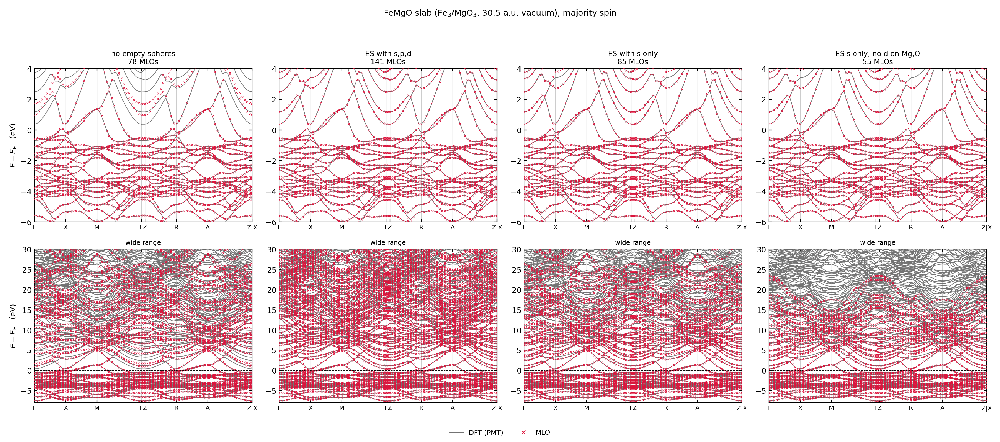

The 4 columns are the models; the upper row is near $E_F$, the lower row a wide range. **Look at the upper left (no empty spheres)** —
$+0.5$ to $4$ eV above $E_F$, **gray lines with no red × on them** remain. These are
surface states leaking into the vacuum side. The valence band ($-6$ to $0$ eV, Fe 3d and O 2p)
agrees even without empty spheres; **what was missing was only the states on the vacuum side**.

The three on the right ($141$ / $85$ / $55$ orbitals) are **almost indistinguishable in the upper row**.
In the wide range of the lower row, only the smallest model leaves $+20$ eV and above empty — the removed d of Mg,O and
the p,d of the empty spheres were carrying that region.

---

### Include up to p on the empty spheres

In the table above s alone seems almost enough, but **looking closely above $E_F$,
p is needed**. The window-type loss (window $E_F\pm2$ eV) simply does not measure there.


Left: only s on the ES (+ d of Mg,O removed) (55 orbitals); right: s,p (76 orbitals). Drawn from $-7$ to $+10$ eV,
**the left leaves gray lines with no red × at $+5$ to $+10$ eV**, while the right fills them.

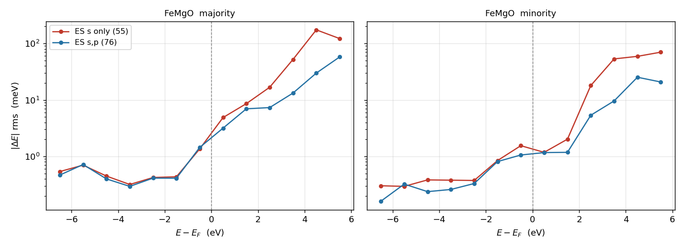

Sorting the per-level errors by the first-principles energy shows where it matters:

| Region | ES s only (+ d of Mg,O removed) (55) | ES s,p (76) |
|---|---|---|
| $-7$ to $-1.5$ eV (valence band) | 0.3–0.7 meV | **same** |
| $E_F$ to $+2$ eV | somewhat worse | slightly better |
| **$+2$ to $+6$ eV** | 20–170 meV | **3–5 times better** |

Also in the overall numbers:

| | Number of orbitals | Window (meV) | Occupied (meV) | Dispersion | Per-level mean (meV) | Max (meV) |
|---|---:|---:|---:|---:|---:|---:|
| ES s only (+ d of Mg,O removed) | 55 | 3.1 | 0.6 | 0.008 | 15.9 / 11.4 | 860 |
| **ES s,p (adopted)** | **76** | **2.5** | **0.5** | **0.006** | **8.3 / 6.0** | **294** |

With the window-type loss it is a modest 3.1 → 2.5 meV, but **per level the mean halves,
and the maximum drops to a third, 860 → 294 meV**. The improvement is outside the window, so it hardly
shows up in the window-type measure. This is what §7 means by "not determined from one direction".

### The adopted model — 76 orbitals

`Samples/MLOsamples/FeMgO` and `FeMgOSoc` are this **76-orbital** model and share the whole set of inputs
(`mlo_lm` has 9 s,p,d orbitals for Fe, 4 s,p for Mg, 3 p for O, and
4 s,p for the empty spheres: 3×9 + 3×4 + 3×3 + 7×4 = 76). The bases of Fe and Mg also contain
f MTOs, but they are not put in the model.

The original model without empty spheres had 78 orbitals, so **with almost the same size the in-window error goes
126.9 → 2.5 meV (a factor of 51)**.


The purpose is the calculation of magnetic fluctuations, and what is needed is the region near $E_F$. For that alone 55 orbitals would
be enough (the table above), but **if you use it up to +10 eV, it is better to include p**.
It costs only 7 sites × 3 = 21 more orbitals.

### Two pitfalls

**(a) Narrow down only `mlo_lm`. Keep `lmx` of `[[spec]]` at 2.**
If $l$ channels are removed from the $Z=0$ sphere on the DFT side, the radial equation diverges and `lmf` crashes:

| E in `[[spec]]` | Result |
|---|---|
| `lmx=2, lmxa=2` | **converges** |
| `lmx=1, lmxa=1` | `lmf` rc=11. The radial solution diverges to $-20$ Ry |
| `lmx=1, lmxa=2` | same as above |
| `lmx=1, lmxa=2` + explicit `p` | same as above. `q` overflows at $e=+20$ Ry |

When it works, the pnu of the empty sphere is 1.509 / 2.256 / 3.150 (s/p/d), and giving these as `p`
does not fix it.
**Give s,p,d on the DFT side and make the MLO selection with `mlo_lm`**; this is the consistent way.

**(b) A vacuum slab needs ESM. Do not forget to write `[esm]`.** Without `[esm]`, `lmf` solves with periodic boundaries and only prints a one-line warning without stopping. The zero of energy shifts ($E_F$ by 4.4 eV for FeMgO). The settings and the conversion from `esm_input.dat` are in [ESM](./esm).

---

## Effective interaction $W$ — `job_mloW` {#mlo-w}

Once the bands are reproduced by the MLO model, what is needed next is **the electron-electron interaction within that model**.
This corresponds to the Hubbard $U$ put on the model Hamiltonian and the interaction used in the calculation of magnetic fluctuations.
It is "the screened interaction projected onto the model space" in cRPA terms, and
`job_mloW` evaluates it in the MLO basis.

### What is computed

For MLO orbitals $i,j,k,l$, lattice vector $\mathbf{R}$ and frequency $\omega$,

$$
V_{ijkl}(\mathbf{R})=\langle ij|v|kl\rangle,
\qquad
W_{ijkl}(\mathbf{R},\omega)=\langle ij|W(\omega)|kl\rangle
\tag{6}
$$

are computed, and **$V$ and $W-V$ are written to separate files**. The on-site diagonal element
$i=j=k=l$, $\mathbf{R}=0$, $\omega=0$ is the quantity corresponding to the model $U$.

```bash
job_mloW <sname> -np <N>
```

It runs in the order lmfa → lmf → `--jobgw=0/1` → `qg4gw` → `heftet` → `hbasfp0` → `mlo` →
`hvccfp0` → `hwmatK_MPI` → `hx0fp0` → `hwmatK_MPI`.
**It is heavier than the MLO band calculation (`job_mlo`)** — because it goes through the whole set of GW components.

### Normalization of MLO — square integral 1 in real space

An MLO is built at each $\mathbf{k}$ as a weighted sum of PMT eigenstates, so as it is its length is not 1.
To read $U$ and $J$ as "values for orbitals of length 1", **the real-space MLO** is normalized.
The square integral of the real-space MLO
$F_{i\mathbf{0}}=N_k^{-1}\sum_{\mathbf{k}}F_i(\mathbf{k})$ built from the MLO Bloch functions $F_i(\mathbf{k})$ on the $\mathbf{k}$ mesh ($N_k$ points) is

$$
N_i=\int|F_{i\mathbf{0}}(\mathbf{r})|^2d\mathbf{r}
=\frac{1}{N_k}\sum_{\mathbf{k}}O_{ii}(\mathbf{k})=O_{ii}(\mathbf{R}=\mathbf{0})
\tag{7a}
$$

which is the $\mathbf{R}=0$ diagonal element of the model overlap matrix of the raw MLOs. `mlo` (`job_mlo`, `lmf --mlo`), which defines the model, first sets
$F_i\to F_i/\sqrt{N_i}$ (**a constant independent of $\mathbf{k}$**), and then orthogonalizes at each $\mathbf{k}$ by Eq. (7b) in the next subsection. The result of Löwdin orthogonalization depends on the scale of the input orbitals
(it picks the orthonormal set closest to the input, so the lengths of the orbitals are equalized first). $N_i$ is written at the end of `HamRsMLO`, and every place that builds MLOs afterwards
(`__cmlo` of `job_mloW`, sugw and `m_sigmlo` of MLO-QSGW) divides by the same constants and then does the same orthogonalization (2026-10-02).

- The $N_i$ of the raw MLOs are much smaller than 1: 0.38 for Ni d, 0.18 for SrVO₃ t₂g, 0.21–0.33 for bcc Fe d, 0.01–0.02 for s and p
  (because the weight falls off above the window). Without normalization, the $U$ of $V$ takes values like 3.4 eV for Ni (24 eV after normalization)
- **Do not divide by $\sqrt{O_{ii}(\mathbf{k})}$ (multiply by $1/\sqrt{O_{ii}(\mathbf{k})}$) for each $\mathbf{k}$** (the former `--mlo_diagnorm`, abolished). Since the factor depends on $\mathbf{k}$, the shape of the real-space orbital changes,
  and the MLO bands at $\mathbf{k}$ off the mesh move (0.74 eV for C, 0.10 eV for Al)
- `hwmatK_MPI` prints the $N_i$ measured on the GW mesh as a check (`square integral of the real-space MLOs on the GW mesh` in `lwmatK1`).
  The mesh of the model (`mlo_nkabc`) and the GW mesh differ, so it deviates slightly from 1. If the GW mesh is coarse, the orbital overlaps with its own images within the periodic box of that mesh and the deviation is large
  (SrVO₃, 1.06 at 2³; Ni, 0.999 at 4³). The deviation enters $U$ squared

### The MLO standard: Löwdin-orthogonalized functions (projected Wannier)

MLOs are not orthogonal at each $\mathbf{k}$. The functions defined at each $\mathbf{k}$ by

$$
|\tilde F(\mathbf{k})\rangle=|F(\mathbf{k})\rangle\,O(\mathbf{k})^{-1/2},\qquad O_{ij}(\mathbf{k})=\langle F_i(\mathbf{k})|F_j(\mathbf{k})\rangle
\tag{7b}
$$

are orthonormal localized functions spanning the same subspace as the MLOs; they are the projected Wannier functions of the MLO subspace. In real space, they have the form in which half of the overlap with each overlapping
neighboring orbital is subtracted from the MLO, $\tilde w_j=\varphi_j-\tfrac12\sum\Delta\,\varphi+\cdots$ ($\Delta$ is the off-diagonal part of the real-space overlap).
Since $O(g\mathbf{k})=D(g)O(\mathbf{k})D(g)^\dagger$, they transform in the same representation as the original MLOs and keep the orbital names (t₂g, e_g, etc.) and the symmetry.

**From 2026-10-02, the MLOs of ecalj are these functions.** The model is held only as $\tilde H(\mathbf{R})$ ($\tilde O(\mathbf{R})=\delta_{\mathbf{R}0}$),
and the bands off the $\mathbf{k}$ mesh are obtained by diagonalizing the Fourier sum of $\tilde H(\mathbf{R})$. The spin-orbit matrix, `__cmlo` ($V$, $W$, cRPA, magnons),
and the $\Sigma$ of MLO-QSGW are all in this basis. The bands on the mesh are the same as before orthogonalization. With `job_mlo <sname> --mlo_raw` (passed to lmf) the earlier
model without orthogonalization (with both $H(\mathbf{R})$ and $O(\mathbf{R})$) can be built. It is an option only for comparison; the subsequent programs choose the same basis by the mark written in `HamRsMLO`.

The orthogonalized functions oscillate on the neighboring atoms for the sake of orthogonality, but are more concentrated at the center (spread $\Omega$: 1.72 → 1.46 bohr² for t₂g of bcc Fe, and for Ni d the sum of the 5 orbitals is 9.88 → 9.42).
The matrix elements of the model are also smaller at long distances (bcc Fe, at $|\mathbf{R}|=5a$: $\max|\tilde H|$ 4.3×10⁻⁴ Ry, against $\max|H|$ 2.9×10⁻³ Ry and $\max|O|$ 2.8×10⁻³).
Interpolation off the mesh is as in Table M8; near $E_F$ the orthogonalized one is better.

*Table M8*. Errors of the bands off the mesh for the raw MLO model $(H,O)$ and the orthogonalized model $\tilde H$ (63 materials, same DFT and same paths as the check of §9, eV).
Near $E_F$ means $[{\rm VBM}-1,{\rm CBM}+1]$ ($E_F\pm1$ for metals)

| | Raw $(H,O)$ | Orthogonalized $\tilde H$ |
| --- | --- | --- |
| Materials passing the check of §9 | 53 | 55 |
| Whole window: median of rms / median of max | 0.0050 / 0.035 | 0.0040 / 0.030 |
| Near $E_F$: median of rms / median of max | 0.0048 / 0.019 | 0.0032 / 0.011 |

- Those that improve greatly near $E_F$: Cu 0.107 → 0.008, Ni 0.054 → 0.010, C 0.078 → 0.031 (gap error −0.038 → −0.013). Those that get worse: 2H-SiC 0.035 → 0.051,
  MnO 0.007 → 0.030. Over the whole window, only the bottom of the 4s band of bcc Fe ($E_F-8$ to $-3$ eV) goes 0.03 → 0.10
- Since the model overlap becomes 1, the smallest eigenvalue of the overlap in the check of §9 (test 3 until 2026-10-02) lost its meaning and was replaced by the band spikes (Eq. (12)). In the output of `mlo` (`lwriteham`),
  `Smallest eigenvalue of the normalized raw overlap` is the value before orthogonalization on the mesh (0.22–0.31 for the 63 materials)

- Orthogonalization gathers the contributions of the overlaps between tails at the center, and the on-site $U$ increases (bcc Fe d, default window, $\omega=0$: 1.564 → 1.704 eV).
  The density-density $W$ between nearest-neighbor sites is 2% of $U$ and does not depend on the basis
- Magnons (which use $W$ including all the screening) become almost independent of the window (`mlo_delta`, `mlo_w`). With raw MLOs they moved a lot with the window, and the scaling factor $\eta$
  for the Goldstone condition also moved with the window, 0.78–1.18. With Löwdin: Fe 1.23–1.24, FeCo 1.26–1.28, Ni 1.75–1.77. The magnons agree with those of earlier calculations using Wannier functions
  within 0.01 eV for FeCo and Ni, and for Fe almost overlap for q ≥ 0.5 (README of `Samples/Magnon/Fe_mlo_magnon`)
- Maximal localization (Marzari–Vanderbilt) can be applied on top, but without constraints s, p and e_g turn into hybrid orbitals shifted toward the bond directions and lose their orbital names.
  With point-group constraints (Sakuma, PRB 87, 235109), the spread of t₂g of Fe shrinks only a further 7% from Löwdin. It is not made the default (prototype in ecalj: `TOOLS/gadget/mlo_maxloc.py --sym`)

### How to read the output

Two files per spin. The unit is **eV**.

| File | Content |
|---|---|
| `Coulomb_v.UP` / `.DN` | $V_{ijkl}(\mathbf{R})$ |
| `Screening_W-v.UP` / `.DN` | $W_{ijkl}(\mathbf{R},\omega)-V_{ijkl}(\mathbf{R})$ |

The columns are exactly in the format of `main_wannier_hwmatK.f90`:

```
 Wannier  ir1 irws1  Rx Ry Rz  is i j k l  [omega omega2]  Re  Im
```

`Coulomb_v` does not have the two $\omega$ columns; `Screening_W-v` does.
**What you want is the real part at $\mathbf{R}=0$, $i=j=k=l$, $\omega=0$**, and
`_parse_diag()` in `Samples/MLOsamples/Fe/test.py` is an example of extracting it.

$$
W_{\rm onsite} = V + (W-V)
\tag{7c}
$$

They are added up as above.

### $V$ and $W-V$ cancel enormously

The d orbitals of Fe (bcc, 9 sp³d⁵ orbitals), majority spin:

| d orbital (lm) | $V$ (eV) | $W-V$ (eV) | $W$ (eV) |
|---|---:|---:|---:|
| 5, 6, 8 ($xy$, $yz$, $xz$) | 22.91 | −21.40 | **1.510** |
| 7, 9 ($3z^2-1$, $x^2-y^2$) | 22.90 | −21.24 | **1.661** |

(2026-10-02, normalization of Eq. (7a); values for the raw MLOs (`--mlo_raw`). The current expected values of `Samples/MLOsamples/Fe/test.py` are in the Löwdin basis: for the majority d, $V$ 24.52 / 24.18 and $W$ 1.66 / 1.79 eV)

**$V\approx23$ eV and $W-V\approx-22$ eV cancel, giving $W\approx1.6$ eV.**
$W$ is only 7% of $V$. Therefore:

- **Do not discuss $V$ or $W-V$ on their own.** A small change in how the model is built
  moves both by 1–2 eV, but 90% of that cancels
- **The relative error of $W$ is amplified to 14 times the relative error of $V$.** If $V$ is off by 1%,
  $W$ is off by 14%

### How much $W$ depends on how the model is built

Average $W$ (eV) of the d orbitals of Fe. This table is from measurements on 2026-09-16, when MLOs were normalized for each $\mathbf{k}$ (the former `--mlo_diagnorm`).
With the normalization of Eq. (7a) the values move by 1–6% (the table above), but the discussion of the size of the differences due to how the model is built still holds:

| Model | $W_{\rm UP}$ (eV) | $W_{\rm DN}$ (eV) |
|---|---:|---:|
| method 0 (old sample) | 1.6684 | 1.5972 |
| method 4, $w=2.0$ (default) | 1.5815 | 1.4248 |
| method 4, $w=11$ | 1.6308 | 1.5546 |

The d component of $V$ moves by $-0.9$ eV for UP and $-1.7$ to $-2.1$ eV for DN from method 0 to 4, but
through the cancellation above **the remaining change of $W$ is $-5.2$% for UP and $-10.8$% for DN**.
The minority d lies above $E_F$, close to the floor $\varepsilon_{\rm CBM}+\Delta$, so
it moves about twice as much as the majority.

Raising $w$ brings $W$ back ($+3.1$% for UP and $+9.1$% for DN at $w=11$).
The band agreement is also better with $w=11$ (§2).

> **Which $W$ is correct is not settled here.**
> What was confirmed is only that "**$W$ depends on how the model is built at the 10% level**".
> The band agreement is better with $w=11$, but that concerns the region above the floor,
> and $W$ was not verified directly. That the method 0 values are close to $w=11$ is
> no reason to regard method 0 as the reference either.
>
> In practice, therefore, **if you use $W$, check its $w$ dependence for your own system.**
> Whether you can use the defaults as they are without worrying about 10% depends on the purpose.
> All 18 samples are unified to the defaults.

### cRPA — `job_mloW --crpa`

$W$ with the screening inside the model removed (constrained RPA). How much band $n$ at each $\mathbf{k}$ lies in the MLO subspace is measured by

$$
p_{\mathbf{k}n}=\big[C\,(C^\dagger C)^{-1}C^\dagger\big]_{nn},\qquad
|F_j(\mathbf{k})\rangle=\sum_n|\psi_{\mathbf{k}n}\rangle C_{nj}
\tag{7d}
$$

(the diagonal elements of the projection onto the MLO subspace; $0\le p_{\mathbf{k}n}\le1$, $\sum_n p_{\mathbf{k}n}$ = number of MLOs), and the transition
$\mathbf{k}n\to\mathbf{k}+\mathbf{q}\,n'$ in $\chi_0$ is multiplied by

$$
1-p_{\mathbf{k}n}\,p_{\mathbf{k}+\mathbf{q}\,n'}
\tag{7e}
$$

(the weight scheme, Şaşıoğlu–Friedrich–Blügel, PRB 83, 121101). Since $p$ is a projection, it does not depend on the MLO normalization (7a).
`job_mloW <sname> --crpa` runs, after v and $W-V$, `hwmatK_MPI --mlo` (10011: Eq. (7d) into `pkm4crpa`) → `hx0fp0` (10011) →
`hwmatK_MPI --mlo` (100), and writes `Screening_W-v_crpa.UP/DN` (same format as `Screening_W-v`). The model subspace is `mlo_lm` itself;
build and use a model of only d (Ni) or only t₂g (SrVO₃, lm = 5 6 8 in `mlo_lm`). The tests are `TestInstall/ni_crpa` and `srvo3_crpa`.

**Table M7**. Comparison of MLO and Wannier functions (maximal localization that was in ecalj until 2026-10-02, `genMLWFx`). On-site averages at $\omega=0$ (eV),
$U=(ii|ii)$, $J=(ij|ji)$. $\Omega$ is the spread of Eq. (7g) (bohr²; in parentheses the Marzari–Vanderbilt form)

| System (GW k mesh) | Method | $\Omega$ | $U$ of $V$ | RPA $U$ | cRPA $U$ | cRPA $J$ |
|---|---|---:|---:|---:|---:|---:|
| SrVO₃ t₂g (4³) | MLO | 7.51 | 15.77 | 0.715 | 3.125 | 0.437 |
| SrVO₃ t₂g (4³) | Wannier | 6.37 (6.13) | 15.99 | 0.730 | 3.149 | 0.444 |
| Ni d (4³) | MLO | t₂g 2.02, e_g 1.90 | 23.80 | 1.405 | 2.838 | 0.645 |
| Ni d (4³) | Wannier | t₂g 1.47, e_g 1.58 (1.44, 1.54) | 26.00 | 1.575 | 3.779 | 0.768 |

- In SrVO₃, where t₂g is isolated, the cRPA $U$ agrees within 1%
- In Ni, where d is entangled with s, the MLO d is wider (by 20–40% in $\Omega$), and less screening is removed in cRPA ($(U_{\rm cRPA}-U_{\rm RPA})/V$ is 0.060 vs 0.085).
  The d subspace of the Wannier functions is built from a wide window ($E_F\pm10$ eV) and also lies on s,p-like bands, so with Eq. (7e) part of the d ↔ s,p transitions are also removed.
  Neither is correct; it is a difference in how the subspace is chosen
- If the GW k mesh is coarse, the normalization of Eq. (7a) deviates from 1 on the GW mesh (SrVO₃, 1.06 at 2³), and $U$ is off by 10%. If you use $U$, use 4³ or more
- The numbers of the comparison and the work location are in the development record (2026-10-02 00:32 in MD/research_kotani_log.md in the repository, not on the site). The Wannier path is in the commit of the git tag `last-wannier`
- The MLO values in Table M7 are for the raw MLOs. In the Löwdin basis (standard, from 2026-10-02), the cRPA $U$ of Ni d (4³) is 2.90 eV (raw 2.84, Wannier 3.78), and
  the RPA $U$ is 1.434 eV. Widening the window moves the cRPA $U$ to 3.13 at (4, 2) and 3.30 eV at (6, 2), but the RPA $U$ moves little, 1.43–1.52 eV.
  cRPA is a quantity that removes "the screening inside the model subspace", so it depends directly on how the subspace is chosen (in systems with entangled bands, also on choices such as the weight scheme versus the projection scheme, or the
  disentanglement window of Wannier). The RPA $W$ including all the screening depends on it only through the shape of the orbitals

### Spread of MLO — `mlo_spread.py`

```bash
mlo_spread.py <sname> -np <N>        # after job_mloW (uses __cmlo, the GW eigenfunctions, HamRsMLO, QBZ.chk)
```

For the vectors $\mathbf{b}$ connecting neighboring points of the GW k mesh (shells added from the nearest until $\sum_b w_b b_\alpha b_\beta=\delta_{\alpha\beta}$),
$M_{ij}(\mathbf{k},\mathbf{b})=\langle u_{i\mathbf{k}}|u_{j\mathbf{k}+\mathbf{b}}\rangle$ is built with `huumat --dwnb=mlo --job=2`, and for each MLO

$$
\langle\mathbf{r}\rangle_i=-\frac{1}{N_k}\sum_{\mathbf{k},\mathbf{b}}w_b\,\mathbf{b}\,{\rm Im}\,M_{ii}(\mathbf{k},\mathbf{b})
\tag{7f}
$$

$$
\langle r^2\rangle_i=\frac{2}{N_k}\sum_{\mathbf{k},\mathbf{b}}w_b\big[O_{ii}(\mathbf{k})-{\rm Re}\,M_{ii}(\mathbf{k},\mathbf{b})\big],
\qquad \Omega_i=\langle r^2\rangle_i-|\langle\mathbf{r}\rangle_i|^2
\tag{7g}
$$

are output in bohr. Eq. (7g) is the sum of $|u(\mathbf{k}+\mathbf{b})-u(\mathbf{k})|^2$ and does not assume length 1 at each $\mathbf{k}$ (the MLOs of Eq. (7a) are not 1 at each $\mathbf{k}$).
The difference from the Marzari–Vanderbilt $\ln M$ form is smaller for smaller $|\mathbf{b}|$; at 4³ it comes out 2–4% larger (the parentheses in Table M7). Both approach the second moment in real space as the mesh is made finer.

### Regression test

`Samples/MLOsamples/Fe` checks these on-site diagonal components of $V$ and $W-V$, 9 components × 2 spins,
**hard-coded in `test.py`, not in a reference file** (tolerance 0.05 eV).
The values move when the way of building the model changes, so update the expected values when you change it.

---

## How to measure the error — not determined from one direction {#mlo-error}

### Definition — keep the raw quantities as a vector

The direction that matters changes with the purpose, so **keep them as a vector instead of squashing them into a scalar**.
No normalization and no squaring. It is better to be able to read directly how far off things are.
The implementation is `SRC/exec/mlo_losscheck.py`.

| Quantity | Meaning | Unit |
|---|---|---|
| $\delta E_{\rm win}$ | $\Delta E$ rms in the window $\mathrm{VBM}-2$ to $\mathrm{CBM}+2$ eV ($E_F\pm2$ eV for metals) | meV |
| $\delta E_{\rm occ}$ | $\Delta E$ rms on the occupied side $E_F-12$ to $E_F-2$ eV | meV |
| $\delta v/v$ | Relative error of the dispersion (gradient along the path) | Dimensionless |
| $\delta E_{\rm gap}$ | Band gap error (signed, insulators only) | meV |
| $m^*$ ratio | $m^*_{\rm MLO}/m^*_{\rm DFT}$ (insulators only) | Dimensionless |

The $m^*$ ratio is **a ratio, not an error**. 1.00 means agreement; 1.18 means the MLO mass is 18% heavier.
$v=\partial\varepsilon/\partial x$ is the gradient with respect to the path coordinate $x$ along the symmetry lines, and
the denominator of $\delta v/v$ is the rms of the first-principles gradient in the window.
Levels are matched by an order-preserving optimal assignment (dynamic programming), which is robust against degeneracies, crossings and differences in the number of bands.

$\delta E_{\rm occ}$ is given separately because **looking only at the window, you miss the degradation of the deep valence band**
(for Si, raising $w$ improves only the region just below $E_F$ ($-2..0$ eV) slightly, while
$-12..-9$ eV worsens from 2.5 to 10.7 meV; see the table "Behavior below $E_F$" below).

### The quantities at the defaults

The measurements at the defaults $\Delta=w=2.0$ eV are as in the table of §2. What stands out is
**the difference between $6^3$ and $8^3$ for Si** ($\delta E_{\rm win}$ 20.0 → 7.1 meV,
$\delta E_{\rm gap}$ +38 → +3 meV, $m^*$ ratio 1.41 → 1.03);
the $6^3$ values contain interpolation noise. **For Si, take $8^3$ as the reference.**

### Optimal $w$ for each direction

With $\Delta$ fixed, $w$ is varied, and **the $w$ (eV) that minimizes each quantity** is given. In parentheses the value there
(ΔE in meV, $\delta v/v$ and the $m^*$ ratio dimensionless):

| System | Window | Occupied | Dispersion | Gap | m\* ratio |
|---|---|---|---|---|---|
| Fe (9) metal | 10.9 (5.2) | 10.9 (4.5) | 10.9 (0.012) | — | — |
| Cu (9) metal | 10.9 (8.5) | 10.9 (2.7) | 10.9 (0.027) | — | — |
| RuO₂ (22) metal | 1.8 (8.1) | 2.7 (9.5) | 1.8 (0.030) | — | — |
| Si $8^3$ (18) insulator | 1.8 (5.7) | 2.7 (2.8) | 2.0 (0.005) | 2.0 (+2) | 2.7 (1.00) |
| GaAs (18) insulator | 1.8 (7.4) | 2.0 (1.5) | 2.0 (0.008) | 1.4 (+1) | 2.0 (1.02) |
| Al₂O₃:Cr (50) insulator | 2.0 (6.7) | 2.0 (2.2) | 2.0 (0.003) | 1.8 (+1) | 1.8 (1.03) |
| C.sp (8) insulator | 2.7 (14.9) | 3.4 (2.7) | 3.4 (0.005) | 3.4 (−4) | 4.1 (0.83) |

**Within a system the quantities agree well** (within $\pm0.7$ eV). They split **across systems**:
10.9 eV for Fe and Cu versus 1.8–2.7 eV for semiconductors, a factor of 6. Optimizing $w$ per system is therefore
well-posed, and no single fixed value can satisfy all systems.

### The limit of large $w$ is penalized by the error itself

$\theta=\sigma((\varepsilon-e^{\rm cut})/w)$ gives $\sigma\to1/2$ as $w\to\infty$,
i.e. $A\propto S$ and $F^{\rm MLO}\to F^{\rm MTO}$, which means
it reaches **the limit of diagonalizing only in the MTO subspace**. That limit is actually bad:

| $w$ (eV) | 10.9 | 27 | 68 | 272 |
|---|---:|---:|---:|---:|
| Fe | **7.8** | 39.8 | 151 | 309 |
| Cu | **7.8** | 44.7 | 148 | 367 |
| Si $8^3$ | 546 | 1230 | 2704 | 2854 |

($\Delta E$ rms in the wide window $E_F-12$ to $+5$ eV, meV)

**The MTO-only limit is off by 309 meV even for Fe.** So there is no need to impose from outside the constraint
"do not go back to MTO"; the error itself provides the bound. The optimum $w=10.9$ eV for Fe and Cu is
not because it is close to the trivial limit, but because it is a finite optimum.

### Below $E_F$ the behavior goes in opposite directions depending on the system

$\Delta E$ rms (meV) binned by the energy of the first-principles bands:

| Fe / $E-E_F$ (eV) | $-9..-6$ | $-6..-4$ | $-4..-2$ | $-2..0$ | $0..+2$ |
|---|---:|---:|---:|---:|---:|
| $w=1.8$ eV | 37.2 | 20.2 | 14.6 | 21.2 | 53.2 |
| $w=10.9$ eV | **6.6** | **4.5** | **4.1** | **3.2** | **9.9** |

| Si $8^3$ / $E-E_F$ (eV) | $-12..-9$ | $-6..-4$ | $-4..-2$ | $-2..0$ | $0..+2$ |
|---|---:|---:|---:|---:|---:|
| $w=1.8$ eV | **2.5** | **3.6** | **4.4** | 5.2 | **4.2** |
| $w=4.1$ eV | 10.7 | 7.2 | 6.8 | **3.3** | 57.8 |

For Fe, raising $w$ **improves all bins**, but Si is the opposite: only the region just below $E_F$ improves slightly, and
**the deep valence band and the conduction band get worse**. Looking only near $E_F$ tempts you to raise $w$, but
looking more widely you lose — this is why $\delta E_{\rm occ}$ is given separately.

### Mesh — do not decide the $m^*$ ratio and the gap on a coarse mesh

$\Delta=2.45$ eV fixed, Si. Each cell is $\delta E_{\rm win}$ (meV) / $\delta E_{\rm gap}$ (meV) / $m^*$ ratio:

| $w$ (eV) | $6^3$ | $8^3$ | $10^3$ |
|---|---|---|---|
| 1.8 | 20.7 / +50 / 1.64 | **5.6 / +3 / 1.05** | **3.7 / −5 / 0.93** |
| 2.0 | 18.3 / +39 / 1.42 | 6.8 / +2 / 1.02 | 5.8 / −3 / 0.95 |
| 2.7 | 19.4 / +25 / 1.18 | 14.8 / +5 / 1.00 | 14.3 / +3 / 0.96 |
| 4.1 | 45.3 / +50 / 1.02 | 44.6 / +40 / 0.96 | 44.4 / +38 / 0.93 |

<del class="clfix">$6^3$ says $w=3.4$ eV is best, but $8^3$/$10^3$ say $2.0$ eV.</del><span class="clfix">$6^3$ says $w=3.4$ eV (0.25 Ry) is best, but $8^3$/$10^3$ say $2.0$ eV (0.15 Ry). This is the best in terms of a single loss $L$ used for a while on 2026-09-13 (the sum of the squares of the window error, velocity, gap and $m^*$ ratio each divided by a reference value; later replaced by the table of individual quantities); $L$ is 17.9 / 13.1 / 30.6 at $w=$ 2.7 / 3.4 / 4.1 eV for $6^3$, and for $8^3$ its minimum 0.4 is at 2.0 eV (MLO_minimal.md of ecalj commit 03854f228). The triplet values of the table above for $w=3.4$ eV are not in the record, so no row is added</span>
**$6^3$ systematically makes a large $w$ look good.**
The sign of the gap error is opposite for $8^3$ and $10^3$ ($+3$ / $-5$ meV at $w=1.8$ eV);
this is the supercell dependence of the truncation of $H(\mathbf{R})$, so **take the range where the two meshes agree**.

### Usage — simple rules

1. **$\Delta$ is a declaration, not a tuning knob.** Write "how many eV above the band edge
   you want agreement". Set it to the same value as the top of the evaluation window. Default **2.0 eV**.
2. **First compute with the default $w=2.0$ eV.**
3. **If the residual is large, change only $w$.** One dimension is enough. The measured optima are
   around 2.0 eV for semiconductors, 11 eV for single-element transition metals such as Fe and Cu, and 1.8 eV for RuO₂.
4. **Judge semiconductors on a mesh of $8^3$ or more.** On $6^3$, interpolation noise affects the $m^*$ ratio and the gap,
   and a large $w$ systematically looks good. Si at $8^3$ is the reference.

> The default of `mlo_w` is **method dependent**: 2.0 eV for `mlo_method = 4`, and
> 2.72 eV (= the conventional value 0.2 Ry) for the old methods 0/1/2/3. This is so as not to change the results
> of existing samples that use the old methods and their reference files; if `mlo_w` is given explicitly,
> that value is used for any method.

$\Delta$ has a much weaker effect than $w$. Varying $\Delta$ from 1 to 4 eV changes the error by
some tens of percent, but for Si $8^3$ just changing $w$ from 1.8 eV to 4.1 eV makes the window error
5.6 → 44.6 meV, a factor of 8. **It is $w$ that you should change.**

The grounds for changing the defaults from $\Delta=2.45$ / $w=2.72$ eV to $2.0$ / $2.0$ eV
(average over all 12 systems, raw errors<span class="clfix">. The 12 systems are the rows of the error table of 2026-09-13: the table of §2 without FeMgO, plus Cu (spd, 9) and Si $8^3$ (Si is counted separately for $6^3$ and $8^3$). It was confirmed that the averages of the new default values in that table are 15.0 meV for the window and 7.4 meV for occupied (MLO_minimal.md of ecalj commit 9d063df33). The table of §2 later added FeMgO and removed Cu and Si $8^3$, so it has 11 rows</span>):

| Default | $\delta E_{\rm win}$ | $\delta E_{\rm occ}$ | \|$\delta E_{\rm gap}$\| |
|---|---:|---:|---:|
| Old $\Delta=2.45$, $w=2.72$ eV | 16.9 meV | 11.6 meV | 16 meV |
| **New $\Delta=w=2.0$ eV** | **15.0 meV** | **7.4 meV** | **13 meV** |

What made the difference were the occupied side of SrTiO₃, 52.9 → 5.5 meV, and the window of Al₂O₃:Cr, 17.5 → 7.2 meV.
What got worse was C.sp (14.9 → 26.7 meV), a system on the side that wants a larger $w$ (the table of optimal $w$ above).

---

## Remaining problems {#mlo-problems}

All of the following were remeasured with `mlo_method = 4` (§1).

### Solved

- **The gap of Al₂O₃:Cr** — with the implementation of the development record (D (c) of §2 in MD/mlo_backup.md in the repository, not on the site), **−128 → +7 meV** ($m^*$ ratio 0.58 → 1.08). (Values at that time. With the defaults in the table of §2, +1 meV and 1.04)
- **The residual of Cu (spd)** — there is nothing real behind it; **two artifacts on the evaluation side overlapped**.
  1. Only **21 of the 92 k points** fall in the window $E_F\pm1.5$ eV. All d bands of Cu lie
     below $-1.5$ eV, and only the steep sp band is in the window.
     The error is concentrated at points with a local slope of 10–14 eV/x, and **restricted to slopes $<5$ eV/x,
     the rms is 0.051 → 0.017 eV**, comparable to other systems. 0.05 eV on a band with a slope of 13 eV/x
     is a shift of only 0.004 in the path coordinate.
  2. The "gap error $-76$ meV" came from **misjudging Cu as an insulator**: the difference 0.1995 eV between the highest occupied
     level $-0.077$ eV and the lowest unoccupied level $+0.122$ eV on the first-principles side exceeded the threshold of 0.15 eV. Cu is a metal.
     Fixed by changing the criterion to "whether the number of occupied bands is constant over $\mathbf{k}$"
     (Cu 5/6, Fe 5–9, RuO₂ 18–21, whereas Si/GaAs/Al₂O₃/NiO are constant).

### Still open

- **With a fixed $w$, semiconductors and metals cannot be satisfied at the same time.** As in §7, the optimal $w$ is
  1.8–2.7 eV for semiconductors and 10.9 eV for Fe and Cu, a factor of 6 apart, and both are finite optima.
  Per-system optimization is well-posed, but **no single fixed value satisfies all systems**.
  The default was lowered to 2.0 eV (formerly 2.72 eV), closer to semiconductors (§7).

- **The $m^*$ of Si at $6^3$ cannot be trusted.** At $6^3$ the gap is +25 meV and $m^*$ 1.18;
  at $8^3$ +5 meV and 1.00 ($w=2.7$ eV in the mesh table of §7). The fluctuation is interpolation noise, not a defect of the model.
  **Do not tune parameters with the $m^*$ at $6^3$** (the mesh item of §7).

### Measures that must not be used (record)

During the study the rms in $E_F\pm1.5$ eV was used, but **it is invalid for wide-gap systems**.
The zero of the band file is taken at the VBM, so $E_F$ comes near the top of the valence band, and
only the valence side is seen. For C.sp, widening $w$ 2.7 → 10.9 eV,
$E_F\pm1.5$ responds sluggishly, 0.0064 → 0.0170, while the gap error runs away, $-18$ → $+822$ meV.
The current way of measuring (§7) does not use this measure.

---

## How to choose the model — criteria 1, 2, 3 {#mlo-choice}

ecalj's `Samples/MATERIALS` is **a set of samples for LDA calculations and MLO calculations**, with inputs for 62 materials (expanded from a structure database) and
La₂CuO₄, an InAs/GaSb superlattice (16 atoms) and BaTiO₃. For these 65 materials, after the self-consistent LDA calculation (LDA+U for the Eu compounds),
MLO models were built and compared with the DFT bands on the symmetry lines (2026-10-01). GaAs_so and Bi₂Te₃, which include spin-orbit, use `job_mlo_soc` (§4).

### The three criteria

**Table M3**. The three criteria for MLO models

| Criterion | MLO seeds | Where to write |
|---|---|---|
| Criterion 1 | The EH of `mlo_lm` (s,p for H–Ne, s,p,d for Na and beyond, plus f for atoms with 4f in the valence), and local orbitals (replacing the EH if the top of the band is above $E_F-8$ eV, added to the EH if it is at $E_F-17$ to $-8$ eV) | Local orbitals are automatic (`m_HamPMT`, §1; the decision is shown in `lmlo`) |
| Criterion 2 | Criterion 1 + EH2 (the second smooth Hankel function) seeds on the s,p of cations. Transition metals and 4f and 5f atoms are excluded from the cations | `mlo_lm2` |
| Criterion 3 | Criterion 1 + s,p seeds on empty spheres ($z=0$) placed in the voids | `[[site]]`, `[[spec]]`, `mlo_lm`. The basis changes, so rerun from `lmfa` (placement in §5) |

The semicore band of criterion 1 is identified as the occupied states whose weight on **the subspace spanned together by the local orbitals of atoms of the same species** exceeds 1/2
(La 5p in La₂CuO₄ is spread half and half over the two La, and is not found when looking at one atom at a time). Semicore states that mix with O or N 2p, such as Ga 3d, In 4d, Eu 5p, La 5p and Sr 4p,
enter the model, and the 2p bands agree.

The EH2 of criterion 2 represents, in structures with large voids (zincblende MgX, CdTe, ZnTe, wurtzite AlN), the bottom of the conduction band spread into the voids.
It is the exception to "at most one MLO per (atom, lm)" in §1 (there is a second band of the same character in the window).

**The number of MLOs** is the number of seeds, a sum over atoms $a$ (an empty sphere counts as one atom):

$$
N_{\rm MLO}=\sum_{a}\Big(N^{\rm EH}_a+N^{\rm EH2}_a+N^{\rm LO}_a\Big),\qquad
N^{\rm EH}_a=\sum_{l\in L_a}(2l+1),\quad
N^{\rm LO}_a=\sum_{l\in L^{\rm LO}_a}(2l+1)
\tag{8}
$$

$L_a$ are the $l$ in the line of atom $a$ in `mlo_lm` ($N^{\rm EH}_a$ is 4 for s,p, 9 for s,p,d, 16 for s,p,d,f; for a partial shell, the number of lm written), $N^{\rm EH2}_a$ is the number of lm in the line of `mlo_lm2`
(4 for s,p; 0 for a line with `!`), and $L^{\rm LO}_a$ are the $l$ of the local orbitals **added** to the EH (the `SHALLOW: LO added` lines of `lmlo`; for atoms written in `mlo_lm3`, the number of those lm).
An $l$ whose local orbital replaces the EH (`IN THE WINDOW`) is counted on the side of $L_a$ (the number does not change).
A spin-polarized system has $N_{\rm MLO}$ per spin. Materials with spin-orbit are counted in the same way (the MLOs are identical for up and down; the procedure of adding $H_{\rm SO}$ and
diagonalizing in $2N_{\rm MLO}$ dimensions is in §4). `Dim of |MLO1>based Hamiltonian HamRsMTO=` in `lmlo`
is the $N_{\rm MLO}$ of Eq. (8). Examples:

- GaAs: criterion 1 is Ga 9 + As 9 + LO of Ga 3d 5 = 23; criterion 2 adds Ga's EH2 4 for 27
- MgTe: criterion 1 is Mg 9 + Te 9 = 18 (the semicore LOs are deep); criterion 2 is 22
- ZnTe: criterion 1 is Zn 9 + Te 9 = 18 (the LO of Zn 3d is at −6.5 eV and replaces the EH); criterion 2 is 22
- NiO (antiferromagnetic, 2 Ni, 2 O): 9×2 + 4×2 = 26 (per spin)
- La₂CuO₄ (2 La, 1 Cu, 4 O): 16×2 + 9 + 4×4 + LO of La 5p 3×2 = 63
- SiO₂ (β-cristobalite, 2 Si, 4 O): 9×2 + 4×4 = 34; criterion 3 adds the s,p of 2 empty spheres for 42
- Bi₂Te₃ (2 Bi, 3 Te, SOC): 9×5 = 45 (MLOs identical for up and down; §4)

### The current best choice

- First build with criterion 1. **If criterion 1 is unsatisfactory, try criterion 2.** In criterion 2, transition metals and 4f and 5f atoms are excluded from the cations that get EH2
  (adding it breaks things: Cu, Ni and EuO in Table M5).
- **If criterion 1 is unsatisfactory and there are geometric voids** (layered materials, SiO₂, etc.), **try adding empty spheres (criterion 3)**.
  Criteria 2 and 3 may also be used together. Whether there are voids can be roughly predicted from the structure, so an automatic decision should be possible (not yet available).
- If anything, `mlo_delta` and `mlo_w` (§1) may also be changed. But fine tuning is pointless.

### How the error is measured — shifts of eigenvalues in the window

The tool is `SRC/exec/mlo_bandcheck.py <dir> ...`. It compares the DFT bands of `job_band` (`bnd*`; for materials with SOC, those with spin-orbit drawn by stage 1b of `job_mlo_soc`, §4) and
the MLO bands (`band_MLO_spin*.dat`)
at the same $\mathbf{k}$ on the symmetry lines (not the whole BZ). The window is

$$
W=[\,E_{\rm VBM}-8\ {\rm eV},\ E_{\rm CBM}+\Delta\,]
\tag{9}
$$

where $\Delta$ is `mlo_delta` (default 2 eV). $\Delta$ is the top of the range in which the model is fitted, so the evaluation uses the same range. For metals
$E_{\rm VBM}=E_{\rm CBM}=E_F$. The shifts of the eigenvalues in the window are measured in two directions:

$$
\delta_{\rm M\to D}=\Big[\frac{1}{N_{\rm M}}\sum_{(\mathbf{k}n):\ \varepsilon^{\rm M}_{\mathbf{k}n}\in W}
\min_{m}\big|\varepsilon^{\rm M}_{\mathbf{k}n}-\varepsilon^{\rm D}_{\mathbf{k}m}\big|^2\Big]^{1/2}
\tag{10}
$$

$N_{\rm M}$ is the number of MLO points in the window. $\delta_{\rm D\to M}$ is Eq. (10) with M and D swapped. $\delta_{\rm M\to D}$ picks up bands absent in DFT (extra bands), and
$\delta_{\rm D\to M}$ picks up bands missing from the model. The error per material (the maximum of the errors) is

$$
\delta=\max\big(\delta_{\rm M\to D},\ \delta_{\rm D\to M},\ |E_g^{\rm M}-E_g^{\rm D}|\big)
\tag{11}
$$

and $\delta\le0.02$ is called good, $\le0.05$ fair, $\le0.1$ marginal, and above that poor (eV). $E_g$ is the gap on the symmetry lines.
A material is treated as an insulator only when, on the SCF k mesh (`efermi.lmf`), $E_F$ is at the top of the valence band with a gap larger than 0.05 eV,
and the gap on the symmetry lines is also larger than 0.05 eV.

Note: bands are matched as "the nearest band at the same $\mathbf{k}$", so where bands are dense a band can be paired with another one and the error can be underestimated.
The maximum shift at a single point is not included in $\delta$ (it is about 10 times the rms; it is looked at in the check below). This is a different tool from the quantities of §7 (`mlo_losscheck.py`, `Samples/MLOsamples`).

### Checking that the model is not broken

The rms dilutes cases where the model breaks only at a few $\mathbf{k}$ (criterion 2 for Cu and Ni, Table M5). So `mlo_bandcheck.py` gives
**FAIL** on any of the following (`job_mlo` and `job_mlo_soc` run it automatically at the end and print `CHECK PASS / FAIL`; it is skipped if there are no DFT bands):

1. **Maximum shift**: the maximum of the per-point shifts in the window (9) (both directions of Eq. (10)) exceeds 0.1 eV (`--fail-max`)
2. **Jump along the line**: the shift of each DFT band (band index in `bnd*`) changes by more than 0.1 eV between neighboring $\mathbf{k}$ on the symmetry line (`--fail-jump`)
3. **Band spikes** (breakdown of linear independence): the second difference, at three neighboring points $\mathbf{k}_-,\mathbf{k},\mathbf{k}_+$ on the symmetry line, of each band $n$ of the model bands

$$
\Delta_n(\mathbf{k})=\Big|\,\varepsilon_n(\mathbf{k})-\tfrac12\big[\varepsilon_n(\mathbf{k}_-)+\varepsilon_n(\mathbf{k}_+)\big]\Big|
\tag{12}
$$

   exceeds 2 eV in the window $[{\rm VBM}-3,\ {\rm CBM}+2]$ eV (`--fail-spike`; the bands are sorted at each $\mathbf{k}$). When the MLOs approach linear dependence, a band jumps only at that
   $\mathbf{k}$ (from 2026-10-02). This can be judged from the model alone, even without DFT bands

Typical values of Eq. (12) (2026-10-02): for healthy models, the maximum over the 63 materials of criterion 1 is 0.56 eV (2H-SiC), and the median is about 0.1 eV (corners at band crossings).
Broken models (the raw MLO model with the EH2 of criterion 2 added to Cu and Ni) give 24 eV and 926 eV.

**Test 3 until 2026-10-02** was that the smallest eigenvalue of the MLO overlap matrix, $\min\,\mathrm{eig}\,O^{\rm MLO}(\mathbf{k})$, is 0 or below on the symmetry lines, or less than 1/100 of its median
(`MLO_ovlpmin.dat` written by `mlo`). Now that the model is the orthogonalized MLO (Eq. (7b) in §6), $O^{\rm MLO}=1$, so it is not used. The values at that time: for the 63 materials of criterion 1,
the minimum was 0.20–0.42 (after normalization in real space); criterion 2 lowered it through the overlap of EH and EH2 (median $3\times10^{-4}$ for Cu); for the broken Cu and Ni it was negative (the Fourier sum of the overlap truncated in real space
is no longer positive definite). Now the value on the mesh before orthogonalization can be seen in the output of `mlo` (`Smallest eigenvalue of the normalized raw overlap`) (0.22–0.31 for the 63 materials of criterion 1).

**Results of the check** (orthogonalized MLO models, 2026-10-02; same DFT as Table M8 in §6): PASS for 55 of the 63 materials of criterion 1. The 8 FAIL materials (AlN, AlSb, InSb, MgS, MgSe, MgTe, Sn, SiO₂)
also FAIL with the same values for the raw model; with criterion 2 (EH2 on the cations) AlN, AlSb, InSb, MgS, MgSe, MgTe and Sn PASS (maximum shift 0.007–0.049 eV), and SiO₂ gives 0.005 eV with criterion 3 (empty spheres).
Criterion 2 for Cu and Ni, which broke with the raw model, PASSes with the orthogonalized model (0.045, 0.055 eV). The overlap is not interpolated, so the breakdown above does not occur. Criterion 2 for EuO stops where the model is built
(the normalization check in `Hreduction`, as before). The tally with the raw model on 2026-10-01 (65 materials: 55 PASS for criterion 1, 59 PASS for criterion 2) is in the development record (2026-10-01 in MD/research_kotani_log.md in the repository, not on the site).

### Results

**Table M4**. Counts of the judgments of Eq. (11) (65 materials)

| Model | Materials | good | fair | marginal | poor |
|---|---:|---:|---:|---:|---:|
| Old default (until 2026-10-01; shallow local orbitals only above $E_F-10$ eV, replacing the EH) | 65 | 44 | 7 | 5 | 9 |
| Criterion 1 | 65 | 53 | 7 | 1 | 4 |
| Criterion 2 (at that time also added to transition-metal and 4f atoms) | 64 | 59 | 2 | 0 | 3 |
| Criterion 3 | 1 (SiO₂) | 1 | 0 | 0 | 0 |
| Best per material | 65 | 63 | 2 | 0 | 0 |

**Table M5**. Materials for which criterion 1 is not good, and materials where changing the criterion caused problems (eV). The gap is that of DFT (the smaller of the k mesh and the symmetry lines),
$\Delta E_g=E_g^{\rm M}-E_g^{\rm D}$, and $\delta$ is Eq. (11)

| Material | Gap | Criterion 1: $\Delta E_g$ | Criterion 1: $\delta$ | Criterion 2: $\Delta E_g$ | Criterion 2: $\delta$ | Criterion 3: $\delta$ | $N_{\rm MLO}$ (criterion 1 / 2 / 3) |
|---|---:|---:|---:|---:|---:|---:|---:|
| MgS | 3.327 | +0.115 | 0.115 | −0.000 | 0.003 | | 18 / 22 |
| MgSe | 2.498 | +0.152 | 0.152 | +0.000 | 0.005 | | 18 / 22 |
| MgTe | 2.304 | +0.287 | 0.287 | +0.002 | 0.006 | | 18 / 22 |
| ZnTe | 1.033 | +0.038 | 0.038 | +0.001 | 0.004 | | 18 / 22 |
| CdTe | 0.516 | +0.037 | 0.037 | +0.000 | 0.003 | | 18 / 22 |
| AlN (wz) | 4.335 | +0.011 | 0.052 | +0.000 | 0.008 | | 26 / 34 |
| 2H-SiC | 2.154 | +0.021 | 0.021 | +0.000 | 0.010 | | 26 / 42 (42 is correct. C is not in the list of anions, so it is treated like a cation, and the EH2 s,p go on all 4 Si and C atoms: 26 + 4×4. The `mlo_lm2` of `Samples/MATERIALS/2hSiC` also has 4 lines) |
| AlSb | 1.148 | +0.009 | 0.020 | +0.002 | 0.008 | | 18 / 22 |
| Sn (metal in LDA) | metal | | 0.024 | | 0.006 | | 18 / 26 |
| C | 4.156 | −0.038 | 0.038 | −0.008 | 0.024 | | 8 / 16 |
| Bi₂Te₃ (SOC) | metal | | 0.026 | | 0.021 | | 45 / 53 |
| SiO₂ (β-cristobalite) | 5.437 | +4.055 | 4.055 | +0.729 | 0.729 | 0.001 | 34 / 42 / 42 |
| Cu | metal | | 0.010 | | **0.794** | | 9 / 13 |
| Ni | metal | | 0.008 | | **0.315** | | 9 / 13 |
| EuO | 1.232 | −0.000 | 0.002 | stopped | | | 23 / — |

- **Those that improve with criterion 2** are s,p compounds with large voids (MgX, ZnTe, CdTe, AlN, 2H-SiC, AlSb, Sn). C goes 0.038 → 0.024 and does not reach good.
  Bi₂Te₃ is fair with both criteria 1 and 2, but there are no missing or extra bands; the shift is just spread thinly over all bands, which is not a problem.
- **SiO₂ needs criterion 3** (Fig. M1). The Si of β-cristobalite form an open diamond network, and the bottom of the conduction band is a state spread into the voids of the network.
  Functions on the atoms (the EH of criterion 1, the EH2 of criterion 2) cannot fully represent it, and the bottom of the conduction band drops out of the model (with criterion 2 the MLO conduction band floats about 0.7 eV up).
  Placing empty spheres of $r=2.6$ a.u. in the 2 voids (½(111) and ¾(111) in units of the cube, void radius 4.3 a.u.) and adding their s,p to the seeds gives 0.001 eV.
- **Cases where changing the criterion caused problems** (Cu, Ni, EuO). These are criterion 2 with EH2 also on transition-metal and 4f atoms:
  for Cu and Ni, only at 2–3 $\mathbf{k}$ points on Γ–X the MLO bands gather at $E_F+0.3$ eV, and the DFT bands at those $\mathbf{k}$ drop out of the model (Fig. M3).
  For EuO, `Hreduction` in `job_mlo` stops with `PMT completeness loss too large`. When both the EH and EH2 of the same atom are used as seeds,
  the PMT eigenvectors drop nearly linearly dependent directions (oveps of `zhev_tk4`), so the norm of the seeds decreases. If the decrease exceeds 1%, it stops
  (NormalizationCheck of `m_hreduction`; below 1% it renormalizes and continues). In all cases, **the cause seems to be a breakdown of the linear independence of the bands
  built from the MLO seeds of the basis** (for EuO, the stop judgment shows it; for Cu and Ni it is not confirmed). This is why transition-metal, 4f and 5f atoms are excluded in criterion 2.


**Fig. M1**. SiO₂ (β-cristobalite). From the left, criterion 1, criterion 2, criterion 3. Gray lines are DFT, red × MLO, and the hatched area is the window of Eq. (9).
Orange points are DFT points with no MLO band within 0.1 eV (bands missing from the model), and black circles are MLO points with no DFT band within 0.1 eV (extra bands). The numbers drawn in Figs. M1–M3 are in the `.npz` files of the same names (`mlo/MATERIALS_*.npz`, written by `Samples/MATERIALS/mlocheck/gallery.py` of ecalj).

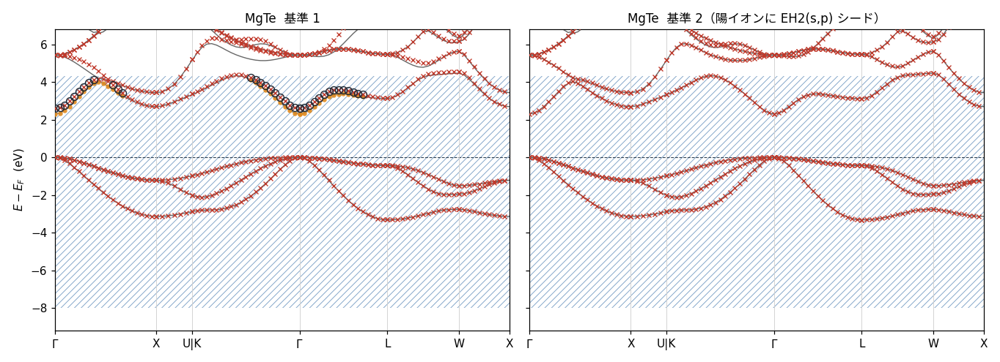

**Fig. M2**. MgTe (zincblende). Left criterion 1, right criterion 2. With criterion 1 the bottom of the conduction band floats up (black circles) and DFT bands drop out (orange). Symbols as in Fig. M1.

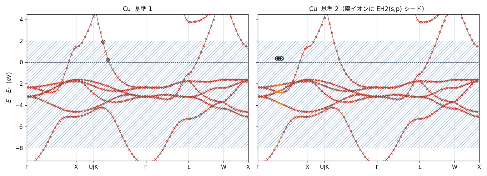

**Fig. M3**. Cu. Left criterion 1, right criterion 2 (EH2 added to Cu). Only 2–3 $\mathbf{k}$ points midway on Γ–X break down. Symbols as in Fig. M1.

### Record — the old default and models with functions added by hand

**Table M6** (record). Models with the old default (the treatment until 2026-10-01 in Table M1), and models with radial functions added by hand (2026-10-01, LDA, `Samples/MATERIALS`). The `mlo_lm3` rows have become automatic with the current criterion 1. The gap difference is MLO − DFT (eV),
rms is MLO → DFT / DFT → MLO (eV). The windows are [VBM − 8, CBM + 3] for MLO → DFT and [VBM − 8, CBM + 1] eV for DFT → MLO (the evaluation until 2026-10-01 17:54; the current `mlo_bandcheck.py` uses [VBM − 8, CBM + mlo_delta] for both). The table for all materials is ecalj's `Samples/MATERIALS/MLOcheck_20261001*.tsv`

| Material | Default: gap difference | Default: rms | What was added | After adding: gap difference | After adding: rms |
|---|---|---|---|---|---|
| GaN (wz) | +0.334 | 0.164 / 0.175 | `mlo_lm3` Ga 3d | +0.000 | 0.008 / 0.002 |
| InN (wz, metal in LDA) | — | 0.234 / 0.255 | `mlo_lm3` In 4d | — | 0.003 / 0.002 |
| EuO | +0.020 | 0.049 / 0.055 | `mlo_lm3` Eu 5p | −0.000 | 0.004 / 0.001 |
| LaGaO₃ | +0.079 | 0.073 / 0.101 | `mlo_lm3` Ga 3d, La 5p | −0.005 | 0.003 / 0.003 |
| SrVO₃ (metal) | — | 0.060 / 0.074 | `mlo_lm3` Sr 4s, 4p, V 3p | — | 0.003 / 0.001 |
| MgTe | +0.287 | 0.091 / 0.069 | `mlo_lm2` s,p of all atoms | +0.000 | 0.004 / 0.001 |
| AlN (wz) | +0.011 | 0.061 / 0.038 | `mlo_lm2` s,p of all atoms | −0.000 | 0.011 / 0.008 |
| SiO₂ (β-cristobalite) | +4.055 | 0.028 / 0.695 | `mlo_lm2` s,p of all atoms | +0.045 | 0.047 / 0.015 |

### How to reproduce

- Input: ecalj's `Samples/MATERIALS/<material>/ctrlg.<sname>.toml` (Table 1 of the [README](https://github.com/tkotani/ecalj/tree/main/Samples/MATERIALS))
- How to run: `Samples/MATERIALS/mlocheck/`. `prep.py` writes `[mlo]`, and `run_one.sh` runs `lmfa` → `lmf` → `job_band` → `job_mlo` (`run_soc.sh` for SOC)
- Evaluation: `mlo_bandcheck.py <dir> ... --json out.json` (Eqs. (9)–(11))
- Overview page (Tables M4 and M5 and band figures for all materials): `Samples/MATERIALS/mlocheck/gallery.py <output dir>`. The numbers drawn in the figures are written to `page_data/*.npz`

### The standard recipe for GW1500 — QSGW80 models

For all materials of the GW1500 database (QSGW80 bands), MLO models are built with the same recipe. Nothing is tuned by hand per material; they are determined only by the following rules.

**Table M12**. Rules of the standard recipe

| | What is decided | Rule | Reason |
|---|---|---|---|
| 1 | Empty spheres (ES) | If the maximum of the interstitial radius (the distance to the surface of the nearest MT sphere) is 3.0 a.u. or more, or 2.0 a.u. or more for molecular crystals, place ES before the calculation. Place them for whole Wyckoff orbits (do not lower the symmetry), with radius 0.9 times the interstice (upper limit 3.5 a.u., and up to half the distance within the orbit and half the shortest lattice vector), only those that do not overlap. Basis: s,p for radius 3.0 a.u. or more, only s below that. **Slabs (structures with a vacuum layer; from 2026-10-08, rule es-d)**: in addition to ES extending the stacking by one layer outside both surfaces, fill the vacuum with layers of ES (gap between layers about 2 a.u. or less). All ES of a slab are s,p | States spread into the interstices, connecting to the vacuum level, cannot be represented by functions on the atoms. There are examples where LDA broke with ES of 3.9 a.u. or more. If ES overlap each other, the overlap matrix of the product basis is no longer positive definite and GW stops. Breaking the symmetry makes GW heavier and also spoils the band figures. The number of orbitals determines the computing time, so no d is attached. The basis changes, so rerun from LDA |
| 2 | Criterion 1 | `[mlo]` of `gwinit` (s,p up to Ne, s,p,d from Na, f for 4f atoms, s,p for ES) | |
| 3 | Semicore local orbitals | Add to the model if the top of the band is above $E_F-17$ eV, or if there is a model band below it. A d inside the window (above $E_F-8$ eV) replaces the EH function | `nskip` can drop only bands below all bands of the model. An s,p semicore state inside the window (Cs 5p) is kept, because the EH (Cs 6p) forms the conduction band |
| 4 | Adding basis functions | If criterion 1 does not PASS, also build a version with EH2 s,p added to the cations, and a version with them added to all atoms other than transition-metal, 4f and 5f atoms. If it still does not PASS and the material contains K, Ca, Rb, Sr, Cs, Ba, Cu, Ag or Au, build a third version: in addition to the EH2 s,p of all atoms, add EH2 d to K–Ba and EH2 s,p to Cu, Ag and Au. Take the version with the better judgment (if equal, the simpler one; if all FAIL, the one with the smaller shift) | In strongly ionic materials the conduction band is a state spread outside the cations (and anions), and one set of MTOs is not enough. For K–Ba, the empty d appears widely in the conduction band (Cs₂S₂ 0.44 → 0.05 eV). For the noble metals, d sinks and the conduction band is s,p (CsCu₃O₂ 0.30 → 0.01 eV). Since the better one is taken, materials that break (such as metallic Cu) do not get worse |
| 5 | Judgment | PASS: maximum shift ≤ 0.1 eV in the window $[{\rm VBM}-8, {\rm CBM}+2]$ eV (no jumps or broken bands). OK: PASS up to CBM + 1.5 eV, and ≤ 0.2 eV over the whole window. FAIL: otherwise. Among FAIL, those with a maximum shift of 0.3 eV or less are shown as FAIR in the database (from 2026-10-07) | At the top of the window, strongly dispersive bands come in and shifts occur easily |

The values in the GW1500 database were computed with the upper limits of the MT radii at that time (no limit for H, 2.8 a.u. for Rb and Cs). From 2026-10-07 `ctrlgenToml.py` limits H to 1.4 and Rb and Cs to 2.4 a.u., so
rerunning with the current ecalj shifts materials containing H, Rb or Cs (135) slightly (gap differences of 0.014 eV or less in the LDA tests; spurious levels such as in Rb₂Sc₂O₄ disappear). Examples of spurious levels (bands without a degeneracy partner) and how the upper limits are chosen are in [mtradius.md](./mtradius.md).

The GW k points are planned to come in 3 levels by a spacing rule (low, middle, high corresponding to 4×4×4, 6×6×6, 8×8×8 for Si; `ctrlgenToml.py --gwk`) (the GW1500 rerun of 2026-10-05 used 4×4×4 throughout).

A molecular crystal is a structure in which, following bonds at 1.2 times the sum of covalent radii, there is no infinitely connected cluster and no isolated atom (`ecalj_auto/gw1500_molecular.py`).

How to run:

1. QSGW80: [`ecalj_auto/gw1500_rerun.sh`](https://github.com/tkotani/ecalj/tree/main/ecalj_auto/gw1500_rerun.sh)
   (POSCAR → `ctrlgenToml.py --ssig=0.8` → ES by `gw1500_addes.py` if `ES_RMIN=auto` → `gwscconv` → `job_band`).
   ES that cannot be placed by the rule are placed by hand: if the `[[site]]` and `[[spec]]` of E* are written in `ctrlg.<mpid>.toml` in `ES_CUSTOM_DIR`, `gw1500_addes.py` uses them.
   Voids are searched with `ctrlg_addes.py <sname> --rmin <a.u.> [--rfloor <a.u.>] [--rsp <a.u.>] --dry-run` (`--rfloor`: lower limit of the radius of the ES placed per orbit, default 1.5 a.u.
   Even if there is a void, an orbit whose ES would be smaller than this is not filled; in that case the number and size of the voids are printed). For slabs (rule es-d), from an input with the ES "E" outside the surfaces and the ES "E2" in the middle of the vacuum
   placed by hand, `ecalj_auto/gw1500_es_slab_layers.py <in> <out> [--r 2.6] [--nlayer 1]` adds the layers "E3" and makes all ES s,p (check the overlaps)
2. MLO: [`ecalj_auto/gw1500_mlo_std.sh`](https://github.com/tkotani/ecalj/tree/main/ecalj_auto/gw1500_mlo_std.sh) `<src> <out> [np]`.
   `<src>` is the `PlotBand/` of 1 plus the last QSGW `efermi.lmf`. For each version it runs `gw1500_mlo.sh` (rewrites `[mlo]` with the current `gwinit`,
   `job_mlo`, `mlo_bandcheck.py`, `gw1500_mlo_grade.py`), and writes the adopted version and the judgment to `best.txt`. `[ham] scaledsigma = 0.8` in ctrlg makes it a QSGW80 model
3. The model matrices (`HamRsMLO`, `__HamiltonianPMT`) are several hundred MB per material, so they are not put in the database. Rerunning 2 produces the same ones

### GW1500 results and evaluation (2026-10-07)

**QSGW80**: 1545 of the 1546 materials have values (N 1297, E 240, R 7, M 1; the symbols are the "Conditions" on the cover of the database). The one without a value is
Rb₈ (mp-1179832; atoms placed with spacing in a large cell, too large). When the conditions are right, there is no material for which QSGW80 itself failed.
The failures of the previous round came from the TF32 precision in May, the k points, and overlapping or too large ES.

**ES**: placed for 240 materials by rule 1 of Table M12. The rule changed twice along the way, so the rule at the time is written for each value (Table M9).
In all inputs, there is no overlap between ES and other spheres (checked on 2026-10-07). The 7 materials for which the rule did not work were placed by hand (Table M10).
Building the slab rule es-d (Table M9) into `ctrlg_addes.py` and making a rule for molecular crystals (small ES of 2.2–2.5 a.u.) are still to come.

*Table M9*. Versions of the ES rule (the version column of the database's `gw1500db.tsv`)

| Version | Since | Content | Materials |
|---|---|---|---|
| es-a | 2026-10-05 00:00 | Per Wyckoff orbit, 0.9 times the interstice (upper limit 4.0 a.u.). Distances were measured by folding each fractional coordinate (can overlap in oblique cells) | 63 |
| es-b | 2026-10-06 12:12 | Distances measured to the nearest image, also limited by the shortest lattice vector | 4 |
| es-c | 2026-10-06 13:09 | es-b with the upper limit of the radius at 3.5 a.u. | 171 |
| es-d | 2026-10-07 23:50 | Slabs: ES outside the surfaces and layers of ES filling the vacuum (gap about 2 a.u. or less), all s,p. Currently placed by hand (es_custom; layers by `ecalj_auto/gw1500_es_slab_layers.py`). Putting it into `ctrlg_addes.py` is still to come | 2 |

*Table M10*. Materials with ES placed by hand (`gw1500_addes.py` takes in `es_custom/ctrlg.<mpid>.toml`)

| Material | Placement | Why |
|---|---|---|
| C₃N₄ mp-570572 | `ctrlg_addes.py --rmin 1.8`, 3 between the layers (2.96, 2.54, 2.30 a.u.) | The rule placed none, and the model could not take the state at Γ at the top of the window |
| N₈ mp-154 | 2.5 a.u., s only | With the rule's 3.45 a.u., no gap appeared in 10 iterations |
| C₄O₄ mp-11875 | 2.5 a.u., s only | With the rule's 3.5 a.u., the gap fluctuated between 7.7 and 9.6 eV |
| K₄BeP₂ mp-9872 | one of 2.2 a.u. | With the rule's 2.9 a.u., LDA broke between the large K spheres |
| PbS mp-726184 (slab) | Just outside both surfaces (2.6 a.u.) and in the middle of the vacuum (2.9 a.u.) | With only the middle of the vacuum, the state at the bottom of the conduction band (leaking just outside the surface) could not be taken |
| SnS mp-554134 (slab, rule es-d) | Outside both surfaces (1.9 a.u.), 2 more layers on each side (1.9 a.u.; small because the pairs of surface ES are close), 2 in the middle of the vacuum (2.65 a.u.), 14 in total, all s,p | With only outside the surfaces and the middle (s), FAIR 0.24 eV; with es-d, PASS 0.007 eV |
| PbS mp-561320 (slab, rule es-d) | Outside both surfaces (2.35 a.u.), one more layer on each side (2.6 a.u.), the middle of the vacuum (3.0 a.u.), 9 in total, all s,p | With only outside the surfaces and the middle (s), the model could not take one band spread over the empty layer of the vacuum (about 4 Å) (0.38 eV). Table M11 |

**MLO**: of 1546 materials, PASS 1539, FAIR 3, OK 2, SKIPPED 2 (2026-10-09). The adopted versions are b1 991, b2 420, b2all 105, b2d 28, handmade 1, total 1545 (the mlo_variant column of `gw1500db.tsv` of the database QSGW80_20261009. 989 and 107 were earlier counts. The 1545 include the SKIPPED Sr (b2); only Rb₈ has no version) (the handmade one is solid H₂,
`x_s_only`: only the s of H, the s of EH2 and the s of ES. With the EH2 p of the recipe, the MLO overlap matrix became singular). FAIR (maximum shift 0.3 eV or less,
a category only for display in the database; may be presented) is H₂ 0.11, H₈ 0.15, BN mp-685145 0.24 eV (placing a small ES of 1.25 a.u. in the 2.56 a.u. void between the sheets made the valence band off by 0.55 eV instead; 2026-10-09). There is no FAIL.
SKIPPED are Rb₈ and Sr (mp-1056418, a cell of 462 ų with 1 atom).

*Table M11*. How ES are put into a slab, and MLO (PbS mp-561320, vacuum 19.4 Å. QSGW80, b1 of the standard MLO recipe. The outlier is one vacuum band at CBM + 1.8 eV, 2026-10-08)

| ES | QSGW80 gap (eV) | Maximum MLO shift (eV) |
|---|---|---|
| 4 outside the surfaces (2.35 a.u.) and 1 in the middle (3.0 a.u.), s only | 4.152 | 0.377 FAIL |
| Same positions, all s,p | 4.151 | 0.330 FAIL |
| Layers filling the vacuum added on both sides, 9 in total, s only | 4.150 | 0.033 PASS |
| Same 9, all s,p (adopted version) | 4.149 | 0.006 PASS |

What works is filling the vacuum with layers of ES; p alone does not fix it. Adding p after filling with layers makes it a further order of magnitude better (the states outside the surface have a shape along the surface normal, p_z).
The gap does not depend on how the ES are put in. SnS mp-554134 of the same type (vacuum 19.5 Å) also goes FAIR 0.24 → PASS 0.007 eV with this rule (2026-10-09).

Many of the cases where the model did not work were problems on the side of the reference QSGW80 bands: states spread into vacuum or interstices without ES,
and spurious levels of large MT spheres (Rb₂Sc₂O₄, [mtradius.md](./mtradius.md)). It was not that the basis was insufficient.

**Caution when reading**: rhombohedral graphite-type carbon and the like have a gap on the 8×8×8 mesh but are semimetals crossing on the band path (`path-metal`, 5 materials).
For materials whose band edges are not on the mesh (53), the true gap is close to the gap on the path (`path<mesh(mesh)`). Values that differ by more than 0.2 eV between conditions (`CHECK`, 100) are
kept for reference. Most are differences from the May value M. The DOS column of the figures was shifted by $E_F$ only until 2026-10-07 (the figures of the version published on 10-03; the gaps and bands were correct).

---

## History (record)

The history leading to this method — that the five `mlo_method`s were in fact one and the same formula,
what the original samples were doing, the intermediate stage with the floor at $E_F+\Delta$,
the measured grounds for the three design decisions leading to the present form, and the bugs found along the way in the evaluator and in
`m_hreduction.f90` — is summarized on a separate page:

**Development record (MD/mlo_backup.md in the repository, not on the site)**

Not needed if you only read the conclusions in the main text, but look there when you question why it is this formula.

