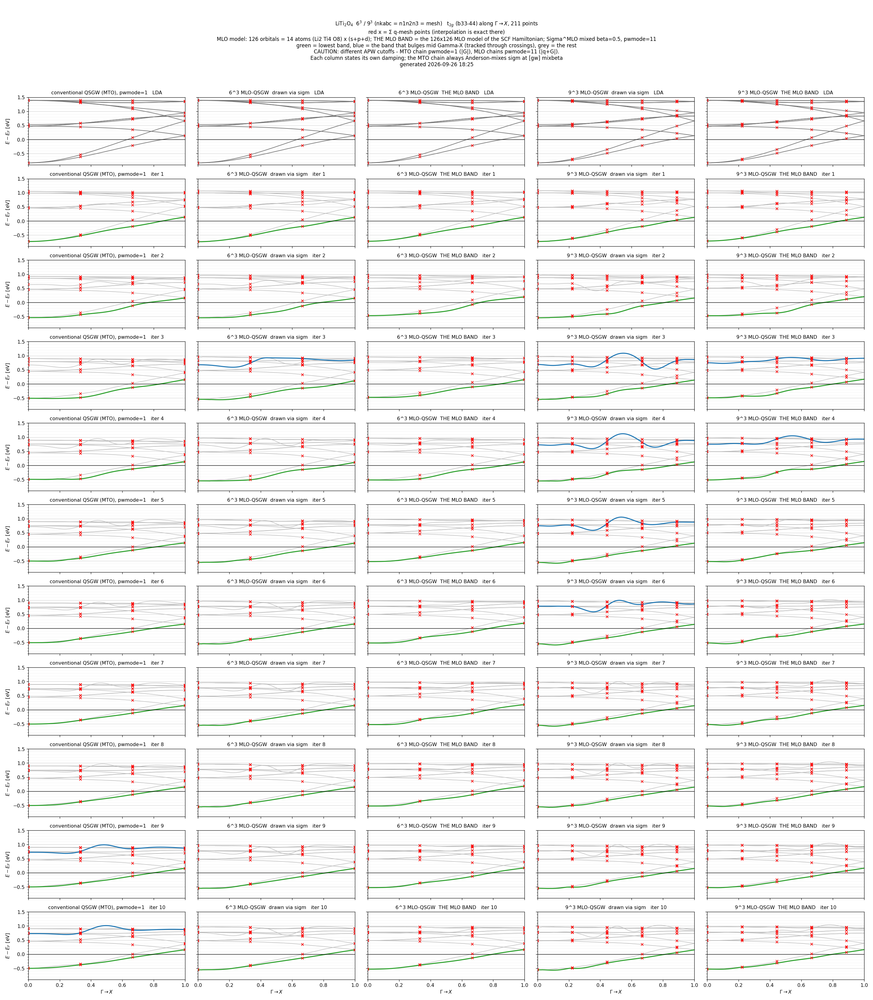
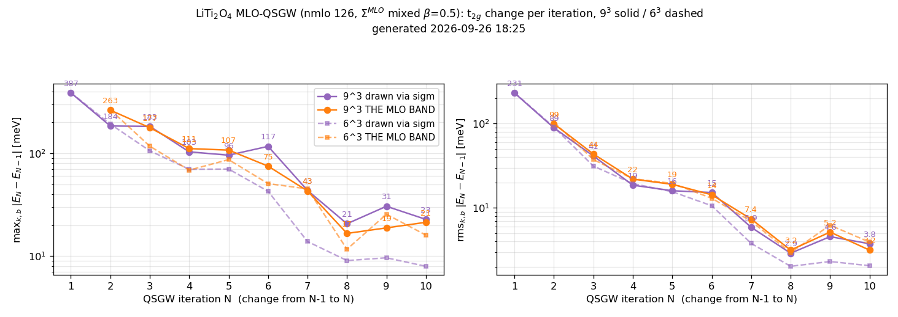

# MLO-gwsc — QSGW with the self-energy interpolated in the MLO representation (under development)

> English version of the page [manual/mlo_gwsc](../../manual/mlo_gwsc.md). The pages at the top of ecaljdoc are the reference; this one was made from manual/mlo_gwsc.md of commit 4f74d9132 (source blob 632e22d87012).

> **Status (2026-09-30)**: LiTi₂O₄ with 6³ and 9³ was run from LDA up to 40 iterations (§3.5). The differences in the MLO bands due to the precision of the GPU matrix products (tf32, fp32, fp64) are
> a few meV or less, so the fast tf32 can be used. At 10 iterations convergence is still in progress; for 6³ a shoulder appears in an occupied band from iteration 20, and for 9³ the bands become fairly smooth at 40 iterations.
> In bands drawn in the MLO representation, the bumps between mesh points that appeared with the `sigm` interpolation (interpolation ringing) are greatly reduced (§3.2).

> Nothing changes by default (it is active only when `gwsc --mlo` is given). Use together with antiferromagnetic symmetry (`symgrpaf`) has not been checked (§5).
> The record of progress is in the development record (MD/research_kotani_log.md in the repository, 2026-09-24 to 29; not on the site), and the design details are in the development record (MD/mlo_notes/sigma_mlo_design.md §9–13 in the repository; not on the site).

This page has three parts: **§1 Theory**, **§2 Settings and running**, **§3 Example: LiTi₂O₄**.

---

## Theory

### What it solves

The static QSGW self-energy $\Sigma$ is computed on the GW $q$ mesh, and at an arbitrary $k$ it is used after **interpolation in k space** from the values at the mesh points (Fourier interpolation: transform to real space and back).
Conventionally it is brought to real space as a matrix in the **MTO basis** (`sigm`) and brought back by a Bloch sum.
The MTO basis is nonorthogonal, EH and EH2 are nearly linearly dependent, and the tails are long, so $\Sigma^{\rm MTO}(R)$ may not decay at long distances
(in LiTi₂O₄ the Ti 3d block levels off at 0.3–0.6 meV out to the edge of the BvK cell). In k-space terms, it is not flat. That is,
bumps of tens of meV, and sometimes hundreds of meV, ride on the bands **only "between" the mesh points**.
Making the mesh finer does not make the bumps smaller; in LiTi₂O₄ they became even larger (§3.2).

MLO-gwsc turns the same $\Sigma$ into a matrix represented in a small subspace $\{\tilde\chi_\alpha\}$ of **MLOs (localized orbitals based on MTOs)** and interpolates it in k space.
The MLOs are rebuilt at every iteration; $\Sigma$ is written with those MLOs and read back with the same MLOs (MLO Sigma interpolation, §1.4).

### Construction of the MLO $\tilde\chi$

At each $k$, from the eigenstates $\Psi^{\rm PMT}_i(k)$ of the PMT Hamiltonian (eigenvalues $\varepsilon^{\rm PMT}_i$) and the eigenstates $\Psi^{\rm MTO}_j(k)$ obtained by diagonalizing only the MTO block (eigenvalues $\varepsilon^{\rm MTO}_j$), the projection

$$\hat P(k)=\sum_{ij}|\Psi^{\rm PMT}_i\rangle\,\bar\theta_{ij}\,\langle\Psi^{\rm PMT}_i|\Psi^{\rm MTO}_j\rangle\langle\Psi^{\rm MTO}_j| \tag{1}$$

is made and applied to the MTO seeds $\chi^{\rm MTO}_\alpha$ selected by `mlo_lm`: 
$$|\tilde\chi_\alpha(k)\rangle=\hat P(k)|\chi^{\rm MTO}_\alpha(k)\rangle \tag{2}$$
(`Hreduction` in `m_hreduction.f90`).
The window function $\bar\theta_{ij}$ is that of `mlo_method = 4` in [MLO](./mlo):
$$\bar\theta_{ij} =f\big((\varepsilon^{\rm PMT}_i-\varepsilon^{\rm cut}_j)/w\big),\qquad
\varepsilon^{\rm cut}_j=\max(\varepsilon_{\rm CBM}+\Delta,\ \varepsilon^{\rm MTO}_j) \tag{3}$$
($\varepsilon_{\rm CBM}$ is the conduction-band bottom of the SCF at each iteration, nearly $E_F$ for metals). $\Delta$ = `mlo_delta` and $w$ = `mlo_w`, both 2 eV by default; $f$ is the Fermi function. All the new MLO model samples use this form.
Since it only contains the energy function $\bar\theta_{ij}$ and the only system-specific quantity needed is $\varepsilon_{\rm CBM}$, it should roughly handle even a system containing two slabs, say of Fe and Si.
$\Psi$ enters only in the form $|\Psi\rangle\langle\Psi|$, so there is no gauge (phase) arbitrariness.

The coefficients of $\tilde\chi$ in the PMT basis are written $z^{\rm MLO}(k)$: 
$$|\tilde\chi_\alpha(k)\rangle=\sum_m|\chi^{\rm PMT}_m(k)\rangle z_{m\alpha}(k) \tag{4}$$

$\tilde\chi$ is not a stored table but **the prescription applied to the Hamiltonian at that moment**; it changes when $H$ changes.
From iteration 2 on it is made from the $H$ including $\Sigma$. The standard MLO method also makes it from `__HamiltonianPMT` (the $H$ after senex is added), so this is the same.
In any case, MLOs can be made as long as the Hamiltonian (including the basis functions) is given on the regular mesh points.

* In the end, the MLO method landed on a "very simple approach". In short, it is just the complete-set expansion of Eq. (1) with $\bar\theta_{ij}$ inserted to firmly extract the low-energy part.
  That is, "if a good localized basis (such as MTOs) is chosen, a projection that respects the low-energy side is enough to model it cleanly".
  There is no need to worry about symmetry or about convergence. For slabs and the like, MLOs corresponding to empty spheres may need to be brought in, but this is the same for other methods.
* Why $\varepsilon^{\rm cut}_j$ in Eq. (3) is not set below $\varepsilon^{\rm MTO}_j$: when bands are drawn with the MTO basis only, without the APW basis, the energies come out
  higher by the amount the basis is insufficient. The PMT eigenstate corresponding to the MTO state $j$ lies below $\varepsilon^{\rm MTO}_j$, so
  PMT eigenstates with energies at or below $\varepsilon^{\rm MTO}_j$ are taken in.

### Holding $\Sigma$ in MLOs and returning it to PMT

What GW produces is the band-indexed $\Sigma^\psi_{ij}(q)=\langle\psi_i|\hat\Sigma|\psi_j\rangle$. This is transferred to the MLOs:

$$\Sigma^{\rm MLO}=c^\dagger\,\Sigma^\psi\,c,\qquad c=\langle\psi|\tilde\chi\rangle \tag{5}$$

This is literally $\langle\tilde\chi_\alpha|\hat\Sigma|\tilde\chi_\beta\rangle$ ($c_i$ is nonzero only for bands where $\bar\theta$ is nonzero. If $\Sigma^\psi$ includes all bands for which $\bar\theta$ is not negligible (including the tail of $f$), i.e. if `ntq` is large enough, it is exact; if not, the tail is cut off).
The PMT basis is nonorthogonal, and its overlap matrix is written $S^{\rm PMT}_{mn}(k)=\langle\chi^{\rm PMT}_m(k)|\chi^{\rm PMT}_n(k)\rangle$.
Expanding the eigenstates as $|\psi_i\rangle=\sum_m|\chi^{\rm PMT}_m\rangle\psi_{mi}$ ($\psi$ is the coefficient matrix), Eq. (4) gives $c=\psi^\dagger S^{\rm PMT}z^{\rm MLO}$.
$\Sigma^{\rm MLO}(q)$ is brought to real space as $\Sigma^{\rm MLO}(R)$ (`QMLO_SigRs`), interpolated in k space, and at an arbitrary $k$ returned to the PMT basis and added to $H$ (`getsenex`).
For general (nonorthogonal) MLOs, the inverse of the overlap is needed on both sides (since 2026-10-02 the MLOs are functions orthogonalized by Löwdin, so $O=1$ and Eq. (7) is $A\,\Sigma^{\rm MLO}A^\dagger$; [mlo](mlo) §6):

$$A=S^{\rm PMT}z^{\rm MLO}=\langle\chi^{\rm PMT}|\tilde\chi\rangle,\qquad O=z^{{\rm MLO}\dagger}A=\langle\tilde\chi|\tilde\chi\rangle \tag{6}$$

$$\mathrm{senex}=A\,O^{-1}\,\Sigma^{\rm MLO}\,O^{-1}A^\dagger=\langle\chi^{\rm PMT}|\hat P_{\rm MLO}\hat\Sigma\hat P_{\rm MLO}|\chi^{\rm PMT}\rangle \tag{7}$$

$\hat P_{\rm MLO}=|\tilde\chi\rangle O^{-1}\langle\tilde\chi|$ is the projector onto the MLO subspace (different from $\hat P(k)$ of Eq. (1)). **Only $\Sigma^{\rm MLO}$ is interpolated in k space.**

> **Caution**: the conventional `sigm` is a quantity projected onto the MTO block with a pseudo-inverse, i.e. a form with $O^{-1}$ folded in on both sides.
> The magnitude of $\Sigma(R)$ cannot be compared directly with $\Sigma^{\rm MLO}(R)$.

### MLO Sigma interpolation — $\Sigma$ is read with the $\tilde\chi$ it was written with

At every iteration the MLOs are rebuilt, the $\Sigma$ of that iteration is turned into the matrix $\Sigma^{\rm MLO}(k)$ in the MLO representation and **interpolated in k space**
(values at arbitrary $k$ are made from the values at the mesh points), and the same MLOs are used when returning to the PMT basis.
We call this **MLO Sigma interpolation**. This form is determined by the following two facts.

1. **What can be interpolated in k space is the matrix in the MLO representation; $z^{\rm MLO}(k)$ cannot be interpolated.** $\Sigma^{\rm MLO}_{\alpha\beta}(k)$ has MLO indices for both rows and columns,
   which refer to the same channels at every $k$, so it can be interpolated in k space. On the other hand, $z^{\rm MLO}(k)$ has rows in the PMT basis.
   With `pwmode = 11` ($|q+G|$ cutoff) the set of APWs itself changes with $k$, so the same row number refers to a different function at each $k$,
   and it cannot be interpolated in k space (the same holds for $A$ in Eq. (6)). For the same reason $H^{\rm PMT}(k)$ cannot be interpolated either.
2. **The numbers of $\Sigma^{\rm MLO}$ carry the stamp of the $\tilde\chi$ they were written with.** At iteration $n-1$ they are made in a single chain
   $z_{n-1}\to c_{n-1}=\psi^\dagger S^{\rm PMT} z_{n-1}\to\Sigma_{n-1}=c_{n-1}^\dagger\Sigma^\psi c_{n-1}$, so when returning with Eq. (7)
   **the same $z_{n-1}$ must always** be used. Reading with a different $z$ would reinterpret the same numbers as matrix elements between different functions,
   and the operator itself would change.

Therefore, **the $z$ made on the writing side is saved for all $k$ that will be read later** ($\tilde\chi$ changes when $H$ changes, so rebuilding it on the reading side gives something different).
Within one iteration both "$z_{n-1}$ for reading" and "$z_n$ for writing" are needed at the same time, so there are two places to keep them.

| File | Contents |
|---|---|
| `QMLO_z` | the $\tilde\chi$ with which the current `QMLO_SigRs` was written (for reading) |
| `__QMLO_zNew` | the $\tilde\chi$ made from the $H$ of this iteration (for writing) |

Each is a single file with fixed-length records ($q$, spin, `ndimh`, and $z$) for each GW $(q,$ spin$)$.
In stage a', each process writes the records of its own $q$ with MPI-IO; `getsenex` first reads only the index and then reads only the records of the $k$ it needs.
**Right after** `mlo` writes `QMLO_SigRs`, `__QMLO_zNew` is renamed (promoted) to `QMLO_z`, so $\Sigma$ and $\tilde\chi$ are always a pair.
To keep "all $k$ that will be read later" within the saved points, **`nkabc` = `n1n2n3` = `mlo_nkabc`** (SCF $k$ ⊂ GW $q$) is required.
`gwsc` checks this before the calculation and stops if they differ.
An attempt to read at a $k$ not among the saved ones also stops by default (since $\Sigma$ would be read in a different basis).

### Flow of one iteration (`gwsc 1 --mlo`)

Only once at the start of the chain, `lmf --writeham --mlo` and `mlo --mlo` make the **MLO index** in `HamRsMLO`.
The index specifies which MTO channels are used as seeds (`ndimMTO` of them). $\Sigma^{\rm MLO}$ is a matrix on these channels, so the index is fixed throughout the chain (`--mlofreeze`).
The window reference ($E_F$ and the conduction edge) is not included in the index; stage a' reads it at every iteration from `efermi.lmf` of that iteration's SCF (since 2026-09-26, evening commit 5118934d3; §2.4).
On the other hand, the coefficients $z$ are rebuilt at ① in every iteration and follow the Hamiltonian.

| # | Run | About $\tilde\chi$ |
|---|---|---|
| ① | `lmf --jobgw=1` | `getsenex` reads `QMLO_SigRs` ($\Sigma_{n-1}$) with $z_{n-1}$ of `QMLO_z` → diagonalization → $\psi$ (passed to GW). In the following stage a', $z_n$ is made from the $H$ including $\Sigma$ and written to `__QMLO_zNew`, and $c_n=\psi^\dagger S^{\rm PMT} z_n$ to `__cmlo.data` |
| ② | `heftet`, `hbasfp0`, `hvccfp0`, `hsfp0_sc`, `hgw` | $\Sigma^\psi_{ij}(q)$. Unrelated to MLO |
| ③ | `hqpe_sc` | $\Sigma^{\rm MLO}_n$ by Eq. (5) → mixing (§1.6) → `__QMLO_Sig`. The conventional `sigm` is also written alongside |
| ④ | `mlo --mlofreeze --mlo` | symmetrization → full BZ → FFT → `QMLO_SigRs` (Σ only; the MLO indices come from `HamRsMLO`) |
| ⑤ | promotion (inside the `mlo` of ④) | `__QMLO_zNew` → `QMLO_z`. Here the "current $\tilde\chi$" switches to $z_n$ |
| ⑥ | `lmf` (SCF) | `getsenex` reads $\Sigma_n$ with $z_n$ |

### Mixing

In the MLO path, what the SCF reads is `QMLO_SigRs` (made from `__QMLO_Sig`), not `sigm`.
`sigm` is Anderson-mixed in `hqpe_sc`, but unless $\Sigma^{\rm MLO}$ is also mixed, **only the MLO chain runs with an effective β=1**,
and in LiTi₂O₄ it overshot greatly at the third iteration (§3.3).
$\Sigma^{\rm MLO}$ is subject to the same Anderson mixing as `sigm` (β = `[gw] mixbeta`) (default since 2026-09-30; `ECALJ_MLO_MIX=0` turns it off.
In older code it was mixed only when `ECALJ_MLO_MIX=1` was given).

- The history is `__QMLO_mixsig` (`__mixsig` for `sigm`). The mixing input $x_0$ (the $\Sigma^{\rm MLO}$ actually used in that iteration) is
  `QMLO_SigRs` Bloch-summed at the irreducible $q$ (the same matrix that `getsenex` put into $H$). It plays the same role as `sigm` in the `sigm` mixing, so the history may be discarded
- **The first iteration (from LDA) starts at $\beta$ times**: since there is no previous $\Sigma$, mixing starts from $x_0=0$ ($\Sigma=0$), and iteration 1 is $\beta\Sigma^{\rm out}$.
  Both `sigm` and $\Sigma^{\rm MLO}$ are multiplied by $\beta$; with the default $\beta=1$ the full amount enters (LiTi₂O₄ uses $\beta=0.5$; [mixbeta](./gwsc#mixbeta-and-mixpriorit))

### How to draw MLO bands

To see the state of an intermediate iteration at arbitrary $k$ while keeping $\Sigma^{\rm MLO}$ as it is, make and solve **the MLO model of the Hamiltonian solved by the SCF**
(`Samples/kBT/LiTi2O4/draw_mloband.sh` of ecalj).

1. On a snapshot, run `lmf --writeham --mkprocar --noinv --mlo` and, with the saved `QMLO_z`, write out on the mesh points the same
   $H=H^{\rm LDA}[\rho_n]+\mathrm{senex}(\Sigma^{\rm MLO}_n)$ as the SCF (it stops if $\tilde\chi$ is not found at even one point)
2. After moving `QMLO_SigRs` aside ($\Sigma$ is already in the $H$ of step 1, so do not add it twice), make the MLO model with an unfrozen `mlo --mlo` and solve it along the path

At the mesh points it is exactly the SCF $H$, and between them it is the standard MLO Fourier interpolation. **$\tilde\chi$ is not rebuilt between mesh points.**
The following three ways do not give MLO bands.

| Route | What happens |
|---|---|
| `job_band` (without `--mlo`) | drawn by the conventional `sigm` interpolation. It combines the density of the MLO chain with the conventional $\Sigma$, not the $\Sigma^{\rm MLO}$ that drove the SCF (usable for comparison) |
| `job_band --mlo` | the search for $\tilde\chi$ compares $k$ literally, so even if a $k$ on the path is symmetry-equivalent to a saved irreducible point, it is not found. It is rebuilt from the $H$ without $\Sigma$, so it is invalid except at Γ |
| `job_mlo --mlofreeze --mlo` | adds the current `QMLO_SigRs` (current $\tilde\chi$) to the frozen `HamRsMLO` (the LDA $H$ and $\tilde\chi$ at the start of the chain), so two bases are mixed and it shifts by 0.3–0.5 eV |

`job_band` writes the $E_F$ for plotting to `efermi.lmf.job_band` and does not touch `efermi.lmf`, from which stage a' reads the window reference (the same for `job_dos` and `job_fermisurface`;
it can also be given by `--efermi=`). Drawing inside the chain's directory does not move the window.

---

## Settings and running

### `ctrlg.<sname>.toml`

Settings used for LiTi₂O₄ 6³ (for 9³ only the three mesh entries were changed to `[9, 9, 9]`):

```toml
[bz]
nkabc  = [6, 6, 6]          # same as [gw] n1n2n3 (required)
[ham]
pwmode = 11                 # |q+G| cutoff (default)
[gw]
n1n2n3  = [6, 6, 6]
mixbeta = 0.5               # mixing of sigm and Sigma^MLO
t_sigmaw   = 1000.0         # (K) Fermi-Dirac width of the intermediate levels of Sigma (required)
t_tetrakbt = -992.4         # (K) negative: chi0 stays at T=0 and Im chi0 is smoothed by a Gaussian of about the same width as FD at 1000 K (formerly SmearX0 = 0.0057 Ha). Smooths the poles of W of a metal ("Settings for LiTi₂O₄" at the top of [kBT](./kBT), and §3.4)
[mlo]
mlo_method = 4              # default
mlo_delta  = 2.0            # (eV) default
mlo_w      = 2.0            # (eV) default
mlo_nkabc  = [6, 6, 6]      # same as n1n2n3 (required)
mlo_lm = """
1 Li   1 2 3 4 5 6 7 8 9
2 Li   1 2 3 4 5 6 7 8 9
3 Ti   1 2 3 4 5 6 7 8 9
...
14 O   1 2 3 4 5 6 7 8 9
"""
```

- The `gwinit` default of `mlo_lm` is s,p (lm 1–4) for Z ≤ 10, s,p,d (1–9) from Na on, and also f (10–16) for atoms with 4f in the valence (since 2026-10-01; [MLO](./mlo) §1).
  Semicore local orbitals are included automatically according to the band position (the table in MLO §1).
  For LiTi₂O₄ all atoms were made s+p+d (126 orbitals). With the default it would be 76 (s,p for Li and O). Which of 126 or 76 is better is not settled (§5)
- **As a rule, at most one MLO per (site, lm).** Adding `mlo_lm2` (EH2) to the same lm collapses into the same function under the projection and makes $O$ nearly singular
  (the exception is s,p of cations with a conduction-band bottom spread into the voids: criterion 2 in [MLO](./mlo) §9; not tried in MLO-QSGW).
  With the raw MLOs up to 2026-10-02, Eq. (7) sandwiches $O^{-1}$ twice, so the effect is (was) squared (for NiO Ni d the condition number goes $1.3\times10^2\to7.4\times10^4$). Now a nearly singular $O$ acts through $O^{-1/2}$ of the Löwdin orthogonalization

### Running

```bash
gwsc 10 -np 60 -np2 2 --gpu --prec=fp32 --ntqxx --mlo liti2o4                     # 10 iterations
gwsc 10 -np 60 -np2 2 --gpu --prec=tf32 --prec-final=fp32:2 --ntqxx --mlo liti2o4 # tf32 on the way, fp32 for the last 2 iterations
```

`gwsc N --mlo` may be run for N iterations at once (it is not strictly the same as running `gwsc 1` N times, but once converged the difference in ehf is 0.1–0.2 meV; research log 2026-09-25 00:06).
For the GPU precision `--prec=tf32|fp32|fp64` and the automatic choice of the matrix-product method, see [ecaljgpu](./ecaljgpu) and [gwsc](./gwsc) (`--prec=fp32` is the same as the older `--mp --fp32`).
One `hgw` run for LiTi₂O₄ takes, for 6³, 367 s with fp32 and 173 s with tf32 (kt1, RTX 5090 × 2, evening of 2026-09-27), and for 9³, 2990 s with fp32 and 1975 s with tf32 (version of the morning of the same day).
tf32 makes only the last matrix product of Σc take inputs with a 10-bit mantissa (FP16 on the RTX 5090, chosen by the per-GPU table; FP16 has a 5-bit exponent and a narrow representable range; [ecaljgpu](./ecaljgpu)), and Re Σc within $E_F$ ±1 eV agrees with double precision within 1.3 meV (development record (MD/ForDevelopers.md §11.2 in the repository; not on the site)).

- `Samples/kBT/LiTi2O4/run_gwsc10.sh <tag> <input> <bindir>` of ecalj runs `gwsc 10` and, with the final state, draws the `sigm` plot and the MLO bands.
  `run_snap.sh <tag> <niter> --mlo` repeats `gwsc 1` while keeping a snapshot of every iteration (the full set needed for a restart) and the two kinds of bands
  (it stops if even one mixing file remains after LDA). `run_gwsc10.sh` can be given `RUNS_DIR` (working location) and `GPUS` (default: one card, GPU 0),
  and its input is `Samples/kBT/LiTi2O4/input/qmlo`. `run_snap.sh` has kt1 paths hard-coded, so rewrite them when using it

### Checks at each iteration

What to look at (in a `run_snap.sh` chain, `Samples/kBT/LiTi2O4/check_iter.sh` checks the logs that `watch_iter.sh` saved at the end of the iteration).
When run all at once with `gwsc N`, `gwsc` copies `lgw`, `lqpe`, `llmfgw01`, `lmlo_sigr`, and `llmf` (`llmf.<N>run`) to `QSGW.<N>run/` at the end of each iteration
(since 2026-09-28), so grep them there afterwards as in the table below (`check_iter.sh` assumes the format of run_snap's `steps.log`):

| Item | Where to look | Normal |
|---|---|---|
| Did the SCF enter the MLO path | number of `MLO Sigma interpolation ON` lines in `llmf` | number of processes holding $k$ points, $\lceil n_k/\lceil n_k/n_p\rceil\rceil$ |
| Did the GW driver enter the MLO path | the same line in `llmfgw01` | number of processes holding GW $q$ points (`QPLIST.jobgw1`). **0 at iteration 1** (no `QMLO_SigRs` yet) |
| Promotion | `m_HamPMT: promoted __QMLO_zNew -> QMLO_z` in `lmlo_sigr` | once per iteration |
| Mixing | `x_0 from QMLO_SigRs =` and `SigmMLO_out`, `SigmMLO_mixed` in `lqpe` | at iteration 1, two lines of `... No mixing file`, x_0 = F, mixed/out = β. From 2 on, x_0 = T |
| Missed $\tilde\chi$ | `m_sigmlo: WARNING chi~ MISS` | does not appear (if it does, it stops by default) |
| SCF | number of iterations in `llmf` | has not reached the `nit` limit |

The numbers of lines **are determined by the mesh and the number of parallel processes**, so do not apply values for a different mesh.
With `-np 60`, 6³ has 16 irreducible points, so 16, and 36 for the 72 GW points. 9³ gives 35 for 35 points and 50 for 200 points.
If there are **fewer** than these, some processes did not enter the MLO path and fell back to the conventional `sigm`.

### Files used, and what to keep

Marks: **●** specific to MLO-QSGW (appears only with `gwsc --mlo`), **○** the MLO method in general (also appears with `job_mlo`); unmarked = shared with ordinary QSGW.
Keep: **result** = keep as a calculation result, **restart** = needed to continue the chain, **—** = work file used only within an iteration.
①–⑥ are the stages of §1.5.

| File | Mark | Keep | Contents |
|---|---|---|---|
| `ctrlg.<sname>.toml` | | result, restart | settings |
| `rst.<sname>` | | result, restart | density (written by the `lmf` of each SCF) |
| `efermi.lmf` | | result, restart | $E_F$ and the conduction-band bottom of the last SCF. Stage a' reads it at every iteration as the window reference |
| `sigm`, `QPU`, `QPD` | | result (`sigm` also for restart) | $\Sigma$ in the conventional representation (plots for comparison, $x_0$ of the `sigm` mixing), QP energy tables |
| `__mixsig` | | restart | history of the `sigm` mixing |
| `QMLO_SigRs` | ● | result, restart | $\Sigma^{\rm MLO}(R)$. The $\Sigma$ of MLO-QSGW itself (written by ④). The mixing $x_0$ is also made from it |
| `QMLO_z` | ● | result, restart | the $\tilde\chi$ with which `QMLO_SigRs` was written (a single file). **Always paired with `QMLO_SigRs`** |
| `HamRsMLO` | ○ | result, restart | the MLO index (made at the start of the chain, fixed afterwards). If deleted midway, it is rebuilt and no longer matches `QMLO_SigRs` |
| `band_MLO_spin1.dat` | ○ | result | MLO bands (§1.7) |
| `llmf`, `llmfgw01`, `lqpe`, `lmlo_sigr` | | result | logs (used for the checks in §2.3) |
| `__QMLO_mixsig` | ● | — | history of the $\Sigma^{\rm MLO}$ mixing. Deleting it only interrupts the Anderson extrapolation once ($x_0$ is made from `QMLO_SigRs`) |
| `__QMLO_Sig` | ● | — | $\Sigma^{\rm MLO}(q)$ written by ③ and read by ④ |
| `__QMLO_zNew` | ● | — | this iteration's $\tilde\chi$ written by stage a' of ① (a single file, MPI-IO) |
| `__QMLO_zdump_*` | ● | — | for diagnostics (`ECALJ_ZMLO_DUMP=1`) |
| `__cmlo.*`, `__HamiltonianGW(.info)` | ○ | — | $c_n$ and the PMT $H$ written by ①. In the chain only ① writes `__cmlo` (in `job_mloW` and `job_mlo_magnon`, `mlo --mlo` writes it from `__HamiltonianGW`) |
| `HamiltonianPMTInfo` | ○ | — | read by the `mlo` of ④ at every iteration (lattice, k mesh, pair table). If missing, `gwsc` rebuilds it at startup with `lmf --writeham` |
| `__HamiltonianPMT(.info)` | ○ | — | read only by the `mlo --mlo` that makes the index (at the start of the chain). ④ does not read it (2026-09-27) |
| `__amlo.*` | ○ | — | written by the `mlo --mlo` that makes the index, but nothing reads it (④ does not write it) |

Files starting with `__` may all be deleted between `gwsc` calls (deleting `__mixsig` and `__QMLO_mixsig` only interrupts the Anderson extrapolation once).
`sigm` is not used as values in the SCF, but without it both `gwsc` and `lmf` restart from LDA, so it is required for restarting.
A `run_snap.sh` snapshot consists of most of the "result" files plus `sigm.<sname>`, `__atm.<sname>`, `syml.<sname>`, and so on.

### Options and environment variables

| | Effect |
|---|---|
| `--mlo` | switch for the whole MLO path. Without it, nothing related to MLO runs |
| `--mlofreeze` | uses the index of the existing `HamRsMLO` and rewrites only `QMLO_SigRs` (`gwsc` passes it to the `mlo` within the iteration) |
| `ECALJ_MLO_MIX=0` | turns off the Anderson mixing of $\Sigma^{\rm MLO}$ (§1.6; mixing is the default) |
| `ECALJ_MLO_ALLOW_REBUILD=1` | allows rebuilding from the current $H$ at a $k$ not in `QMLO_z` (stops by default). Bases are mixed, so for diagnostics |
| `ECALJ_MLO_NOSIG=1` | ignores `QMLO_z` and rebuilds from the current $H$ at all $k$. For diagnostics |
| `ECALJ_MLO_NOCACHE=1` | stops using `QMLO_z` and any reuse, rebuilding at every call (old behavior). For diagnostics |
| `ECALJ_ZMLO_DUMP=1` | writes the $z$ of stage a' to `__QMLO_zdump_sugw` and the $z$ of `getsenex` to `__QMLO_zdump_getsenex`. They should agree between a' and the SCF of ⑥ in the same iteration |
| `ECALJ_SIGMLO_RT=1` | checks at the mesh points whether the Bloch sum of $\Sigma^{\rm MLO}(R)$ reproduces `__QMLO_Sig` |
| `ECALJ_SIGMLO_CHECK=1` | at each $k$, prints the maximum difference between the senex of the MLO path and that of the conventional `sigm` path |

---

## Example: LiTi₂O₄

### Settings

| Item | Value |
|---|---|
| MLO | **126 orbitals = 14 atoms (Li₂Ti₄O₈) × (s+p+d)** |
| Mesh | `nkabc` = `n1n2n3` = `mlo_nkabc` = 6³ and 9³ |
| Mixing | `[gw] mixbeta = 0.5` (both `sigm` and $\Sigma^{\rm MLO}$) |
| Basis | `pwmode = 11` |
| Window | `mlo_method = 4`, $\Delta = w = 2.0$ eV (default) |
| Machine | kt1 (RTX 5090 × 2), `gwsc 1 --mp --fp32` 10 times (code of 2026-09-26 before the evening fix of the window) |
| Window reference | fixed to the $E_F$ at the start of the chain (LDA) (the current code uses the value of the SCF of each iteration, §1.5) |
| One iteration | 6³: 950–1000 s, 9³: about 5300 s (89 min). `hgw` takes 86 % (6³) and 94 % (9³), and the processing for MLO about 1 %. After the 2026-09-27 speedup, 555 s for 6³ with fp32 |
| Reference for comparison | conventional QSGW (MTO) 6³, `pwmode = 1`, β = 0.5, 10 iterations (only the LDA row uses `pwmode = 11`) |

### Bands



t2g (bands 33–44), Γ→X, 211 points. Columns from the left: **conventional QSGW 6³** / **6³ MLO-QSGW drawn with `sigm`** / **6³ MLO bands** /
**9³ MLO-QSGW drawn with `sigm`** / **9³ MLO bands**; rows from the top: LDA, iterations 1–10.
Red × marks are the mesh points of $\Sigma$ (where the interpolation is exact). Green is the lowest band, and blue is the band that bulges in the middle of Γ→X;
it is tracked across crossings and colored only in iterations where the bulge is 50 meV or more.

- **The bump of the bulging band (blue) does not appear in the MLO bands.** When the same state is drawn with the `sigm` interpolation (columns 2 and 4), bumps form between the mesh points.
  They fluctuate strongly at iteration 3 for 6³ and at iterations 3–6 for 9³, and settle from 7 on.
  They never appear in the 6³ MLO bands, and do not appear in the 9³ MLO bands from iteration 5 on
- **The bumps are larger for 9³** (`sigm` plots). In conventional QSGW too, making the mesh denser enlarged the ripples of the occupied t2g.
  Our view is that since $\Sigma^{\rm MTO}(R)$ does not decay at long distances, the larger the periodic cell, the more of that component is picked up and interpolated
- In the lowest band (green), step-like shoulders appear in the early iterations (the step spacing is close to the mesh spacing).
  These appear both in the `sigm` plots and in the MLO bands
- In the conventional QSGW column, blue appears even at iterations 9–10. It does not appear in the two MLO-QSGW columns of the same 6³

### Convergence



Change of t2g per iteration (left: max, right: rms). 9³ is solid, 6³ is dashed.

| rms [meV] | 7 | 8 | 9 | 10 |
|---|---|---|---|---|
| **9³ MLO bands** | 7.4 | 3.2 | 5.2 | **3.2** |
| **6³ MLO bands** | 6.9 | 2.9 | 6.2 | **3.9** |
| Conventional 6³ | 6.7 | 6.6 | 4.7 | 6.5 |

- With both meshes, it goes down to the same level as conventional (rms 3–7 meV). All the checks of §2.3 passed in all 10 iterations
- Without mixing $\Sigma^{\rm MLO}$ (equivalent to β=1), the rms jumps by 120–150 meV at the third iteration (35 meV for conventional).
  With mixing it falls in the same way as conventional (31 meV at the third iteration)
- **The movement of the bands when the mesh goes from 6³ to 9³** (iteration 10) is rms 13 meV for the MLO bands and 27 meV for the `sigm` plots.
  **Interpolation in the MLO representation is less sensitive to the mesh**

### Difference from conventional

The difference between the MLO bands at iteration 10 and conventional 6³ is rms 46 meV (mean +30) for 6³ and rms 49 meV (mean +34) for 9³.
Looking at 6³, it is not a uniform shift: the two occupied bands are 7–13 meV lower and the unoccupied t2g are 22–61 meV higher. The total t2g width is nearly the same, 1505 vs 1516 meV.
**It differs by 43 meV even on the mesh points**, so it is a difference of the state, not of the interpolation.
However, the reference for comparison uses `pwmode = 1` and the MLO side `pwmode = 11`. The `pwmode` difference at LDA (rms 5.6 meV) alone cannot explain it,
but it may have been amplified by QSGW. **Whether it is a difference in the representation of $\Sigma$ or in `pwmode` cannot be separated without running a conventional chain with `pwmode = 11`** (not done).

### Up to 40 iterations (2026-09-29)

With the settings of §3.1 (but code from 2026-09-27 on: the window reference is the value of the SCF at each iteration, $\chi_0$ with `t_tetrakbt = -992.4`, `t_sigmaw = 1000`),
we ran `gwsc 10 --prec=tf32` from LDA, followed by one iteration at a time up to 40 iterations. The settings table and all the figures and numbers are in `Samples/kBT/LiTi2O4/README.md` of ecalj.


**Figure 3.5-1**. t2g MLO bands (Γ→X). Left: 6³, right: 9³. From the top: LDA, iterations 10, 20, 30, 40. Below, $x$ is the position along Γ→X (Γ = 0, X = 1)

**Table 3.5-1**. Maximum change of the MLO bands from the previous iteration (meV), and a measure of the waviness of the lowest band (maximum residual of a fit of the correction from LDA with cosines up to third order)

| | Iteration | Change of t2g | Change of the two occupied bands | Waviness |
|---|---|---|---|---|
| 6³ | 10 | — | — | 12.7 |
| 6³ | 20 | 13.6 | 8.7 | 26.0 |
| 6³ | 40 | 3.3 | 0.8 | 26.7 |
| 9³ | 10 | — | — | 17.2 |
| 9³ | 20 | 9.6 | 2.1 | 14.4 |
| 9³ | 40 | 5.1 | 0.2 | 12.9 |

- **Precision**: the difference between the tf32 and fp32 MLO bands for the same input is at most 0.8 meV for 6³ at iteration 10, and at most 1.2 meV for 9³ at iterations 10–12 (t2g).
  fp64 and fp32 differ by at most 1 meV at the first iteration of 6³. The time per iteration for 9³ is 21 min with tf32 and 47 min with fp32
- **6³**: smooth at iteration 10, but from 20 a shoulder forms in the lowest band at $x$ = 0.35–0.45 and remains at 40. The bulge of the middle t2g band is
  largest at iteration 22 with 131 meV and decreases to 49 meV at 40 (still decreasing by 2–3 meV per iteration)
- **9³**: at iterations 10–15 the lowest band just outside Γ dips 6–12 meV below Γ, but this becomes 1.5 meV at 40.
  The interpolated curve connecting the mesh points still looks slightly wavy at 40 iterations
- At the mesh points common to 6³ and 9³ (Γ and $x$ = 2/3), the difference in the lowest band at 40 iterations is 4 meV or less. Between the mesh points it is at most 37 meV

---

## Pitfalls

| Mistake | Why it is wrong / what is correct |
|---|---|
| Not mixing $\Sigma^{\rm MLO}$ (`ECALJ_MLO_MIX=0`; with code up to 2026-09-29, forgetting `ECALJ_MLO_MIX=1`) | it overshoots in the early iterations (§3.3) |
| Taking the `job_band` plot as the MLO result | it is the conventional `sigm` interpolation. Draw the MLO bands by the method of §1.7 |
| Drawing MLO bands with `job_band --mlo` or `job_mlo --mlofreeze` | invalid, as in the table of §1.7 |
| Applying check values (numbers of marked lines, run times) from a different mesh | normal runs are judged abnormal. The values are determined by the mesh and the number of parallel processes (§2.3) |

## Open issues and future work

- Run a **conventional chain with `pwmode = 11`** for 10 iterations and separate the difference of §3.4 into the difference of representation and the difference of `pwmode`
- **Antiferromagnetic symmetry (`symgrpaf`)**: since 2026-09-30 QSGW works in a form where the GW programs compute both spins (ecalj `Samples/AFsymmetry`).
  Use together with `--mlo` has not been checked
- The figures and numbers of §3.2–§3.4 are from the code of 2026-09-26 before the evening fix of the window (window reference = $E_F$ at the start of the chain). The MLO bands of the current code after 9 iterations differ from them by
  rms 8 meV (max 23 meV), a nearly uniform drop of 7–10 meV (because the window reference moved by 0.55 eV; they separate from the second iteration). §3.5 uses the current code
- `--prec-final=fp32:N` (fp32 only at the end) has not been run and checked yet (the difference between tf32 and fp32 is about 1 meV, as in §3.5)
- Whether the 6³ shoulder (§3.5) is a property of the converged solution or disappears with further iterations is not known
- Effect of the number of MLOs: 76 (`gwinit` default), 126, and all MTOs (154) have not been compared with mixing of $\Sigma^{\rm MLO}$
- Whether including empty spheres reduces the oscillations and stabilizes (not checked)
- Extend the search for $\tilde\chi$ to symmetry-equivalent $k$ (so that `job_band --mlo` becomes usable at the mesh points).
  To draw PMT bands via MLOs after convergence, rebuild $z$ at each $k$ with the $H$ including $\Sigma$ and make it self-consistent
- Speed: the remaining 80 % of `hgw` for 9³ is the Σc matrix product, which already runs close to the single-precision capability of this GPU ([ecaljgpu](./ecaljgpu)).
  Making $\Sigma^{\rm MLO}$ directly from the vertex $\langle\tilde\chi_n|\psi_{i'}M_I\rangle$ would make one side of the matrix product $n_{\rm MLO}$, but
  for LiTi₂O₄ ($n_{\rm MLO}$ = 126, `ntq` = 159) it would reduce it only by about 10 %
