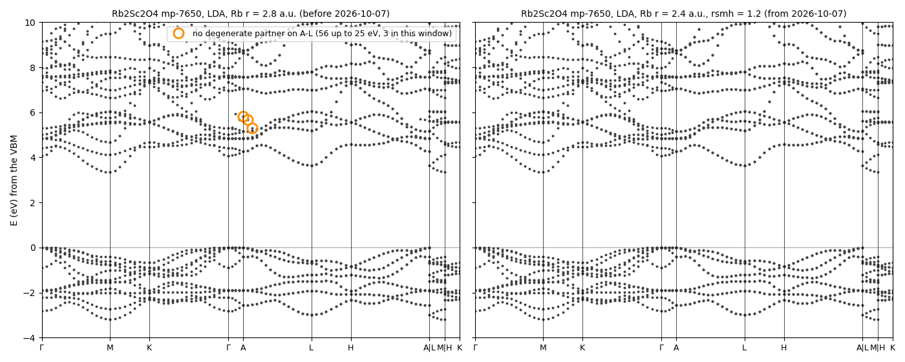
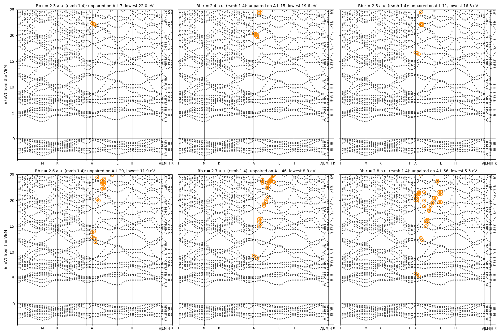

# Upper limits of the MT radii, and spurious levels (bands without a degeneracy partner)

> English version of the page [manual/mtradius](../../manual/mtradius.md). The pages at the top of ecaljdoc are the reference; this one was made from manual/mtradius.md of commit 296542c3a (source blob 21c4a9a7c751).

If the MT spheres are taken too large, spurious levels can appear in the bands. The upper limits of the spheres for alkali and alkaline-earth atoms and for H are chosen to avoid this
(`r_upper_limit` in `ctrlgenToml.py`, 2026-10-07). This page summarizes an example and how the upper limits are determined. The table of the upper limits itself is also in the section
on MT radii of [lmf.md](./lmf.md).

## Example: Rb₂Sc₂O₄ (mp-7650, P6₃/mmc)

Rb₂Sc₂O₄ has a layered structure, with an in-plane lattice constant of 3.26 Å and c of 12.8 Å. Since the space group P6₃/mmc is nonsymmorphic (it has screw axes and glide planes), on the top face of the BZ
(A–L–H, k_z = π/c) all levels are doubly degenerate in the absence of spin-orbit coupling.

The left of Fig. 1 shows the LDA bands with the MT radius of Rb 2.8 a.u. (the upper limit before 2026-10-07). On A–L near A there is a **level without a degeneracy partner**
(orange circles). This level does not connect to the surrounding bands and is impossible by symmetry. With the radius 2.4 a.u. (right of Fig. 1, the present rule), it disappears.
The valence bands, the bottom of the conduction band, and the gap (3.348 → 3.350 eV) do not change.

*Fig. 1*. LDA bands of Rb₂Sc₂O₄. Left: MT radius of Rb 2.8 a.u., rsmh 1.4. Right: 2.4 a.u., rsmh 1.2 (rsmh = r/2, the input of the present `ctrlgenToml.py`).
The orange circles are levels on A–L without a degeneracy partner within 0.02 eV. The path is from `getsyml` (at least 5 points per segment). Left: ecalj b81da2342 (kt1);
right: ecalj of 2026-10-07 (t14). The plotted values are in [`mtradius/bands.npz`](../../manual/mtradius/bands.npz), and the script that makes the figures is [`mtradius/make_figs.py`](../../manual/mtradius/make_figs.py).

This spurious level appears as it is in QSGW80 as well, and in the MLO check of the database (comparison of the bands of the model and of QSGW80) it was the cause of a FAIL with a maximum deviation of 0.86 eV.
The model side has no spurious level, so it was the reference being compared against that was broken. Rerunning with Rb 2.5 a.u. (not 2.4 a.u. of the present rule; QSGW80 with 2.4 a.u. has not been run), the QSGW80 gap changed 6.056 → 6.058 eV, and the MLO check became PASS (0.040 eV).

## What is happening

In the PMT method, inside a sphere the envelope functions (MTO and APW) are replaced by combinations of the radial functions φ, φ̇ (l ≤ lmxa) of that atom (augmentation). The part of the envelope functions
that cannot be represented by φ, φ̇ inside the sphere (higher-l components, radial shapes) is discarded. When the sphere is large, the discarded part becomes large, and combinations of envelope functions
that are "almost 0 outside the sphere and differ only inside the sphere" remain after augmentation as undetermined directions, fixed by nothing. These give spurious levels and linear dependence of the basis.

As Table 1 shows, the spurious levels do not disappear when the sphere is made smaller; they escape upward (to higher energy). On the other hand, the true bands hardly move with the radius (Fig. 2).
Making the expansion inside the sphere finer (kmxa of Rb 5 → 7) did not remove them. Turning off the APWs (pwmode 0) removed them.

*Table 1*. The lowest of the levels on A–L without a degeneracy partner in the LDA of Rb₂Sc₂O₄ (from the top of the valence band, counted up to 25 eV; rsmh 1.4)

| Radius of Rb (a.u.) | 2.3 | 2.4 | 2.5 | 2.6 | 2.7 | 2.8 |
| --- | --- | --- | --- | --- | --- | --- |
| Lowest spurious level (eV) | 22.0 | 19.6 | 16.3 | 11.9 | 8.8 | 5.3 |
| Their number (up to 25 eV) | 7 | 15 | 11 | 29 | 46 | 56 |

At 2.6 a.u. and below, the spurious levels appear at about 12 eV or above (11.9 eV at 2.6 a.u., above 16 eV at 2.5 a.u. and below). With the present rule (2.4 a.u., rsmh = r/2 = 1.2), there is none up to 25 eV (right of Fig. 1).
Above 20 eV the bands are crowded, so this way of counting (pairs within 0.02 eV) also picks up extra ones. Read the numbers as a rough guide.

*Fig. 2*. LDA bands of Rb₂Sc₂O₄ (-4 to 25 eV) for Rb radii 2.3 to 2.8 a.u. (rsmh kept at 1.4, ecalj b81da2342, kt1). The orange circles are as in Fig. 1.

## How the upper limits are determined

What should be kept inside the sphere are the semicore p and the bound d. Extended states such as the alkali s (and the alkaline-earth s) and the H 1s
can be represented by the envelope functions outside the sphere, so large spheres are not needed. Table 2 shows the free-atom orbitals (the valence table of `lmfa`, the radius where the radial function is maximal).

*Table 2*. Valence orbitals of the free atoms (lmfa). "peak" is the radius (a.u.) where r·φ is maximal; "out" is the fraction outside the MT sphere (the radius of that calculation)

| Element | Semicore | Valence s | d (bound) |
| --- | --- | --- | --- |
| H | — | 1s peak 1.06 (out 45 %, sphere 1.60) | — |
| Na | 2p peak 0.54 | 3s peak 3.24 (out 85 %) | — |
| K | 3p peak 1.15 | 4s peak 4.03 (out 93 %) | 3d is not bound |
| Ca | 3p peak 1.05 | 4s peak 3.33 (out 84 %) | 3d peak 1.28 |
| Rb | 4p peak 1.42 | 5s peak 4.24 (out 92 %) | 4d is not bound |
| Sr | 4p peak 1.32 | 5s peak 3.62 (out 85 %) | 4d peak 2.15 |
| Cs | 5p peak 1.77 | 6s peak 4.65 (out 95 %) | 5d peak 3.46 (almost unbound) |
| Ba | 5p peak 1.67 | 6s peak 4.06 (out 91 %) | 5d peak 2.51 (61 % outside a 2.8 sphere) |

We varied the radius in the LDA (2 to 3 materials each, 2.0 to 2.8 a.u.):

- Rb, Cs (RbBr, RbI, CsCl, CsF, Rb₂Sc₂O₄): change of the gap 0.014 eV or less, conduction band at Γ 0.01 eV or less. Nothing is lost by making the sphere smaller
- H (NaH, LiH, 1.0 to 1.8 a.u.): no spurious levels, change of the gap 0.006 eV or less
- Ba (BaO, BaSe): the conduction band at Γ (Ba 5d, 6s) moves 1.90 → 3.30 eV for 2.0 → 2.8 a.u., and settles at 2.7 to 2.8 (the difference between 2.4 and 2.8 remains even when the APW cutoff is
  raised to 7 Ry). The peak of the bound 5d (2.51 a.u.) needs to be inside the sphere
- Na, Mg, K, Ca, Sr: no spurious levels. The changes are small (for K the gap changes by +0.03 eV for 2.2 → 2.6, settling at the larger radius)

*Table 3*. Upper limits of the MT radii (a.u., `r_upper_limit`). H, Rb and Cs were changed on 2026-10-07. "Future proposal" is a proposal for aligning to smaller spheres (in molecular crystals
the bonds are short and the spheres have to be small; then the meshes of the APWs and of the expansion of the electron density need to be raised)

| Element | Until 2026-10-07 | Now | Future proposal |
| --- | --- | --- | --- |
| H | 3.0 (only the global upper limit) | **1.4** | 1.4 |
| Li, Be | 2.7 | 2.7 | 2.0 (not verified) |
| Na | 2.4 | 2.4 | 2.2 |
| Mg | 2.4 | 2.4 | 2.4 |
| K, Ca | 2.6 | 2.6 | 2.4 |
| Rb | 2.8 | **2.4** | 2.4 |
| Sr | 2.8 | 2.8 | 2.6 |
| Cs | 2.8 | **2.4** | 2.4 |
| Ba | 2.8 | 2.8 | 2.8 |
| Others | 3.0 | 3.0 | |

rsmh (the smoothing radius of the smooth Hankel functions) is r/2 and changes with the radius. With the input of the present rule (Rb, Cs: r 2.4, rsmh 1.2; H: r 1.4, rsmh 0.7),
the gaps of Rb₂Sc₂O₄, CsCl, RbBr and NaH agreed with those of the previous input within 0.006 eV, and no spurious levels appeared.

## How to recognize them

- If there is a level without a partner where symmetry requires degeneracy (faces of the BZ for nonsymmorphic space groups, high-symmetry points), suspect a spurious level
- Draw the LDA bands with the radius changed slightly; a level that moves a lot is spurious, one that does not move is real
- First suspect the large spheres (alkali and alkaline-earth atoms, large empty spheres). Raising lmxa or kmxa does not fix it. For empty spheres (ES), too, there are cases where the LDA broke with large ES (above 3.5 a.u.) or
  with ES next to atoms with large spheres (the GW1500 recipe keeps the ES radii at 3.5 a.u. or less; see the table of rules (rule 1) in "the GW1500 standard recipe" of [mlo.md](./mlo.md). mlo.md had another table with the same number M7)

The values in the GW1500 database were computed with the upper limits before 2026-10-07 ("the GW1500 standard recipe" of [mlo.md](./mlo.md)).
