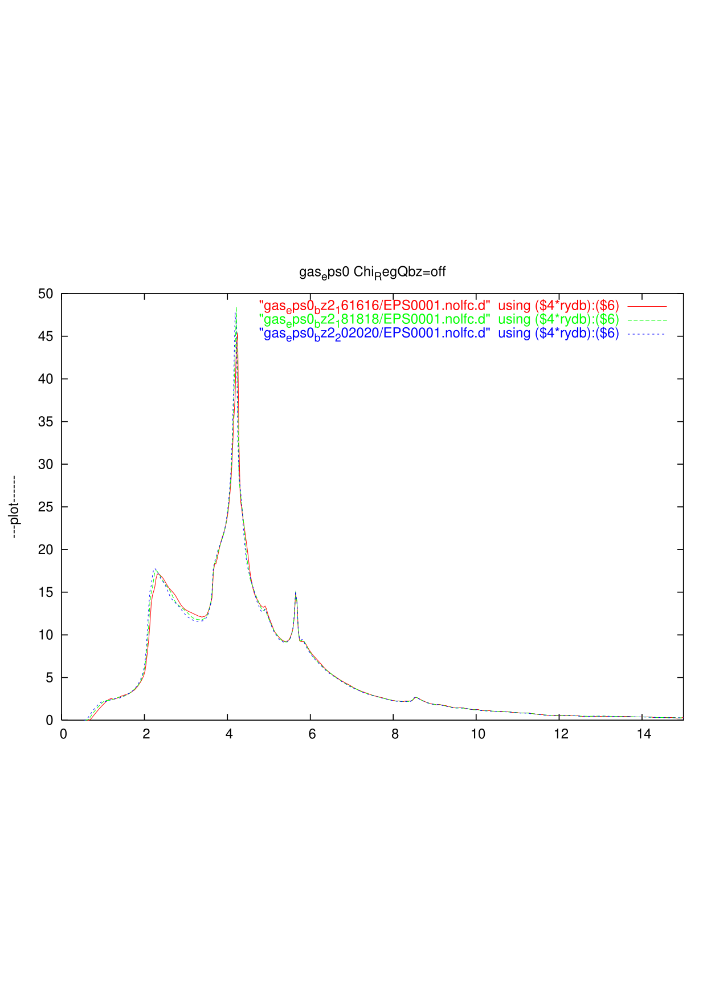

# Dielectric function: job_eps

> English version of the page [manual/optical](../../manual/optical.md). The pages at the top of ecaljdoc are the reference; this one was made from manual/optical.md of commit 2d552b893 (source blob 948e59b76cb8).

The RPA dielectric function $\epsilon(\mathbf q,\omega)$ is calculated with `job_eps` (since 2026-06; it replaces `epsPP0` of 2025-05-08).
The samples are in [Samples/EPS/](https://github.com/tkotani/ecalj/tree/main/Samples/EPS) (`EPS_Cu`, `EPS_GaAs`, `EPS_Ag`), and
[README_eps.md](https://github.com/tkotani/ecalj/blob/main/Samples/EPS/EPS_GaAs/README_eps.md) of `EPS_GaAs` gives the settings of this sample.
The theory is in [Optical properties](../theory/optical_properties).

Within the QSGW iterations too, $\epsilon_{IJ}(\mathbf q,\omega)$ (including local-field corrections) is calculated for $W$.
To compare with experiment, $\epsilon(\mathbf q,\omega)$ must be calculated with more k points than that, so `job_eps` is run after the self-consistent calculation.

For $\epsilon(\mathbf q,\omega)=1-v(\mathbf q)\chi_0(\mathbf q,\omega)$ without local-field corrections, the interband and intraband (the Drude weight in the limit $\mathbf q\to0$) contributions can be calculated separately.
Without local-field corrections, spherical Bessel functions for expanding $\exp(i\mathbf q\cdot\mathbf r)$ are added to the product basis in the MT (even with the usual product basis, the change is small).

## Procedure

1. Self-consistent calculation (`lmfa`, `lmf`; for QSGW, make `sigm.<sname>` with `gwsc`). If `sigm` exists, the calculation uses the QSGW eigenvalues and eigenfunctions.
2. Run `job_eps`.
   ```
   job_eps gaas -np 8               # without local-field corrections (fast)
   job_eps gaas -np 8 --lcf         # with local-field corrections (much slower)
   job_eps gaas -np 8 --decompose   # separate interband and intraband (the sample tests use this)
   ```
   `--nognuplot` skips drawing the figures.

The procedure of each sample is in `test.py` in each directory (in `ecalj/Samples/EPS`, `testecalj EPS_Cu -np 4` runs it in `EPS_Cu_work/`).

## Settings in `ctrlg.<sname>.toml`

### q points: `[gw] QforEPS`, `QforEPSau`

Since q = 0 cannot be used, several small q along one direction are calculated and the limit q → 0 is taken (or the smallest q is used).
If q is too small, the calculation becomes numerically unstable.

```toml
[gw]
QforEPSau = true   # required: true = QforEPS in a.u. (1/bohr); false = in units of 2π/alat
QforEPS = """
 0 0 0.00050
 0 0 0.00100
 0 0 0.00200
"""
```

`QforEPSau` is required (since 2026-11-14; the template has true). `QforEPS` written in `[blocks]` is read only when `[gw]` has no `QforEPS`.

An example of too small a q: in `EPS_GaAs`, the imaginary part for q = 0.0005 a.u. (`0 0 0.00050`, EPS0001) deviates strongly from EPS0002 and EPS0003 between 20 and 110 eV
(at 98 eV, Im ε = 0.077, versus 0.029 and 0.018 for EPS0002 and EPS0003). In this example, use EPS0002 (0.001 a.u.) and later.
For Cu too, a small q such as `0 0 0.00005` goes wrong, and when q is made as large as about 0.0032 a.u., the real part at ω=0 starts to deviate somewhat.

### k points: `[gw] n1n2n3eps` (or `n1n2n3`)

Sharp structures of Im ε need many k points (about 20×20×20 for GaAs; Fe and Ni also need 20×20×20, and 30×30×30 to see convergence).
`job_eps` uses `[gw] n1n2n3eps` if present, otherwise `n1n2n3` (`qg4gw --n1n2n3eps`).
With `n1n2n3eps`, only the dielectric function can be made finer, without changing `n1n2n3` of QSGW.
Without `--lcf`, even 20×20×20 runs without difficulty. With `--lcf`, start from about 12×12×12 (ε(0,0) of MgO is already reasonable there).

### Product basis (with `--lcf`)

To make `--lcf` lighter, reduce `[product_basis] pb_lcutmx` (e.g. to 2 for each atom) and set `[gw] QpGcut_cou` to about 2.0
([GW settings: product basis](./gwinput#product-basis)). Check with a small k mesh that the results do not change.

### Energy mesh: `[gw] HistBin_dw`, `HistBin_ratio`

The real-axis mesh is logarithmic, $\omega_i = b\,(e^{a(i-1)}-1)$, $a$ = `HistBin_ratio` − 1, $b$ = `HistBin_dw`/$a$ (the HistBin section of [GW settings](./gwinput)).
Making it finer does not increase the cost much. Since the weights of the imaginary part are accumulated as a histogram and the real part is then obtained by the Hilbert transform, it is numerically fairly stable.

```toml
HistBin_dw    = 2e-4   # (a.u.) bin width at ω = 0; 1e-5 is fine (metals)
HistBin_ratio = 1.01   # 1.03 is safer
```

### Memory

To reduce memory, write `KeepEigen = false` in `[gw]` (`KeepPpb = false` is the default). See [GW settings](./gwinput).

## Output

For the 1st, 2nd, … q of `QforEPS`, `EPS0001.nlfc.dat`, `EPS0002.nlfc.dat`, … are written (`nlfc` means without local-field corrections).
With `--lcf`, `EPS000n.dat` (with local-field corrections) is also written. With `--decompose`, `.interbandonly` and `.intrabandonly` are appended to the names.

Columns: q (1–3, in units of 2π/alat), ω (4, Ry), Re ε and Im ε (5, 6), the real and imaginary parts of 1/ε (7, 8). Example (EPS0001 of `EPS_GaAs`):
```
# qp(1:3)   w(Ry)   eps    epsi  --- NO LFC
  0.00000000  0.00000000  0.00085013    0.0000D+00  0.304436384993639E+02  0.144767011002870E-16    0.328475848910403E-01 -0.156198369108813E-19
```
The q value 0.00085013 is 0.0005 a.u. written in units of 2π/alat. As in the reference files included in the samples, the exponent may be written with `D`, so
when you plot with gnuplot yourself, add `set datafile fortran`.
```gnuplot
set datafile fortran
set xrange [0:20]
plot "EPS0001.nlfc.dat" u ($4*13.605):($6) w lp
```

At the end, `job_eps` writes gnuplot scripts and figures (pdf).

| Run | gnuplot script |
|---|---|
| `job_eps <sname>` | `eps_without_lcf_<sname>.glt` |
| `job_eps <sname> --lcf` | `eps_with_lcf_<sname>.glt` |
| `job_eps <sname> --decompose` | `eps_interbandonly_<sname>.glt`, `eps_intrabandonly_<sname>.glt`, `eps_total_<sname>.glt` (the total is interband + intraband − 1) |

For Cu (`EPS_Cu`), `gnuplot -p eps_intrabandonly_cu.glt` shows the Fermi-surface contribution (the Drude weight) for each q. The behavior near ω=0 is as described in Fetter-Walecka.

## Notes

* The $\sqrt{E-E_0}$ onset of Im ε at the absorption edge is hard to reproduce with the tetrahedron method unless the k mesh is very fine (80×80×80 for GaAs). Convergence of ε(q → 0, ω = 0) is much easier.
  An idea for obtaining the absorption edge correctly is in [the 2016 slides](../../data/abosorb_preport_tkotani2016Jul5.pptx.pdf).
* The former option `--zmel0` was dropped on 2025-05-08 (because the Gram-Schmidt orthogonalization in `sugw.f90` became accurate enough. Now only its registration remains, and it does nothing).

## Planned improvements

* The interband contribution at q = 0 should be calculable more directly, since the division by 1/q² can be done beforehand using the matrix ⟨u|u⟩.
* Local-field corrections (`job_eps --lcf`): `lcutmx=2` seems sufficient for 0.5 % error (probably better). Further, `QpGcut_cou` could be reduced to about 2.2,
  and the product basis made smaller (up to products p×d, without f). However, this needs checking, and `job_eps --lcf` may need some rework.
* Spin-fluctuation calculations should go through a model ([MLO](./mlo)) ([Other explanations § spin fluctuations](./UsageDetailed)).

## Old convergence tests (2010)
* Convergence tests for the number of k points (`n1n2n3`) (2010). Roughly, Fe and Ni need 20×20×20 for reasonable results. 30×30×30 is good for seeing convergence.
  However, for zincblende MnAs (probably because the structure around Ef is simple), fewer q points suffice.

  Old figures of ε of GaAs (2010).
  fig001: convergence in `n1n2n3` with `Chi_RegQbz = on` (mesh including Γ).
  
  fig002: convergence in `n1n2n3` with `Chi_RegQbz = off` (mesh not including Γ).
  
  fig003: comparison of the result of Alouani (from Arnaud) with `Chi_RegQbz = on` and `Chi_RegQbz = off`.
  The threshold of the red line (20×20×20, `Chi_RegQbz=on`) is almost the same as that of Alouani's result, but the red line oscillates too much at low energies.
  On the other hand, `Chi_RegQbz = off` (green dashed line) is not very satisfactory at low energies.
  

* Old unpublished QSGW results for the spin waves of zincblende MnAs:

