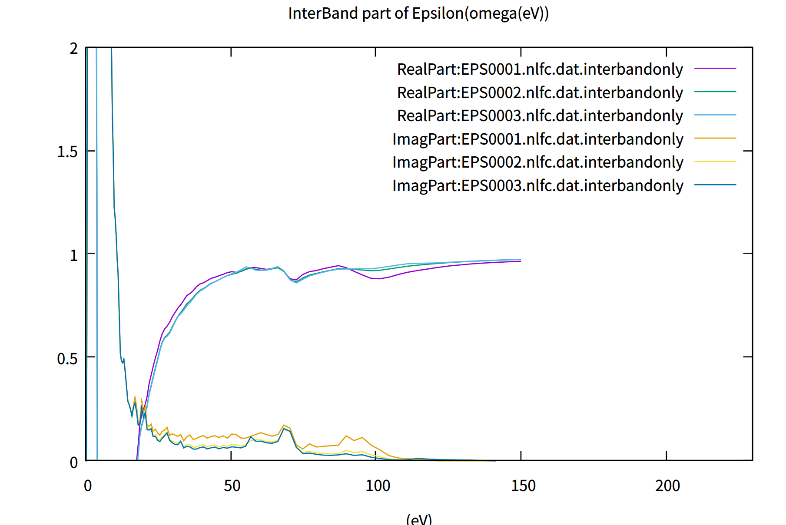
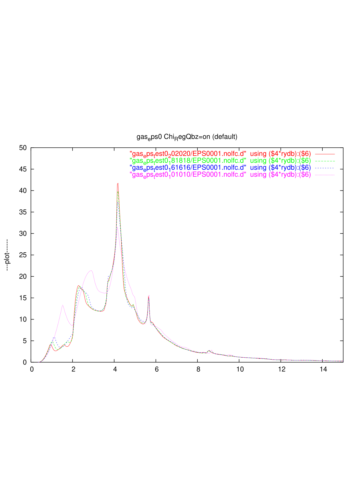
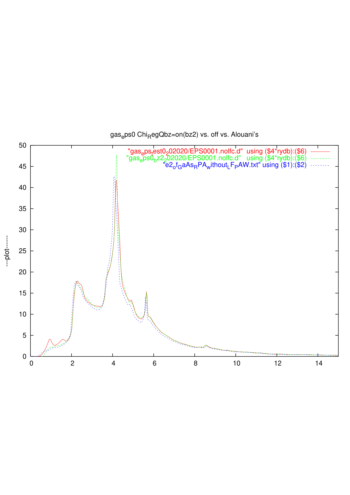
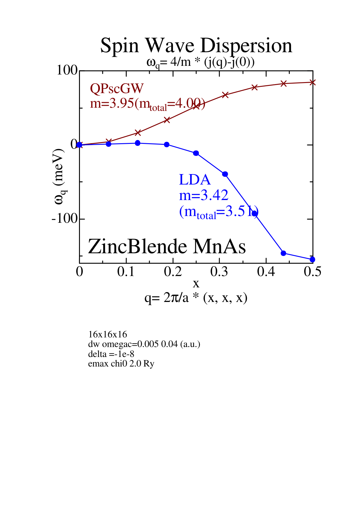

# Dielectric function: job_eps

> English version of the page [manual/optical](../../manual/optical.md). The pages at the top of ecaljdoc are the reference; this one was made from manual/optical.md of commit 85cdee981 (source blob 2cf0032efe11).

> ⚠️ **Tool consolidation (2026-06)** — The dielectric-function driver is now **`job_eps`** (with `--lcf` for local-field correction, `--decompose` for interband / intraband split). The legacy `epsPP0` / `eps_lmfh` / `epsPP_lmfh` / `epsPP_lmfh_intra` wrappers have moved to `SRC/exec_legacy/` and are no longer installed to `~/bin`.
>
> **TOML migration (2026-05)** — `job_eps` reads `ctrlg.<sname>.toml`. Convert legacy `ctrl.<sname>` / `GWinput` directories with `Legacy2toml.py <sname>`. See [Input file](./toml_migration) and worked examples in [Samples/EPS/](https://github.com/tkotani/ecalj/blob/main/Samples/EPS) — `EPS_Cu`, `EPS_GaAs`, `EPS_Ag`.

job_eps (canonical post-2026-06; replaces the 2025-5-8 `epsPP0` script).

During QSGW, we calculate $\epsilon_{IJ}(q, \omega)$ for $W$ in the GW calculation.

However, we need to calculate $\epsilon(q, \omega)$ with larger number of k points
to compare experiments.
<!-- In ecalj, the dielectric function can be calculated in the random phase approximation to study optical properties.
Here we explain the concrete steps of the calculation. -->

Based on the no local-field correction equation $\epsilon({\bf q},\omega)=1-v({\bf q}) \chi_0({{\bf q},\omega})$, we can calculate interband and intraband contributions separately.
The intraband contribution is the Drude weight at the limit ${\bf q} \to 0$.
We use the command `job_eps` now (legacy name: `epsPP0`). `job_eps --decompose` writes the interband / intraband split.
We include spherical Bessel functions in the MPB to expand $\exp(i {\bf q r})$.

Local-field corrections are enabled with `job_eps --lcf` (legacy name: `eps_lmfh`); the LFC path is computationally heavier but otherwise drives the same machinery. The LFC contribution is always included in the QSGW iteration itself; `--lcf` here only controls the post-SC dielectric output.


## Computational steps

### Examples of `job_eps`
It is instructive to learn things from samples as 
* ecalj/Samples/EPS/EPS_GaAs
* ecalj/Samples/EPS/EPS_Cu
* ecalj/Samples/EPS/EPS_Ag

Follow `test.py` in these directories (`testecalj EPS_Cu -np 4` in `ecalj/Samples/EPS` runs it in `EPS_Cu_work/`). 
We explain the steps in `test.py` in the following steps.

You can start from `ctrlg.<sname>.toml` (or, for legacy directories, `ctrl.<sname>` + `GWinput` after running `Legacy2toml.py <sname>`). After `job_eps cu -np 4 --decompose`,
<div class="clfix-old">

```
gnuplot -p epsinter.glt 
gnuplot -p epsintra.glt 
gnuplot -p epsall.glt 
```

</div>

<div class="clfix">

```
gnuplot -p eps_interbandonly_cu.glt
gnuplot -p eps_intrabandonly_cu.glt
gnuplot -p eps_total_cu.glt
```
(`epsinter.glt`, `epsintra.glt`, `epsall.glt` were the names written by the old `epsPP0`.)

</div>

Note that we usually need many k points if you like to have 0.1 level of error for 
dielectric constants (at the limit of ${\bf q}=\omega =0$)
(e.g, reasonable results for GaAs may require `[gw].n1n2n3 = [20, 20, 20]` in `ctrlg.<sname>.toml`.)

* NOTE: to calculate $\epsilon({\bf q},\omega)$ without LFC accurately,
the best basis set for the expansion of the Coulomb matrix within MT
is apparently not the product basis, but the Bessel functions
corresponding to the plane waves $\exp(i{\bf q r})$. We include such a basis in this mode. 
(However, our experience shows that the changes are little even with the usual product basis).

### step1: Run `lmf` to convergence.
If there is a `sigm` file, the dielectric function can be calculated from the eigenvalues and eigenfunctions of the QSGW calculation.


### step2: Set the GW driver parameters

The settings are written in the `[gw]` section of `ctrlg.<sname>.toml`.

- Edit `QforEPS` in `[gw]` of `ctrlg.<sname>.toml`
  (`QforEPS` written in `[blocks]` is read only when `[gw]` has no `QforEPS`).
    // by default it is written as follows
    ```toml
    [gw]
    QforEPSau = true

    QforEPS = """
    0 0 0.00050
    0 0 0.00100
    0 0 0.00200
    """
    ```
    * This part sets the **q** vectors at which the dielectric function is calculated.
    By changing these values, the dependence of the dielectric function on <del class="clfix">the direction of **q**</del><span class="clfix">**q** (magnitude and direction)</span> can be studied. <span class="clfix">Usually several small **q** along one direction are given and the limit **q**→0 is taken (several **q** are also needed to separate the intraband and interband parts).</span>

    * Since `QforEPSau = true` is given, the unit is a.u. That is, 0 0 0.001 means
    ${\bf q}$ = (0,0,0.001) bohr^{-1}

    * If `QforEPSau = true` is not given, the unit of **q** is $\frac{2 \pi }{a}$, where $a$ is the one defined by `[struc] alat`.


    For optical response we want **q**=**0**, but this is numerically unstable in the present code.
    So take it suitably small. <del class="clfix">This instability appears slightly below 100 eV in the figure from gnuplot -p epsinter.glt in ecalj/Samples/EPS/EPS_GaAs. So, for example, for EPS_GaAs, 0,0,0.00050 (corresponding to EPS0001) becomes somewhat large and is not good. See the gnuplot file epsinter.glt.</del><span class="clfix">In ecalj/Samples/EPS/EPS_GaAs, `gnuplot -p eps_interbandonly_gaas.glt` shows that at q = 0.0005 a.u. (`0 0 0.00050`, EPS0001) q is too small: the imaginary part between 20 and 110 eV (up to just below 100 eV) deviates upward from EPS0002 and EPS0003 (e.g. Im ε = 0.077 at 98 eV, against 0.029 and 0.018). In this example use EPS0002 (0.001 a.u.) and later.</span>
<!--  -->
<!-- Also, when the intraband and interband transitions are calculated separately as described below, two or more coordinates must be written. -->


- How to take the energy mesh
The mesh for calculating the dielectric function is a logarithmic mesh; in the `[gw]` section of `ctrlg.<sname>.toml`,
```toml
    HistBin_dw = 2e-3
    HistBin_ratio = 1.08
```
by changing these values the energy mesh of the dielectric function can be increased (decreased). With a finer mesh, more structure of the dielectric function appears. However, if it is too fine, the computational cost increases somewhat. The method first accumulates the weights of the imaginary part as a histogram, and then obtains the real part by Hilbert transformation. So it is reasonably stable numerically.


* To reduce the memory of the calculation, in the `[gw]` section of `ctrlg.<sname>.toml`
```toml
[gw]
KeepEigen = false
KeepPpb = false      # (default)
```
and so on, as appropriate ([gwinput](./gwinput)).


* `QforEPSau = true`
This means that q of `QforEPS` is measured in a.u.
For example, if `QforEPS` has `0 0 0.00005`, read it as
q=(0 0 0.00005)/bohr.
<span class="clfix">The EPS files write q (the first three columns) in units of 2π/alat.</span> To check, multiply the first three numbers of the EPS file by 2pi/alat
and see that it becomes the q written in `QforEPS`.

* The former --zmel0 option was abolished on 2025-5-8.
This is because GramSchmidt2 was inserted into sugw.f90,
which made a somewhat more accurate orthogonalization possible.

* At the end, `job_eps` writes gnuplot scripts (with `--decompose`: `eps_interbandonly_<sname>.glt`, `eps_intrabandonly_<sname>.glt`, `eps_total_<sname>.glt`) and figures (pdf). `--nognuplot` omits the figures.


* For Cu, the calculation is unstable if q is too close to zero. For example,
```toml
[gw]
QforEPSau = true
QforEPS = """
 0 0 0.00005
 0 0 0.0001
 0 0 0.0002
 0 0 0.0004
 0 0 0.0008
 0 0 0.0016
 0 0 0.0032
"""
```
then the graph for 0 0 0.00005 is strange.
The other graphs almost coincide. However, at about 0.0032 the real part at omega=0 starts to deviate somewhat.

* For Cu (Samples/EPS/EPS_Cu) there is also the Fermi-surface contribution;
<del class="clfix">`gnuplot -p epsintra.glt`</del><span class="clfix">`gnuplot -p eps_intrabandonly_cu.glt`</span>
shows the Fermi-surface contribution. This is Drude weight, seen resolved in q.
The behavior near omega=0 is as described in Fetter-Walecka.
<div class="clfix-old">

```
gnuplot -p epsintra.glt
gnuplot -p epsall.glt
```

</div>

<div class="clfix">

```
gnuplot -p eps_intrabandonly_cu.glt
gnuplot -p eps_total_cu.glt
```

</div>


* When the `job_eps` (legacy `epsPP0`) calculation finishes, files `EPS000*.nlfc.dat` are created, as many as the q points set by `QforEPS` in `[gw]`. They contain

```
    // example EPS0001.nlfc.dat
    q(1:3)   w(Ry)   eps    epsi  --- NO LFC
  0.01000000  0.00000000  0.00000000    0.0000E+00  0.276888086703565E+02  0.211273167660642E-17    0.361156744555281E-01 -0.275572453667495E-20
  0.01000000  0.00000000  0.00000000    0.1015E-04  0.276873286605807E+02  0.424191214559347E-01    0.361175202203266E-01 -0.553348246663633E-04
  0.01000000  0.00000000  0.00000000    0.3076E-04  0.276716446748960E+02  0.128515093142673E+00    0.361372966009293E-01 -0.167832020581202E-03
  0.01000000  0.00000000  0.00000000    0.5200E-04  0.276450859807482E+02  0.197440420455938E+00    0.361709489903162E-01 -0.258331892398948E-03
  0.01000000  0.00000000  0.00000000    0.7389E-04  0.276274571460234E+02  0.249411594405801E+00    0.361929258459201E-01 -0.326737828014011E-03
```
<span class="clfix">(This example is from an old run at q = (0.01, 0, 0) in units of 2π/alat, not from the `QforEPS` example above; the present header is `# qp(1:3) ...`.)</span>
columns 1-3: q-point coordinates; column 4: energy (Ry); columns 5, 6: real and imaginary parts of the dielectric function; columns 7, 8: real and imaginary parts of the inverse dielectric function.


---

** (Improvement plan) The dielectric-function calculation has a numerical problem: at the band absorption edge it does not rise cleanly as (E-E0)**.5 (in cases such as GaAs). It has been shown that it can be made clean by taking a fine mesh. Rather than an odd interpolation method, the technique of taking a fine mesh only where needed should be effective. It must be generalized.
Test at 2016: we need to have correct edge $\propto \sqrt{\omega-E_0}$. To do so, we need to move to new method as documented in the slide deck:
[abosorb_preport_tkotani2016Jul5.pdf](../../data/abosorb_preport_tkotani2016Jul5.pptx.pdf).

**(Improvement plan) The interband contribution at q=0 should be obtainable more directly, since with the `<u|u>` matrix the division by q² (the 1/q² factor) can be done beforehand.

** (To be fixed) Local-field correction
Local-field correction with `job_eps --lcf` (legacy name: `eps_lmfh`).
To include eps with LFC, do `job_eps --lcf <sname>`. Expensive.
lcutmx=2 seems to be good enough to get 0.5 percent error (maybe better than this).
Further we can use smaller QpGcut_cou like 2.2 or so, with rather smaller product basis (up to <del class="clfix">p timed d</del><span class="clfix">p×d products</span>, not including f).
But we need checks and may be modification of `job_eps --lcf`.

** Spin fluctuations should be calculated via a model
  
## old convergence test (2010)
* Convergence test for number of k point(specified by n1n2n3) test at 2010. 
   Roughly speaking, 20x20x20 is required for not-so-bad results for Fe and Ni.
   It is better to do 30x30x30 to see convergence check.
   However, in the case of ZB-MnAs (maybe because of simple structure around Ef), it requires less q points.

   Old figuresof epsilon for GaAs (2010).
   fig001: n1n2n3 convergence for Chi_RegQbz = on  case. (mesh including Gamma)
   
   fig002: n1n2n3 convergence for Chi_RegQbz = off case. (mesh not including Gamma)
   
   fig003: Alouanis'(from Arnaud)  vs. ``Chi_RegQbz = on'' vs. ``Chi_RegQbz = off''
   As you see, the threshold of the Red line (20x20x20 Chi_RegQbz=on) and Alouani's 
   are almost the same, but the red line is too oscilating at the low energy part.
   On the other hand, ``Chi_RegQbz = off'' in Green broken line is not so satisfactory
   at the low energy part. 
   

* Old unpublished result for spin wave of ZB MnAs in QSGW as


   <!-- As you see, k points convergence looks a little better in Chi_RegQbz=off
   (mesh not including gamma). However a little ploblem is that its thereshold around 
   0.5eV is too high and slowly changing. -->


   <!-- [fig.gas_eps_kconf.pdf] shows the convergence behevior of epsilon for  -->


<!-- ### step:3 epsPP_lmfh , eps_lmfh

For an eps calculation, use either epsPP_lmfh (without local-field correction) or eps_lmfh (with local-field correction).

Usage:

```   
 // example 
 mpirun epsPP_lmfh -np 4 si
```


---

## Dielectric function from intraband and interband contributions

Besides the usual dielectric-function calculation, the dielectric function can also be calculated with the intraband-transition and interband-transition contributions separated.
This is useful for analyzing the structure of the dielectric function and composite plasmons in metals etc.

Concretely, first write a small q coordinate and q coordinates slightly shifted from it in `[blocks].QforEPS` of `ctrlg.<sname>.toml` (legacy: `<QforEPS>...</QforEPS>` in `GWinput`).
 ```toml
    [blocks]
    QforEPS = """
     0 0 0.0001
     0 0 0.001
     0 0 0.01
      ...
    """
  ```
  Otherwise, as in the usual calculation, put q coordinates in the direction you want to calculate.  
  Then the calculation is done by using epsPP_lmfh_intra instead of epsPP_lmfh.
```   
 // example 
 mpirun epsPP_lmfh_intra -np 4 si
```
When the calculation finishes, files `EPS000*.nlfc.dat.intrabandonly` and `EPS000*.nlfc.dat.interbandonly`
are created. The data in them are the same as in the usual calculation.
 -->


<!-- 
=======================================================
* OLD document before 2025-5-7

To calculate the dielectric function at q=0, use the script epsPP0 from a converged state with a recent version (after 2023-10-23).
There is a sample in
ecalj/MATERIALS/Cueps
so after converging Cu,
epsPP0 cu -np 4
or the like gives epsinter.glt, epsintra.glt, epsall.glt.
epsintra is the Fermi-surface contribution.


We calculate at several q points and take q => 0. For that, in ctrl
------------------
```
QforEPSunita on
<QforEPS>
 0d0 0d0 0.00001
 0d0 0d0 0.001
 0d0 0d0 0.0014142
 0d0 0d0 0.002
 0d0 0d0 0.0028284
 0d0 0d0 0.004
</QforEPS>
```
------------------
or the like must be written.


At least two lines are needed.
```
QforEPSunita on
<QforEPS>
 0d0 0d0 0.00001
 0d0 0d0 0.001
</QforEPS>
```
------------------
is required. Preferably a few more lines.

QforEPSunita on specifies the unit 2pi/alat.
The first line 0d0 0d0 0.00001 is needed to calculate the numerical error.

 The dielectric-function calculation at 0d0 0d0 0.001 also uses the matrix elements calculated at 0d0 0d0 0.00001 (to estimate the size of the error). So EPS0002 and later are the meaningful answers.
In epsinter.glt etc., several q are calculated and overlaid.
For Cu one can see that they overlap cleanly.

At the end, epsPP0 runs readeps.py to put the answers together.
(readeps.py is messy. Results of trial and error remain, and the function fd0 is not used now.)
I think the results are obtained much more cleanly than before.

For Ag, please tell me if the result is still strange.

================================================================================
 -->
