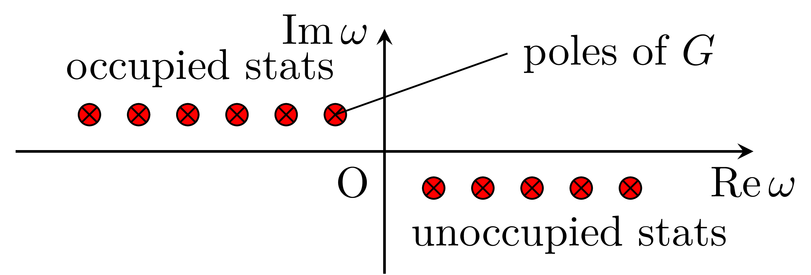

# Basic expressions

> English version of the page [theory/basic](../../theory/basic.md). The pages at the top of ecaljdoc are the reference; this one was made from theory/basic.md of commit 12e791b01 (source blob f71054987498).

On the Green function at zero temperature

## References
- A. L. Fetter and J. D. Walecka, *Quantum Theory of Many-Particle Systems* (McGraw-Hill, 1971). Japanese translation: 『多粒子系の量子論』理論編・応用編, translated by T. Matsubara and K. Fujii (McGraw-Hill Book, Tokyo, 1987)
- A. Szabo and N. S. Ostlund, *Modern Quantum Chemistry* (Macmillan, 1982; Dover, 1996), Chapter 6. Japanese translation: 『新しい量子化学 電子構造の理論入門』上・下, translated by K. Ohno, T. Sakai and Y. Mochizuki (University of Tokyo Press, 1987, 1988)

## What is a Green function {#what-is-green}

The linear response (impulse response) of a spring is the basis of the Green function.

**Impulse response of a spring.** For a damped spring (mass $m$, damping $\gamma$, spring constant $k$) driven by a force $f(t)$ (the source term), the displacement $x(t)$ obeys

$$
m\ddot x + \gamma \dot x + k x = f(t)
\tag{GF1}
$$

Write $g(t-t')$ for the response to a single kick at time $t'$ ($f(t)=𝛿(t-t')$). This is the impulse response (the Green function). An impulse is a strong kick in a very short time: the limit of a shorter and stronger kick with the impulse (the time integral of the force) kept fixed (this is $𝛿(t-t')$, with impulse 1).
Nothing moves before the kick, so $g=0$ for $t<t'$ (causality). With the step function $𝜃(t)$ (1 for $t>0$ and 0 for $t<0$), $g(t-t')$ has the factor $𝜃(t-t')$. Since the equation is linear, the response to any force is a superposition of kicks,

$$
x(t) = \int dt'\, g(t-t') f(t')
\tag{GF2}
$$

(linear response). This is sometimes called an integral equation. In the integral equation the solution $x(t)$ for the input $f(t)$ is determined uniquely, because the initial condition (at rest before the kick, $g=0$ for $t<t'$) is built in exactly . The differential equation (GF1) alone leaves the freedom to add a solution without force (a homogeneous solution), while Eq. (GF2) determines the particular solution only. What matters in practice is the particular solution only.

Set $m=1$. Taking the Fourier transform $x(𝜔)=\int dt\, e^{i𝜔t} x(t)$ ($d/dt \to -i𝜔$) and writing the spring and damping terms together as $H = k - i\gamma𝜔$, Eq. (GF1) becomes

$$
(H - 𝜔^2)\, x(𝜔) = f(𝜔)
\tag{GF3}
$$

Hence

$$
x(𝜔) = g(𝜔) f(𝜔), \qquad g(𝜔) = \frac{1}{H - 𝜔^2}
\tag{GF4}
$$

$g(𝜔)$ is nothing but the inverse of the operator $H-𝜔^2$ on the left-hand side of Eq. (GF3). When the displacement also depends on position (many masses connected by springs), $H$ is the matrix of spring constants (and damping); seeing the operator as a matrix, obtaining $g(𝜔)$ is the operation of inverting the matrix. The right-hand side of Eq. (GF2), too, is a product of a matrix $g$ and a vector $f$ when the times $t$ and $t'$ are seen as indices.

Two lessons follow.

- When the response $x(t)$ to the input $f(t)$ satisfies the differential equation (GF1), its solution is found by Eq. (GF2).
- Eq. (GF4) may be written abstractly, staying in time, as $g(t-t') = 1/(m\partial^2 + \gamma\partial + k)$ ($\partial = d/dt$; the right-hand side is the $(t,t')$ element of the inverse of the differential operator). The Fourier transform, $\partial \to -i𝜔$, gives Eq. (GF4).

**Dependence on position.** When the displacement $u(𝒓,t)$ also depends on position, as for a string or a membrane, the Green function is the response
$g(𝒓,t;𝒓',t')$ at point $𝒓$ and time $t$ to a kick at point $𝒓'$ and time $t'$: $u(𝒓,t)=\int d𝒓' dt'\, g(𝒓,t;𝒓',t') f(𝒓',t')$.

**A differential equation of first order in time.** The Schrödinger equation is of first order in time, so the Green function is the solution of

$$
\left(i\hbar \frac{\partial}{\partial t} - \hat H(𝒓)\right) G^\mathrm{R}(𝒓,t;𝒓',t') = \hbar\, 𝛿(𝒓-𝒓')𝛿(t-t')
\tag{GF5}
$$

that vanishes for $t<t'$ (the retarded Green function). It corresponds exactly to the impulse response $g$ of the spring in Eq. (GF1). With the eigenfunctions $𝜙_n$ and eigenvalues $𝜀_n$ of $\hat H$,

$$
G^\mathrm{R}(𝒓,t;𝒓',t') = -i\, 𝜃(t-t') \sum_n 𝜙_n(𝒓)𝜙^*_n(𝒓') e^{-i𝜀_n(t-t')/\hbar}
\tag{GF6}
$$

(the $𝛿(t-t')$ from differentiating $𝜃$, with the completeness $\sum_n 𝜙_n(𝒓)𝜙^*_n(𝒓')=𝛿(𝒓-𝒓')$, gives the right-hand side of Eq. (GF5)).
Its Fourier transform is $G^\mathrm{R}(𝒓,𝒓';𝜔) = \sum_n 𝜙_n(𝒓)𝜙^*_n(𝒓')/(𝜔+i𝜂-𝜀_n/\hbar)$, that is, $(𝜔+i𝜂-\hat H/\hbar)^{-1}$ as an operator, the same form as Eq. (GF4) ($𝜔$ enters squared or linearly as the equation is of second or first order in time). It is the amplitude to find at point $𝒓$ and time $t$ a particle put in at point $𝒓'$ and time $t'$.
Because the equation is of first order, the wave function at time $t'$ fixes the future, and the Green function has one side in time only ($t>t'$).
(The spring equation (GF1) is of second order, so its initial condition needs both position and velocity.)

**A chain of responses is a convolution; simultaneous propagation is a product.** The frequency representation is taken with the same Fourier transform as in Eq. (GF3). When the response $x_\mathrm{A}$ of a system A drives a system B as it is (in series, a chain), the total response is a convolution in time and a product in frequency:

$$
\begin{aligned}
g(t-t') &= \int dt''\, g_\mathrm{B}(t-t'') g_\mathrm{A}(t''-t'), \\
g(𝜔) &= g_\mathrm{B}(𝜔)\, g_\mathrm{A}(𝜔)
\end{aligned}
\tag{GF7}
$$

On the other hand, when two independent propagations run at the same time (in parallel) and we ask for the amplitude that both happen, the result is a product in time and a convolution in frequency:

$$
\begin{aligned}
g_\mathrm{AB}(t) &= g_\mathrm{A}(t)\, g_\mathrm{B}(t), \\
g_\mathrm{AB}(𝜔) &= \int \frac{d𝜔'}{2\pi}\, g_\mathrm{A}(𝜔') g_\mathrm{B}(𝜔-𝜔')
\end{aligned}
\tag{GF8}
$$

The polarization function $D = G G$, in which an electron and a hole propagate at the same time (Eq. (P3) below), and the self-energy $𝛴 = iGW$ ([Basic II](./basic2), "the case of the $GW$ self-energy") have this form. (Two mechanical springs A and B connected in parallel share the displacement and their forces add, so the inverse responses add, $1/g = 1/g_\mathrm{A} + 1/g_\mathrm{B}$. The product appears when amplitudes are multiplied, as above.)

## The vector space of an electron system {#fock-space}

In second quantization, operations that change the number of particles are also considered.
For simplicity, take $M=n^3$ lattice points and consider whether an electron is or is not at each point (spin is ignored).
Since each site either has an electron or not, there are $2^M$ states, and their linear combinations form a $2^M$-dimensional vector space.
This vector space is conveniently built up with products of matrices (these are changes of basis) called creation and annihilation operators.
The Hamiltonian is then considered in this linear space, and the ground state found with the total number of particles fixed is the ground state of the many-body system.

In a one-body problem, on the other hand, only one electron is considered, so we work in an $n^3$-dimensional vector space.
The ground state of a one-body problem is specified by dividing this $n^3$-dimensional vector space into the occupied and the unoccupied subspaces with the one-body Hamiltonian (this is what solving a one-body problem means).
With the Hamiltonian specified by the one-body problem (the division into the occupied and the unoccupied subspaces) as the base, the $2^M$-dimensional vector space is built up.
The Green-function method below (many-body perturbation theory) approaches this many-body problem on the basis of the one-body problem.

## Definition of the (one-particle) Green function

**Electron Green function.** At time $t_2$ add (kick in) one electron at point $𝒓_2$. The response is the $(N+1)$-electron state after the addition (the ground-state energy may be set to 0, so the ground state $\ket{\Psi_0}$ is taken as time-independent),

$$
\ket{\chi_\mathrm{ele}(t_1)} = 𝜃(t_1-t_2)\, e^{-i\hat H(t_1-t_2)/\hbar}\, \hat 𝜓^†(𝒓_2)\ket{\Psi_0}
\tag{Ge1}
$$

It evolves by the Schrödinger equation, which is linear and of first order in time, and it is 0 before the kick (the same structure as Eq. (GF6)). The equation satisfied by Eq. (Ge1) is

$$
\left(i\hbar\frac{\partial}{\partial t_1} - \hat H\right)\ket{\chi_\mathrm{ele}(t_1)} = i\hbar\, 𝛿(t_1-t_2)\, \hat 𝜓^†(𝒓_2)\ket{\Psi_0}
\tag{Ge2}
$$

where the right-hand side is the source term, the kick (the same form as Eq. (GF1) with $f=𝛿$). Understand Eq. (Ge2) in correspondence with Eq. (GF1). The point is that the source term on the right-hand side is proportional to $𝛿(t_1-t_2)$, and we solve the differential equation for the response to it. In the many-body problem the source term $\hat 𝜓^†(𝒓_2)\ket{\Psi_0}$ is the $(N+1)$-electron state made by adding one electron to the ground state of $N$ electrons; expanded in the eigenstates of the $(N+1)$-electron system, it contains many electron and hole excitations. This state seen at point $𝒓_1$ is the electron Green function:

$$
\begin{aligned}
iG_\mathrm{ele}(𝒓_1t_1, 𝒓_2t_2) &= \braket{\Psi_0|\hat 𝜓(𝒓_1)|\chi_\mathrm{ele}(t_1)} \\
&= \braket{\Psi_0|\hat 𝜓_\mathrm{H}(𝒓_1,t_1)\hat 𝜓^†_\mathrm{H}(𝒓_2,t_2)|\Psi_0}\, 𝜃(t_1-t_2)
\end{aligned}
\tag{Gd1}
$$

When the input that adds electrons is an arbitrary $f(𝒓_2,t_2)$ (where, when and how much), the response is the superposition of the kicked responses; seen at point $𝒓_1$,

$$
x(𝒓_1,t_1) = \int d𝒓_2\, dt_2\; iG_\mathrm{ele}(𝒓_1t_1, 𝒓_2t_2)\, f(𝒓_2,t_2)
\tag{Ge3}
$$

(the same linear-response form as Eq. (GF2)). The basic equation is Eq. (Ge2). For an arbitrary input, the right-hand side as the source term is replaced by $i\hbar\int d𝒓_2\, f(𝒓_2,t_1)\,\hat 𝜓^†(𝒓_2)\ket{\Psi_0}$, and the response measured by taking the inner product of the solution at $(𝒓_1,t_1)$ (with $\bra{\Psi_0}\hat 𝜓(𝒓_1)$) is Eq. (Ge3).

**Hole Green function.** At time $t_1$ remove one electron at point $𝒓_1$. The response is the remaining $(N-1)$-electron state,

$$
\ket{\chi_\mathrm{hole}(t_2)} = 𝜃(t_2-t_1)\, e^{-i\hat H(t_2-t_1)/\hbar}\, \hat 𝜓(𝒓_1)\ket{\Psi_0}
\tag{Gh1}
$$

This state seen at point $𝒓_2$ is the hole Green function (the sign comes from exchanging fermions):

$$
\begin{aligned}
iG_\mathrm{hole}(𝒓_1t_1, 𝒓_2t_2) &= -\braket{\Psi_0|\hat 𝜓^†(𝒓_2)|\chi_\mathrm{hole}(t_2)} \\
&= -\braket{\Psi_0|\hat 𝜓^†_\mathrm{H}(𝒓_2,t_2)\hat 𝜓_\mathrm{H}(𝒓_1,t_1)|\Psi_0}\, 𝜃(t_2-t_1)
\end{aligned}
\tag{Gd2}
$$

In its own time ($t_2-t_1>0$) the hole also goes to the future. The hole seems to "propagate to the past" only because the variables $(𝒓_1t_1, 𝒓_2t_2)$ are simply swapped.

- $\hat 𝜓_\mathrm{H}(𝒓,t)$ : the field operator in the Heisenberg picture, $\hat 𝜓_\mathrm{H}(𝒓,t) = e^{i\hat Ht/\hbar}\hat 𝜓(𝒓)e^{-i\hat Ht/\hbar}$.
- $\hat 𝜓^†_\mathrm{H}(𝒓,t) = e^{i\hat Ht/\hbar}\hat 𝜓^†(𝒓)e^{-i\hat Ht/\hbar}$.
- The field operators of fermions satisfy the anticommutation relation $\{𝜓_\mathrm{H}(𝒓_1,t),𝜓_\mathrm{H}^†(𝒓_2,t)\} = 𝛿(𝒓_1-𝒓_2)$. Note that this is the equal-time anticommutation relation.
- $\Psi_0$: the $N$-particle ground state in the Heisenberg picture, $\hat H\ket{\Psi_0} = E \ket{\Psi_0}$ ($\hat H$ includes $-𝜇\hat N$ and $E=0$; see the section "Hamiltonian" below)

The sum of Eqs. (Gd1) and (Gd2) of this one-particle Green function is what is called the one-particle Green function with the T product (Eq. (G4)); it is introduced naturally in the perturbation theory below.

### The Gell-Mann–Low theorem and disconnected diagrams {#gell-mann-low}

Switching the interaction on adiabatically turns the non-interacting ground state $\ket{\Phi_0}$ into the interacting ground state (the Gell-Mann–Low theorem). Split the Hamiltonian into the non-interacting part $\hat H_0$ (including $-𝜇\hat N$) and the interaction $\hat V$, and define the operators in the interaction picture as

$$
\hat 𝜓_\mathrm{I}(𝒓,t) = e^{i\hat H_0 t/\hbar}\,\hat 𝜓(𝒓)\,e^{-i\hat H_0 t/\hbar}, \qquad
\hat V_\mathrm{I}(t) = e^{i\hat H_0 t/\hbar}\,\hat V\,e^{-i\hat H_0 t/\hbar}
\tag{G1}
$$

The time-evolution operator from time $t'$ to $t$ ($t>t'$) is the series of integrals with the later times on the left,

$$
\begin{aligned}
\hat S(t,t') = \sum_{n=0}^{\infty} \left(\frac{-i}{\hbar}\right)^{n}
&\int_{t'}^{t} d\tau_1 \int_{t'}^{\tau_1} d\tau_2 \cdots \\
&\times \int_{t'}^{\tau_{n-1}} d\tau_n\, \hat V_\mathrm{I}(\tau_1)\hat V_\mathrm{I}(\tau_2)\cdots \hat V_\mathrm{I}(\tau_n)
\end{aligned}
\tag{G2}
$$

($\tau_1>\tau_2>\cdots>\tau_n$; the interaction is switched on with the adiabatic factor $e^{-𝜂|\tau|}$). Write $\hat S = \hat S(\infty,-\infty)$. Then the Green function is

$$
\begin{aligned}
&iG(𝒓_1t_1, 𝒓_2t_2) = \frac{1}{\braket{\Phi_0|\hat S|\Phi_0}} \Big[ \\
&\quad \langle\Phi_0|\hat S(\infty,t_1)\,\hat 𝜓_\mathrm{I}(𝒓_1,t_1)\,\hat S(t_1,t_2) \\
&\qquad\quad \times\hat 𝜓^†_\mathrm{I}(𝒓_2,t_2)\,\hat S(t_2,-\infty)|\Phi_0\rangle\, 𝜃(t_1-t_2) \\
&\quad -\langle\Phi_0|\hat S(\infty,t_2)\,\hat 𝜓^†_\mathrm{I}(𝒓_2,t_2)\,\hat S(t_2,t_1) \\
&\qquad\quad \times\hat 𝜓_\mathrm{I}(𝒓_1,t_1)\,\hat S(t_1,-\infty)|\Phi_0\rangle\, 𝜃(t_2-t_1) \Big]
\end{aligned}
\tag{G3}
$$

The times are ordered with the later ones on the left; no T product is used. Diagrams can be written down from this form as it is; they are then a diagram expansion made of propagation forward along the time axis (with step functions). That is, all the terms have to be written down with the non-interacting (Gd1) and (Gd2).

**Writing with the T product.** Electrons ($t_1>t_2$: an electron is added and propagates) and holes ($t_2>t_1$: an electron is removed and propagates) can be treated together by adding the two in parallel. This is because the basis functions of both the electron and the hole are specified by the same one-body Hamiltonian. That sum, $G = G_\mathrm{ele} + G_\mathrm{hole}$, is the Green function, and with the time-ordered product (T product) it is written in one line:

$$
iG(𝒓_1t_1, 𝒓_2t_2) = \braket{\Psi_0|T[\hat 𝜓_\mathrm{H}(𝒓_1,t_1)\hat 𝜓^†_\mathrm{H}(𝒓_2,t_2)]|\Psi_0}
\tag{G4}
$$

$T$ reorders the operators with the later times on the left and the earlier on the right, changing the sign at each exchange of fermion operators. In perturbation theory, symmetrizing the ranges of the integrals in Eq. (G2) to $-\infty$ to $\infty$ gathers the step functions into $1/n!$ and the T product, and Eq. (G3) becomes the one line $iG = \braket{\Phi_0|T[\hat S\,\hat 𝜓_\mathrm{I}(𝒓_1,t_1)\hat 𝜓^†_\mathrm{I}(𝒓_2,t_2)]|\Phi_0}/\braket{\Phi_0|\hat S|\Phi_0}$.

 The vacuum amplitude in the denominator cancels exactly the disconnected diagrams of the numerator (the vacuum parts not connected to the external lines).
So the disconnected diagrams need not be counted; only connected diagrams are summed (the linked-cluster theorem).

The correspondence with ordinary (time-independent) perturbation theory: there are two kinds of disconnected diagrams.

- **Disconnected type 1**: the system returns to the vacuum $\ket{\Phi_0}$ in an intermediate state (the disconnected parts follow one another in time). Ordinary perturbation theory excludes $\ket{\Phi_0}$ from the intermediate states, so these never enter.
- **Disconnected type 2**: disconnected but overlapping in time (the intermediate state has two excitations and is not $\ket{\Phi_0}$). These do enter the formulas of ordinary perturbation theory, but they cancel exactly the terms that come from the normalization (e.g. $-V_{00}\sum_n|V_{0n}|^2/\Delta_n^2$ at third order).

Excluding type 1, and dropping type 2 together with the normalization terms, leaves only the connected diagrams: the same result as Eq. (G3) (Goldstone).

> On the side of perturbation theory without time, this cancellation is shown for the energy, order by order, in Chapter 6 (many-body perturbation theory) of the quantum-chemistry textbook by Szabo and Ostlund.
> The renormalization terms that come from the normalization cancel the unlinked terms, and the energy stays proportional to the size of the system (size consistency).
> Unlinked terms appear clearly from the fourth order on, and terms such as $-E^{(2)}\sum_n|V_{0n}|^2/\Delta_n^2$ cancel them (the linked-diagram theorem).
> There the energy (vacuum diagrams without external lines) is treated, but the mechanism of the cancellation is the same for the Green function (two external lines).
> In the Møller–Plesset division ($\hat H_0$ taken as the sum of Fock operators), $\hat H-\hat H_0$ contains a one-body part, so $V_{00}=E^{(1)}$ is not zero; this is the same structure as the note on the adiabatic connection in the section [Hamiltonian](#hamiltonian).

> In the form of Eq. (G3), with the terms written for each time ordering (Goldstone type), each ordering of the vertex times is a separate term. Feynman's view is to see the hole as an electron going backward in time, to represent the electron and the hole by one propagator (the T-product Green function of Eq. (G4)), and to gather the terms of different time orderings into one diagram. Integrating over frequency, the energy denominators come out automatically. The formal derivation with the T product and $1/n!$ is due to Dyson. Note that, many-body perturbation theory though it is, the essence is the same as ordinary perturbation theory; it is only rewritten.

### Perturbation theory with and without time {#td-vs-ti-perturbation}

Perturbation theory with time (expanding $\hat S$ as in Eqs. (G2) and (G3)) gives correlation functions, that is, operators at different times sandwiched by the ground state (Green functions and response functions). It corresponds to elementary perturbation theory as follows; the two are not different theories.

- An elementary example of perturbation theory with time is Fermi's golden rule. The transition amplitude is taken to first (linear) order in the perturbation, which gives the transition rate. The rate corresponds to the imaginary part of the second-order energy shift (the imaginary part of the self-energy, the quasiparticle lifetime).
- Perturbation theory without time gives energies and expectation values of operators. An expectation value sandwiches the operator between the same state on the left and right; it is a correlation function with its two times set equal (for example the density, $𝜌(𝒓) = -iG(𝒓t,𝒓t^+)$).
- Doing the time integrals with the adiabatic factor $e^{𝜂 t}$ gives, per integral, a factor $1/(E_0-E_n)$ for the intermediate state $n$, which is the formula of perturbation theory without time (Goldstone).

Perturbation theory with time thus contains perturbation theory without time, and gives more: the correlation at different times (the excitation spectrum). Many-body perturbation theory is not different from basic perturbation theory. What differs is that the terms are organized by diagrams and the waste is removed by counting only the connected ones (ordinary perturbation theory has to do the same: the disconnected terms must be cancelled; types 1 and 2 above). Also, selected terms can be summed to infinite order, as in the Dyson equation (this ends up as a self-consistent equation: in the GW approximation, the electrons ($G$) determine the effective electrostatic interaction between the electrons ($W$), which determines the effective one-body potential ($𝛴$); this determines the electron density).

## Green function of a non-interacting system

### Hamiltonian {#hamiltonian}
We take the Hamiltonian as $\hat H -μ\hat N$ and set the ground-state energy to 0. $𝜇$: the Fermi energy; $\hat N = \int d𝒓 𝜓^†(𝒓)𝜓(𝒓)$: the particle-number operator; with $N$ the number of particles in the ground state, $\hat N \ket{\Psi_0} = N \ket{\Psi_0}$. From the previous section on, the $\hat H$ of the Heisenberg picture $e^{i\hat Ht/\hbar}\cdots e^{-i\hat Ht/\hbar}$ is also read as this $\hat H-𝜇\hat N$ (for the density operator $\hat 𝜌_\mathrm{H}$ it makes no difference, since $\hat N$ commutes with $\hat 𝜌$).
Without interaction the Hamiltonian is a sum over one-particle states,
$$
\hat H - \mu \hat N =  \sum_n 𝜀_n \hat c^†_{n}\hat c_{n}
\tag{N1}
$$
.

> [!WARNING]
>  Note that the energy reference (zero) is the Fermi level.

Here $𝜙_{n}(𝒓)$ are the eigenfunctions of the one-particle Hamiltonian (they form a complete set), and $\hat c_n$ are the coefficients of the expansion of the field operator in them.
$$
\hat 𝜓(𝒓) = \sum_n \hat c_n 𝜙_{n}(𝒓)
\tag{N2}
$$
In the ground state without interaction, all the orbitals with $𝜀_n<0$ are occupied and those with $𝜀_n>0$ are empty.

> In QSGW and similar methods the one-body term of $\hat H_0$ is optimized, so the division for perturbation (the way the interaction is switched on adiabatically) is
> $\hat H_\lambda-\mu\hat N=\hat H_0-\mu\hat N+\lambda(\hat H-\hat H_0)$, where $\hat H_0$ is the one-body part.
> This is also called the adiabatic connection. $\hat H-\hat H_0$ then contains a one-body part.
> In this method the quasiparticle bands are conserved while $\lambda$ is changed from 0 to 1. It is the best way to switch on the interaction adiabatically.

### Real-time representation
The two processes, an electron created in an unoccupied state by $\hat 𝜓^\dagger \ket{\Psi_0}$, or a hole created in an occupied state by $\hat 𝜓 \ket{\Psi_0}$ (an occupied electron annihilated), correspond to the electron of Eq. (Gd1) and the hole of Eq. (Gd2), respectively.
$$
\begin{align}
&\braket{\Psi_0|\hat 𝜓_\mathrm{H}(𝒓_1,t_1)\hat 𝜓^†_\mathrm{H}(𝒓_2,t_2)|\Psi_0} \\
&= \braket{\Psi_0|\hat 𝜓(𝒓_1)e^{-i(\hat H- 𝜇 \hat N)(t_1-t_2)/\hbar}  \hat 𝜓^†(𝒓_2)|\Psi_0} \\
&= \sum_{n'}^{\mathrm{unocc}} 𝜙_{n'}(𝒓_1)𝜙^*_{n'}(𝒓_2)e^{-i𝜀_{n'}(t_1-t_2)/\hbar} \\
&\qquad (\text{electron: from creation to annihilation}) \\
&\braket{\Psi_0|\hat 𝜓^†_\mathrm{H}(𝒓_2,t_2)\hat 𝜓_\mathrm{H}(𝒓_1,t_1)|\Psi_0} \\
&= \braket{\Psi_0|\hat 𝜓^†(𝒓_2)e^{-i(\hat H- 𝜇 \hat N)(t_2-t_1)/\hbar} \hat 𝜓(𝒓_1)|\Psi_0} \\
&= \sum_{n}^{\mathrm{occ}} 𝜙_{n}(𝒓_1)𝜙^*_{n}(𝒓_2)e^{i𝜀_{n}(t_2-t_1)/\hbar} \\
&\qquad (\text{hole: from creation to annihilation})
\tag{N3}
\end{align}
$$
- Creation and annihilation act on the same one-particle state $n$; otherwise the term vanishes.
- A state with a created hole is also an excited state; its excitation energy from the ground state is $-𝜀_n>0$.
::: details Derivation

Since the eigenvalue of $\hat H-𝜇\hat N$ in the ground state is set to 0, $e^{-i(\hat H-𝜇\hat N)t_2/\hbar}\ket{\Psi_0}=\ket{\Psi_0}$.
Of $\hat 𝜓^†(𝒓_2)\ket{\Psi_0}=\sum_{n'}𝜙^*_{n'}(𝒓_2)\hat c^†_{n'}\ket{\Psi_0}$ only the unoccupied $n'$ survive, and $(\hat H-𝜇\hat N)\hat c^†_{n'}\ket{\Psi_0}=𝜀_{n'}\hat c^†_{n'}\ket{\Psi_0}$.
Multiplying from the left by $\bra{\Psi_0}\hat 𝜓(𝒓_1)=\sum_{m}𝜙_{m}(𝒓_1)\bra{\Psi_0}\hat c_{m}$ and using $\braket{\Psi_0|\hat c_{m}\hat c^†_{n'}|\Psi_0}=𝛿_{mn'}$ gives the first expression.
The second follows in the same way: in $\hat 𝜓(𝒓_1)\ket{\Psi_0}$ only the occupied $n$ survive, and $(\hat H-𝜇\hat N)\hat c_{n}\ket{\Psi_0}=-𝜀_{n}\hat c_{n}\ket{\Psi_0}$.

:::

Hence,
$$
\begin{align}
iG(𝒓_1t_1,𝒓_2t_2) =& \sum_{n'}^{\mathrm{unocc}} 𝜙_{n'}(𝒓_1)𝜙^*_{n'}(𝒓_2)e^{-i𝜀_{n'}(t_1-t_2)/\hbar} 𝜃(t_1-t_2) \\
  &- \sum_{n}^{\mathrm{occ}} 𝜙_{n}(𝒓_1)𝜙^*_{n}(𝒓_2)e^{i𝜀_{n}(t_2-t_1)/\hbar}𝜃(t_2-t_1) \\
  & = iG_\mathrm{ele}(𝒓_1t_1,𝒓_2t_2)+ iG_\mathrm{hole}(𝒓_1t_1,𝒓_2t_2)
\tag{N4}
\end{align}
$$
The last line is the non-interacting form of the electron and hole Green functions of Eqs. (Gd1) and (Gd2). The unoccupied term has the same form as Eq. (GF6); only the occupied term is moved, with its sign changed, to the side $t_2>t_1$. Separating electrons and holes helps in understanding products of the Green function with something else (the simultaneous propagation of Eq. (GF8)).
> [!INFO]
> The Green function is easier to picture in real space and real time.

### Frequency representation
Since the Green function is a function of $t_1-t_2$, its Fourier transform with respect to it is also used. It is called the Lehmann representation or the spectral representation.
As the Fourier representation of the step function we have
$$
𝜃(t) = - \int \frac{d𝜔'}{2𝜋i} \frac{e^{-i𝜔't}}{𝜔'+i𝛿}
\tag{N5}
$$
Here $𝛿$ is a positive infinitesimal. The step function is expressed by whether or not the residue in the lower half of the $𝜔'$ plane is picked up.

::: info
The Fourier transform has an ambiguity in the normalization factor; in this text we take the following (the same as used in Eq. (GF3)).
$$
\begin{align}
f(𝜔) &= \int dt f(t) e^{i𝜔t} \\
f(t) &= \frac{1}{2\pi}\int d𝜔 f(𝜔) e^{-i𝜔t} \\
𝛿(𝜔) &= \frac{1}{2\pi} \int dt e^{i𝜔t}
\tag{N6}
\end{align}
$$
:::

Consider the Fourier transform of $𝜃(\pm t)e^{-iEt/\hbar}$ (for $𝜃(-t)$, replace $e^{-i𝜔't}$ in $𝜃(t)$ by $e^{i𝜔't}$):
$$
\begin{align}
\int dt 𝜃(\pm t)e^{-iEt/\hbar}e^{i𝜔t} = - \int \frac{d𝜔'}{2𝜋i} \int dt \frac{e^{-i(\pm 𝜔'+ E/\hbar-𝜔)t}}{𝜔'+ i𝛿} \\
= - \int \frac{d𝜔'}{i}\frac{1}{𝜔'+ i𝛿}𝛿(\pm 𝜔'-𝜔+ E/\hbar) = i\frac{1}{\pm (𝜔 - E/\hbar) + i𝛿}
\tag{N7}
\end{align}
$$
Then,

$$
\begin{align}
G(𝒓_1,𝒓_2;𝜔) &= \int d(t_1-t_2) G(𝒓_1t_1,𝒓_2t_2) e^{i𝜔(t_1-t_2)} \\
&=  \sum_{n'}^{\mathrm{unocc}} \frac{𝜙_{n'}(𝒓_1)𝜙^*_{n'}(𝒓_2)}{𝜔-𝜀_{n'}/\hbar + i𝛿} +
    \sum_{n}^{\mathrm{occ}} \frac{𝜙_{n}(𝒓_1)𝜙^*_{n}(𝒓_2)}{𝜔 - 𝜀_{n}/\hbar -i𝛿}
\tag{N8}
\end{align}
$$
is obtained. In the $𝜔$ plane extended to complex numbers, the poles of the unoccupied states (electron excitations) lie in the lower half plane at $\Re 𝜔 >0$, and the poles of the occupied states (hole excitations) in the upper half plane at $\Re 𝜔 <0$.

In the figure: stats → states

> [!INFO]
> The $i$ in the definition of the real-time representation was attached so that the expression in the frequency representation becomes clean.

### Density of states

$$
\lim_{𝛿 →0}\frac{1}{x \pm i 𝛿} = \mathcal{P} \frac{1}{x} \mp i𝜋𝛿(x)
\tag{N9}
$$
Using the relation above,
$$
\begin{align}
\int d𝒓 G(𝒓,𝒓;𝜔) &=  \sum_{n} \frac{1}{𝜔-𝜀_{n}/\hbar \mp i𝛿} \\ &= \sum_n \left( \mathcal{P} \frac{1}{𝜔-𝜀_n/\hbar} \pm i 𝜋 𝛿(𝜔-𝜀_n/\hbar)\right)
\tag{N10}
\end{align}
$$
(upper signs: occupied, $𝜀_n\lt 0$; lower signs: unoccupied, $𝜀_n>0$), and formally the density of states $N(𝜀) = \sum_n 𝛿(𝜀-𝜀_n)$ (to distinguish it from the polarization function $D$) can be written as

$$
\begin{align}
N(𝜀) = \pm \frac{1}{𝜋\hbar}\Im \text{Tr}G(𝜀/\hbar)\quad \text{where } (+:𝜀<0,\ -:𝜀>0)
\tag{N11}
\end{align}
$$
The factor $1/\hbar$ comes from $𝛿(𝜀/\hbar-𝜀_n/\hbar)=\hbar\,𝛿(𝜀-𝜀_n)$. The signs follow the double signs above.

## Time-ordered polarization function

With the density operator in the Heisenberg picture $\hat 𝜌_\mathrm{H}(𝒓,t)$, $\hat 𝜌_\mathrm{H}(𝒓,t) = e^{i\hat Ht/\hbar}\hat 𝜓^†(𝒓)\hat 𝜓(𝒓)e^{-i\hat Ht/\hbar}$.
We introduce the operator of the deviation from the expectation value of the density, $\hat {𝛿\rho} = \hat \rho - \braket{\hat \rho}$.
The time-ordered polarization function $D(𝒓_1t_1,𝒓_2t_2)$ is then defined as the time-ordered product ($T$ of Eq. (G4)) of densities (density correlation):
$$
\begin{align}
iD(𝒓_1t_1,𝒓_2t_2) &= 
\braket{T[\hat {𝛿𝜌}(𝒓_1,t_1)\hat {𝛿𝜌}(𝒓_2,t_2)]} \\ &= 
\braket{\hat   {𝛿𝜌}(𝒓_1,t_1)\hat {𝛿𝜌}(𝒓_2,t_2)}𝜃(t_1-t_2)  \\
&\quad +\braket{\hat  {𝛿𝜌}(𝒓_2,t_2)\hat {𝛿𝜌}(𝒓_1,t_1)}𝜃(t_2-t_1)
\tag{P1}
\end{align}
$$

## Time-ordered polarization function of a non-interacting system
In a non-interacting system, decomposing the T product into products of Green functions by Wick's theorem, the normal-ordered (N-product) terms have zero ground-state expectation value, so only the full contractions remain:
$$
\begin{align}
iD(𝒓_1t_1,𝒓_2t_2) &= 
\braket{T[\hat {𝛿𝜌}(𝒓_1,t_1)\hat {𝛿𝜌}(𝒓_2,t_2)]} \\ &= G(𝒓_1t_1,𝒓_2t_2)G(𝒓_2t_2,𝒓_1t_1)
\tag{P2}
\end{align}
$$
Recalling that $G(𝒓_1t_1,𝒓_2t_2) = G_\mathrm{ele}(𝒓_1t_1,𝒓_2t_2) + G_\mathrm{hole}(𝒓_1t_1,𝒓_2t_2)$ can be separated, with $G_\mathrm{ele}$ remaining for $t_1 > t_2$ and $G_\mathrm{hole}$ for $t_1 < t_2$ (the step functions of Eqs. (Gd1) and (Gd2)),
$$
\begin{align}
iD(𝒓_1t_1,𝒓_2t_2) =& G_\mathrm{ele}(𝒓_1t_1,𝒓_2t_2)G_\mathrm{hole}(𝒓_2t_2,𝒓_1t_1) \\
                  &+ G_\mathrm{hole}(𝒓_1t_1,𝒓_2t_2)G_\mathrm{ele}(𝒓_2t_2,𝒓_1t_1) \\
               =& \sum_{n'}^\mathrm{unocc} \sum_{n}^\mathrm{occ} 𝜙_{n'}(𝒓_1) 𝜙^*_{n'}(𝒓_2) 𝜙_{n}(𝒓_2) 𝜙^*_{n}(𝒓_1) \\
                &\qquad \times e^{-i(𝜀_{n'}-𝜀_{n})(t_1-t_2)/\hbar} \theta(t_1-t_2) \\
                & +\sum_{n}^\mathrm{occ} \sum_{n'}^\mathrm{unocc} 𝜙_{n}(𝒓_1) 𝜙^*_{n}(𝒓_2) 𝜙_{n'}(𝒓_2) 𝜙^*_{n'}(𝒓_1) \\
                &\qquad \times e^{-i(𝜀_{n'}-𝜀_{n})(t_2-t_1)/\hbar} \theta(t_2-t_1)
\tag{P3}
\end{align}
$$
Since the electron and the hole propagate at the same time, this is a product in time, the form of Eq. (GF8). Its Fourier transform, in the same way as above, is
$$
\begin{align}
D(𝒓_1,𝒓_2;𝜔) =& \sum_{n'}^\mathrm{unocc} \sum_{n}^\mathrm{occ} 
                   \frac{𝜙_{n'}(𝒓_1) 𝜙^*_{n'}(𝒓_2) 𝜙_{n}(𝒓_2) 𝜙^*_{n}(𝒓_1)}{  𝜔-(𝜀_{n'}-𝜀_n)/\hbar + i𝛿} \\
              & +\sum_{n}^\mathrm{occ} \sum_{n'}^\mathrm{unocc} 
                   \frac{𝜙_{n}(𝒓_1) 𝜙^*_{n}(𝒓_2) 𝜙_{n'}(𝒓_2) 𝜙^*_{n'}(𝒓_1)}{-(𝜔-(𝜀_{n}-𝜀_{n'})/\hbar) + i𝛿} \\
            =& \sum_{n'}^\mathrm{unocc} \sum_{n}^\mathrm{occ} \left[
                   \frac{𝜙_{n'}(𝒓_1) 𝜙^*_{n'}(𝒓_2) 𝜙_{n}(𝒓_2) 𝜙^*_{n}(𝒓_1)}{  𝜔-(𝜀_{n'}-𝜀_n)/\hbar + i𝛿} \right. \\
              & \qquad\qquad \left. -\frac{𝜙_{n}(𝒓_1) 𝜙^*_{n}(𝒓_2) 𝜙_{n'}(𝒓_2) 𝜙^*_{n'}(𝒓_1)}{  𝜔+(𝜀_{n'}-𝜀_{n})/\hbar - i𝛿} \right]
\tag{P4}
\end{align}
$$
.
Let $E_\mu(𝒓)$ be an orthonormalized basis in which products of wave functions are expanded as $𝜙^*_n(𝒓)𝜙_m(𝒓) = \sum_{𝜇} Z_{nm𝜇}E_𝜇(𝒓)$, with expansion coefficients $Z_{nm𝜇}$
(satisfying $\braket{E_𝜇|E_𝜈} = 𝛿_{𝜇𝜈}$). The expansion coefficients of $D(𝜔)$ in $E_{𝜇}$ are then:
$$
\begin{align}
D_{𝜇𝜈}(𝜔) &= \int d𝒓_1 d𝒓_2 E_{𝜇}^*(𝒓_1) D(𝒓_1,𝒓_2;𝜔)  E_{𝜈}(𝒓_2) \\
         &= \sum_{n'}^\mathrm{unocc} \sum_{n}^\mathrm{occ} \left[
               \frac{Z_{nn'𝜇} Z^*_{nn'𝜈}}{  𝜔-(𝜀_{n'}-𝜀_n)/\hbar + i𝛿} \right. \\
         & \qquad\qquad \left. -\frac{Z_{n'n𝜇} Z^*_{n'n𝜈}}{  𝜔+(𝜀_{n'}-𝜀_{n})/\hbar - i𝛿} \right]
\tag{P5}
\end{align}
$$
<!-- Because it is time-symmetrized, it contains both the retarded (poles in the lower $ω$ plane) and the advanced (poles in the upper $ω$ plane) parts -->

<!-- ::: details Derivation -->
<!-- $$ -->
<!-- \begin{align} -->
<!-- \braket{T[\hat {𝛿𝜌}(𝒓_1,t_1)\hat {𝛿𝜌}(𝒓_2,t_2)]} &=  -->
<!--    \braket{T[\hat 𝜌_\mathrm{H}(𝒓_1,t_1) \hat 𝜌_\mathrm{H}(𝒓_2,t_2)]} -->
<!--  - \braket{T[\hat 𝜌_\mathrm{H}(𝒓_1,t_1) \braket{\hat \rho_\mathrm{H}(𝒓_2,t_2)}]}  \\ -->
<!-- &- \braket{T[\hat 𝜌_\mathrm{H}(𝒓_2,t_2) \braket{\hat \rho_\mathrm{H}(𝒓_1,t_1)}]}  -->
<!-- + \braket{T[\braket{\hat \rho_\mathrm{H}(𝒓_1,t_1)} \braket{\hat \rho_\mathrm{H}(𝒓_2,t_2)}]} \\ -->
<!-- &= \braket{T[\hat 𝜌_\mathrm{H}(𝒓_1,t_1) \hat 𝜌_\mathrm{H}(𝒓_2,t_2)]}+{\braket{\hat \rho_\mathrm{H}(𝒓_1,t_1)} \braket{\hat \rho_\mathrm{H}(𝒓_2,t_2)}} \\ -->
<!-- \end{align} -->
<!-- $$ -->
<!---->
<!-- Since $\hat \rho_\mathrm{H}(𝒓,t) = \hat 𝜓^\dagger_\mathrm{H}(𝒓,t) \hat 𝜓_\mathrm{H}(𝒓,t)$,  -->
<!-- \braket{T[\hat 𝜓^†_\mathrm{H}(𝒓_1,t_1)𝜓_\mathrm{H}(𝒓_1,t_1)𝜓^†_\mathrm{H}(𝒓_1,t_1)𝜓_\mathrm{H}(𝒓_2,t_2)]} =  -->
<!-- ::: -->
