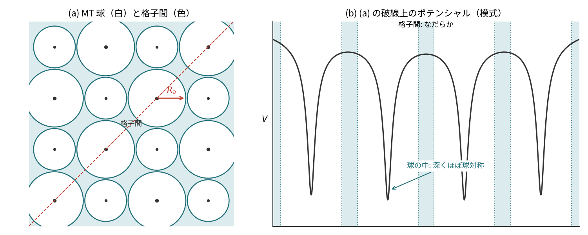
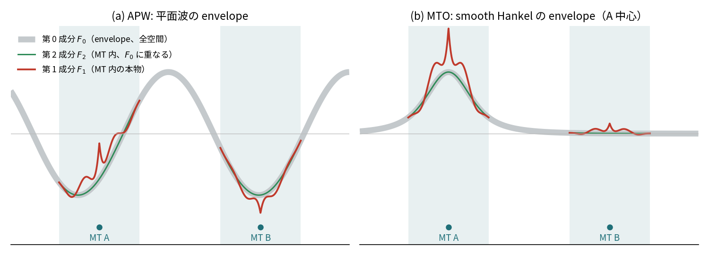
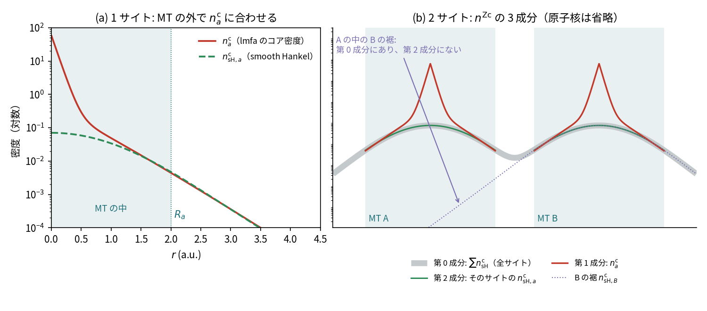

# PMT method (mixed basis of APW and MTO, DFT)

> English version of the page [theory/pmt](../../theory/pmt.md). The pages at the top of ecaljdoc are the reference; this one was made from theory/pmt.md of commit 67645a4a0 (source blob 190c13badd57).

How `lmf` of ecalj solves the one-body problem. For details and derivations, see
T. Kotani, H. Kino, H. Akai, [J. Phys. Soc. Jpn. **84**, 034702 (2015)](https://doi.org/10.7566/JPSJ.84.034702).
The first proposal is Kotani and van Schilfgaarde, [PRB **81**, 125117 (2010)](https://doi.org/10.1103/PhysRevB.81.125117).

- PMT = APW + MTO. An all-electron, full-potential mixed-basis method that uses two kinds of augmented waves at the same time
  - APW (plane-wave envelope): the extended part of the wave functions
  - MTO (envelope of atom-centered smooth Hankel functions): the localized part (3d etc.)
  - As a special type there are local orbitals Lo (in the implementation and the theory they are usually treated as belonging to the MTOs)
- The formulation is the "three-component formalism" (a rewriting of the additive augmentation formalism of Soler and Williams; J. M. Soler and A. R. Williams, [PRB **40**, 1560 (1989)](https://doi.org/10.1103/PhysRevB.40.1560), [PRB **47**, 6784 (1993)](https://doi.org/10.1103/PhysRevB.47.6784)). The Kohn–Sham equation and the atomic forces follow directly from the minimization of the total energy

## Preliminaries: muffin-tin division of space

The unit cell $\Omega$ is divided into non-overlapping spheres centered at the atoms $a$ (MT spheres, center $\mathbf R_a$, radius $R_a$) and the interstitial region outside them.

- Inside an MT sphere: near the nucleus the potential is deep and nearly spherical. The wave functions oscillate quickly as in an atom and have nodes. So they are expressed by solutions of the radial equation (partial waves) $\times\,Y_L$
- Interstitial: the potential is shallow and smooth, and the wave functions are smooth. Analytic functions such as plane waves and smooth Hankel functions represent them well enough

Figure 1 shows a schematic.

Figure 1. Schematic of the MT division of space. (a) MT spheres (white) and the interstitial (colored) in a plane where two kinds of atoms alternate. The radius is 0.97 times the radius at which the sphere touches its neighbor (default).
(b) The potential along the broken line in (a) (the diagonal connecting the large atoms). Inside the spheres it deepens toward the nucleus; in the interstitial it is smooth.
The figure is made by [`figures/pmt_mtdivision.py`](https://github.com/tkotani/ecalj/tree/main/ecaljdoc/theory/figures/pmt_mtdivision.py) (numbers in `pmt_mtdivision.dat`).

This division is for representing the wave functions and the density; it is not an approximation to the shape of the potential.
Unlike the old muffin-tin approximation (spherical inside the spheres, constant outside), PMT is full-potential and treats everything, both the non-spherical part inside the spheres and the variation in the interstitial.
The MT radius is given by `r` in `[[spec]]` and is usually taken so that the spheres nearly touch their neighbors. However, by default (`--tratio=0.97` of `ctrlgenToml.py`) it is made 3% smaller than the touching radius (for the upper limit and cautions, see [Upper limit of MT radii and spurious levels](../manual/mtradius.md)).

## Three-component formalism

The three-component formalism is a rewriting of the Soler–Williams formalism. The wave functions are expressed as linear combinations of basis functions.
A basis function is an envelope function augmented in the MTs (the inside of each MT is cut out and replaced by atomic-like wave functions).
On top of the MT division of §1, we write this as a set of three components:

$$
F_i = F_{0i}(\mathbf r) \oplus \{F_{1i,a}(\mathbf r)\} \ominus \{F_{2i,a}(\mathbf r)\} \tag{1}
$$

Here $\oplus,\ominus$ are mere separators. However, addition of $F_i$ is done component by component. Multiplication of $F_i$ is also done component by component, as we will see from §3 on.

- Component 0 $F_{0i}$: the envelope (a plane wave, or a Bloch sum of smooth Hankel functions). Analytic in all space
- Component 1 $F_{1i,a}$: the true function in the MT (a linear combination of partial waves)
- Component 2 $F_{2i,a}$: the low-$l$, slowly oscillating part of $F_{0i}$ in the MT (the expansion with $l\le l_{\max,a}$, $k\le k_{\max,a}$, Eq. 4). It cancels this part of component 0 in the MT

Indices in Eq. (1): $i$ numbers the basis functions ($\mathbf G$ for APW; the set of $a$, $L$, $(R_{\rm SM},\epsilon)$ for MTO; $a$, $L$ for Lo).
$L=(l,m)$ is the angular-momentum index ($Y_L$ are real spherical harmonics). $(R_{\rm SM},\epsilon)$ are the parameters of the smooth Hankel function (see below, §6, Eq. 25).
The leading 0, 1, 2 are the component numbers. $a$ numbers the MTs (atomic sites), and $\{\cdots\}$ denotes the set over all $a$.
The $\mathbf r$ of components 1 and 2 is measured from the MT center $\mathbf R_a$ and is defined only for $|\mathbf r|\le R_a$. The list of indices is Table 2 (§11).

Figure 2 shows the APW and MTO basis functions in these three components.

Figure 2. The three components of Eq. (1) for an APW (a) and an MTO (b). Schematic of a one-dimensional cut through two MT spheres (A, B).
Component 2, $F_2$, is the low-$l$, slowly oscillating part of $F_0$ in the MT (the expansion of Eq. 4).
The wide gray line is component 0, $F_0$ (all space); green is $F_2$ (in the MTs; in the one-dimensional figure it is drawn the same as $F_0$, so they overlap); red is component 1, $F_1$ (in the MTs).
$F_1$ matches $F_2$ in value and slope at the sphere surface (condition B below). The $F_0$ of the MTO is a smooth Hankel function centered at A (Eq. 25), and its tail inside B also has $F_1$ and $F_2$.
The figure is made by [`figures/pmt_basis.py`](https://github.com/tkotani/ecalj/tree/main/ecaljdoc/theory/figures/pmt_basis.py) (numbers in `pmt_basis.dat`).

**What augmentation achieves**

With augmentation, the wave functions in the MTs become linear combinations of the partial waves $\phi_{al},\dot\phi_{al}$, which makes them very good.

In the recent implementation, the logarithmic derivative at the MT boundary used to determine the partial waves is fixed to that of the spherical atom computed by `lmfa` (however, fixing the partial waves themselves to those of the spherical atom would cost some energy in the DFT sense, so $\phi,\dot\phi$ are solved anew each time in the spherical part of the potential in the MT). Previously, the logarithmic derivative was taken at the energy of the center of the partial DOS (center of PDOS), but this was unstable.

On the other hand, the wave functions outside the MTs are smooth, so the representation by the envelope functions ($F_0$) is sufficient.
In addition, local orbitals (Lo), whose envelope function is 0, are also used. With them, the degrees of freedom of the wave functions in the MTs are not limited to $\phi,\dot\phi$ and become large enough, and a change in the number of nodes in the MT can also be described
(Lo are actually needed only in limited cases, such as semicore and high-lying levels).

Corresponding to Eq. (1), the wave function in the three-component representation is

$$
\psi_p = \sum_i \alpha^i_p F_i = \psi_{0p} \oplus \{\psi_{1p,a}\} \ominus \{\psi_{2p,a}\} \tag{2}
$$

The map to a function in real space (augmentation) is

$$
\mathcal A[\psi_p] = \psi_{0p}(\mathbf r) + \sum_a \psi_{1p,a}(\mathbf r-\mathbf R_a) - \sum_a \psi_{2p,a}(\mathbf r-\mathbf R_a) \tag{3}
$$

and the conditions on the function space that is its domain are the following two:

- (A) $\psi_{2p,a}=\psi_{0p}$ in the MT (the exact condition; in practice relaxed to (A′) below)
- (A′) $\psi_{2p,a}\approx\psi_{0p}$ in the MT (it suffices that the low-$l$, low-frequency parts match)
- (B) $\psi_{1p,a}$ and $\psi_{2p,a}$ agree in value and slope on the MT sphere

In the form of Eq. (1) the three components seem to be freely chosen, but in fact only the set of those that satisfy the two conditions (A′) and (B) is considered as the function space (the domain of $\mathcal A$). This function space is closed under addition and multiplication (component-wise products). $\mathcal A$ is a functional that projects an element of this three-component function space to a function in three-dimensional space.

(A′) relaxes the exact (A) $\psi_{2p,a}=\psi_{0p}$. Component 2 is expanded in the MT:

$$
F_{2i,a}(\mathbf r) = \sum_{k\le k_{\max,a},\,l\le l_{\max,a}} C^i_{akL} P_{akL}(\mathbf r),\qquad
F_{1i,a}(\mathbf r) = \sum_{kL} C^i_{akL} \widetilde P_{akL}(\mathbf r) \tag{4}
$$

$P_{akL}$ are Laguerre polynomials $\times\, Y_L$ (at the site at the center of the MTO (the head part), the smooth Hankel function itself is also added to the expansion functions). $\widetilde P_{akL}$ is the linear combination of the partial waves $\phi_{al},\dot\phi_{al}$ that matches $P_{akL}$ in value and slope at the sphere surface.
The cutoffs $k_{\max,a}$, $l_{\max,a}$ are the input `kmxa`, `lmxa`.

Since (A′) contains "$\approx$", it is somewhat ambiguous as a definition of the function space, and it need not be part of the definition. The function space is determined by (B) alone ($\mathcal A[F]$ is continuous in both value and slope on the MT sphere). (A′) is the condition for the separable products of §3 to be a good approximation (it makes $(0-2)$ of Eq. 8 small).

## Augmentation of products (separable form)

Physical quantities are obtained from component-wise products, following the definition of products in the three-component representation, without making cross terms between components:

$$
\mathcal A[F_i^*F_j] = F^*_{0i}F_{0j} + \sum_a F^*_{1i,a}F_{1j,a} - \sum_a F^*_{2i,a}F_{2j,a} \tag{5}
$$

The overlap matrix and the kinetic-energy matrix are determined from this:

$$
O_{ij} = \int_\Omega F^*_{0i}F_{0j} + \sum_a\int_{|\mathbf r|\le R_a}\left(F^*_{1i,a}F_{1j,a}-F^*_{2i,a}F_{2j,a}\right) \tag{6}
$$

$$
T_{ij} = \frac{1}{2m}\left[\int_\Omega \nabla F^*_{0i}\nabla F_{0j} + \sum_a\int_{|\mathbf r|\le R_a}\left(\nabla F^*_{1i,a}\nabla F_{1j,a}-\nabla F^*_{2i,a}\nabla F_{2j,a}\right)\right] \tag{7}
$$

Because of (B), integration by parts gives $T_{ij}=\langle F_i|-\nabla^2/2m|F_j\rangle$.

**Error of the separable form**

The matrix elements of a quasi-local operator $X(\mathbf r,\mathbf r')$ are obtained in the separable form $0X0'+1X1'-2X2'$ instead of $(0+1-2)X(0'+1'-2')$ ($0,1,2$ are the three components, $'$ is the $\mathbf r'$ side). The difference is given by the identity

$$
(0+1-2)X(0'+1'-2')-(0X0'+1X1'-2X2')=(0-2)X(1'-2')+(1-2)X(0'-2') \tag{8}
$$

$(0-2)$ is 0 under (A); under (A′) it is the remainder of high $l$ and fast oscillation due to the truncation by `lmxa`, `kmxa` (its amplitude is small and, for each $L$, largest at the MT sphere).
$(1'-2')$ is the low-energy part that converges regardless of the truncation, and it is 0 in both value and slope at the MT sphere.
Hence the product $\delta n_a(\mathbf r)=(0-2)_a(1'-2')_a$ is small, and for low $L$ it is nearly orthogonal, $\int_{|\mathbf r|\le R_a}\delta n_a\,Y_L\approx 0$.
The error can be checked by changing `lmxa`, `kmxa`. The same idea can be used, with a small modification, for the electron density in the Coulomb interaction (§4).

In the three-component representation of the electron density $n$, each component is a sum of products within the same component:

$$
\begin{aligned}
n &= n_0(\mathbf r) \oplus \{n_{1,a}(\mathbf r)\} \ominus \{n_{2,a}(\mathbf r)\} \\
&= \sum_{ij}\rho_{ij}F^*_{0i}(\mathbf r)F_{0j}(\mathbf r) \;\oplus\; \Big\{\sum_{ij}\rho_{ij}F^*_{1i,a}(\mathbf r)F_{1j,a}(\mathbf r)\Big\}\\
&\qquad\ominus\; \Big\{\sum_{ij}\rho_{ij}F^*_{2i,a}(\mathbf r)F_{2j,a}(\mathbf r)\Big\},
\\
\rho_{ij} &= \sum_p^{\rm occ}\alpha^{i*}_p\alpha^j_p
\end{aligned} \tag{9}
$$

Note that the map to real space $\mathcal A$ (Eq. 3) is introduced for the formalism and is not used in actual calculations.
What is computed are only component-wise quantities like the right-hand side of Eq. (5) (Eqs. 6, 7, 9, and likewise the Coulomb and exchange-correlation terms below); there is no need to construct the real-space function $\mathcal A[\psi_p]$. The addition and subtraction of components 1 and 2 in Eq. (5) are formal, but they are useful when considering the map to the physical reality.

## Coulomb interaction

Equations are written keeping $e^2$ and $m$. The code uses Ry units ($\hbar=1$, $2m=1$, $e^2=2$).

**Multipole transformation**

With the three-component representation of the electron density (Eq. 9) as it is, the Coulomb energy cannot be computed component by component. If the multipoles of components 1 and 2 differ, the difference produces a potential also outside the MT, which couples to other MTs and to component 0. So we rewrite the three components so that the multipoles of components 1 and 2 agree, without changing the physical density $\mathcal A[n]$. This is the multipole transformation; after it, the electrostatic potential in the interstitial is obtained from component 0 alone, and the Coulomb energy can be treated in the separable form (Eq. 13).

With $\mathcal Y_L(\mathbf r)\equiv r^lY_L(\hat{\mathbf r})$, define the $L$-th multipole of a function $f$ in MT $a$ as $Q_{aL}[f]\equiv\int_{|\mathbf r|\le R_a}\mathcal Y_L(\mathbf r)f(\mathbf r)\,d^3r$. $G_{aL}$ is a Gaussian normalized so that its $L$-th multipole is 1:

$$
G_{aL}(\mathbf r)=\frac{4\pi}{(2l+1)!!}\left(\frac{1}{\pi R_{{\rm G},a}^2}\right)^{3/2}\left(\frac{2}{R_{{\rm G},a}^2}\right)^l\mathcal Y_L(\mathbf r)\,e^{-r^2/R_{{\rm G},a}^2},\qquad Q_{aL'}[G_{aL}]=\delta_{LL'} \tag{10}
$$

$R_{{\rm G},a}$ is taken small enough within the MT (fixed to $R_{{\rm G},a}=0.25R_a$ in the code).
Gaussians $G_{aL}$ carrying the difference $Q_{aL}[n_{1,a}-n_{2,a}]$ of the $L$-th multipoles of components 1 and 2 are added to both component 0 and component 2:

$$
\mathcal M[n] = n_0 + \sum_{a\mathbf T L} Q_{aL}G_{aL}(\mathbf r-\mathbf R_a-\mathbf T)
\ \oplus\ \{n_{1,a}\}\ \ominus\ \Big\{n_{2,a}+\sum_L Q_{aL}G_{aL}(\mathbf r)\Big\} \tag{11}
$$

The components inside the MT on the right-hand side of Eq. (11) (components 1 and 2) are truncated in $L$ at `lmxl` (default: the same as `lmxa`).
Note that in the three-component representation, $n$ of Eq. (9) and $\mathcal M[n]$ of Eq. (11) are distinguished as different objects.
Since $\mathcal A[\mathcal M[n]]=\mathcal A[n]$, nothing changes physically (this corresponds to the compensation charge of PAW).
Now the multipoles of components 1 and 2 agree, and the electrostatic potential in the interstitial is correct from component 0 alone.

Write the three components on the right-hand side of Eq. (11) as $\bar n=\mathcal M[n]=\bar n_0\oplus\{\bar n_{1,a}\}\ominus\{\bar n_{2,a}\}$. They are

$$
\begin{alignedat}{2}
&\bar n_0 &&= n_0+\sum_{a\mathbf TL}Q_{aL}\,G_{aL}(\mathbf r-\mathbf R_a-\mathbf T),\\
&\bar n_{1,a} &&= n_{1,a},\\
&\bar n_{2,a} &&= n_{2,a}+\sum_L Q_{aL}\,G_{aL}(\mathbf r)
\end{alignedat}
\tag{12}
$$

($Q_{aL}=Q_{aL}[n_{1,a}-n_{2,a}]$).

**Coulomb in the separable form**

$\bar n_{1,a}-\bar n_{2,a}$ is confined in the MT and has no multipoles, so the potential it produces is zero outside the MT. Hence the Coulomb potential outside the MTs can be computed exactly from $\bar n_0$ (up to the upper limit of $L$ for the multipoles), and no terms coupling different MTs appear:

$$
\begin{aligned}
(n|v|m) &\equiv (\mathcal A[n]|v|\mathcal A[m]) = (\mathcal A[\bar n]|v|\mathcal A[\bar m])\\
&= \bar n_0\bullet v\bullet\bar m_0+(\bar n_1-\bar n_2)\circ v\circ(\bar m_1-\bar m_2)\\
&\qquad+\bar n_0\circ v\circ(\bar m_1-\bar m_2)+(\bar n_1-\bar n_2)\circ v\circ\bar m_0\\
&\simeq \bar n_0\bullet v\bullet\bar m_0 + \bar n_1\circ v\circ\bar m_1 - \bar n_2\circ v\circ\bar m_2
\end{aligned}
\tag{13}
$$

$\bullet$ is the integral over all space (for periodic systems, made into a quantity per unit cell: $\mathbf r$ over the unit cell, $\mathbf r'$ over all space), 
$\circ$ is the integral only within the same MT sphere (summed over all sites).
The Coulomb interaction is defined for the real-space function $\mathcal A[n]$; substituting $\mathcal A[\bar n]=\mathcal A[n]$ and $\mathcal A[\bar n]=\bar n_0+\sum_a(\bar n_{1,a}-\bar n_{2,a})$ from Eq. (3) and expanding gives lines 2 to 3. Lines 2 to 3 are exact, and the right-hand side of $\simeq$ (the separable form) is obtained by setting $\bar n_0=\bar n_2$ in the MT (the exact condition (A)).
The Coulomb term is evaluated with the last expression of Eq. (13) (the separable form).

We estimate the approximation in Eq. (13). The difference is $(\bar n_0-\bar n_2)\circ v\circ(\bar m_1-\bar m_2)+(\bar n_1-\bar n_2)\circ v\circ(\bar m_0-\bar m_2)$. Consider the first term (the second is the same).
The multipoles of $\bar m_1-\bar m_2$ are 0 for all $L$ up to `lmxl` (because in Eq. 11, $Q_{aL}[m_1-m_2]$ was added with $G_{aL}$ normalized to multipole 1; it has no components with $L$ above `lmxl`). Hence the potential produced by $v\circ(\bar m_1-\bar m_2)$ is 0 outside the MT, and its $L$ is at most `lmxl`. Inside the MT, however, this potential is not 0. Its size is determined not by the multipoles but by the difference of the radial distributions of the charge in the MT (for example, the difference between $G_{aL}$, localized near the center, and the distribution of $\bar m_1$), and it is not necessarily small near the center. On the other hand, it is guaranteed to approach 0 near the MT boundary. Since the multipoles are 0, the potential does not leak outside the MT and is 0 in both value and slope at the MT sphere (the same property as $(1'-2')$ of Eq. 8).
On the other hand, $\bar n_0-\bar n_2$ is the deviation from (A′) and is dominated by high-$L$ components. $v$ preserves $L$ (it is invariant under rotations), and $v\circ(\bar m_1-\bar m_2)$ has only components with $L\le$ `lmxl`, so the components of $\bar n_0-\bar n_2$ with $L>$ `lmxl` are orthogonal to it and do not contribute.
Only the low-$L$ components of $\bar n_0-\bar n_2$ contribute, and they are the part that $n_2$ cannot fully reproduce of $n_0$ (the truncation by `kmxa` in Eq. (4)). Hence the difference consists only of terms proportional to that truncation. Furthermore, $\bar n_0-\bar n_2$ is large near the MT sphere (the error of the separable form in §3), while the potential is 0 in both value and slope at the MT sphere, so the integral of the product is even smaller.

**Core electron density**

The core electron density is basically treated as a frozen core. We explain this first. In GW calculations the core wave functions are generated and used, but they are not included in the electron density of the self-consistent (sc) calculation.

- The core density $n^{\rm c}_a(r)$ is obtained by a spherical atomic calculation (`lmfa`) and placed rigidly on each atom.
- To treat the leakage outside the MT, a smooth Hankel function $n^{\rm c}_{{\rm sH},a}$ that reproduces $n^{\rm c}_a$ for $|\mathbf r|>R_a$ is constructed (one function with $l=0$; its energy and smoothing radius are determined by `lmfa` and `lfoca`, `rfoca`). This allows small MTs.
- Together with the nucleus $-Z_a\delta(\mathbf r)$, the charge of the core and the nucleus is written in three components:

$$
n^{\rm Zc} = \sum_{a\mathbf T} n^{\rm c}_{{\rm sH},a}(\mathbf r-\mathbf R_a-\mathbf T)\ \oplus\ \{n^{\rm c}_a(\mathbf r)-Z_a\delta(\mathbf r)\}\ \ominus\ \{n^{\rm c}_{{\rm sH},a}(\mathbf r)\} \tag{14}
$$

Component 0 is the sum of $n^{\rm c}_{{\rm sH},a}$ over all sites, component 1 is the true core density and the nucleus, and component 2 is the $n^{\rm c}_{{\rm sH},a}$ of that site. Figure 3 shows a schematic.

Figure 3. (a) Radial distribution at one site (log scale). Red is the core density $n^{\rm c}_a$ of `lmfa`; the green broken line is the smooth Hankel function $n^{\rm c}_{{\rm sH},a}$ fitted to $n^{\rm c}_a$ outside the MT ($r>R_a$). Inside the MT, $n^{\rm c}_{{\rm sH},a}$ is smooth and finite even at the origin. (b) The three components of Eq. (14) on a line through two MT spheres (A, B) (the nucleus is omitted). The wide gray line is component 0 (the sum of $n^{\rm c}_{\rm sH}$ over all sites), green is component 2 (the $n^{\rm c}_{{\rm sH},a}$ of that site), red is component 1 ($n^{\rm c}_a$). The dotted line is the tail of B; inside MT A it is included in component 0 but not in component 2. This tail also enters the Coulomb energy (the $\bar n_0\bullet v\bullet\bar m_0$ of Eq. (13)) through component 0.
The figure is made by [`figures/pmt_core.py`](https://github.com/tkotani/ecalj/tree/main/ecaljdoc/theory/figures/pmt_core.py) (numbers in `pmt_core.dat`).

The paper says "a linear combination of a few smooth Hankel functions", but the code (`corprm`) uses one.

The total charge including the valence density $n$ (Eq. 9) is $n^{\rm Zcv}=n^{\rm Zc}+n$, and the multipole transformation of Eq. (11) is applied to it.
With $Q^{\rm Zc}_{aL}=Q_{aL}[n^{\rm c}_a-Z_a\delta-n^{\rm c}_{{\rm sH},a}]$ and $Q^{\rm v}_{aL}=Q_{aL}[n_{1,a}-n_{2,a}]$, the three components of $\bar n^{\rm Zcv}=\mathcal M[n^{\rm Zcv}]$ are

$$
\begin{alignedat}{2}
&\bar n^{\rm Zcv}_0 &&= \sum_{a\mathbf T}n^{\rm c}_{{\rm sH},a}(\mathbf r-\mathbf R_a-\mathbf T)+n_0+\sum_{a\mathbf TL}(Q^{\rm Zc}_{aL}+Q^{\rm v}_{aL})\,G_{aL}(\mathbf r-\mathbf R_a-\mathbf T),\\
&\bar n^{\rm Zcv}_{1,a} &&= n^{\rm c}_a-Z_a\delta+n_{1,a},\\
&\bar n^{\rm Zcv}_{2,a} &&= n^{\rm c}_{{\rm sH},a}+n_{2,a}+\sum_L(Q^{\rm Zc}_{aL}+Q^{\rm v}_{aL})\,G_{aL}(\mathbf r)
\end{alignedat}
\tag{15}
$$

Since the core density is spherical, $Q^{\rm Zc}_{aL}$ has only the $L=0$ component (non-spherical cores are in Appendix B).
$\mathcal A[n^{\rm Zc}]$ is the superposition of the cores and nuclei of all sites, both inside and outside the MTs.

Adding $n^{\rm c}_{{\rm sH},a}$ to component 2 agrees with the code (`rhol2` in `locpot`). $n^{\rm Zc}_{2,a}$ in Eq. (30) of the paper is the same as this by Eq. (23) of the paper (the comment in `locpot` calls Eq. (30) of the paper a typo, but the content is the same).

The tail of the neighboring $n^{\rm c}_{{\rm sH},a'}$ ends up in component 0 inside MT $a$. However, component 2 is only the $n^{\rm c}_{{\rm sH},a}$ of that site, so the neighbor's tail does not enter component 2. Like the high-$l$ components in the MT, this tail is a part treated by component 0 alone. Unlike the high-$l$ components, however, this tail is mainly low-$L$, so it can couple to $v\circ(\bar m_1-\bar m_2)$. Therefore the discussion of the error of the Coulomb interaction in Eq. (13) does need a slight modification. This remark about the core tail is not in the paper.
By default, for $Z>8$, `lfoca`=1 and the treatment is as described above; for $Z\le 8$, `lfoca`=0, the core is confined in the MT ($n^{\rm c}_{{\rm sH},a}=0$) and solved anew in the potential in the MT at each iteration (not frozen).

Correspondence with the code (`corprm`, `mkrout`): with `lfoca`=1, the core density $n^{\rm c}_a$ and its smooth Hankel function $n^{\rm c}_{{\rm sH},a}$ are fixed to those made by `lmfa` (frozen). With `lfoca`=0, `mkrout` solves the core anew at each iteration with `getcor`, using the spherical potential in the MT at that time (the core relaxes while confined in the MT). In both cases the core density is spherical ($L=0$ only).

## Total energy and the Kohn–Sham equation

$$
\begin{aligned}
E_{\rm total} &= E^{\rm core}_{\rm k} + \sum_{ij}\rho_{ij}T_{ij} + E_{\rm es} + E_{\rm xc}[n^{\rm Zcv}],\\
E_{\rm es} &= \frac12\,(n^{\rm Zcv}|v|n^{\rm Zcv})
\end{aligned}
\tag{16}
$$

$$
E_{\rm xc}[n^{\rm Zcv}] = E_{\rm xc}[n^{\rm Zcv}_0] + \sum_a E_{\rm xc}[n^{\rm Zcv}_{1,a}] - \sum_a E_{\rm xc}[n^{\rm Zcv}_{2,a}] \tag{17}
$$

$E^{\rm core}_{\rm k}$ is the kinetic energy of the core (a constant for the frozen core with `lfoca`=1; with `lfoca`=0 it is recomputed each time the core is solved anew), and $T_{ij}$ is Eq. (7). $E_{\rm es}$ is evaluated with the last expression of Eq. (13) (the separable form), using $\bar n=\mathcal M[n^{\rm Zcv}]$ (excluding the constant self-interaction of the nuclei).
The components of $n^{\rm Zcv}$ and $\bar n^{\rm Zcv}$ are Eqs. (14), (15). Component 0 is computed on a real-space mesh (cutoff `gmax`), the inside of the MTs on radial meshes.
Fixing the basis and varying Eq. (16) with respect to $\alpha^{i*}_p$ while keeping the normalization $\sum_{ij}\alpha^{i*}_pO_{ij}\alpha^j_p=1$ gives a generalized eigenvalue problem:

$$
\sum_j\left(H_{ij}-\epsilon_p O_{ij}\right)\alpha^j_p = 0,\qquad H_{ij}=T_{ij}+V_{ij} \tag{18}
$$

Here $O_{ij}$ and $T_{ij}$ are Eqs. (6), (7), and $V_{ij}=\langle F_i|V|F_j\rangle$ is the integral of the component-wise product of the three-component potential $V$ and $F_i^*F_j$ (Eq. 5) (we write this integral between three-component functions with "$\cdot$", as $V\cdot F_i^*F_j$). $V$ is determined as follows.
The exchange-correlation potential is the functional derivative of $E_{\rm xc}$ of Eq. (17) with respect to each component of $n^{\rm Zcv}$:

$$
v^{\rm xc}=v^{\rm xc}_0(\mathbf r)\oplus\{v^{\rm xc}_{1,a}(\mathbf r)\}\ominus\{v^{\rm xc}_{2,a}(\mathbf r)\} \tag{19}
$$

The potential is

$$
\begin{aligned}
V ={}& \bar n^{\rm Zcv}_0\bullet v\bullet{}+v^{\rm xc}_0\\
&\oplus\Big\{\sum_L\overset{\raise{-0.3em}{\scriptscriptstyle\bullet}}{Q}{}^{\rm v}_{aL}\mathcal Y_L(\mathbf r)+\bar n^{\rm Zcv}_{1,a}\circ w\circ{}+v^{\rm xc}_{1,a}\Big\}\\
&\ominus\Big\{\sum_L\overset{\raise{-0.3em}{\scriptscriptstyle\bullet}}{Q}{}^{\rm v}_{aL}\mathcal Y_L(\mathbf r)+\bar n^{\rm Zcv}_{2,a}\circ w\circ{}+v^{\rm xc}_{2,a}\Big\}
\end{aligned}
\tag{20}
$$

$$
\overset{\raise{-0.3em}{\scriptscriptstyle\bullet}}{Q}{}^{\rm v}_{aL}\equiv\frac{\partial E_{\rm es}}{\partial Q^{\rm v}_{aL}}
=\bar n^{\rm Zcv}_0\bullet v\bullet G_{aL}(\mathbf r'-\mathbf R_a)-\bar n^{\rm Zcv}_{2,a}\circ w\circ G_{aL}(\mathbf r') \tag{21}
$$

(Eqs. 32 to 35 of the paper). The symbol $\overset{\raise{-0.3em}{\scriptscriptstyle\bullet}}{Q}{}^{\rm v}_{aL}$ is written $\mathcal Q^{\rm v}_{aL}$ in the paper (changed here because it is easily confused with the multipole $Q^{\rm v}_{aL}$).
$\bar n_0\bullet v\bullet$ is a function of $\mathbf r$ with only one of the variables integrated. $w$ is the Coulomb kernel in the MT that vanishes on the MT sphere (Dirichlet boundary condition):

$$
\begin{aligned}
&w(\mathbf r,\mathbf r')=e^2\sum_L\frac{4\pi}{2l+1}\,r_<^l\left(\frac{1}{r_>^{l+1}}-\frac{r_>^l}{R_a^{2l+1}}\right)Y_L(\hat{\mathbf r})Y_L(\hat{\mathbf r}'),\\
&r_<=\min(r,r'),\quad r_>=\max(r,r')
\end{aligned}
\tag{22}
$$

The value on the MT sphere is carried by the term $\sum_L\overset{\raise{-0.3em}{\scriptscriptstyle\bullet}}{Q}{}^{\rm v}_{aL}\mathcal Y_L$. The MT terms of the electrostatic energy, $\frac12\bar n^{\rm Zcv}_1\circ w\circ\bar n^{\rm Zcv}_1-\frac12\bar n^{\rm Zcv}_2\circ w\circ\bar n^{\rm Zcv}_2$, can also be written with $w$ and are computed on radial meshes. The derivation of Eqs. (20), (21) is in Appendix A. The definition of $w$ (Eq. 22) is missing in the paper and is supplied here.
$\overset{\raise{-0.3em}{\scriptscriptstyle\bullet}}{Q}{}^{\rm v}_{aL}$ is the derivative of $E_{\rm es}$ with respect to the Gaussian weights $Q^{\rm v}_{aL}$ (Eq. 15); multiplied by $\mathcal Y_L$, the same quantity is added to components 1 and 2.
The densities and potentials in the MT ($n_{1,a}$, $n_{2,a}$, $V_{1,a}$, $V_{2,a}$) are all truncated in $L$ at `lmxl` (default: the same as `lmxa`). The upper limit of $l$ of the partial waves is `lmxa`, and the matrix elements in the MT are built from combinations of partial waves with $l_1,l_2\le$ `lmxa` and potentials with $L\le$ `lmxl`.

Correspondence with the code (Eqs. 20 to 22, `smves` and `locpot`; Ry units, $e^2=2$): component 0 and the inside of the MTs are connected in the following order.

1. `rhomom`: makes the multipoles of each site, `qmom` $=Q^{\rm v}_{aL}+Q^{\rm Zc}_{aL}$. $Q^{\rm v}_{aL}=\int r^l(\rho_1-\rho_2)$; for $L=0$, $-Y_0Z$ and `cofg` $=Y_0(q_{\rm c}-q_{\rm c,sH})$ are added as $Q^{\rm Zc}$ (`cofg` is the part of the core charge not contained in $n^{\rm c}_{\rm sH}$).
2. `smves` (`vesgcm`, `ugcomp`): makes the electrostatic potential $\bar n_0\bullet v$ of component 0, $\bar n^{\rm Zcv}_0$ ($n_0$ represented in plane waves, $n^{\rm c}_{\rm sH}$, Gaussians). The terms between different sites for pairs of Gaussians and pairs of smooth Hankel functions are obtained analytically (by Ewald sums). Two quantities come out of this: `gpot0`$_{aL}=\int G_{aL}\,(\bar n_0\bullet v)$ (the first term of Eq. 21), and the $L$ components `vval`$_{aL}$ of $\bar n_0\bullet v$ on the MT sphere. The shift of the average potential, `vconst`, is added equally to both.
3. `locpot`: makes component 1 in the MT, `rhol1` $=\rho_1+Y_0\rho_{\rm c}$ (the nucleus $-Z$ is put in when solving Poisson), and component 2, `rhol2` $=\rho_2+\sum_L$`qmom`$_L\,G_{aL}+Y_0\,n^{\rm c}_{\rm sH}$ (Eq. 15). It checks that the two charges are equal.
4. `poinsp(0, 0, rhol2)`: solves component 2 with the boundary condition 0 on the MT sphere. This is $\bar n_2\circ w$ (Eq. 22). It computes `gpotb`$_{aL}=\int G_{aL}\,(\bar n_2\circ w)$ and sets `dEdQ`$_{aL}=$ (`gpot0` $-$ `gpotb`) $R_a^l=\overset{\raise{-0.3em}{\scriptscriptstyle\bullet}}{Q}{}^{\rm v}_{aL}R_a^l$ (Eq. 21).
5. `poinsp(z, dEdQ, rhol1)`, `poinsp(0, dEdQ, rhol2)`: solve components 1 and 2 again with the boundary value `dEdQ`. Since `poinsp` matches the boundary value with the homogeneous solution $r^lY_L$, the solution becomes $\bar n_{1(2)}\circ w+\sum_L\overset{\raise{-0.3em}{\scriptscriptstyle\bullet}}{Q}{}^{\rm v}_{aL}\mathcal Y_L$, which is exactly the electrostatic part of Eq. (20). The electrostatic potential of component 1 is $Y_0$`v1es` $-2Z/r$.
6. The potential for the partial waves, `v1out`, is solved separately by `poinsp(z, vval, rhol1)`, matching the value on the MT sphere to `vval` (§6).
7. With the re-solved component 2, `gpotb` is recomputed, and `gpot0` $-$ `gpotb` is passed to `gaugm` and used for the matrix elements (the multipole term of $\pi$ in Eq. 24).

**Matrix elements in the MT (one-center matrices)**

Using the expansion coefficients $C^i_{akL}$ of Eq. (4), $O_{ij}$, $T_{ij}$, $V_{ij}$ become sums of integrals of component 0 and one-center matrices:

$$
\begin{aligned}
O_{ij} &= \int_\Omega F^*_{0i}F_{0j}+\sum_{akk'L}C^{i*}_{akL}\,\sigma_{akk'l}\,C^j_{ak'L},\\
T_{ij} &= \frac{1}{2m}\int_\Omega \nabla F^*_{0i}\nabla F_{0j}+\sum_{akk'L}C^{i*}_{akL}\,\tau_{akk'l}\,C^j_{ak'L},\\
V_{ij} &= \int_\Omega F^*_{0i}V_0F_{0j}+\sum_{akk'LL'}C^{i*}_{akL}\,\pi_{akk'LL'}\,C^j_{ak'L'}
\end{aligned}
\tag{23}
$$

The one-center matrices are integrals in the MT ($|\mathbf r|\le R_a$):

$$
\begin{aligned}
\sigma_{akk'l} &= \int\big(\widetilde P_{akL}\widetilde P_{ak'L}-P_{akL}P_{ak'L}\big),\\
\tau_{akk'l} &= \frac{1}{2m}\int\big(\nabla\widetilde P_{akL}\nabla\widetilde P_{ak'L}-\nabla P_{akL}\nabla P_{ak'L}\big),\\
\pi_{akk'LL'} &= \sum_M Q_{akk'LL'M}\,\overset{\raise{-0.3em}{\scriptscriptstyle\bullet}}{Q}{}^{\rm v}_{aM}\\
&\quad+\int\big(\bar n^{\rm Zcv}_{1,a}\circ w+v^{\rm xc}_{1,a}\big)\widetilde P_{akL}\widetilde P_{ak'L'}\\
&\quad-\int\big(\bar n^{\rm Zcv}_{2,a}\circ w+v^{\rm xc}_{2,a}\big)P_{akL}P_{ak'L'},\\
Q_{akk'LL'M} &= \int\big(\widetilde P_{akL}\widetilde P_{ak'L'}-P_{akL}P_{ak'L'}\big)\,\mathcal Y_M
\end{aligned}
\tag{24}
$$

$\sigma$ and $\tau$ depend only on $l$ of $L=(l,m)$. The first term of $\pi$ is the multipole contribution through $\overset{\raise{-0.3em}{\scriptscriptstyle\bullet}}{Q}{}^{\rm v}_{aM}$ of Eq. (21), and $Q_{akk'LL'M}$ is the $M$-th multipole of $\widetilde P\widetilde P-PP$.
Local orbitals Lo (those with tens digit 0 in `pz`) are made so that both value and slope are 0 at the MT boundary, so they have only component 1 (components 0 and 2 are 0). Matrix elements involving Lo consist only of MT terms.
$O_{ij}$ and $T_{ij}$ are the one-center terms of Eq. (23) (Eq. 24) with the radial function of the Lo $\times\,Y_L$ used in place of $\widetilde P_{akL}$, and with the $P$ terms on the Lo side set to 0.
For $V_{ij}$, since Lo have no components 0 and 2, there is no freedom to shift the potential by harmonic functions $\mathcal Y_L$. Therefore, instead of $V_{1,a}$ of Eq. (20) (whose value on the MT sphere is $\overset{\raise{-0.3em}{\scriptscriptstyle\bullet}}{Q}{}^{\rm v}_{aL}R_a^l$), a potential whose value on the MT sphere is matched to the actual electrostatic potential (determined from component 0) is used.

Correspondence with the code:
- The radial functions of Lo are made by `makusp`. If the tens digit of `pz` is 0, `lpz`=1 and $\phi,\dot\phi$ are mixed to make the value and slope at the MT boundary 0. If the tens digit is 1, it is an extended Lo with `lpz`=2: a smooth Hankel tail (envelope) is attached, and the radial function is not changed.
- As noted in `m_augmat`, the tails of Lo are not expanded around other sites, so Lo have only one-center and two-center terms. $O$ and $T$ are obtained without the error of the $L$ truncation.
- The one-center term of $V$ for Lo is obtained with the expansion in the MT $V_L(r)=V_{1,l}(r)+\frac{V^{\rm val}_L}{R^l}r^l$ ($V^{\rm val}_L$ is the $L$ component of the electrostatic potential on the MT sphere, `vval` in the code) (note in `m_augmat`).

## PMT basis

There are three kinds of basis functions:

| Kind | Envelope (component 0) | Input |
| --- | --- | --- |
| APW | Plane wave $e^{i(\mathbf k+\mathbf G)\mathbf r}$ | Cutoff `pwemax` (Ry) |
| MTO | Smooth Hankel $h_L$ (Eq. 25) | `rsmh`, `eh` (second set `rsmh2`, `eh2`), `lmx` |
| Lo | None (only in the MT) | `pz` |

Table 1. PMT basis functions and input keys (`[[spec]]` and `[ham]`). `pwmode` selects the treatment of plane waves ([lmf](../manual/lmf.md)).

The smooth Hankel function is the solution of the Helmholtz equation with a Gaussian source instead of a δ function:

$$
(\nabla^2+\epsilon)\,h_0(\mathbf r) = -4\pi g_0(\mathbf r),\quad g_0\propto e^{-r^2/R_{\rm SM}^2},\qquad h_L = \mathcal Y_L(-\nabla)h_0 \tag{25}
$$

For $R_{\rm SM}\to0$ it becomes the ordinary Hankel function $e^{-\kappa r}/r$ ($\epsilon=-\kappa^2$). For finite $R_{\rm SM}$, $h_0$ does not diverge at the origin.

- The partial waves $\phi_{al}$, $\dot\phi_{al}$ are made by solving the radial equation in the spherical part of the actual potential in the MT. This potential is the electrostatic potential of the charge of component 1, solved with its value on the MT sphere matched to that determined from component 0, plus $v^{\rm xc}_{1,a}$ (`v1out` in the code); its boundary value differs from that of component 1, $V_{1,a}$, of Eq. (20). Since the partial waves are only ingredients of the basis, this does not affect the consistency of the variation. The logarithmic derivative at the MT boundary is fixed to that of the spherical atom of `lmfa` (note in §2).
- The partial waves of Lo are also solved with the logarithmic derivative at the MT boundary fixed to the value from `lmfa`. 
- Simple rules are enough for $R_{\rm SM}$ and $\epsilon$ of the MTOs ($R_{\rm SM}=R_a/2$ etc.)
  - What is missing is supplemented by the APWs. The dependence of the total energy on $\epsilon$ is weak and becomes weaker as more APWs are added
  - "How to choose the MTO parameters", which was a hard problem of the full-potential LMTO, essentially disappears
- Above `lmxl` (default $l_{\max,a}$ = `lmxa`), components 1 and 2 are discarded also in the density (products of components produce up to $2l_{\max,a}$, but this is meaningless because the eigenfunctions are already truncated)

Correspondence with the code: the input written by `ctrlgenToml.py` has `readp = true` and `pnufix = true` in `[ham]`. With `readp`, the valence $P$ (logarithmic derivatives) and the $P_z$ of Lo are read from `atmpnu.*` written by `lmfa` (`m_lmfinit`), and with `pnufix` they are kept fixed during the self-consistency iterations (`pnunew` is not called in `m_bndfp`).
When `pnufix = false`, `pnunew` updates $P$. There, for $l$ without Lo, $\phi$ is solved at the energy of the center of gravity of the occupied states; for $l$ with a semicore Lo, the valence $\phi$ is solved at the Fermi energy (this is what the paper describes).

## Points to note

- **Positive definiteness of $O_{ij}$**
  - The last term of Eq. (6) is negative, so the matrix can fail to be positive definite.
  - With `kmxa` ~5 and `lmxa` ~4, there is usually no problem.
  - Small eigenvalues are dropped with `oveps`.
- **Indeterminacy of component 2 (null vectors)**
  - A combination of basis functions in which only components 0 and 2 remain in the MT contributes to neither $H$ nor $O$ (a ghost).
  - With too many basis functions, such ghosts can attach to eigenfunctions or produce 0/0 eigenvalues, which breaks convergence.
  - In practice, there was a case where component 2 of the density became too large and the calculation did not converge.
  - Keep the number of basis functions moderate.
- **Orthogonality to the core**
  - If the MTs are made very small, the wave functions are no longer orthogonal to the core and the calculation does not converge.
  - In that case, represent the core with Lo (`pz`).

## Comparison with PAW (main points)

Written in the same three-component formalism, PAW is the method that determines components 1 and 2 from component 0 (the pseudo wave function $\tilde\psi$) with projectors $\tilde p_i$:

$$
\psi = \tilde\psi \oplus \sum_i|\phi_i\rangle\langle\tilde p_i|\tilde\psi\rangle \ominus \sum_i|\tilde\phi_i\rangle\langle\tilde p_i|\tilde\psi\rangle \tag{26}
$$

- PAW must determine the pseudo wave function in the MT uniquely, so the results depend on the choice of the pseudopotential
  - Care is also needed for ghost states due to the truncation of partial waves
  - On the other hand, there is no problem of null vectors
- In PMT (and LAPW), component 2 cancels component 0 in the MT, so component 0 can be anything in the MT
  - The plane-wave cutoff can be as low as in LAPW (~15 Ry; PAW ~30 Ry)

## Atomic forces

**Harris energy**

The input density $n^{\rm in}$ before self-consistency is reached produces the one-particle potential $V=V[n^{\rm Zc}+n^{\rm in},\mathbf R_a]$ (Eq. 20 with $n$ replaced by $n^{\rm in}$), and the output density $n^{\rm out}$ comes from its eigenfunctions. The Harris energy with a frozen core is, as a functional of $n^{\rm in}$,

$$
\begin{aligned}
E_{\rm Harris}&=E^{\rm core}_{\rm k}+E_{\rm B}-V[n^{\rm Zc}+n^{\rm in},\mathbf R_a]\cdot n^{\rm in}\\
&\quad+E_{\rm es}[n^{\rm Zc}+n^{\rm in},\mathbf R_a]+E_{\rm xc}[n^{\rm Zc}+n^{\rm in}],\\
E_{\rm B}&=\sum_p^{\rm occ}\sum_{ij}\alpha^{i*}_p\langle F_i|H^{\rm in}|F_j\rangle\alpha^j_p=\sum_p^{\rm occ}\epsilon_p,\\
H^{\rm in}&=-\frac{\nabla^2}{2m}+V[n^{\rm Zc}+n^{\rm in},\mathbf R_a]
\end{aligned}
\tag{27}
$$

The dependence on $\mathbf R_a$ enters, besides through $n^{\rm Zc}+n^{\rm in}$, explicitly through the multipole transformation and $\mathcal A$ (even with $n^{\rm Zc}+n^{\rm in}$ fixed as a three-component function, it depends on $\mathbf R_a$ through $G_{aL}(\mathbf r-\mathbf R_a)$ in Eqs. (15) and (21)). The partial waves ($\phi_{al}$, $\dot\phi_{al}$, Lo) are assumed not to depend on the atomic positions.

**Forces**

We obtain the change of $E_{\rm Harris}$ due to atomic displacements $\delta\mathbf R_a$. Regarding $E_{\rm B}$ as a functional of $\{F_i\}$ and $V$, the perturbation of Eq. (18) gives

$$
\begin{aligned}
\delta E_{\rm B}&=\sum_p^{\rm occ}\delta\epsilon_p=\sum_p^{\rm occ}\sum_{ij}\alpha^{i*}_p\left(\delta H_{ij}-\epsilon_p\delta O_{ij}\right)\alpha^j_p\\
&=\delta V\cdot n^{\rm out}+\delta E^{\rm Pulay}_{\rm B},\\
\delta E^{\rm Pulay}_{\rm B}&=\sum_p^{\rm occ}\sum_{ij}\alpha^{i*}_p\left(\delta H^F_{ij}-\epsilon_p\delta O^F_{ij}\right)\alpha^j_p
\end{aligned}
\tag{28}
$$

Here $\delta(V\cdot F_i^*F_j)=\delta V\cdot F_i^*F_j+V\cdot\delta(F_i^*F_j)$ was used. $\delta H^F$ and $\delta O^F$ are the parts coming from the changes of the basis, $\delta F_{0i}(\mathbf r)$ and $\delta C^i_{akL}$ (Pulay terms). Since $E_{\rm es}+E_{\rm xc}$ is a functional of $\{n^{\rm in},\mathbf R_a\}$,

$$
\begin{aligned}
\delta E_{\rm Harris}&=\delta E_{\rm B}-\delta(V\cdot n^{\rm in})+\delta(E_{\rm es}+E_{\rm xc})\\
&=\delta V\cdot(n^{\rm out}-n^{\rm in})+\delta E^{\rm Pulay}_{\rm B}+\left.\frac{\partial(E_{\rm es}+E_{\rm xc})}{\partial\mathbf R_a}\right|_{n^{\rm in}}\!\!\delta\mathbf R_a
\end{aligned}
\tag{29}
$$

The three terms on the right-hand side are the term due to non-self-consistency ($n^{\rm out}\ne n^{\rm in}$), the Pulay term, and the term of explicit dependence.
The first term requires $\delta n^{\rm in}$. At self-consistency it is determined by $\delta n^{\rm in}=\delta n^{\rm out}$, but otherwise it is not uniquely determined.
So we set $\delta n^{\rm in}=0$ in the three-component representation. Physically, this means that $n_{1,a}-n_{2,a}$ and the frozen core centered at $\mathbf R_a$ move rigidly together with $\mathbf R_a\to\mathbf R_a+\delta\mathbf R_a$.
Then $\delta V$ is obtained from $\delta\bar n^{\rm Zcv}_0$ of Eq. (20), and $\delta\bar n^{\rm Zcv}_0$ from Eq. (15). $n^{\rm Zc}_0$ also depends on $\mathbf R_a$ as in Eq. (14).

## Scalar relativity

In the MTs the scalar-relativistic (SR) approximation is used. SR wave functions have large and small components. The large component connects smoothly to the non-relativistic (NR) wave function in the interstitial, and the small component is negligible in the interstitial. Physical quantities in the MTs are computed with the SR wave functions.

Component 1 of the basis, $F_{1i,aL}$, is replaced by two components $\{g_{1i,aL}(r),f_{1i,aL}(r)\}$. $g$ is the large component and $f$ the small component (both are radial functions $\times\,r$), solutions of the SR radial equation. $f$ is roughly $\frac{1}{2Mc}\frac{dg}{dr}$ ($c$ is the speed of light, $M$ the relativistic mass).
$F_{0i}$ and $F_{2i}$ are the same as in the NR case, and condition (B) (value and slope match on the MT sphere) is imposed on the large component $g_{1i,aL}$.
The product of components 1 is replaced as

$$
\begin{aligned}
&F^*_{1i,aL}(r)F_{1j,aL}(r)\ \to\ \gamma_l(r)\,g^*_{1i,aL}(r)g_{1j,aL}(r)+f^*_{1i,aL}(r)f_{1j,aL}(r),\\
&\gamma_l(r)=1+\frac{l(l+1)}{\big(2M(r)c\,r\big)^2},\qquad 2M(r)c=c-\frac{V(r)-\epsilon}{c}
\end{aligned}
\tag{30}
$$

(Ry units; $V(r)$ is the spherical potential including the nuclear $-2Z/r$, and $\epsilon$ is the energy of the partial wave).
The $\gamma_l$ term is $l(l+1)g^2/(2Mcr)^2$, which arises when the angular part of the small component of the Dirac equation is averaged over $j=l\pm\frac12$.
With this, the density $n$, $O_{ij}$ etc. are obtained, giving the total energy in the SR approximation.
What changes is $\widetilde P_{akL}\widetilde P_{ak'L}$ in Eq. (24) (and those with $\nabla$), which is read as the product of the large components multiplied by $\gamma_l$ (Eq. 30) plus the product of the small components. The same holds for the density of component 1, $n_{1,a}$, in $\pi$.
The spin-orbit interaction is also put into component 1 in the same way, giving spin-off-diagonal contributions.

Correspondence with the code: the solution of the radial equation, `rseq`, is normalized as $\int\big(g^2(1+\frac{l(l+1)}{(2Mcr)^2})+f^2\big)dr=1$ (`tmcr` $=2Mcr$). The products of partial waves in `makusp` are also made as $\gamma_l\,g g+f f$. For products of functions with different energies ($\phi$ and Lo, etc.), $\gamma_l$ is the average of its values at the two energies.
Appendix D of the paper writes the replacement as $g^*g+(\frac{1}{2mc})^2f^*f$, but this is an error in the paper (the definition of $f$ already contains $\frac{1}{2mc}$, so the factor is doubled, and $\gamma_l$ is also missing). The code is correct; it is not a bug. Eq. (30) follows the code.

## Summary of indices and symbols

| Symbol | Meaning | First appears |
| --- | --- | --- |
| $i, j$ | Basis function number ($\mathbf G$ for APW; $a$, $L$, $(R_{\rm SM},\epsilon)$ for MTO; $a$, $L$ for Lo). $(R_{\rm SM},\epsilon)$ are the parameters of the smooth Hankel function (Eq. 25) | Eq. (1) |
| 0, 1, 2 | Components: 0 = envelope (all space), 1 = the true function in the MT, 2 = the low-$l$, slowly oscillating part of the envelope in the MT | Eq. (1) |
| $a$ | MT (atomic site). Center $\mathbf R_a$, radius $R_a$ | §1, Eq. (1) |
| $p$ | Eigenstate (wave function $\psi_p$), eigenvalue $\epsilon_p$ | Eqs. (2), (18) |
| $\alpha^i_p$ | Coefficients of the wave function, $\psi_p=\sum_i\alpha^i_pF_i$ | Eq. (2) |
| $L=(l,m)$ | Angular momentum. $Y_L$ are real spherical harmonics, $\mathcal Y_L(\mathbf r)=r^lY_L(\hat{\mathbf r})$ | Eq. (1) |
| $k$ | Order of the radial expansion in the MT (degree of the polynomial in $P_{akL}$) | Eq. (4) |
| $k_{\max,a}$, $l_{\max,a}$ | Cutoffs of the expansion of components 1 and 2 (`kmxa`, `lmxa`) | Eq. (4) |
| $C^i_{akL}$ | Expansion coefficients of basis function $i$ in MT $a$ | Eq. (4) |
| $P_{akL}$, $\widetilde P_{akL}$ | Expansion functions in the MT (polynomial $\times Y_L$) and the matching combinations of partial waves (value and slope agree at the sphere) | Eq. (4) |
| $\phi_{al}$, $\dot\phi_{al}$ | Partial wave and its energy derivative | §2, §6 |
| $\rho_{ij}$ | Density matrix $\sum_p^{\rm occ}\alpha^{i*}_p\alpha^j_p$ | Eq. (9) |
| $\Omega$ | Unit cell | §1 |
| $\mathbf T$ | Lattice translation vector | Eq. (11) |
| $\mathbf G$ | Reciprocal lattice vector (APW, real-space mesh) | Eq. (1) |
| $\bullet$, $\circ$ | Integral over all space (per unit cell for periodic systems); integral only within the same MT sphere | Eq. (13) |

Table 2. Indices and symbols on this page.

## Appendix A: Derivation of the electrostatic potential (Eqs. 20, 21)

**In the MT terms, $v$ may be replaced by $w$**

In the MT, $v$ can be split as $v=w+\Delta$:

$$
\Delta(\mathbf r,\mathbf r')=e^2\sum_L\frac{4\pi}{2l+1}\frac{r^lr'^l}{R_a^{2l+1}}Y_L(\hat{\mathbf r})Y_L(\hat{\mathbf r}') \tag{A1}
$$

Since $\Delta$ is a product of multipoles, $\bar n_1\circ\Delta\circ\bar n_1-\bar n_2\circ\Delta\circ\bar n_2$ is the difference of the squares of the multipoles of components 1 and 2. After the multipole transformation (Eq. 11), the multipoles of the two agree up to `lmxl`, so this is 0. Hence the electrostatic energy can be written as

$$
E_{\rm es}=\frac12\,\bar n_0\bullet v\bullet\bar n_0+\frac12\,\bar n_1\circ w\circ\bar n_1-\frac12\,\bar n_2\circ w\circ\bar n_2 \tag{A2}
$$

($\bar n=\mathcal M[n^{\rm Zcv}]$, Eq. 15; the constant self-interaction of the nuclei is excluded). This is the same as $\circ v\circ$ in Eq. (13).

**Variation**

Since the core is frozen, only the valence part changes. From Eq. (12), $\delta\bar n_0=\delta n_0+\sum_{a\mathbf TL}\delta Q_{aL}G_{aL}(\mathbf r-\mathbf R_a-\mathbf T)$, $\delta\bar n_{1,a}=\delta n_{1,a}$, $\delta\bar n_{2,a}=\delta n_{2,a}+\sum_L\delta Q_{aL}G_{aL}(\mathbf r)$, and the change of the multipoles is $\delta Q_{aL}=\int_{|\mathbf r|\le R_a}\mathcal Y_L(\delta n_{1,a}-\delta n_{2,a})$. Substituting into Eq. (A2) gives

$$
\begin{aligned}
\delta E_{\rm es}={}&(\bar n_0\bullet v)\cdot\delta n_0+\sum_a(\bar n_{1,a}\circ w)\cdot\delta n_{1,a}-\sum_a(\bar n_{2,a}\circ w)\cdot\delta n_{2,a}\\
&+\sum_{aL}\overset{\raise{-0.3em}{\scriptscriptstyle\bullet}}{Q}{}^{\rm v}_{aL}\int_{|\mathbf r|\le R_a}\mathcal Y_L\,(\delta n_{1,a}-\delta n_{2,a}),\\
\overset{\raise{-0.3em}{\scriptscriptstyle\bullet}}{Q}{}^{\rm v}_{aL}={}&\bar n_0\bullet v\bullet G_{aL}(\mathbf r'-\mathbf R_a)-\bar n_{2,a}\circ w\circ G_{aL}(\mathbf r')
\end{aligned}
\tag{A3}
$$

Since $G_{aL}$ enters both $\bar n_0$ and $\bar n_2$, two terms appear in $\overset{\raise{-0.3em}{\scriptscriptstyle\bullet}}{Q}{}^{\rm v}_{aL}$ (Eq. 21; $\bullet$ includes the sum over periodic images).
Reading Eq. (A3) component by component, the electrostatic potential is $\bar n_0\bullet v$ for component 0, $\bar n_{1,a}\circ w+\sum_L\overset{\raise{-0.3em}{\scriptscriptstyle\bullet}}{Q}{}^{\rm v}_{aL}\mathcal Y_L$ for component 1, and $\bar n_{2,a}\circ w+\sum_L\overset{\raise{-0.3em}{\scriptscriptstyle\bullet}}{Q}{}^{\rm v}_{aL}\mathcal Y_L$ for component 2 (on the $\ominus$ side).
Adding the exchange-correlation potential $v^{\rm xc}$ (Eq. 19) coming from Eq. (17) gives Eq. (20).

## Appendix B: Extension to open core (non-spherical core) (proposal)

A proposal for modifications to treat 4f electrons as a core with fixed occupation (open core). The present code takes the core density to be spherical ($L=0$), and the multipoles, Poisson and exchange-correlation also assume this. To give the 4f occupation matrix $n_{mm'\sigma}$ and make the core non-spherical, the following places need to be changed.

- **Core density**: from the 4f radial function $R_{4f}(r)$ and the occupation matrix, make
  $n^{\rm c}_{aL\sigma}(r)=|R_{4f}(r)|^2\sum_{mm'}n_{mm'\sigma}\,C_{mLm'}$ ($C$ are the Gaunt coefficients of real spherical harmonics; $L$ is even with $l\le 6$) and add it to the spherical density of the other core states. $R_{4f}$ comes from the atomic calculation of `lmfa`, and the occupation is given in the input.
- **Eqs. (14), (15)**: the core in component 1 has components with $L>0$. Assuming the 4f fits within the MT and keeping $n^{\rm c}_{\rm sH}$ at $L=0$, the multipoles for $L>0$ become $Q^{\rm Zc}_{aL}=Q_{aL}[n^{\rm c}_{a,L}]$. Set `lmxl` of that site to 6 or more (otherwise the non-spherical part of the 4f is lost by the truncation of the density).
- **Relation to the frozen core (§4)**: if the 4f is solved anew at each iteration as with `lfoca`=0, `getcor` solves it in the spherical potential, so it does not become non-spherical. The open-core 4f should be frozen (treated as `lfoca`=1), with the radial function and the occupation fixed.

Places to change in the code (proposal):
- `rhomom` (`pvrhom`): at present the core contribution ($-Y_0Z$, `cofg`) is added only to `qmom(1)`. Add $\int r^l n^{\rm c}_{a,L}$ for $L>0$.
- `locpot`: where $Y_0\rho_{\rm c}$ is added to `rhol1(:,1,:)`, add all $L$ components of the core density $\rho_{{\rm c},L}$ to `rhol1(:,L,:)` instead (per spin). Then, without changing `poinsp` and `vxcnsp`, the non-spherical core enters both the electrostatics and the exchange-correlation. Make `xcor` $=\int\rho_{\rm c}V$ also a sum over all $L$.
- Kinetic energy of the core $E^{\rm core}_{\rm k}$: if the radial function is fixed, it does not depend on the orientation of the occupation, but the double-counting term ($\int n^{\rm c}V$) is taken over all $L$.
- Symmetry: a non-spherical core lowers the site symmetry. Use only the symmetry operations compatible with the occupation matrix, so that the components with $L>0$ are not removed by the symmetrization in `symrhoat`.
- Valence $f$: so that the valence $f$ partial waves do not collapse into the occupied 4f, make the valence $f$ 5f ($P_f=5.x$) or remove $f$ from the valence.
- Atomic forces (§9): if the orientation of the 4f is fixed in the crystal coordinates and it moves rigidly with the atom, the present treatment with $\delta n^{\rm in}=0$ can be used as it is.
- GW: the core wave functions used for the core exchange (generated and used in GW) should also be made for the 4f with the occupation per $m$.

