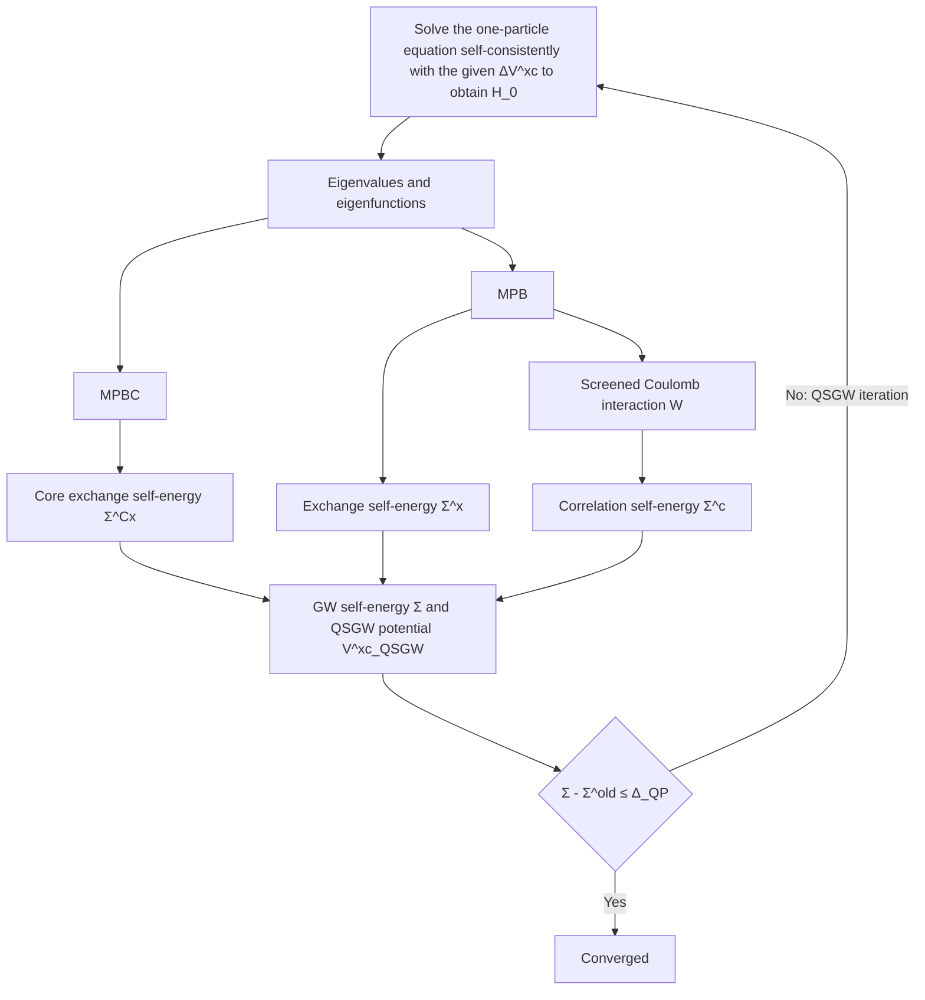

# Quasiparticle self-consistent $GW$ (QSGW)

> English version of the page [theory/qsgw](../../theory/qsgw.md). The pages at the top of ecaljdoc are the reference; this one was made from theory/qsgw.md of commit 7263caee9 (source blob 2a0c944f4c9b).

> **Main reference.** [1] M. Obata, T. Kotani, T. Oda, "Efficient implementation of the quasiparticle self-consistent $GW$ method on GPU",
> Comput. Mater. Sci. **260**, 114190 (2025), [doi:10.1016/j.commatsci.2025.114190](https://doi.org/10.1016/j.commatsci.2025.114190) (open access).
> Its Section 2 is the newest and most concise description of the formulation and algorithms of QSGW in ecalj (the flowchart below is its Fig. 1.
> The program names in the figure are those of that time; now `hgw` computes $\Sigma^{\rm x}$, $W$, and $\Sigma^{\rm c}$ in a single run, and `hsfp0_sc` computes $\Sigma^{\rm Cx}$).

> **Changes since [1].** The present code follows [1], with the following changes (details and dates are in `Changes.md` of the repository).
> - **Smearing of Σ** (2026-09): the Gaussian smearing (`esmr`) was replaced by a Fermi-Dirac kernel of width `t_sigmaw` (K, required since 2026-11-14).
>   It is used in all of $\Sigma^{\rm x}$, the real-axis pole part $R^{\rm c}$, and the imaginary-axis part $I^{\rm c}$. `ctrlg_update.py` converts an old `esmr` into a `t_sigmaw` of the same width.
>   With `wcsmear = true` (default), the pole part integrates $W^{\rm c}$ with this kernel instead of evaluating it at one energy (the 3-point interpolation of [1]).
>   See [kBT](../manual/kBT).
> - **Smearing of χ0** (2026-06 to 09): chosen by the required key `[gw] t_tetrakbt`. 0 is the tetrahedron method of [1] (T = 0), T > 0 is the finite-temperature tetrahedron method,
>   and −T smears Im χ0 with the Fermi-Dirac width.
> - **Programs**: $W$, $\Sigma^{\rm x}$, and $\Sigma^{\rm c}$ are computed in a single run of `hgw` (W is kept in memory, not in files). `hsfp0_sc` computes $\Sigma^{\rm Cx}$.
> - **GPU precision** (2026-06 to 09): `gwsc --prec=tf32|fp32|fp64`. The `--mp` of [1], which does everything in TF32, sometimes broke $W$ (the dielectric matrix is ill-conditioned).
>   The present `--mp` means `--prec=tf32`, and does only the last product of $\Sigma^{\rm c}$ in low precision. The GPU can be shared by several ranks (`-np2`). See [GPU version](../manual/ecaljgpu).
> - **Interpolation of $\tilde\Sigma$** (2026-09, under development): `gwsc --mlo` keeps $\tilde\Sigma$ in the MLO representation instead of interpolating $\Delta V^{\rm xc}$ with MTOs. See [MLO-gwsc](../manual/mlo_gwsc).
> - **Bug fixes that changed GW results** (2026-06 to 09): binning of the pole term of $\Sigma^{\rm c}$, the Fermi level of $\Sigma^{\rm Cx}$ at finite temperature,
>   QSGW using antiferromagnetic symmetry (`symgrpaf`), and the LDA+U starting point (`idu`).

The QSGW (quasiparticle self-consistent $GW$) method is an advanced computational method for calculating the electronic structure of materials in condensed-matter physics and materials science.
It improves the standard $GW$ approximation by iteratively updating the one-particle (quasiparticle) Hamiltonian $H^0$.
It gives more accurate quasiparticle energies and band structures than conventional density functional theory (DFT) calculations.

Main features of QSGW:
- It is a self-consistent method.
- Its predictions of electronic structure are highly accurate.
- It applies to a wide range of materials, including semiconductors, insulators, and metals.
::: warning
QSGW does not update the one-particle Green function directly; it updates it through the one-particle Hamiltonian.
The method that updates the one-particle Green function directly is known as self-consistent $GW$, and it is also known to be less accurate because it neglects vertex corrections.
:::

$$
H_0 = H_{\text{DFT}} + V^\mathrm{QSGW}_\text{xc} - V^\mathrm{LDA/GGA}_{\text{xc}}
\tag{Q1}
$$
where
$$
H_{\text{DFT}} = -\frac{\hbar^2}{2m}\nabla^2 + V_{\text{ext}} + V_{\text{H}} + V^\mathrm{LDA/GGA}_{\text{xc}}
\tag{Q2}
$$
- $-\frac{\hbar^2}{2m}\nabla^2$: kinetic energy term
- $V_{\text{ext}}$: external potential
- $V_{\text{H}}$: Hartree term (Coulomb interaction between electrons)
- $V_{\text{xc}}$: exchange-correlation potential

In QSGW, the one-particle Hamiltonian is constructed with the following equation.
$$
\begin{align}
  \widetilde{𝛴}^\mathrm{c}_{nm}(𝐤) &
  = \Braket{\Psi_{𝐤n} | 
  {\rm Re}\left[
  {\frac{ {\varSigma}^{\rm c}(\varepsilon_{𝐤n}) + {\varSigma}^{\rm c}(\varepsilon_{𝐤m}) }{2}}
\right]  |{\Psi_{𝐤m}} }
\tag{Q3}
\end{align}
$$

## Flowchart

This flowchart shows the procedure to obtain the $GW$ self-energy $𝛴$ and the QSGW potential $V^\mathrm{xc}_\mathrm{QSGW}$.
It starts by solving the one-particle equation to obtain $H^0$ and computing its eigenvalues and eigenfunctions.
It then branches into the calculations of the core exchange self-energy $𝛴^\mathrm{Cx}$, the exchange self-energy $𝛴^\mathrm{x}$, and the correlation self-energy $𝛴^\mathrm{c}$, which are combined to obtain the $GW$ self-energy $𝛴$ and the QSGW potential $V^\mathrm{xc}_\mathrm{QSGW}$.
This iteration continues until the condition $| 𝛴 - 𝛴^\mathrm{old}| ≤ Δ_\mathrm{QP}$ is satisfied.
