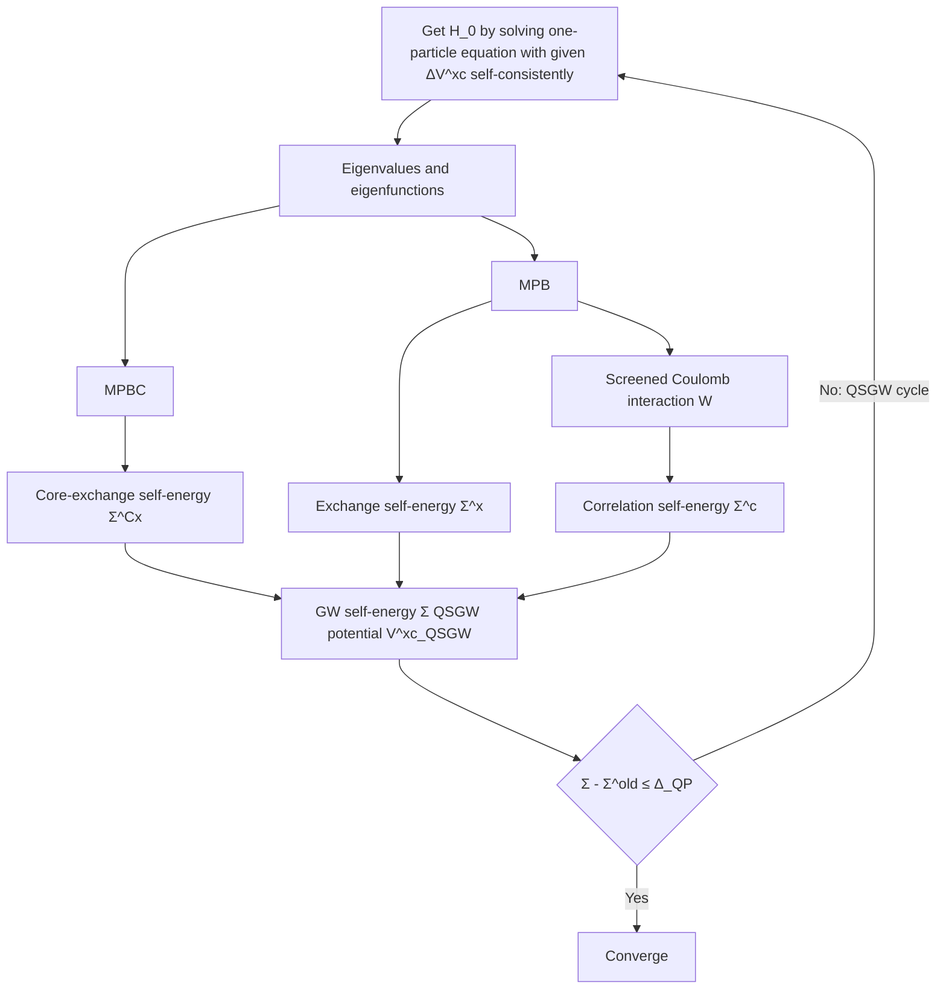

# Quasi-particle self-consistent $GW$

> English version of the page [theory/qsgw](../../theory/qsgw.md). The pages at the top of ecaljdoc are the reference; this one was made from theory/qsgw.md of commit 847e65213 (source blob 7c582dc25df2).

> **Main reference.** [1] M. Obata, T. Kotani, T. Oda, "Efficient implementation of the quasiparticle self-consistent $GW$ method on GPU",
> Comput. Mater. Sci. **260**, 114190 (2025), [doi:10.1016/j.commatsci.2025.114190](https://doi.org/10.1016/j.commatsci.2025.114190) (open access).
> Its section 2 is the latest compact account of the QSGW formalism and algorithm in ecalj (the flowchart below is its Fig. 1;
> the program names there are of that time: now `hgw` computes $\Sigma^{\rm x}$, $W$ and $\Sigma^{\rm c}$ in one run, and `hsfp0_sc` computes $\Sigma^{\rm Cx}$).

> **Changes since [1].** The present code follows [1], with these changes (details and dates in `Changes.md` of the repository):
> - **Smearing of Σ** (2026-09): the Gaussian smearing (`esmr`) is replaced by a Fermi-Dirac kernel of width `t_sigmaw` (K, <del class="clfix">default 1000 K</del>required since 2026-11-14)
>   in $\Sigma^{\rm x}$, in the real-axis pole part $R^{\rm c}$ and in the imaginary-axis part $I^{\rm c}$; <del class="clfix">an old `esmr` is read as the `t_sigmaw` of the same width.</del>an old `esmr` is converted to `t_sigmaw` of the same width by `ctrlg_update.py`.
>   With `wcsmear = true` (default) the pole part integrates $W^{\rm c}$ over this kernel instead of evaluating it at one energy (3-point interpolation of [1]).
>   See [kBT](../manual/kBT).
> - **Smearing of χ0** (2026-06 to 09): chosen by the required key `[gw] t_tetrakbt`: 0 = the tetrahedron method of [1] (T = 0), T > 0 = the tetrahedron
>   method at finite temperature, −T = Im χ0 smeared with the Fermi-Dirac width.
> - **Programs**: $W$ and $\Sigma^{\rm x}$, $\Sigma^{\rm c}$ are computed in one run of `hgw` (W kept in memory, not in files); `hsfp0_sc` computes $\Sigma^{\rm Cx}$.
> - **GPU precision** (2026-06 to 09): `gwsc --prec=tf32|fp32|fp64`. The all-TF32 mode `--mp` of [1] could break $W$ (ill-conditioned dielectric matrix);
>   `--mp` now means `--prec=tf32`, where only the last product of $\Sigma^{\rm c}$ is in reduced precision. GPUs can be shared by several ranks (`-np2`). See [GPU version](../manual/ecaljgpu).
> - **Interpolation of $\tilde\Sigma$** (2026-09, in development): `gwsc --mlo` holds $\tilde\Sigma$ in the MLO representation instead of interpolating $\Delta V^{\rm xc}$ in MTOs. See [MLO-gwsc](../manual/mlo_gwsc).
> - **Bug fixes that changed GW results** (2026-06 to 09): the pole-term binning of $\Sigma^{\rm c}$, the Fermi level of $\Sigma^{\rm Cx}$ at finite temperature,
>   QSGW with antiferromagnetic symmetry (`symgrpaf`), and the LDA+U starting point (`idu`).
> - <del class="clfix">**Input** (2026-05): all settings, including the product basis, are in `ctrlg.<sname>.toml`; see [Input file](../manual/toml_migration).</del>

The quasi-particle self-consistent $GW$ (QSGW) method is an advanced computational technique used in condensed matter physics and materials science to calculate the electronic properties of materials.
It improves upon the standard $GW$ approximation by iteratively updating the one-particle (quasi-particle) Hamiltonian $H^0$.
This method provides more accurate quasi-particle energies and electronic band structures compared to traditional density functional theory (DFT) calculations.

Key features of QSGW:
- Self-consistent scheme
- Improved accuracy in predicting electronic properties.
- Applicable to a wide range of materials, including semiconductors, insulators, and metals.
::: warning
QSGW does NOT directly update the one-particle Green's function but does so through the one-particle Hamiltonian.
The former method is known as self-consistent $GW$, but it is also known as a less accurate method due to the neglect of vertex corrections.
:::

$$
H_0 = H_{\text{DFT}} + V^\mathrm{QSGW}_\text{xc} - V^\mathrm{LDA/GGA}_{\text{xc}}
\tag{Q1}
$$
where 
$$
H_{\text{DFT}} = -\frac{\hbar^2}{2m}\nabla^2 + V_{\text{ext}} + V_{\text{H}} + V^\mathrm{LDA/GGA}_{\text{xc}}
\tag{Q2}
$$
- $-\frac{\hbar^2}{2m}\nabla^2$: Kinetic energy term
- $V_{\text{ext}}$: External potential
- $V_{\text{H}}$: Hartree term (Coulomb interaction between electrons)
- $V_{\text{xc}}$: Exchange-correlation potential

In QSGW, the one-particle Hamiltonian is constructed with the following formula
$$
\begin{align}
  \widetilde{𝛴}^\mathrm{c}_{nm}(𝐤) &
  = \Braket{\Psi_{𝐤n} | 
  {\rm Re}\left[
  {\frac{ {\varSigma}^{\rm c}(\varepsilon_{𝐤n}) + {\varSigma}^{\rm c}(\varepsilon_{𝐤m}) }{2}}
\right]  |{\Psi_{𝐤m}} }
\tag{Q3}
\end{align}
$$

## Flowchart

This flowchart outlines the process of obtaining the GW self-energy $𝛴$ and the QSGW potential $V^\mathrm{xc}_\mathrm{QSGW}$.
It starts with solving a one-particle equation to get $H^0$, followed by determining its eigenvalues and eigenfunctions.
The process then branches into calculating core-exchange self-energy $𝛴^\mathrm{Cx}$, exchange self-energy $𝛴^\mathrm{x}$, and correlation self-energy $𝛴^\mathrm{c}$, which are combined to obtain the $GW$ self-energy $𝛴$ and the QSGW potential $V^\mathrm{xc}_\mathrm{QSGW}$.
The cycle continues until the condition $| 𝛴 - 𝛴^\mathrm{old}| ≤ Δ_\mathrm{QP}$ is met.
