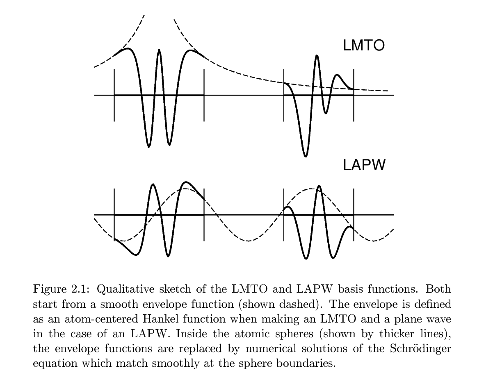
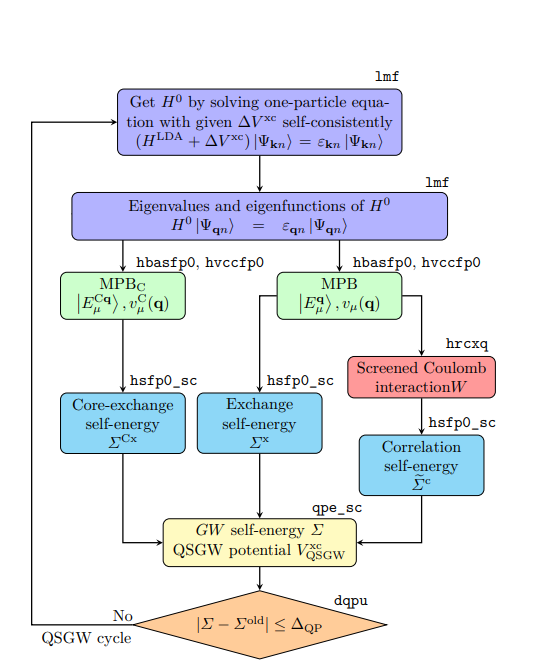
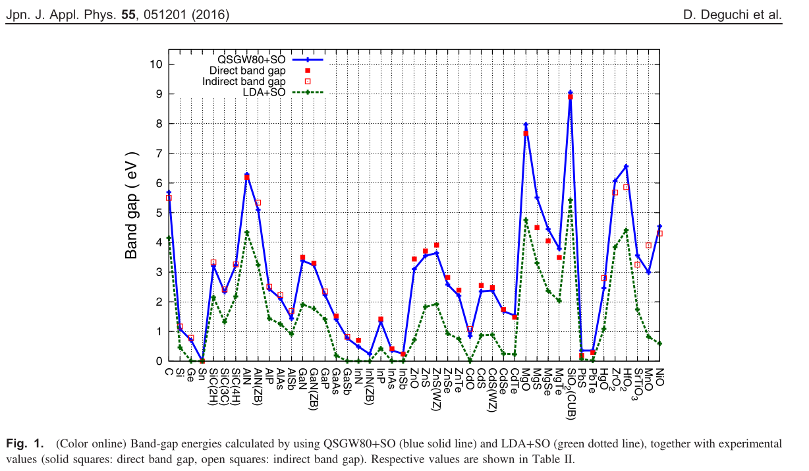
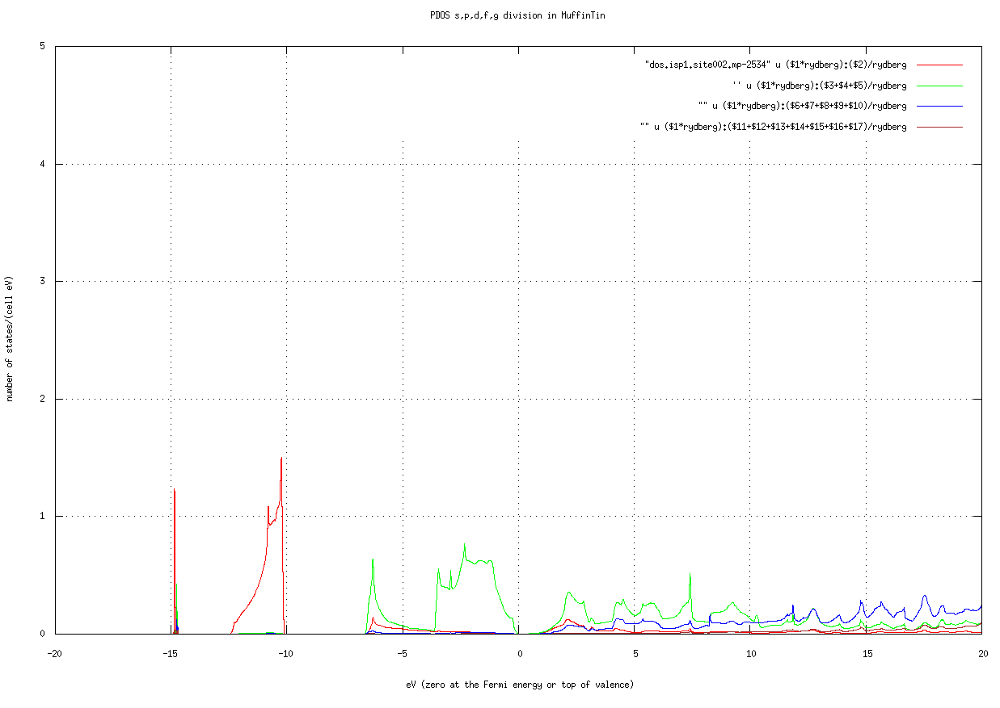
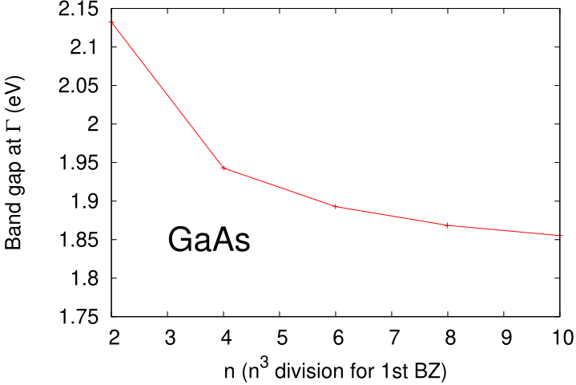

# ecalj メインドキュメント {#ecalj-maindocument}
**ecaljdoc のメインドキュメントです。ecalj の特徴、QSGW の概観、最初の計算（GetStarted）を書いています。ほかのページへは左のメニューからたどってください。**

* ここでは [GetStarted](#getstarted) を、インストールと QSGW の概観とあわせて説明します。
* [UsageDetails](./UsageDetailed.md) は別のファイルにあります。
* [Qiita の日本語の記事](https://qiita.com/takaokotani/items/9bdf5f1551000771dc48) も参考になるかもしれませんが、ほとんどはここに書いてあります。
* リンクが切れていたら、https://github.com/tkotani/ecalj からダウンロードしてください。
* インストールと案内は AI にさせてください（[GetStarted with AI](./getstartedAI) を AI に読ませる）。インストールの手順の文書は [install](../install/install.md)、[ISSP でのインストール](../install/installISSP.md)。
* ライセンス: AGPLv3（AI にも例外なく適用）。[ライセンス](./license) のページを見てください。

## ecalj パッケージの特徴 {#features-of-ecalj-package}

1. **全電子フルポテンシャルの PMT 法** 
   PMT 法とは、2 種類の補強された波（augmented waves）、つまり APW+MTO の混合基底の方法です。
   言い換えると、PMT 法 = 線形化した（APW+MTO）法です。ecalj と同じ起源をもつ [Questaal](https://www.questaal.org/) を除けば、ほかにない方法です。MTO と APW は、波動関数の表現において相補的に機能します。それぞれ固有関数の局在した性質と広がった性質に対応します。

   図 1 を見てください。<br>
   MTO と APW では、MT の外の包絡関数（図の破線）の曲率が逆になっています。曲率の符号は、その場所の $V-E$ の符号で決まります（$\nabla^2\psi/\psi = (2m/\hbar^2)(V-E)$）。$E>V$ では振動し（APW）、$E<V$ では減衰します（MTO）。3d のような局在した状態の固有値は、MT の外の有効ポテンシャル（遠心力の項 $l(l+1)/r^2$ を含む）の下にきます。一方、Na の 3s のような広がった状態の固有値は、その上にきます。
   局在した MTO（減衰因子 $\exp(-\kappa r)$、$\kappa \sim 1\,{\rm bohr}^{-1}$。最近接の原子までしか届かないということです）と APW（カットオフは $\approx 3$ Ry）を合わせると、十分な収束が得られます。APW を含むので、散乱状態もとてもよく記述できます。これは Gaussian などでは困難な点です。一方で、極端に少ない APW でも、3d などのコアの形に近い原子の波動関数を記述できるのは、MTO のおかげです。GGA/LDA のレベルで原子の位置の緩和もできます。 
   

   *図 1*. MTO と APW（M. Methfessel と M. van Schilfgaarde による [nfp のマニュアル](../presentations/nfpmanual.pdf) から）。

   いまの PMT の定式化は次にあります。

   [1][KotaniKinoAkai2015, PMT formalism](https://github.com/ecalj/ecaljdoc/blob/main/presentations/KotaniKinoAkai2015FormulationPMT.pdf)
   
   [2][KotaniKino2013, PMT applied to diatomic molecules](https://github.com/ecalj/ecaljdoc/blob/main/presentations/KotaniKino2013PMTMolecule.pdf).

   基底関数のパラメータは自動で設定するので、パラメータの設定に悩む必要はありません。計算に要るのは結晶構造（POSCAR）だけです。 
   <!-- In principle, it is possible to perform reasonable calculations just from crystal structures and very minimum setting.  -->
    * PMT のはじまりは https://journals.aps.org/prb/abstract/10.1103/PhysRevB.81.125117 です。
    * PMT は [E. Bott、M. Methfessel、W. Krabs、P. C. Schmidt による smooth Hankel 関数の論文](https://github.com/ecalj/ecaljdoc/blob/main/presentations/Bott1988.pdf) にある smooth Hankel 関数を使います。これは [B][M. Methfessel、M. van Schilfgaarde、R.A. Casali による nfp の論文](https://github.com/ecalj/ecaljdoc/blob/main/presentations/nfp.pdf) で使われたもので、私たちの PMT はその上に作られています。
   *  PMT の基底に加えて、局所軌道（local orbital）も合わせて使います。
   * カットオフ $\approx 3$ Ry は驚くほど小さく聞こえるかもしれません。しかし、平面波の方法で高いエネルギーの部分は、動径関数の曲率が負になる、固有関数の内殻のような形を表すためだけに使われていることに注意してください。さらに、平面波には周期ゲージ（periodic gauge）を満たさないという難しさがあります（https://arxiv.org/pdf/2010.03959）。一方、LMTO やガウス関数のような局在基底の方法は、真空の領域を扱うのが苦手です。

2. **PMT-QSGW 法** 
   
   PMT-QSGW とは、`the Quasiparticle self-consistent GW method (QSGW) based on the PMT method`、つまり PMT 法にもとづく準粒子セルフコンシステント GW 法（QSGW）のことです。PMT の上で QSGW を行うための鍵は [3] の開発です。磁性金属も扱えます。ecalj は GPU に実装したので、4 枚の GPU で約 40 原子を扱えます。
   [3][Kotani2014, Formulation of PMT-QSGW method](https://github.com/ecalj/ecaljdoc/blob/main/presentations/Kotani2014QSGWinPMT.pdf)
   [4][D.Deguchi PMT-QSGW applied to a variety of insulators/semiconductors](https://github.com/ecalj/ecaljdoc/blob/main/presentations/deguchi2016.pdf)
   [5][M.Obata GPU implementation](https://arxiv.org/abs/2506.03477)。ここでは Type II の GaSb/InAs（40 原子）を 4 枚の GPU で扱っています。
   Wannier などの内挿をしなくても、バンドの図を簡単に描けます。自己エネルギーの内挿の仕組みが内部に組み込まれているからです。
   これは、QSGW の基底状態の上で固有関数から物理量を計算するのにとても大事です。

   すべての電子を扱うので、擬ポテンシャルのあいまいさに悩まされません。

3. **誘電関数と磁化率**
    誘電関数、グリーン関数のスペクトル関数、磁気ゆらぎなど、GW に関係する量を計算できます。QSGW は任意の k 点で固有関数と固有値を作れるからです。

4. **MLO によるモデルハミルトニアン** 
   MLO（muffin-tin based localized orbitals、マフィンティンにもとづく局在軌道）で有効模型を作ります。模型のハミルトニアンと、MLO の間の有効相互作用 v、W、cRPA の W です
   （`job_mlo`、`job_mloW --crpa`。[MLO](./mlo)）。
   * 2026-10-02 まで、ecalj には cRPA つきの最局在 Wannier 関数（Juelich のグループの定式化）がありました。もとは
     宮川博士、佐久間博士、木野博士のコードです（これを使った論文: https://journals.aps.org/prb/abstract/10.1103/PhysRevB.108.035141）。
     MLO がこれに置き換わりました。もとのものは git のタグ `last-wannier` にあります。 

5. **Fortran の singleton パターン**
   コードの主な部分は Fortran です。コードは singleton のデザインパターンにもとづくオブジェクト指向の構造をもっています。これは、Fortran のコードを JAX/PyTorch のようなモダンな言語のものに置き換えていくための一歩だと考えています。どうしても古いコードは残っていますが、できるだけカプセル化しており、置き換えていく予定です。

# QSGW の概観 {#overview-of-qsgw}

* バンド計算（LDA のレベル）はプログラム `lmf` で行います。最初の設定ファイルは `ctrlg.<sname>.toml` です（`<sname>` は利用者が選ぶ物質の拡張子。古い形は `ctrl.<sname>`）。`lmf` の前に `lmfa` を走らせる必要があります。これは球対称の原子の計算で、電子密度の初期条件を決めます（`lmfa` はすぐに終わります）。
* ファイル `sigm.<sname>` が QSGW 計算の鍵です。`sigm.<sname>` には非局所ポテンシャル $\Delta V_{\rm xc}=V_{\rm xc}^{\rm QSGW}-V_{\rm xc}^{\rm LDA}$ が入っています。`lmf` が行う通常の LDA 計算にこのポテンシャルの項を加えることで、QSGW 計算ができます。下の図を見てください。
* そこで問題は $V_{\rm xc}^{\rm QSGW}({\bf r},{\bf r}')$ をどう作るかです。これは GW 近似で計算した自己エネルギー $\Sigma({\bf r},{\bf r}',\omega)$ から計算します。大まかに言えば、$\Sigma({\bf r},{\bf r}',\omega)$ の omega 依存性を取り除いて $V_{\rm xc}^{\rm QSGW}({\bf r},{\bf r}')$ を得ます。
* したがって、$V_{\rm xc}^{\rm QSGW}$ の計算が QSGW のサイクルの主な部分で、二重のループで計算します。つまり、`lmf` の内側のループと、`lmf` が与える固有関数を使って $V_{\rm xc}^{\rm QSGW}$ を計算する外側のループがあります。外側のループは gwsc という python のスクリプト（Fortran のプログラムを走らせます）で実行できます。QSGW の計算時間は LDA の計算よりずっと長くなります。 
目安として、20 原子でおよそ 10 時間かかります 
（電子の数によります。セルあたり 10 原子くらいより大きい系では GPU を使うことを勧めます）。 
* 次は https://arxiv.org/abs/2506.03477 の Figure 1 に示した QSGW のサイクルです。MPB は、固有関数の積を展開するための混合積基底（mixed product basis）のことです。 
 
* [QSGW の GPU による高速化](https://arxiv.org/abs/2506.03477) があります。この論文は QSGW の基本も説明しています。QSGW のアルゴリズムは GPU の計算にとてもよく合います。4 枚の GPU で、セルあたり 40 原子の系を計算できます（lmf の部分では、まだ GPU を効率よく使えていません）。PMT ではスラブ模型の大きな真空の領域も扱えます。
* 手でパラメータを設定することなく、ほぼ自動で QSGW を行えます。そのため、ecalj は GW/QSGW を行うのに最も簡単なものの一つだと考えています。QSGW のバンドのデータベースを https://github.com/tkotani/DOSnpSupplement で見てください（GW1500: 1546 物質の QSGW80、2026-10 から。2025 年版は https://arxiv.org/abs/2507.19189 の補遺で、その `DOSnp2025.md` です）。

 この図は [4][D.Deguchi](https://github.com/ecalj/ecaljdoc/blob/main/presentations/deguchi2016.pdf) から取りました。

LDA と比べると、QSGW では次の違いが見られます。
* バンドギャップ。QSGW は実験よりやや大きくなる傾向があります。上の図のように系統的に見えます。
* バンド幅。ふつう sp バンドは広がります（Na のようなとても密度の低い場合を除く）。
    これは一様電子ガスの場合と整合しています。
    3d 電子のような局在したバンドは狭くなります。
* バンドの相対的な位置。例えば O(2p) と Ni(3d)。
より局在したバンドほど深くなる傾向があります。
上向きと下向きの間の交換分裂は大きくなります（LDA+U のように）。
NiO のような場合、磁気モーメントは大きくなり、実験値に近づきます。
* 3d バンドとほかのバンドの混成。QSGW は固有関数を局在させる傾向があります。

ただし実際は複雑で、場合によってはそう単純ではありません。

<!-- 
## 基礎知識check 
* LDA計算の流れ
* MT division of space
* 基底関数 MTOとAPW　（AugmentationとMT内の原子的な波動関数). 3つの成分をもつ。envelope + true - counter
* バンド計算法PMT=LMTO+LAPW法. ３つの成分で電荷も表現する。MTOの張る空間の不満足な部分を3Ry以下程度のAPWでサポートする。
* 独立粒子近似とは
* Hartree-Fock(HF)近似で水素Hがきちんと解ける。一様ガスではフェルミ面で状態密度がゼロになる。
* LDAでは一様ガスがきちんと解けるがHのバンドギャップはかなり小さい。
* LDAとHFは両極にある。HFではSiのバンドギャップは10eV以上（なぜか？）　ハイブリッド法HSE。自己相互作用。
* 交換項の重要性。H2のbonging-antibondingを区別するには、占有状態へのプロジェクタの役割をするFock項が重要
* GW近似. Fock項にくわえて相関項。分極媒質中を走る荷電粒子の感じる時間依存ポテンシャル。スクリーンHF+クーロンホール
　バンドギャップ、dバンドの位置、Uの効果
* QSGW法。GW近似における自己エネルギーからいくらか強引に時間依存性をとりのぞいて特殊な交換相関項をつくる。
* （できたら線形応答理論の基礎、ステップ関数のフーリエ変換、古典的な減衰振動系でのグリーン関数（線形応答関数）。）

## ecalj 何ができるか？

* LDA計算 
VWN,PBE-GGA,LDA+Uがえらべる。
構造緩和（格子変化は手動）、Colinear,  SOC(軸を選べる）, AFの対称性を入れることができる。
ESM法でのスラブ計算. 最適化しきれてないので現状では構造緩和などでは優位性がない。

* QSGW計算：
self-consistent GW法。特殊な交換相関項を作る計算であるといえる。
自己エネルギースペクトルプロット。
インパクトイオン化率（オージェによる寿命）。
GPU化、自動化セッテイング。
GW法でのバンドプロットが直接に可能。
QSGWでは現状全エネルギー計算ができない。バンド構造（固有値、波動関数）のみ。
* 線形応答などの計算。
RPAでの誘電率計算、スピンゆらぎ計算 （改良の余地。金属でもできる。ドルーデウエイト(q→0<del class="clfix">）</del><span class="clfix">)）</span>
MLO による模型化（模型のハミルトニアン、v・W・cRPA。2026-10-02 に最局在 Wannier から置き換えた）。 自動化がすこしできてないところがある。
その他の物理量についても応用できるはず。
* かなりの部分で自動計算が可能。QSGW法ではMaterial Projectから1500個程度の構造ファイルを持ってきて自動化でQSGW計算しているが
ほぼ問題なく可能。個別にセッティングを手動でいじらなくても良い（4f,5fについては自動化がまだ設定できてないが基本的に可能）
バンドプロットも対称ラインも含め自動化してある。データはgnuplotなどでプロットするので読みやすい。結晶構造についてはPOSCARとの相互コンバータあり。
複数のPOSCARを一括計算するecalj_autoも梱包してある（整備中）。 -->


# 始めよう（GetStarted） {#getstarted}
ここでは ecalj による DFT/QSGW の計算を説明します。そのあとでバンドの図の描き方を説明します。簡単のため、常磁性（nsp=1）で、4f なし、SOC なしの場合を扱います。
一歩ずつ説明します。

> **実例** — 以下のすべての Step で **GaAs** を例に使います。
> 最小の種（`ctrls.gaas` と、生成した
> `ctrlg.gaas.toml`）は
> [`Samples/GetStarted/GaAs/`](https://github.com/tkotani/ecalj/tree/main/Samples/GetStarted/GaAs) にあります。
> このディレクトリを新しい作業場所にコピーして、下の Step 1-6
> に従ってください。一度に再現するスクリプトは、その
> [README](https://github.com/tkotani/ecalj/blob/main/Samples/GetStarted/GaAs/README.md)
> を見てください。

詳しくは [UsageDetailed](./UsageDetailed.md) で説明します。

## Step 0. POSCAR を用意する {#step-0-get-poscar}
まず POSCAR（VASP の形式の結晶構造）が必要です。 
POSCAR の例は ecalj/ecalj_auto/INPUT/testSGA/POSCARALL にあります。
```bash
cd ecalj
mkdir TEST
cd TEST
mkdir test1
mkdir test2
cat ecalj_auto/INPUT/testSGA/joblist.bk
cp ../ecalj_auto/INPUT/testSGA/POSCARALL/POSCAR.mp-2534 test1
cp ../ecalj_auto/INPUT/testSGA/POSCARALL/POSCAR.mp-8062 test2
```

例えば、mp-2534 の GaAs の POSCAR は次のとおりです。
```
Ga1 As1
1.0
   3.5212530000000002    0.0000000000000000    2.0329969999999999
   1.1737510000000000    3.3198690000000002    2.0329969999999999
   0.0000000000000000    0.0000000000000000    4.0659929999999997
Ga As
1 1
direct
   0.0000000000000000    0.0000000000000000    0.0000000000000000 Ga
   0.2500000000000000    0.2500000000000000    0.2500000000000000 As

```

次は ba2pdo2cl2 の POSCAR です（QSGW の結果は下に示します）。
```
POSCAR_ba2pdo2cl2
1.0
-2.06443 2.06443 8.40383 
2.06443 -2.06443 8.40383 
2.06443 2.06443 -8.40383 
Ba Pd O Cl 
2 1 2 2 
Cartesian
0.0 0.0 6.5153213224
0.0 0.0 10.2923386776
0.0 0.0 0.0
0.0 2.06443 0.0
2.06443 0.0 0.0
0.0 0.0 3.1625293056
0.0 0.0 13.6451306944
```

cif を `POSCAR` に変換したいときは、次のようにします。
`cif2cell foobar.cif -p vasp --vasp-cartesian --vasp-format=5`


## Step 1. POSCAR を ctrls に変換する {#step-1-convert-poscar-to-ctrls}
次に vasp2ctrl で POSCAR を ctrls に変換します。
ctrls は ecalj で使う構造のファイルです。

```
vasp2ctrl POSCAR.mp-2534 
mv ctrls.POSCAR.mp-2534.vasp2ctrl ctrls.POSCAR.mp-2534
cat ctrls.mp-2534
```

ctrls.mp-2534 には POSCAR と同じ結晶構造が入っています。
```
STRUC
     ALAT=1.8897268777743552
     PLAT=       3.52125300000       0.00000000000       2.03299700000  
                 1.17375100000       3.31986900000       2.03299700000 
                 0.00000000000       0.00000000000       4.06599300000 
SITE
     ATOM=Ga POS=     0.00000000000       0.00000000000       0.00000000000 
     ATOM=As POS=     1.17375100000       0.82996725000       2.03299675000 
```
STRUC と SITE のような区分のブロックを示すために、字下げが必要です。
`ctrls.gaas` の別の例です（実例の種として
[`Samples/GetStarted/GaAs/ctrls.gaas`](https://github.com/tkotani/ecalj/blob/main/Samples/GetStarted/GaAs/ctrls.gaas) にあります）。

```
%const bohr=0.529177 a=5.65325/bohr
STRUC
     ALAT={a}
     PLAT=0 0.5 0.5 0.5 0 0.5 0.5 0.5 0
SITE
    ATOM=Ga POS=0.0 0.0 0.0
    ATOM=As POS=0.25 0.25 0.25
```
ctrls.srtio3:
```
%const au=0.529177
%const a0=2*1.95/au v=a0^3 a1=v^(1/3)
STRUC ALAT={a1}
   PLAT=1 0 0 0 1 0 0 0 1
SITE
   ATOM=Sr POS=1/2 1/2 1/2
   ATOM=Ti POS= 0 0 0
   ATOM=O POS=1/2 0 0
   ATOM=O POS= 0 1/2 0
   ATOM=O POS= 0 0 1/2
```

`%const` の行は、`ctrlgenToml.py` が展開する変数を定義します。1 行に複数の定義を書いて
かまいません。演算子（`+ - * / ** ^`）と `sin / cos / log / sqrt / pi`
は評価されます。先に定義したものは後の定義から見えます（そのため、
`au` が前の `%const` の行で定義されているので
`a0=2*1.95/au` が使えます）。`1/3` は浮動小数点の割り算（Python 3）なので、
`v^(1/3) ≡ v**(1/3)` は立方根です。

> **落とし穴** — `%const x= y=...` のような、値の空のプレースホルダは
> **使わないでください**。右辺のない項目は次の語とくっついてしまい、
> 行の残りが黙って壊れます（そのため `y`、`z`、... は定義されません）。
> 空の項目を消すか、実際の値を入れてください
> （`%const x=0 y=...`）。

原子の種の既定の名前は `ctrlgenToml.py --showatomlist` で表示されます。
既定の記号の代わりに、自分の記号を次のように使えます。
```
SITE
   ATOM=M1 POS=1/2 1/2 1/2
   ATOM=M2 POS= 0 0 0
   ATOM=O POS=1/2 0 0
   ATOM=O POS= 0 1/2 0
   ATOM=O POS= 0 0 1/2
SPEC
   ATOM=M1 Z=38
   ATOM=M2 Z=22
   ATOM=O Z=8
```
この場合は SPEC が必要です。これを使うと、反強磁性の NiO は次のようになります。
```
%const bohr=0.529177 a=7.88
STRUC 
   ALAT={a} PLAT= 0.5 0.5 1.0 0.5 1.0 0.5 1.0 0.5 0.5
SITE 
   ATOM=Niup POS= .0 .0 .0
   ATOM=Nidn POS= 1.0 1.0 1.0
   ATOM=O POS= .5 .5 .5
   ATOM=O POS= 1.5 1.5 1.5
SPEC
   ATOM=Niup Z=28 MMOM=0 0 1.2 0
   ATOM=Nidn Z=28 MMOM=0 0 -1.2 0
   ATOM=O Z=8 MMOM=0 0 0 0
```
反強磁性の対称性を使いたいとき（上向きのバンドだけを計算し、下向きのバンドを作る）は、
[AFsymmetry](./UsageDetailed.md#antiferro-symmetry-without-soc) を見てください。MMOM は各サイトの磁気モーメントの初期条件です。
数値（ここでは 1.2）はあまり正確でなくてかまいません（整数くらいで十分です）。
例は [Samples/MATERIALS](#samples-materials-lda-and-mlo-samples-of-65-materials) にあります。まずは簡単な物質から始めてください。ただ、
自分の POSCAR から VASP や MP の結果を再現するのは、それほど難しくありません。


- メモ: 
    - ctrl2vasp ctrls.mp-2534 で VASP のファイルに戻せます。VESTA で確かめてください。viewvesta（変換して VESTA を起動します）も使えます。
    - 使わないファイルがたくさん作られます（気にしなくてかまいません）。
    - サイトには [Niup などの](./UsageDetailed.md#antiferro-symmetry-without-soc) 好きな名前を使えます。その場合は SPEC の区分も設定する必要があります。[Z は整数でなくてもかまいません。](./UsageDetailed.md#background-charge-and-fractional-z) これは後で学んでください。
    - 古い ctrls には NL、NBAS、NSPEC があるかもしれませんが、いまは要りません。

## Step 2. ctrls から `ctrlg.<sname>.toml` を作る {#step-2-get-ctrlg-sname-toml-from-ctrls}

`ctrlg.<sname>.toml` は、2026-05 から Fortran のバイナリ（`lmf`、`lmfa`、`lmchk`、`gwsc`、...）
が実際に読むただ一つの入力ファイルです。（最後の区分 `[product_basis]` の末尾には、
GW だけが使う原子ごとの表があります。生成するプログラムが書くので、ふつうは
編集しません。）軽い `ctrls.<sname>`
（Step 1 で `vasp2ctrl` が作った、構造だけの種）から、
**`ctrlgenToml.py`** で直接作ります。

```bash
ctrlgenToml.py mp-2534
```

（あるいは、[`Samples/GetStarted/GaAs/`](https://github.com/tkotani/ecalj/tree/main/Samples/GetStarted/GaAs)
にある GaAs の実例では、
`ctrlgenToml.py gaas` で、そのディレクトリにある
[`ctrlg.gaas.toml`](https://github.com/tkotani/ecalj/blob/main/Samples/GetStarted/GaAs/ctrlg.gaas.toml)
が作られます。）

この一つのコマンドは次のことをします。

1. 最上位（`symgrp` / `verbose` / `time`）と `[struc] / [[site]] / [[spec]]` を、周期表の
   既定値（`atomlist` の表、`SRC/exec/pylib/atomlist.py`）で埋めます。
2. 内部で `lmfa → lmf --jobgw=0 → gwinit` を走らせて、
   `[gw] / [mlo] / [blocks] / [product_basis]`（最後のものは
   原子ごとの表 `nlx` / `valence` / `core` を含みます）を埋めます。
3. `ctrlg.<sname>.toml` を書いて終わります。

うまく終わると、最後は次のようになります。

```text
ctrlgenToml: wrote ctrlg.mp-2534.toml (2 spec, 2 sites)
ctrlgenToml: running lmfa -> lmf --jobgw=0 -> gwinit  to fill GW sections
ctrlgenToml: done. ctrlg.mp-2534.toml has top-level/[struc]/[[site]]/[[spec]]/...
             plus [gw]/[mlo]/[blocks]/[product_basis] (incl. nlx/valence/core).
```

**勧める手順**: `ctrlgenToml.py <sname>` を**ほかのフラグなしで**走らせて
既定値を得て、**そのあとで `ctrlg.<sname>.toml` を編集します**。
ファイルには説明のコメントがすべて付いていて、TOML の型も付いているので、
エディタでその場で直すのが自然なやり方です。**`ctrlgenToml.py --help` に
出る CLI のフラグは、こうした編集をあらかじめ焼き込むためのもので、必須ではありません。**
スクリプトで多くの物質をまとめて作るときには便利ですが、
ふつうに対話的に使うときはフラグを付けず、生成された `ctrlg.<sname>.toml` のキーを直接編集してください。

`[product_basis]` の末尾の `nlx` / `valence` / `core` の表は
GW の計算だけで使われ、**ふつうは手で編集する必要はありません**。
生成されたままにしておいてください。

DFT だけで GW を使わないディレクトリなら、`--skipgw` を付けます。

```bash
ctrlgenToml.py <sname> --skipgw   # ctrlg.<sname>.toml without [gw]/[mlo]/[blocks]/[product_basis]
```

**それまでに ctrl の側で行った編集を失わずに**、あとから GW の区分を加えるには、
`--addgw` を使います。

```bash
ctrlgenToml.py <sname> --addgw    # appends [gw]/[mlo]/[blocks]/[product_basis] in place;
                                  # ctrl-side keys ([bz], [ham], [[spec]], ...)
                                  # are preserved verbatim.
```

`[gw]` がすでにあると、`--addgw` は走るのを断ります（黙って
二重になるのを避けるためです）。この目的で `ctrlgenToml.py <sname>` を
そのまま走らせ直すことは**しないでください**。既定の流れでは
`ctrlg.<sname>.toml` 全体を `ctrls.<sname>` から上書きします（前のファイルは
`ctrlg.<sname>.toml.bakup` に移されますが、控えは一世代だけです。
編集した内容はそこに残りますが、手で戻してマージしなければなりません）。

`ctrlg.<sname>.toml` でよく編集するものです。

1. `[bz].nkabc` — k 点のメッシュ（LDA）。
2. `[ham].nspin` — 磁性なら 2、非磁性なら 1。
3. `[ham].so` — 0 / 1（完全な L·S）/ 2（Lz·Sz だけ）。`nspin = 2` が必要です。
   `so=1` はまだ QSGW に対応していません。QSGW + SOC では、`so=0`
   か `so=2` で走らせて `sigm.<sname>` を得てから、`so=1` にします。
4. `[ham].xcfun` — 1 = VWN、2 = Barth-Hedin（既定）、103 = PBE-GGA。
5. `[ham].scaledsigma` — QSGW の混合。`1.0` = 完全な QSGW、`0.8` = QSGW80。
   `sigm.<sname>` のファイルがあれば、`(scaledsigma) × (V_xc^QSGW − V_xc^LDA)` が lmf の
   ハミルトニアンに加わります。
6. `[gw].n1n2n3` — GW の k 点のメッシュ。`[bz].nkabc` より小さくします（1/2 か 2/3）。
7. LDA+U: `[[spec]]` の中に配列 `idu / uh / jh` を加えます。
   [`lmf.md` の LDA+U の節](./lmf) を見てください。

一回の実行だけキーを上書きするには、コマンドラインで `--ctrlg:<section.key>=<value>` を使います。[入力ファイル](./toml_migration#run-time-ctrlg-overrides) を見てください。

```bash
# OLD (legacy ctrl + %const; the programs stop)
lmf si -vnk=8 -vmetal=3 -vnspin=2

# NEW (TOML path; processed in-memory, no on-disk rewrite)
lmf si --ctrlg:bz.nkabc=[8,8,8] --ctrlg:bz.metal=3 --ctrlg:ham.nspin=2
```

> ⚠️ **注意** — `-v` は*以前は*、古い `ctrl.<sname>` の中で宣言した
> `%const NAME=...` の記号を上書きしていました（そのあと参照されている所で
> `{NAME}` が展開されました）。TOML では、**上書きは TOML のパスを直接指します**
> （`--ctrlg:section.key=val`）。`%const` を介した間接の参照はありません。
> `-vmetal=3` とすると、プログラムは新しい形を示すメッセージを出して止まります。
> `--ctrlg:bz.metal=3` を使ってください。
> [toml_migration の注意のブロック](./toml_migration#run-time-ctrlg-overrides) を見てください。

* `lmchk mp-2534 --ctrlg:verbose=60` で、認識された対称性を確かめられます。
  （古い `lmchk --pr60 mp-2534` は廃止しました。`--pr=N` の短縮形は移行のヒントを出して
  止まります。代わりに `--ctrlg:verbose=N` を使ってください。）

ここで、次のものを目で確かめられます。

* `SiteInfo.lmchk` — MT 半径、原子の位置
* `PlatQlat.chk` — 基本格子ベクトル（plat）と逆格子（qlat）

[`ctrlg.<sname>.toml` のすべてのキーの詳しい説明](./lmf)。

> **`ctrlgenToml.py`** は周期表の既定値を
> `SRC/exec/pylib/atomlist.py` から取ります（2026-05 より前に
> `ctrl.<sname>` を書いていた古い `ctrlgenM1.py` は、2026-10-07 に削除しました）。手で編集した
> `ctrl.<sname>`（または `ctrl.<sname>` + `GWinput`）がすでにある古いディレクトリは、
> `Legacy2toml.py <sname>` で変換します。下の
> Step 2-Migration を見てください。

### Step 2-Migration. すでにある `ctrl.<sname>`（と、あれば `GWinput`） {#step-2-migration-existing-ctrl-sname-and-optional-gwinput}

手で編集した `ctrl.<sname>`（と、場合によっては `GWinput`）がすでにある
古い作業ディレクトリから始めるときは、`ctrls` から作り直さず、
その場で変換してください。

```bash
Legacy2toml.py mp-2534
```

これは `ctrl.<sname>` と（あれば）`GWinput` を読んで、
`ctrlg.<sname>.toml` を出力します。何度走らせても同じ結果になり、そのままでは
引き継げない `%const` / `-v` の上書きについて
`[INFO] / [WARN] / [ERROR]` の診断を出します。キーの対応の全体は
[入力ファイル](./toml_migration) を見てください。

### VESTA をインストールする {#install-vesta}
結晶構造を見るには VESTA が便利です。
（私は ubuntu 24 に VESTA-gtk3.tar.bz2（ver. 3.5.8、built on Aug 11 2022、23.8MB）を入れました）
ecalj/StructureTool/ に 'viewvesta' のコマンドがあります。
次を試してください。
```
viewvesta ctrlg.si.toml      # canonical (post-2026-05)
viewvesta ctrls.si           # legacy structure-only seed file
```
これで構造を VESTA で見られます。変換のプログラム `vasp2ctrl` / `ctrl2vasp`（これも `/StructureTool` にあります）も、同じく TOML / ctrls / ctrl の形の入力を受け付けます。
<small>（~/ecalj/GetSyml/README.md もありますが、利用者は読まなくてかまいません。）</small>


## Step 3. LDA の計算 {#step-3-lda-calculation}
1. まず lmfa を走らせます。結晶に含まれる、球対称の原子の電子密度を求めるものです。lmfa はすぐに終わります。
   ```bash
   lmfa mp-2534
   ```
   で、初期化のための球対称の原子の計算をします。`lmfa` は
   `ctrlg.mp-2534.toml` を読み（cwd に `ctrlg.*.toml` がちょうど一つだけあれば、
   名前を省いても自動で見つけます）、下の `lmf` に要る
   ファイルを作ります。
   コンソールの出力の `conf ` の部分を、次のようにして確かめてください。
   ```bash
   lmfa mp-2534 |grep conf
   ```
   これで原子の配置が表示されます（`lmfa` を何度走らせても副作用はありません）。
   ```
   conf:------------------------------------------------------
   conf:SPEC_ATOM= Ga : --- Table for atomic configuration --- (n and nz are Pr. Quantum numbers for valence) 
   conf:  isp  l    n nz    Qval     Qcore   CoreConf 
   conf:    1  0    4  0    2.000    6.000 => 1,2,3,
   conf:    1  1    4  0    1.000   12.000 => 2,3,
   conf:    1  2    4  3   10.000    0.000 => 
   conf:    1  3    4  0    0.000    0.000 => 
   conf:    1  4    5  0    0.000    0.000 => 
   conf: Species  Ga       Z=  31.00 Qc=  18.000 R=  2.230000 Q=  0.000000 nsp= 1 mom=  0.000000
   conf: rmt rmax a=  2.230000  49.011231  0.015000 nrmt nr= 661 867
   conf: Core rhoc(rmt)= 0.001940 spillout= 0.001839
   conf:------------------------------------------------------
   conf:SPEC_ATOM= As : --- Table for atomic configuration --- (n and nz are Pr. Quantum numbers for valence) 
   conf:  isp  l    n nz    Qval     Qcore   CoreConf 
   conf:    1  0    4  0    2.000    6.000 => 1,2,3,
   conf:    1  1    4  0    3.000   12.000 => 2,3,
   conf:    1  2    4  0    0.000   10.000 => 3,
   conf:    1  3    4  0    0.000    0.000 => 
   conf:    1  4    5  0    0.000    0.000 => 
   conf: Species  As       Z=  33.00 Qc=  28.000 R=  2.330000 Q=  0.000000 nsp= 1 mom=  0.000000
   conf: rmt rmax a=  2.330000  49.695135  0.015000 nrmt nr= 675 879
   conf: Core rhoc(rmt)= 0.011286 spillout= 0.017467
   ```
   この表から、Ga の初期条件の価電子の数は 4s、4p、4d+3d（局所軌道を使う）でそれぞれ 2、1、10 だとわかります。 
   内殻の配置と電荷も表示されています。Q=0 は電荷の中性を満たしていることを意味します。 
   * lmfa は球対称の原子を（実質的に $r \to \infty$ まで）計算し、MT の境界での対数微分を計算して `atmpnu.*` に保存します。 
   * lmf の初期の電子密度は、lmfa が与える球対称の原子の密度の重ね合わせです。 
   * [`[ham].readp = true`](./lmf.md#readp-option)（`ctrlgenToml.py` が既定で設定します。古い `READP=T` も同じでした）のときは、MT の境界での動径波動関数の対数微分を固定したままにします。

2. `lmfa` のあと、次のようにして LDA の計算を走らせます。

   ```bash
   mpirun -np 8 lmf mp-2534
   ```
   数秒で終わります。すると次のように表示されます。   
   ```bash
   it 10  of 80    ehf=   -8398.499465   ehk=   -8398.499466
   From last iter    ehf=   -8398.499464 ehk=   -8398.499465
   diffe(q)= -0.000001 (0.000004)    tol= 0.000010 (0.000010)   more=F
   c ehf(eV)=-114268.304015 ehk(eV)=-114268.304037 sev(eV)
   ```
   ここで `c ` は、前の反復からのエネルギーと電荷の変化を示す `diffe(q)` が基準より小さい、つまり収束したという印です。save.mp-2534 には反復ごとに 1 行が入ります。収束までに 10 回かかったことがわかります。[二つのエネルギー](./lmf.md#q-should-the-harris-foulkes-and-hohenberg-kohn-sham-functionals-agree-at-self-consistency) を表示していますが、これらは同じになるはずです。
   * 注意: mp-2534（GaAs）では GaAs の格子定数が 5.75 $\AA$ ですが、実験値は 5.65$\AA$ です。PBEsol の問題だと思います。
   * llmf には反復の情報が入っています（上で tee コマンドを使っているので）。固有値、フェルミエネルギー、バンドギャップを確かめてください。
   * rst.mp-2534 が作られます。セルフコンシステントな電荷が入っています。
   * 格子定数は `ctrlg.mp-2534.toml` の `[struc].alat` を編集して
     変えられます。TOML のスカラーの中の演算子は
     評価されません。値を先に計算しておく（例えば `alat = 10.6818`）か、
     実行時に `--ctrlg:struc.alat=10.6818` を使ってください。古い `ctrl.<sname>` の
     `%const` の計算（`1.8897268777743552*5.65/5.75` など）は、
     `Legacy2toml.py` のときに値に焼き込まれました。
   * 注意（過去の話）: `ctrlp.<sname>` は、古い `ctrl.<sname>` から
     `ctrl2ctrlp.py` が作る中間のファイルでした。
     2026-05 から Fortran は `m_ctrl_toml_loader.f90` で `ctrlg.<sname>.toml` を直接読むので、
     `ctrlp` の段はありません。
   * save.mp-2534 を確かめてください。lmfa と lmf の履歴を、反復ごとに 1 行で示します。コンソールのオプションも示します。c、x、i、h
   LDA のエネルギーとして表示される二つの値は同じになるはずです（ただし少し違います）。
   lmf を繰り返すと、2 回の反復で止まります。
   * SiteInfo.lmchk : サイトの情報
   * PlatQlat.chk : 格子の情報
   * efermi.lmf: フェルミエネルギー 
   * estaticpot.dat : なめらかな部分の静電ポテンシャル。
   * __mixm* は反復の履歴を入れた混合のファイルです。
   * lmf をもう一度走らせると、rst のファイルを自動で読みます。そのため、もう収束しているはずです。それを確かめるために、2 回の反復で止まります。  
一体ポテンシャルのゼロの基準の定義に注意してください。MT の境界での静電ポテンシャルの平均をゼロにしています。 
`__*` は一時的なファイルで、消してかまいません。 
コンソールの出力には、次のようなものが見られます。
```
...
 bndfp: kpt     1 of    29 k=  0.0000  0.0000  0.0000 ndimh = nmto+napw =    82   55   27
 bndfp: kpt     2 of    29 k=  0.0355 -0.0126  0.0000 ndimh = nmto+napw =    79   55   24
 bndfp: kpt     3 of    29 k=  0.0710 -0.0251  0.0000 ndimh = nmto+napw =    82   55   27
 bndfp: kpt     4 of    29 k=  0.1065 -0.0377  0.0000 ndimh = nmto+napw =    83   55   28
 bndfp: kpt     5 of    29 k=  0.1420 -0.0502  0.0000 ndimh = nmto+napw =    89   55   34
 bndfp: kpt     6 of    29 k=  0.0355  0.0251  0.0000 ndimh = nmto+napw =    78   55   23
 bndfp: kpt     7 of    29 k=  0.0710  0.0126  0.0000 ndimh = nmto+napw =    80   55   25
...
```
ここでハミルトニアンの次元がわかります。PWMODE=11 のときは、APW のエネルギーのカットオフが |q+G|^2< pwemax で q に依存します（コードでは Rydberg 単位 $2m=\hbar=e^2/2=1$ を使います）。 

* 注意: ctrlgenToml.py の既定値では、すべての計算が次の設定です。  
   >空の球は置きません。 
   >EH=-1,EH=-2、MT 半径は接しないように -3% です。
   >RSMH=RSMH2=R/2

   この設定が最良だと主張するわけではありません。しかし、非線形の最適化はとても厄介です。一つずつ最適化することはしたくありません。
   この設定を変えるには、大がかりな系統的な研究が必要かもしれません。

### job_tdos, job_pdos {#job-tdos-job-pdos}
全 DOS は次のようにして計算できます。
```
job_tdos mp-2534 -np 8
gnuplot -persist tdos.mp-2534.glt
```
PDOS は次のようにします。
```
job_pdos mp-2534 -np 8
```
`job_pdos` は対称性を使わないので、少し重い計算です。終わったら、`gnuplot -p pdos.site001.mp-2534.glt` で、実の球面調和関数の $lm$ のチャネルに分けた PDOS が表示されます
（チャネルは `job_pdos` の最後に表示されます）。
。これは mp-2534 の As のサイトでの PDOS です。
k 点の数に注意してください。正確な DOS / PDOS には、メッシュを
大きくする必要があるかもしれません。コマンドラインで、TOML のパスの書き方で
渡してください。
`job_tdos mp-2534 -np 8 --ctrlg:bz.nkabc=[10,10,10]`
`grep '^bz.nkabc\|^nkabc' llmf_tdos` で確かめ、`save.mp-2534` も見てください。

## Step 4. バンドの図のための k の経路とブリルアンゾーンを作る {#step-4-create-k-path-and-brillouin-zone-for-band-plot}
`lmf` が収束したら、後で説明する `job_band` でバンドの図を描きます。バンドの計算が正常かどうかは、バンドの図で確かめられます（磁性の系では、全体の磁気モーメントとサイトごとの磁気モーメントも確かめてください）。

`job_band` の前に ```getsyml gaas``` を走らせます。足りないパッケージは pip で入れてください。Togo さんの spglib と seekpath を使っています。終わったら BZ.html を見てください。BZ の中の k の経路が表示されます。下の図に ba2pdo2cl2 の例を示します。 
plotly で書いた対話的な図なので、座標の値を読み取れます。

```
getsyml foobar
```
（ここの `foobar` は `ctrlg.<sname>.toml` の `<sname>` に合わせます。）

* getsyml による BZ.html の例は次で見られます。 
https://ecalj.sakura.ne.jp/BZgetsyml/


## Step 5. バンドの図 {#step-5-band-plot}
（これは ba2pdo2cl2 の場合です）
```
>job_band ba2pdo2cl2 -np 8
```

gnuplot のスクリプトが作られます。必要なら編集してください。`job_band` の前に syml.ba2pdo2cl2 を編集すれば、対称線とメッシュの大きさを調整できます。

* 次の図は、ba2pdo2cl2 の既定の計算での LDA のバンドです（対称点の名前は BZ.html で確かめられます。`syml.<sname>` も見てください）。0 eV がフェルミエネルギーです。金属なので、バンドギャップはありません。
.


ここではバンドのエネルギーについて述べています。

* ecalj では、`lmf` の k 点のメッシュ（`ctrlg.<sname>.toml` の `[bz].nkabc`）と GW の k 点のメッシュ（`[gw].n1n2n3`）は別にできます。前者は LDA の実時間にあまり効きませんが、後者は大きく効きます（そのため `[gw].n1n2n3` は小さくしたい）。

* ecalj のバンドの図のモードでは、BZ の端で対称性のために理論上縮退するバンドが縮退しません。APW の基底関数の数が限られているためです。そこで、pwemax=4 などでバンドの図を描いてください（一時的な解決策です。自動化したいと考えています）。


### job_tdos, job_fermisurface, job_pdos {#job-tdos-job-fermisurface-job-pdos}
`job_pdos` は PDOS を、`job_tdos` は全 DOS を計算し、`job_fermisurface` は Xcrysden でフェルミ面を描きます。
`job_fermisurface` は、Si の CBM の底の形を楕円体として描くのにも使えます。
xxx 

<!-- ### job_pdos,job_tdos, job_fermisurface 
For band plot, we use job_band. Before this, we need to generate symmetry lines written in [`syml.<sname>`](./syml). This can be generated by `getsyml <sname>`.

This generates syml.mp-2534.
[BZ.html](https://ecalj.sakura.ne.jp/BZgetsyml/) contains BZ and symmetry lines.
For bandplot,
```
job_band mp-2534 -np 8 [options]
```
At the end of job_band, you can add TOML overrides for lmf as `--ctrlg:ham.so=1 --ctrlg:ham.nspin=2`.
(these are for SOC as perturbation)
We use gnuplot for band plot bandplot.isp1.glt.

In the similar manner, we can run job_pdos, job_tdos, job_fermisurface. -->


## Step 6. QSGW の計算 {#step-6-qsgw-calculation}

ここで QSGW の計算を走らせます。QSGW は計算がとても重いので、
まず小さな系から走らせることを勧めます。

> GW の入力は、同じ `ctrlg.<sname>.toml` の**中の**
> `[gw]`、`[mlo]`、`[blocks]`、`[product_basis]` の区分にあります。
> `ctrlgenToml.py`（Step 2）がこれらを書いています。古い
> 別の `GWinput` のテキストファイルは、Fortran は読みません。
> `ctrl.<sname>` + `GWinput` のある古いディレクトリから始めたときは、
> `Legacy2toml.py <sname>`（Step 2-Migration）がすでに GW の内容をまとめています。
> `ctrlg.<sname>.toml` に GW の区分がなく
> （`--skipgw` で作った、または `ctrl.<sname>` だけのディレクトリから
> 変換した）、既定の GW の設定がほしいときは、次を走らせます。
>
> ```bash
> ctrlgenToml.py mp-2534 --addgw     # appends [gw]/[mlo]/[blocks]/[product_basis] to ctrlg.mp-2534.toml
> ```

`[gw]` には、ケルビン単位の二つの温度があります。`t_sigmaw`（自己エネルギーの中の準位の
フェルミ・ディラックの幅）と `t_tetrakbt`（$\chi_0$ をどう
ぼかすか。**必須**で、ないとプログラムは止まります）です。生成されたファイルでは
どちらも 300 です。半導体と絶縁体では `t_tetrakbt = 0`
（T=0 の四面体法）を使ってください。金属は [kBT](./kBT) を見てください。

QSGW を始める前に最もよく調整するキーは、GW の
k 点のメッシュ `[gw].n1n2n3` です。実時間を大きく左右するので、
`[bz].nkabc` より小さく（ふつうはその 1/2 か 2/3）しておきます。

```toml
[bz]
nkabc = [12, 12, 12]      # LDA k-mesh

[gw]
n1n2n3 = [6, 6, 6]        # GW k-mesh (smaller -> faster)
```

Si では `n1n2n3 = [6, 6, 6]` で十分です。非磁性の半導体では、`[gw]` のほかのキーを
触る必要はほとんどありません。古い GWinput のキーとの
対応は [`lmf.md` § Legacy ctrl.&lt;sname&gt; ↔ TOML path map](./lmf#legacy-ctrl-lt-sname-gt-toml-path-map) にあり、
`[gw]` のキーは [`gwinput.md`](./gwinput) で説明しています。
次は Ref.[3] から取った、GaAs のバンドギャップの収束の様子です。
 
この図から、~0.1eV の精度でよければ 4 4 4 でも悪くないと言えそうです。6 6 6 なら十分です。8 8 8 より大きいのは数値の確認のためです（実用上は得るものがありません）。


### スクリプト gwsc による QSGW の計算の流れ {#flow-of-qsgw-calculation-with-the-script-gwsc}
QSGW の計算は gwsc で走らせます。半導体では、QSGW の反復を数回行えば十分で、最終の結果に十分近くなります。
QSGW で得るのはバンド構造（一体のハミルトニアン）で、全エネルギーはまだ得られません。

`QPU` のファイルには GW の計算の対角成分が入っています。
混合積基底（`Mixed Produce basis`）は GW の計算の鍵となる技術です。
```
gwsc -np NP [-np2 NP2] [--gpu] [--prec=tf32|fp32|fp64] nloop extension
```
（`--gpu` は GPU のプログラムを使い、`--prec` はその精度を選びます。[gwsc](./gwsc) を見てください。
磁性体で上向きと下向きに同じ基底を使いたいときは、
`ctrlg.<sname>.toml` で `[ham] phispinsym = true` にするか、実行時に
`--ctrlg:ham.phispinsym=true` を渡してください。）


`gwsc` のコンソールの出力は次のようになります。
```text
--- Start gwsc ---
option= []
gwsc: using ctrlg.si.toml (TOML mode)
### START gwsc: ITERADD= 1, MPI size=  2, 2 TARGET= si
===== Ititial band structure ====== 
--> No sigm. LDA caculation for eigenfunctions 
00:00:00.007   mpirun -np 1 /home/takao/bin/lmfa si stdout='llmfa'  Elap. 1.5s
00:00:01.481   mpirun -np 2 /home/takao/bin/lmf si --ctrlg:iter.b=0.5 stdout='llmf_lda'  Elap. 6.1s
lmf successful with b=0.5
Removing __mixm.si
00:00:07.563   mpirun -np 2 /home/takao/bin/lmf si --jobgw=0 stdout='llmfgw00'  Elap. 1.8s
00:00:09.335   mpirun -np 1 /home/takao/bin/qg4gw si --job=1 stdout='lqg4gw'  Elap. 1.0s
===== QSGW iteration start iter 1 === (GW precision fp64)
00:00:10.381   mpirun -np 2 /home/takao/bin/lmf si --jobgw=1 stdout='llmfgw01'  Elap. 3.7s
00:00:14.042   mpirun -np 1 /home/takao/bin/heftet si --job=1 stdout='leftet'  Elap. 1.1s
00:00:15.193   mpirun -np 1 /home/takao/bin/hbasfp0 si --job=3 stdout='lbasC'  Elap. 1.4s
00:00:16.570   mpirun -np 2 /home/takao/bin/hvccfp0 si --job=3 stdout='lvccC'  Elap. 1.4s
00:00:17.966   mpirun -np 2 /home/takao/bin/hsfp0_sc si --job=3 stdout='lsxC'  Elap. 1.9s
00:00:19.862   mpirun -np 1 /home/takao/bin/hbasfp0 si --job=0 stdout='lbas'  Elap. 2.1s
00:00:21.973   mpirun -np 2 /home/takao/bin/hvccfp0 si --job=0 stdout='lvcc'  Elap. 2.5s
00:00:24.472   mpirun -np 2 /home/takao/bin/hgw si --jobgw=1 stdout='lgw'  Elap. 4.8s
00:00:29.276   mpirun -np 1 /home/takao/bin/hqpe_sc si stdout='lqpe'  Elap. 1.5s
Using cached b-value 0.5 for /home/takao/bin/lmf
00:00:30.814   mpirun -np 2 /home/takao/bin/lmf si --ctrlg:iter.b=0.5 stdout='llmf'  Elap. 8.0s
lmf successful with b=0.5
===== QSGW iteration end   iter 1 ===
OK! ==== All calclation finished for  gwsc ====
```
... 

コンソールの出力はログのファイル `l*` に書かれます。`lsxC` は内殻による交換の自己エネルギーです。`lgw` はプログラム `hgw` のもので、`hgw` は価電子の交換の自己エネルギー、遮蔽されたクーロン相互作用 $W$、相関の自己エネルギーを一度に計算します（$W$ はメモリに保ちます）。`lvcc` はクーロン行列のものです。
この計算では `gwsc -np 2 1 si` を走らせています。1 は QSGW の反復の回数です。
gwsc を繰り返すと、前の計算の上に QSGW の反復が追加されます。

#### La2CuO4 の場合 {#a-case-of-la2cuo4}
La2CuO4 では次のようになりました（2025-06 のログをそのまま載せます。下に記録された古い `-vssig=0.8`
の形では、今はプログラムが止まります。同じ上書きは
`--ctrlg:ham.scaledsigma=0.8` です。また、三つの段 `hsfp0_sc --job=1`、`hrcxq`、
`hsfp0_sc --job=2` は、今は一つの段 `hgw --jobgw=1` です）。
```
2025-06-27 19:09:01.465241   mpirun -np 1 echo --- Start gwsc ---
--- Start gwsc ---
option=   -vssig=0.8 
### START gwsc: ITERADD= 5, MPI size=  32, 32 TARGET= lcuo
===== Ititial band structure ====== 
---> We use existing sigm file
0:00:00.041902   mpirun -np 32 /home/takao/bin/lmf lcuo   -vssig=0.8  >llmf_start
We found QPU.5 -->start to generate QPU.6...
===== QSGW iteration start iter 6 ===
0:00:18.111042   mpirun -np 1 /home/takao/bin/lmf lcuo   -vssig=0.8  --jobgw=0 >llmfgw00
0:00:18.233440   mpirun -np 1 /home/takao/bin/qg4gw   -vssig=0.8 --job=1 > lqg4gw
0:00:18.488197   mpirun -np 32 /home/takao/bin/lmf lcuo   -vssig=0.8  --jobgw=1 >llmfgw01
0:00:40.910973   mpirun -np 1 /home/takao/bin/heftet --job=1   -vssig=0.8 > leftet
0:00:41.052760   mpirun -np 1 /home/takao/bin/hbasfp0 --job=3   -vssig=0.8 >lbasC
0:00:43.290214   mpirun -np 32 /home/takao/bin/hvccfp0 --job=3   -vssig=0.8 > lvccC
0:01:00.327823   mpirun -np 32 /home/takao/bin/hsfp0_sc --job=3   -vssig=0.8 >lsxC
0:01:45.547149   mpirun -np 1 /home/takao/bin/hbasfp0 --job=0   -vssig=0.8 > lbas
0:01:46.806858   mpirun -np 32 /home/takao/bin/hvccfp0 --job=0   -vssig=0.8 > lvcc
0:01:59.034735   mpirun -np 32 /home/takao/bin/hsfp0_sc --job=1   -vssig=0.8 >lsx
0:02:45.526614   mpirun -np 32 /home/takao/bin/hrcxq  -vssig=0.8 > lrcxq
0:06:51.996781   mpirun -np 32 /home/takao/bin/hsfp0_sc --job=2   -vssig=0.8 > lsc
0:23:31.022636   mpirun -np 1 /home/takao/bin/hqpe_sc   -vssig=0.8 > lqpe
0:23:33.062303   mpirun -np 32 /home/takao/bin/lmf lcuo   -vssig=0.8  >llmf
===== QSGW iteration end   iter 6 ======== QSGW iteration start iter 7 ===
0:24:12.969096   mpirun -np 1 /home/takao/bin/lmf lcuo   -vssig=0.8  --jobgw=0 >llmfgw00
...
```
これは GPU なしです。QSGW の 1 回の反復に 24 分かかっています（各行の先頭に開始の時刻が表示されています）。
5 回目の QSGW の反復がすでに終わっていた（QPU.5run があることで確かめます）ので、6 回目の反復から始まっています。


#### ba2pdo2cl2 の事例 {#a-case-study-of-ba2pdo2cl2}

`ctrl.<sname>` だけがある 2026-05 より前のディレクトリから始めたときは、
二つの段で変換して GW の設定を加えます。

```bash
Legacy2toml.py ba2pdo2cl2            # ctrl.<sname> -> ctrlg.<sname>.toml (no GW sections without GWinput)
ctrlgenToml.py ba2pdo2cl2 --addgw    # appends [gw]/[mlo]/[blocks]/[product_basis]
```

そのあと、QSGW を走らせる前にふつう見る必要があるキーは、
`t_tetrakbt`（上を見てください）と GW の k 点のメッシュです。

```toml
[gw]
n1n2n3 = [4, 4, 4]   # smaller than [bz].nkabc; 1/2 or 2/3 of it works
```

非磁性の半導体では、`[gw]` のほかのキーに
注意を払う必要はほとんどありません。

次のようにして QSGW の計算を走らせます。 
```
gwsc -np 32 1 ba2pdo2cl2
```
ここで 1 は QSGW の反復の回数です。QSGW の反復にはかなり時間がかかります。`gwsc` が表示するヘルプは最小限です（オプションは別の所で説明する必要があります）。

反復の結果は `rst.<sname>`（電子密度）と `sigm.*`（vxcqsgw）に保たれます。
（最初からやり直したいときは、これらのファイルに加えて *run のファイルやディレクトリも消してください。）

* QSGW の 1 回の反復に 53 分かかります。

* job_band ba2pdo2cl2 -np 32 で次の図が得られます。QSGW の 1 回目で、Ef の近くのバンド構造が LDA のものから変わります。ただしまだ金属で、バンドギャップはありません。


* QSGW の反復を続けるには、次を走らせます。
```
gwsc -np 32 nx ba2pdo2cl2
```
すでに 1 回行っているので、1+nx 回の QSGW の反復の結果が得られます。 

* ba2pdo2cl2 で 8 回反復すると、バンドギャップは 2.1 eV になりました。4 回目の反復のあとでバンドギャップが現れました。

* 実験と比べるには、ssig=0.8 を使うことを勧めます
（`ctrlg.<sname>.toml` で `[ham].scaledsigma = 0.8` と設定します）。これを QSGW80 と呼びます。

* スピン軌道相互作用。`sigm.<sname>` を得たあと、SO=1（LdotS の方式）にして lmf を走らせます。これで SOC の効果を入れられます。SO=1
は gwsc のサイクル全体には実装していないので、最後の段でだけ SOC を入れる必要があります（VxcQSGW を固定したあとで SOC を入れます）。

* 次を走らせると 
```
gwsc -np 32 5 ba2pdo2cl2 --ctrlg:ham.scaledsigma=0.8
```
lmf の計算で `ctrlg.ba2pdo2cl2.toml` の `[ham] scaledsigma` が上書きされます（save.ba2pdo2cl2 と `llmf` の先頭で確かめてください）。

#### KTaO3 の場合 {#a-case-of-ktao3}
KTaO3（ペロブスカイト、mp-3614）の QSGW の例


## lmchk {#lmchk}
  ```
  lmchk mp-2534
  ```
  で結晶の対称性を確かめます。さらに MT 半径を決め、MT の重なりを確かめます。既定の設定は -3% の重なり（重なりなし）です。

  - 対称性
  - MT の重なり
磁性の系で、格子の対称性より低い対称性をもつときは、
結晶の対称性を手で設定する必要があります。

これは `ctrlg.<sname>.toml` の `symgrp` に（`find` の代わりに）空間群の対称操作の生成元を書くことでできます。
SOC の場合はこの点に注意が必要です。

### 空間群の操作の書き方 {#how-to-write-space-group-operation}
例えば r3x は x 軸のまわりの 3 回軸を意味します。ecalj での空間群の操作の書き方は [lmf.md の SYMGRP の節](lmf.md#symgrp) で説明しています。


## 計算をやり直す方法 {#how-to-start-over-calcualtions}
rst* を消します（前の実行の混合のファイル `__mixm.<sname>` は、`lmf` が始めるときに捨てます）。
MT 半径を変えたときは、lmfa からやり直します（atm* のファイルを消します）。

- 収束していれば問題はありません。 
- Ef に 3d のスパゲッティのように絡み合ったバンドがあるときは、注意が必要です。


# Samples/MATERIALS: 65 物質の LDA と MLO の例 {#samples-materials-lda-and-mlo-samples-of-65-materials}
ecalj の `Samples/MATERIALS/` には物質ごとに一つのディレクトリがあります。62 の簡単な物質（Si、GaAs、ZnO、MgO、SrTiO3、NiO、EuO、Bi2Te3、...）
と、La2CuO4、16 原子の InAs/GaSb 超格子、BaTiO3 です。それぞれに `ctrls.<sname>` と `ctrlg.<sname>.toml` があります。
これらは LDA の計算と MLO の模型の例です。65 物質すべての LDA のバンドと MLO の模型を
2026-10-01 に計算して比べました（MLO の模型の選び方と結果: [mlo](./mlo) §9。物質の一覧: ecalj の
[Samples/MATERIALS/README.md](https://github.com/tkotani/ecalj/blob/main/Samples/MATERIALS/README.md)）。試験ではありません。

例えば Si を走らせます（まずディレクトリをコピーします）。
  ```
  cp -r ~/ecalj/Samples/MATERIALS/Si ~/work/ && cd ~/work/Si
  mpirun -np 1 lmfa si
  mpirun -np 8 lmf si
  ```
（2026-10-01 までは、これらの入力は最上位の `MATERIALS/` にある `Materials.ctrls.database` から `jobmaterials.py` がその場で作っていました。
このディレクトリは今はありません。中身は ecalj の `MD/past_log.md` §9 に書いてあります。）

* 主な入力ファイルは
```ctrls.si,ctrlg.si.toml```
です。下の節を見てください。```rst.si``` にはセルフコンシステントな電子密度が入っています。反復は出力ファイル `save.si` で確かめてください。lmf のコンソールの出力は llmf にあります。コンソールの出力をすべて知る必要はありません。 

* QSGW の前に、LDA のレベルの計算に問題がないことを確かめておくのがよいです。確かめるにはバンドの図が便利です。
バンドの図には `syml.si` のような対称線が必要で、これは
次のようにして作れます。
    ```
    getsyml si
    ```
  次に、
  ```
  job_band si -np 8
  ```
  を走らせると、gnuplot でバンドの図が表示されます。


-----

GetStarted はここまでです。[UsageDetailed](./UsageDetailed.md) に進んでください。
