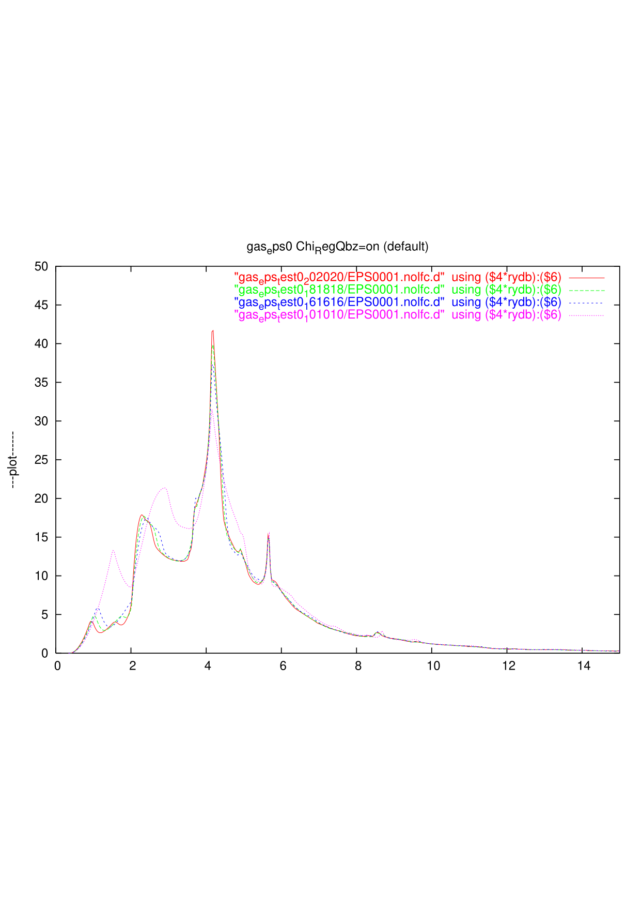
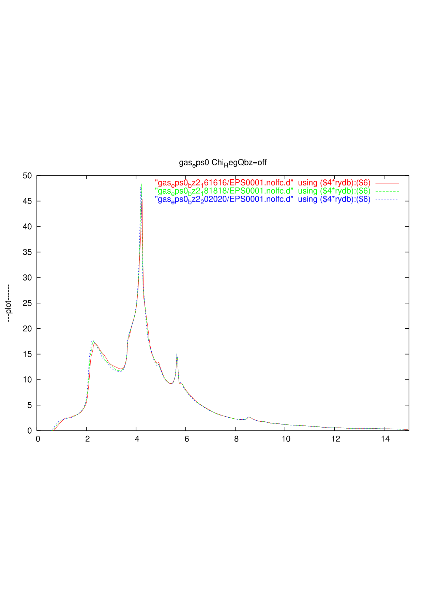
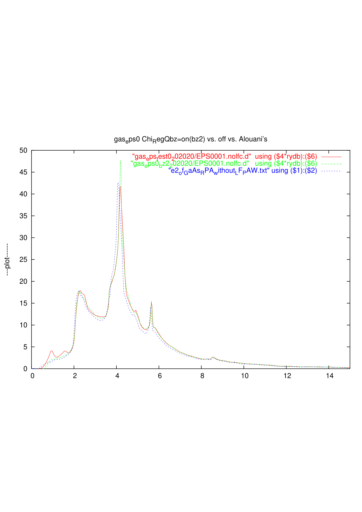
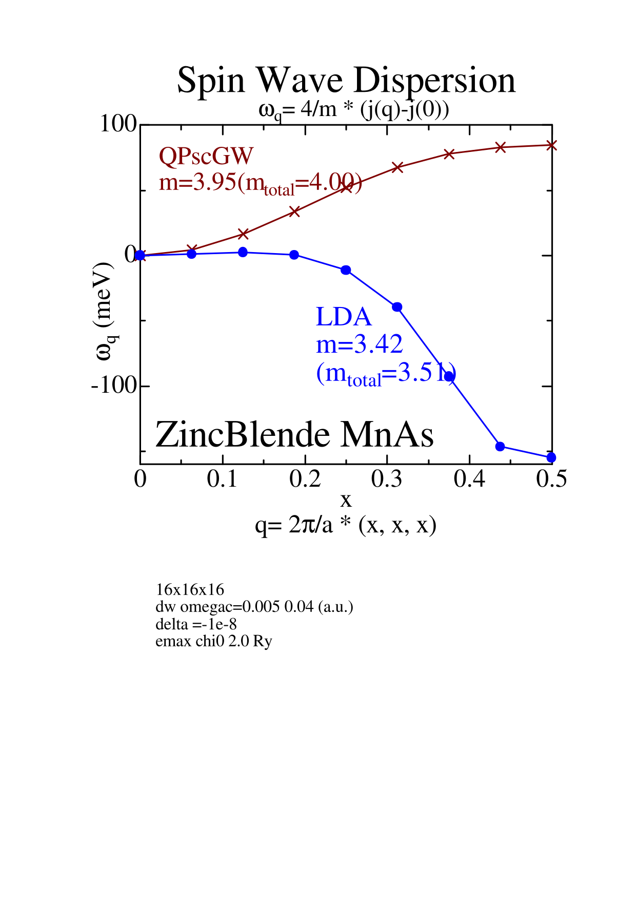

# 誘電関数: job_eps

RPA の誘電関数 $\epsilon(\mathbf q,\omega)$ を `job_eps` で計算します（2026-06 から。2025-05-08 の `epsPP0` の代わり）。
サンプルは [Samples/EPS/](https://github.com/tkotani/ecalj/tree/main/Samples/EPS)（`EPS_Cu`、`EPS_GaAs`、`EPS_Ag`）にあり、
`EPS_GaAs` の [README_eps.md](https://github.com/tkotani/ecalj/blob/main/Samples/EPS/EPS_GaAs/README_eps.md) にこのサンプルの設定があります。
理論は [光学的性質](../theory/optical_properties) にあります。

QSGW の反復の中でも、$W$ のために $\epsilon_{IJ}(\mathbf q,\omega)$（局所場補正を含む）を計算しています。
実験と比べるには、それより多くの k 点で $\epsilon(\mathbf q,\omega)$ を計算する必要があるので、自己無撞着な計算の後で `job_eps` を走らせます。

局所場補正なしの $\epsilon(\mathbf q,\omega)=1-v(\mathbf q)\chi_0(\mathbf q,\omega)$ では、バンド間とバンド内（$\mathbf q\to0$ の極限での Drude の重み）の寄与を分けて計算できます。
局所場補正なしのときは、$\exp(i\mathbf q\cdot\mathbf r)$ を展開するための球 Bessel 関数を、MT の中の積基底に加えます（ふつうの積基底でも、変化はわずかです）。

## 計算の手順

1. 自己無撞着な計算（`lmfa`、`lmf`。QSGW なら `gwsc` で `sigm.<sname>` を作る）。`sigm` があれば、QSGW の固有値と固有関数で計算します。
2. `job_eps` を走らせます。
   ```
   job_eps gaas -np 8               # 局所場補正なし（速い）
   job_eps gaas -np 8 --lcf         # 局所場補正あり（ずっと遅い）
   job_eps gaas -np 8 --decompose   # バンド間とバンド内を分ける（サンプルの試験はこれ）
   ```
   `--nognuplot` で図を描くのを省きます。

サンプルの手順は各ディレクトリの `test.py` にあります（`ecalj/Samples/EPS` で `testecalj EPS_Cu -np 4` とすると `EPS_Cu_work/` で走ります）。

## `ctrlg.<sname>.toml` の設定

### q 点: `[gw] QforEPS`、`QforEPSau`

q = 0 は使えないので、一つの方向に小さな q をいくつか並べて計算し、q → 0 の極限をとります（または一番小さな q を使います）。
q が小さすぎると数値的に不安定になります。

```toml
[gw]
QforEPSau = true   # required: true = QforEPS in a.u. (1/bohr); false = in units of 2π/alat
QforEPS = """
 0 0 0.00050
 0 0 0.00100
 0 0 0.00200
"""
```

`QforEPSau` は必須です（2026-11-14 から。雛形は true）。`[blocks]` に書いた `QforEPS` は、`[gw]` に `QforEPS` が無いときだけ読みます。

小さすぎる q の例: `EPS_GaAs` では、q = 0.0005 a.u.（`0 0 0.00050`、EPS0001）の虚部が、20〜110 eV で EPS0002・EPS0003 から大きくずれます
（98 eV で Im ε = 0.077、EPS0002・EPS0003 では 0.029・0.018）。この例では EPS0002（0.001 a.u.）以降を使います。
Cu でも、`0 0 0.00005` のような小さな q ではおかしくなり、0.0032 a.u. くらいまで大きくすると ω=0 での実部がいくらかずれてきます。

### k 点: `[gw] n1n2n3eps`（または `n1n2n3`）

Im ε の鋭い構造には多くの k 点が要ります（GaAs で 20×20×20 くらい。Fe や Ni でも 20×20×20 は要り、収束を見るには 30×30×30）。
`job_eps` は `[gw] n1n2n3eps` があればそれを、無ければ `n1n2n3` を使います（`qg4gw --n1n2n3eps`）。
`n1n2n3eps` を使えば、QSGW の `n1n2n3` を変えずに、誘電関数だけ細かくできます。
`--lcf` なしなら 20×20×20 も無理なく回せます。`--lcf` では 12×12×12 くらいから始めてください（MgO の ε(0,0) はそこでもう妥当です）。

### 積基底（`--lcf` のとき）

`--lcf` を軽くするには、`[product_basis] pb_lcutmx` を小さくし（例えば原子ごとに 2）、`[gw] QpGcut_cou` を 2.0 くらいにします
（[GW の設定: 積基底](./gwinput#product-basis)）。小さな k のメッシュで、結果が変わらないことを確かめてください。

### エネルギーのメッシュ: `[gw] HistBin_dw`、`HistBin_ratio`

実軸のメッシュは対数的で、$\omega_i = b\,(e^{a(i-1)}-1)$、$a$ = `HistBin_ratio` − 1、$b$ = `HistBin_dw`/$a$ です（[GW の設定](./gwinput) の HistBin の節）。
細かくしても負荷はあまり増えません。虚部の重みをヒストグラムとしてためてから、実部をヒルベルト変換で求めるので、数値的にはまずまず安定です。

```toml
HistBin_dw    = 2e-4   # (a.u.) bin width at ω = 0; 1e-5 is fine (metals)
HistBin_ratio = 1.01   # 1.03 is safer
```

### メモリ

メモリを減らしたいときは、`[gw]` に `KeepEigen = false` を書きます（`KeepPpb = false` は既定）。[GW の設定](./gwinput) を参照。

## 出力

`QforEPS` の 1 番目、2 番目、… の q について、`EPS0001.nlfc.dat`、`EPS0002.nlfc.dat`、… を書きます（`nlfc` は局所場補正なし）。
`--lcf` のときは `EPS000n.dat`（局所場補正あり）も書きます。`--decompose` のときは、名前の後ろに `.interbandonly` と `.intrabandonly` が付きます。

列: q（1〜3。2π/alat の単位）、ω（4。Ry）、Re ε と Im ε（5、6）、1/ε の実部と虚部（7、8）。例（`EPS_GaAs` の EPS0001）:
```
# qp(1:3)   w(Ry)   eps    epsi  --- NO LFC
  0.00000000  0.00000000  0.00085013    0.0000D+00  0.304436384993639E+02  0.144767011002870E-16    0.328475848910403E-01 -0.156198369108813E-19
```
q の 0.00085013 は、0.0005 a.u. を 2π/alat の単位で書いたものです。サンプルに入っている参照のファイルのように、指数が `D` で書かれていることがあるので、
自分で gnuplot で描くときは `set datafile fortran` を付けてください。
```gnuplot
set datafile fortran
set xrange [0:20]
plot "EPS0001.nlfc.dat" u ($4*13.605):($6) w lp
```

`job_eps` は最後に gnuplot のスクリプトと図（pdf）を書きます。

| 実行 | gnuplot のスクリプト |
|---|---|
| `job_eps <sname>` | `eps_without_lcf_<sname>.glt` |
| `job_eps <sname> --lcf` | `eps_with_lcf_<sname>.glt` |
| `job_eps <sname> --decompose` | `eps_interbandonly_<sname>.glt`、`eps_intrabandonly_<sname>.glt`、`eps_total_<sname>.glt`（全体はバンド間 + バンド内 − 1） |

Cu（`EPS_Cu`）では、`gnuplot -p eps_intrabandonly_cu.glt` でフェルミ面の寄与（Drude の重み）を q ごとに見られます。ω=0 の近くの振る舞いは Fetter-Walecka にあるとおりです。

## 注意

* 吸収端での Im ε の $\sqrt{E-E_0}$ の立ち上がりは、k のメッシュをとても細かくしないと（GaAs で 80×80×80）四面体法では再現しにくいです。ε(q → 0, ω = 0) の収束はずっと容易です。
  吸収端を正しく出す方法の案は [2016 年のスライド](../data/abosorb_preport_tkotani2016Jul5.pptx.pdf) にあります。
* 以前のオプション `--zmel0` は 2025-05-08 にやめました（`sugw.f90` の Gram-Schmidt の直交化で十分正確になったため。いまは登録だけ残っていて、何もしません）。

## 改良の予定

* q = 0 のバンド間の寄与は、⟨u|u⟩ の行列を使えば先に 1/q² の割り算ができるので、もっと直接に計算できるはずです。
* 局所場補正（`job_eps --lcf`）: `lcutmx=2` で 0.5 % の誤差（おそらくもっとよい）に十分なようです。さらに `QpGcut_cou` を 2.2 くらいに小さくし、
  積基底を小さく（p×d の積まで、f は入れない）できそうです。ただし確認と、`job_eps --lcf` の手直しが要るかもしれません。
* スピンゆらぎの計算は、模型（[MLO](./mlo)）を経由するべきです（[その他の説明 § スピンゆらぎ](./UsageDetailed)）。

## 古い収束の試験（2010）
* k 点の数（`n1n2n3`）の収束の試験（2010）。おおまかには、Fe と Ni でそこそこの結果に 20×20×20 が要ります。収束を見るには 30×30×30 がよいです。
  ただし閃亜鉛鉱の MnAs では（おそらく Ef のまわりの構造が単純なため）、もっと少ない q 点ですみます。

  GaAs の ε の古い図（2010）。
  fig001: `Chi_RegQbz = on`（Γ を含むメッシュ）での `n1n2n3` の収束。
  
  fig002: `Chi_RegQbz = off`（Γ を含まないメッシュ）での `n1n2n3` の収束。
  
  fig003: Alouani の結果（Arnaud による）と `Chi_RegQbz = on`、`Chi_RegQbz = off` の比較。
  赤の線（20×20×20、`Chi_RegQbz=on`）と Alouani の結果のしきい値はほぼ同じですが、赤の線は低いエネルギーで振動しすぎています。
  一方、`Chi_RegQbz = off`（緑の破線）は低いエネルギーであまり満足できません。
  

* 閃亜鉛鉱の MnAs のスピン波の、QSGW での未発表の古い結果:

