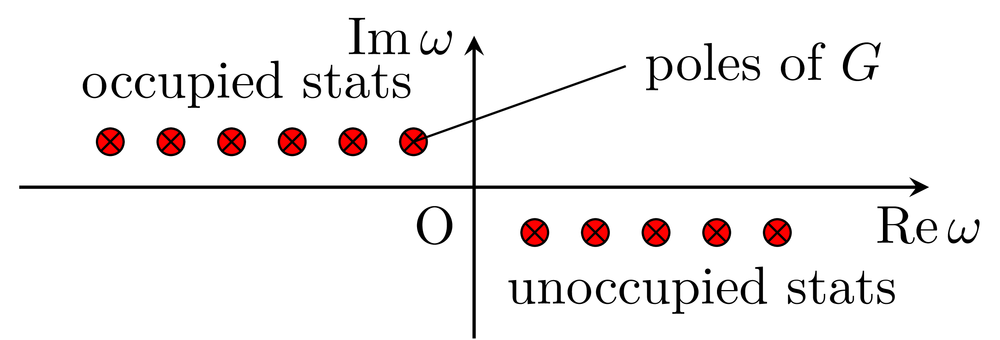

# 基本表式

絶対零度でのGreen関数について

## 参考文献
- Fetter Walecka

## Green関数とは {#what-is-green}

**バネのインパルス応答。** 減衰のあるバネ（質量 $m$、減衰 $\gamma$、ばね定数 $k$）に外力 $f(t)$ を加えると、変位 $x(t)$ は

$$
m\ddot x + \gamma \dot x + k x = f(t)
\tag{GF1}
$$

に従う。時刻 $t'$ に一瞬だけ叩いたとき（$f(t)=𝛿(t-t')$）の応答を $g(t-t')$ と書く。これがインパルス応答（Green 関数）である。叩く前には動かないので、$t<t'$ では $g=0$（因果律）。方程式が線形なので、任意の外力への応答は叩いた応答の重ね合わせで

$$
x(t) = \int dt'\, g(t-t') f(t')
\tag{GF2}
$$

と書ける（線形応答）。

**位置への依存。** 弦や膜のように変位 $u(𝒓,t)$ が位置にもよるときは、点 $𝒓'$ を時刻 $t'$ に叩いたときの点 $𝒓$、時刻 $t$ での応答$g(𝒓,t;𝒓',t')$ が Green 関数になる。$u(𝒓,t)=\int d𝒓' dt'\, g(𝒓,t;𝒓',t') f(𝒓',t')$。

**時間について一階の微分方程式。** Schrödinger 方程式は時間について一階なので、Green 関数は

$$
\left(i\hbar \frac{\partial}{\partial t} - \hat H(𝒓)\right) G^\mathrm{R}(𝒓,t;𝒓',t') = \hbar\, 𝛿(𝒓-𝒓')𝛿(t-t')
\tag{GF3}
$$

の解で、$t<t'$ で 0 となるもの（遅延 Green 関数）である。$\hat H$ の固有関数 $𝜙_n$、固有値 $𝜀_n$ を使うと

$$
G^\mathrm{R}(𝒓,t;𝒓',t') = -i\, 𝜃(t-t') \sum_n 𝜙_n(𝒓)𝜙^*_n(𝒓') e^{-i𝜀_n(t-t')/\hbar}
\tag{GF4}
$$

（$𝜃$ を微分して出る $𝛿(t-t')$ と完全性 $\sum_n 𝜙_n(𝒓)𝜙^*_n(𝒓')=𝛿(𝒓-𝒓')$ で式 (GF3) の右辺になる）。時刻 $t'$ に点 $𝒓'$ へ粒子を一つ入れたとき、時刻 $t$ に点 $𝒓$ で見つける振幅である。一階の方程式なので、時刻 $t'$ の波動関数を与えれば未来が決まり、Green 関数は時間の片側（$t>t'$）だけを持つ。（バネの式 (GF1) は二階なので、初期条件に位置と速度の二つが要る。）

**多電子系では両側になる。** 多電子の基底状態では、占有された状態には電子を入れられない。占有された状態の分は、電子を抜いた穴（正孔）が過去へ（$t<t'$ の側へ）伝わる項になる。電子の項（$t>t'$）と正孔の項（$t<t'$）を足したものが、次の節の T 積の Green 関数である。

**応答の連鎖は畳み込み、同時の伝播は積。** 振動数表示を $g(𝜔)=\int dt\, e^{i𝜔t} g(t)$ とする。系 A の応答 $x_\mathrm{A}$ がそのまま系 B を駆動するとき（直列、連鎖）、全体の応答は時間について畳み込み、振動数については積になる。

$$
\begin{aligned}
g(t-t') &= \int dt''\, g_\mathrm{B}(t-t'') g_\mathrm{A}(t''-t'), \\
g(𝜔) &= g_\mathrm{B}(𝜔)\, g_\mathrm{A}(𝜔)
\end{aligned}
\tag{GF5}
$$

Dyson 方程式 $G = G_0 + G_0 𝛴 G$ はこの連鎖の形をしている。一方、独立な二つの伝播が同時に（並列に）進み、両方が起こる振幅を考えるときは、時間について積、振動数については畳み込みになる。

$$
\begin{aligned}
g_\mathrm{AB}(t) &= g_\mathrm{A}(t)\, g_\mathrm{B}(t), \\
g_\mathrm{AB}(𝜔) &= \int \frac{d𝜔'}{2\pi}\, g_\mathrm{A}(𝜔') g_\mathrm{B}(𝜔-𝜔')
\end{aligned}
\tag{GF6}
$$

電子と正孔が同時に伝わる分極関数 $D = G G$（後の「相互作用がない系での時間秩序分極関数」）や、自己エネルギー $𝛴 = iGW$（[Basic II](./basic2) の「$GW$ 自己エネルギーの場合」）がこの形である。（力学のバネ A と B を並列につなぐと、同じ変位に対して力が足し合わさるので、応答の逆数が和 $1/g = 1/g_\mathrm{A} + 1/g_\mathrm{B}$ になる。積になるのは、振幅を掛ける上の場合である。）

## (1粒子) Green関数の定義

$$
\begin{align}
iG(𝒓_1t_1, 𝒓_2t_2) &= \braket{\Psi_0|T[\hat 𝜓_\mathrm{H}(𝒓_1,t_1)\hat 𝜓^†_\mathrm{H}(𝒓_2,t_2)]|\Psi_0} \\
&=\braket{\Psi_0|\hat 𝜓_\mathrm{H}(𝒓_1,t_1)\hat 𝜓^†_\mathrm{H}(𝒓_2,t_2)|\Psi_0} 𝜃(t_1-t_2) \\
&\quad -\braket{\Psi_0|\hat 𝜓^†_\mathrm{H}(𝒓_2,t_2)\hat 𝜓_\mathrm{H}(𝒓_1,t_1)|\Psi_0} 𝜃(t_2-t_1)
\end{align}
$$

- $\hat 𝜓_\mathrm{H}(𝒓,t)$ :ハイゼンベルグ表示での場の演算子であり, $\hat 𝜓_\mathrm{H}(𝒓,t) = e^{i\hat Ht/\hbar}\hat 𝜓(𝒓)e^{-i\hat Ht/\hbar}$．
- $\hat 𝜓^†_\mathrm{H}(𝒓,t) = e^{i\hat Ht/\hbar}\hat 𝜓^†(𝒓)e^{-i\hat Ht/\hbar}$である．
- フェルミ粒子の場の演算子には反交換関係があり$\{𝜓_\mathrm{H}(𝒓_1,t),𝜓_\mathrm{H}^†(𝒓_2,t)\} = 𝛿(𝒓_1-𝒓_2)$. 同時刻の反交換関係であることに注意。
- $T$は時間順序積であり, 時間$t$の順序を左側に未来の時間, 右側に過去の時間となるように並べ変える．
- なぜ T 積になるか: 摂動理論で時間軸の積分範囲を対称化する（$-\infty$ から $\infty$ にする）ところで、ステップ関数 $𝜃(t_1-t_2)$、$𝜃(t_2-t_1)$ が出てくる。
- 一方で、電子（$t_1>t_2$、電子を足して伝播させる）と正孔（$t_2>t_1$、電子を抜いて伝播させる）は、二つを並列に足しておけば同時に扱うことができる。これは、電子と正孔の基底関数が同じ一体ハミルトニアンによって指定されているからである。この足し合わせが上の式の二つの項で、T 積となる。
- $𝜃(t)$: ステップ関数 $t>0$なら1, $t<0$なら0である．
- $\Psi_0$:ハイゼンベルグ表示の$N$粒子での基底状態 $\hat H\ket{\Psi_0} = E \ket{\Psi_0}$

### Gell-Mann–Low の定理と分離したダイヤグラム {#gell-mann-low}

相互作用を断熱的に入れると、相互作用の無い基底状態 $\ket{\Phi_0}$ から、相互作用のある基底状態が得られる（Gell-Mann–Low の定理）。その結果、Green 関数は

$$
iG(𝒓_1t_1, 𝒓_2t_2) = \frac{\braket{\Phi_0|T[\hat S\,\hat 𝜓_\mathrm{I}(𝒓_1,t_1)\hat 𝜓^†_\mathrm{I}(𝒓_2,t_2)]|\Phi_0}}{\braket{\Phi_0|\hat S|\Phi_0}}
\tag{G1}
$$

と書ける（$\hat S$ は時間発展の演算子、添字 I は相互作用表示）。分母の真空の振幅が、分子に出てくる分離したダイヤグラム（外の線につながらない真空の部分）をちょうど打ち消す。
そのため、分離したダイヤグラムは数えなくてよく、つながったダイヤグラムだけを足せばよい（つながったダイヤグラムの定理）。

通常の（時間によらない）摂動論との対応は次のとおり。分離したダイヤグラムには 2 種類ある。

- **分離型 1**: 中間状態で系がいったん真空 $\ket{\Phi_0}$ に戻るもの（分離した部分が時間の上で前後に並ぶ）。通常の摂動論では中間状態から $\ket{\Phi_0}$ を除くので、最初から入らない。
- **分離型 2**: 分離しているが時間の上で重なるもの（中間状態は励起を二つ持ち、$\ket{\Phi_0}$ ではない）。通常の摂動論の式には入っているが、規格化から来る項（3 次の $-V_{00}\sum_n|V_{0n}|^2/\Delta_n^2$ など）とちょうど打ち消し合う。

分離型 1 を除き、分離型 2 と規格化の項をまとめて捨てると、つながったダイヤグラムだけが残り、式 (G1) と同じ結果になる（Goldstone）。

### 時間の入った摂動論と時間の入らない摂動論 {#td-vs-ti-perturbation}

時間の入った摂動論（式 (G1) のように $\hat S$ を展開するもの）で求めるのは相関関数、すなわち異なる時刻の演算子を基底状態で挟んだもの（Green 関数や応答関数）である。初等的な摂動論とは次のように対応し、両者は別のものではない。

- 時間の入った摂動論の初等的な例はフェルミの黄金則である。遷移の振幅を摂動の一次（線形）まで取り、遷移の速さを得る。この速さは、二次のエネルギーのずれの虚部（自己エネルギーの虚部、準粒子の寿命）に当たる。
- 時間の入らない摂動論で求めるのは、エネルギーと演算子の期待値である。期待値は左右に同じ状態を置いて演算子を挟んだもので、相関関数の二つの時刻を等しくしたものに当たる（例えば密度は $𝜌(𝒓) = -iG(𝒓t,𝒓t^+)$）。
- 時間の積分を断熱因子 $e^{𝜂 t}$ を付けて行うと、積分一つごとにエネルギーの分母 $1/(E_0-E_n)$ が出て、時間の入らない摂動論の式になる（Goldstone）。

つまり時間の入った摂動論は時間の入らない摂動論を含み、異なる時刻の相関（励起のスペクトル）の分だけ多くを与える。多体摂動論だからといって、基礎的な摂動論と違うわけではない。違うのは、項をダイヤグラムで整理し、つながったものだけを数えることで無駄を省いてあること（これは通常の摂動論でも同じで、分離した項は消し合わせなければいけない。上の分離型 1、2）と、Dyson 方程式のように特定の項を無限次まで足し上げられることである。

## 相互作用のない系でのGreen関数

### ハミルトニアン
ハミルトニアンを$\hat H -μ\hat N$ として, 基底状態のエネルギーを0としておく．$𝜇$:フェルミエネルギー, $\hat N = \int d𝒓 𝜓^†(𝒓)𝜓(𝒓)$: 粒子数演算子であり, 基底状態の粒子数を$N$とすると$\hat N \ket{\Psi_0} = N \ket{\Psi_0}$.以下, ハイゼンベルグ表示 $e^{i\hat Ht/\hbar}\cdots e^{-i\hat Ht/\hbar}$ の $\hat H$ もこの $\hat H-𝜇\hat N$ と読む（密度演算子 $\hat 𝜌_\mathrm{H}$ では $\hat N$ が $\hat 𝜌$ と交換するので同じ）．
また, 相互作用がない場合は1粒子状態の和であるので
$$
\hat H - \mu \hat N =  \sum_n 𝜀_n \hat c^†_{n}\hat c_{n}
$$
である．

> [!WARNING]
>  エネルギーの基準(ゼロ点)をフェルミ準位にしていることに注意．

ここで, 1粒子ハルミトニアンの固有関数を$𝜙_{n}(𝒓)$(これは完全系をつくる)として, 場の演算子を展開した係数を$\hat c_n$としている．
$$
\hat 𝜓(𝒓) = \sum_n \hat c_n 𝜙_{n}(𝒓)
$$
相互作用のない場合の基底状態は, エネルギー$𝜀_n$をもつ占有軌道がフェルミ準位までフェルミ分布に従い占有している．

### 実時間表示
$\hat 𝜓^\dagger \ket{\Psi_0}$によって電子が非占有状態に生成されるもしくは, $\hat 𝜓 \ket{\Psi_0}$によって正孔が占有状態に生成される(占有状態電子を消滅する)という2通りが, それぞれGreen関数の1項目と2項目に対応する．
$$
\begin{align}
&\braket{\Psi_0|\hat 𝜓_\mathrm{H}(𝒓_1,t_1)\hat 𝜓^†_\mathrm{H}(𝒓_2,t_2)|\Psi_0} \\
&= \braket{\Psi_0|\hat 𝜓(𝒓_1)e^{-i(\hat H- 𝜇 \hat N)(t_1-t_2)/\hbar}  \hat 𝜓^†(𝒓_2)|\Psi_0} \\
&= \sum_{n'}^{\mathrm{unocc}} 𝜙_{n'}(𝒓_1)𝜙^*_{n'}(𝒓_2)e^{-i𝜀_{n'}(t_1-t_2)/\hbar} \\
&\qquad (\text{電子の生成から消滅のプロパゲータ}) \\
&\braket{\Psi_0|\hat 𝜓^†_\mathrm{H}(𝒓_2,t_2)\hat 𝜓_\mathrm{H}(𝒓_1,t_1)|\Psi_0} \\
&= \braket{\Psi_0|\hat 𝜓^†(𝒓_2)e^{-i(\hat H- 𝜇 \hat N)(t_2-t_1)/\hbar} \hat 𝜓(𝒓_1)|\Psi_0} \\
&= \sum_{n}^{\mathrm{occ}} 𝜙_{n}(𝒓_1)𝜙^*_{n}(𝒓_2)e^{i𝜀_{n}(t_2-t_1)/\hbar} \\
&\qquad (\text{正孔の生成から消滅のプロパゲータ})
\end{align}
$$
- 生成と消滅は同じ1粒子状態$n$に対して行なわれる．そうでない場合はゼロになる．
- 正孔の生成状態も励起状態であり基底状態からの，励起エネルギーは$-𝜀_n>0$である．
::: details 導出

$\hat H-𝜇\hat N$ の固有値を基底状態で 0 としたので $e^{-i(\hat H-𝜇\hat N)t_2/\hbar}\ket{\Psi_0}=\ket{\Psi_0}$．
$\hat 𝜓^†(𝒓_2)\ket{\Psi_0}=\sum_{n'}𝜙^*_{n'}(𝒓_2)\hat c^†_{n'}\ket{\Psi_0}$ のうち残るのは非占有の $n'$ だけで，$(\hat H-𝜇\hat N)\hat c^†_{n'}\ket{\Psi_0}=𝜀_{n'}\hat c^†_{n'}\ket{\Psi_0}$ である．
左から $\bra{\Psi_0}\hat 𝜓(𝒓_1)=\sum_{m}𝜙_{m}(𝒓_1)\bra{\Psi_0}\hat c_{m}$ を掛けると $\braket{\Psi_0|\hat c_{m}\hat c^†_{n'}|\Psi_0}=𝛿_{mn'}$ で第 1 式を得る．
第 2 式も同様で, $\hat 𝜓(𝒓_1)\ket{\Psi_0}$ では占有の $n$ だけが残り, $(\hat H-𝜇\hat N)\hat c_{n}\ket{\Psi_0}=-𝜀_{n}\hat c_{n}\ket{\Psi_0}$ である．

:::

よって, 
$$
\begin{align}
iG(𝒓_1t_1,𝒓_2t_2) =& \sum_{n'}^{\mathrm{unocc}} 𝜙_{n'}(𝒓_1)𝜙^*_{n'}(𝒓_2)e^{-i𝜀_{n'}(t_1-t_2)/\hbar} 𝜃(t_1-t_2) \\
  &- \sum_{n}^{\mathrm{occ}} 𝜙_{n}(𝒓_1)𝜙^*_{n}(𝒓_2)e^{i𝜀_{n}(t_2-t_1)/\hbar}𝜃(t_2-t_1) \\
  & \equiv iG_\mathrm{ele}(𝒓_1t_1,𝒓_2t_2)+ iG_\mathrm{hole}(𝒓_1t_1,𝒓_2t_2)
\end{align}
$$
となる。最後の行では, 電子と正孔の寄与を分けて定義しておく。これはグリーン関数と何かの積を考える際に理解の助けになる。
> [!INFO]
> グリーン関数は実空間, 実時間表示で見る方がイメージしやすい．

### 振動数表示
Green関数は$t_1-t_2$の関数なので,それについてフーリエ変換した表式も用いられる．レーマン表示とかスペクトル表示と呼ばれている．
ステップ関数をフーリエ表示として
$$
𝜃(t) = - \int \frac{d𝜔'}{2𝜋i} \frac{e^{-i𝜔't}}{𝜔'+i𝛿}
$$
がある．ここで$𝛿$は正の微少量．$𝜔'$面の下反面の留数を拾う拾わないかでステップ関数を表現している．

::: info
フーリエ変換は，規格化因子の不定性があるので，この文章では以下のようにしておきます．
$$
\begin{align}
f(𝜔) &= \int dt f(t) e^{i𝜔t} \\
f(t) &= \frac{1}{2\pi}\int d𝜔 f(𝜔) e^{-i𝜔t} \\
𝛿(𝜔) &= \frac{1}{2\pi} \int dt e^{i𝜔t}
\end{align}
$$
:::

$𝜃(\pm t)e^{-iEt/\hbar}$のフーリエ変換を考えると, ($𝜃(-t)$は$𝜃(t)$の中の$e^{-i𝜔't}$ を$e^{i𝜔't}$とすればよい)
$$
\begin{align}
\int dt 𝜃(\pm t)e^{-iEt/\hbar}e^{i𝜔t} = - \int \frac{d𝜔'}{2𝜋i} \int dt \frac{e^{-i(\pm 𝜔'+ E/\hbar-𝜔)t}}{𝜔'+ i𝛿} \\
= - \int \frac{d𝜔'}{i}\frac{1}{𝜔'+ i𝛿}𝛿(\pm 𝜔'-𝜔+ E/\hbar) = i\frac{1}{\pm (𝜔 - E/\hbar) + i𝛿}
\end{align}
$$
となっているので,

$$
\begin{align}
G(𝒓_1,𝒓_2;𝜔) &= \int d(t_1-t_2) G(𝒓_1t_1,𝒓_2t_2) e^{i𝜔(t_1-t_2)} \\
&=  \sum_{n'}^{\mathrm{unocc}} \frac{𝜙_{n'}(𝒓_1)𝜙^*_{n'}(𝒓_2)}{𝜔-𝜀_{n'}/\hbar + i𝛿} +
    \sum_{n}^{\mathrm{occ}} \frac{𝜙_{n}(𝒓_1)𝜙^*_{n}(𝒓_2)}{𝜔 - 𝜀_{n}/\hbar -i𝛿}
\end{align}
$$
を得る．複素数に拡張した$𝜔$面では,非占有状態(電子励起)の極が$\Re 𝜔 >0$の下反面，占有状態(正孔励起)の極が上反面に$\Re 𝜔 <0$にある．

図の「occupied stats」「unoccupied stats」は「occupied states」「unoccupied states」（占有状態、非占有状態）の誤り。図を作ったスクリプトが残っていないので、図は描き直していない。

> [!INFO]
> 実時間表示の定義についていた$i$は, 振動数表示での表式がキレイになるようにつけられていた．

### 状態密度

$$
\lim_{𝛿 →0}\frac{1}{x \pm i 𝛿} = \mathcal{P} \frac{1}{x} \mp i𝜋𝛿(x)
$$
の関係式を用いると,
$$
\begin{align}
\int d𝒓 G(𝒓,𝒓;𝜔) &=  \sum_{n} \frac{1}{𝜔-𝜀_{n}/\hbar \mp i𝛿} \\ &= \sum_n \left( \mathcal{P} \frac{1}{𝜔-𝜀_n/\hbar} \pm i 𝜋 𝛿(𝜔-𝜀_n/\hbar)\right)
\end{align}
$$
(複号は上が占有 $𝜀_n\lt 0$, 下が非占有 $𝜀_n>0$.) となるので形式的には状態密度<del class="clfix">$D(𝜀) = \sum_n 𝛿(𝜀-𝜀_n)$</del>$N(𝜀) = \sum_n 𝛿(𝜀-𝜀_n)$（分極関数の $D$ と区別する）は

$$
\begin{align}
D(𝜀) = \pm \frac{1}{𝜋}\Im \text{Tr}G(𝜀/\hbar)  ただし (+:𝜀<0, -:𝜀>0)
\end{align}
$$
のように書ける($\hbar$や符号があっている??)

$$
\begin{align}
N(𝜀) = \pm \frac{1}{𝜋\hbar}\Im \text{Tr}G(𝜀/\hbar)  ただし (+:𝜀<0, -:𝜀>0)
\end{align}
$$
のように書ける．$𝛿(𝜀/\hbar-𝜀_n/\hbar)=\hbar\,𝛿(𝜀-𝜀_n)$ から $1/\hbar$ が付く．符号は上の複号のとおり．

## 時間秩序分極関数

ハイゼンベルグ表示の密度演算子を$\hat 𝜌_\mathrm{H}(𝒓,t)$とすると $\hat 𝜌_\mathrm{H}(𝒓,t) = e^{i\hat Ht/\hbar}\hat 𝜓^†(𝒓)\hat 𝜓(𝒓)e^{-i\hat Ht/\hbar}$ である．（もとは $\hat 𝜓$ の後に余分な `^` があった）
密度の期待値からの変位を表す演算子として$\hat {𝛿\rho} = \hat \rho - \braket{\hat \rho}$を導入する．
このとき時間秩序分極関数$D(𝒓_1t_1,𝒓_2t_2)$は以下のような時間順序積による密度の積(密度相関)と定義する．
$$
\begin{align}
iD(𝒓_1t_1,𝒓_2t_2) &= 
\braket{T[\hat {𝛿𝜌}(𝒓_1,t_1)\hat {𝛿𝜌}(𝒓_2,t_2)]} \\ &= 
\braket{\hat   {𝛿𝜌}(𝒓_1,t_1)\hat {𝛿𝜌}(𝒓_2,t_2)}𝜃(t_1-t_2)  \\
&\quad +\braket{\hat  {𝛿𝜌}(𝒓_2,t_2)\hat {𝛿𝜌}(𝒓_1,t_1)}𝜃(t_2-t_1)
\end{align}
$$

## 相互作用がない系での時間秩序分極関数
相互作用がない系では、N積項は消えるためWickの定理により
$$
\begin{align}
iD(𝒓_1t_1,𝒓_2t_2) &= 
\braket{T[\hat {𝛿𝜌}(𝒓_1,t_1)\hat {𝛿𝜌}(𝒓_2,t_2)]} \\ &= G(𝒓_1t_1,𝒓_2t_2)G(𝒓_2t_2,𝒓_1t_1)
\end{align}
$$
となる。$G(𝒓_1t_1,𝒓_2t_2) = G_\mathrm{ele}(𝒓_1t_1,𝒓_2t_2) + G_\mathrm{hole}(𝒓_1t_1,𝒓_2t_2)$のように分離でき、$t_1 > t_2$では $G_\mathrm{ele}$が残り$t_1 < t_2$では $G_\mathrm{hole}$が残ることを思い出すと
$$
\begin{align}
iD(𝒓_1t_1,𝒓_2t_2) =& G_\mathrm{ele}(𝒓_1t_1,𝒓_2t_2)G_\mathrm{hole}(𝒓_2t_2,𝒓_1t_1) \\
                  &+ G_\mathrm{hole}(𝒓_1t_1,𝒓_2t_2)G_\mathrm{ele}(𝒓_2t_2,𝒓_1t_1) \\
               =& \sum_{n'}^\mathrm{unocc} \sum_{n}^\mathrm{occ} 𝜙_{n'}(𝒓_1) 𝜙^*_{n'}(𝒓_2) 𝜙_{n}(𝒓_2) 𝜙^*_{n}(𝒓_1) \\
                &\qquad \times e^{-i(𝜀_{n'}-𝜀_{n})(t_1-t_2)/\hbar} \theta(t_1-t_2) \\
                & +\sum_{n}^\mathrm{occ} \sum_{n'}^\mathrm{unocc} 𝜙_{n}(𝒓_1) 𝜙^*_{n}(𝒓_2) 𝜙_{n'}(𝒓_2) 𝜙^*_{n'}(𝒓_1) \\
                &\qquad \times e^{-i(𝜀_{n'}-𝜀_{n})(t_2-t_1)/\hbar} \theta(t_2-t_1)
\end{align}
$$
となる。このフーリエ変換は上記と同様に
$$
\begin{align}
D(𝒓_1,𝒓_2;𝜔) =& \sum_{n'}^\mathrm{unocc} \sum_{n}^\mathrm{occ} 
                   \frac{𝜙_{n'}(𝒓_1) 𝜙^*_{n'}(𝒓_2) 𝜙_{n}(𝒓_2) 𝜙^*_{n}(𝒓_1)}{  𝜔-(𝜀_{n'}-𝜀_n)/\hbar + i𝛿} \\
              & +\sum_{n}^\mathrm{occ} \sum_{n'}^\mathrm{unocc} 
                   \frac{𝜙_{n}(𝒓_1) 𝜙^*_{n}(𝒓_2) 𝜙_{n'}(𝒓_2) 𝜙^*_{n'}(𝒓_1)}{-(𝜔-(𝜀_{n}-𝜀_{n'})/\hbar) + i𝛿} \\
            =& \sum_{n'}^\mathrm{unocc} \sum_{n}^\mathrm{occ} \left[
                   \frac{𝜙_{n'}(𝒓_1) 𝜙^*_{n'}(𝒓_2) 𝜙_{n}(𝒓_2) 𝜙^*_{n}(𝒓_1)}{  𝜔-(𝜀_{n'}-𝜀_n)/\hbar + i𝛿} \right. \\
              & \qquad\qquad \left. -\frac{𝜙_{n}(𝒓_1) 𝜙^*_{n}(𝒓_2) 𝜙_{n'}(𝒓_2) 𝜙^*_{n'}(𝒓_1)}{  𝜔+(𝜀_{n'}-𝜀_{n})/\hbar - i𝛿} \right]
\end{align}
$$
を得る。
$𝜙^*_n(𝒓)𝜙_m(𝒓) = \sum_{𝜇} Z_{nm𝜇}E_𝜇(𝒓)$ のように波動関数の積を展開する規格直交化する基底を$E_\mu(𝒓)$とし, 展開係数を$Z_{nm𝜇}$とする。
($\braket{E_𝜇|E_𝜈} = 𝛿_{𝜇𝜈}$を満たす)。 このとき$D(𝜔)$を$E_{𝜇}$での展開係数は以下のようになる。
$$
\begin{align}
D_{𝜇𝜈}(𝜔) &= \int d𝒓_1 d𝒓_2 E_{𝜇}^*(𝒓_1) D(𝒓_1,𝒓_2;𝜔)  E_{𝜈}(𝒓_2) \\
         &= \sum_{n'}^\mathrm{unocc} \sum_{n}^\mathrm{occ} \left[
               \frac{Z_{nn'𝜇} Z^*_{nn'𝜈}}{  𝜔-(𝜀_{n'}-𝜀_n)/\hbar + i𝛿} \right. \\
         & \qquad\qquad \left. -\frac{Z_{n'n𝜇} Z^*_{n'n𝜈}}{  𝜔+(𝜀_{n'}-𝜀_{n})/\hbar - i𝛿} \right]
\end{align}
$$
<!-- 時間対称化しているため, 遅延(極が$ω$下面)と先進(極が$ω$上面)を含むため -->

<!-- ::: details 導出 -->
<!-- $$ -->
<!-- \begin{align} -->
<!-- \braket{T[\hat {𝛿𝜌}(𝒓_1,t_1)\hat {𝛿𝜌}(𝒓_2,t_2)]} &=  -->
<!--    \braket{T[\hat 𝜌_\mathrm{H}(𝒓_1,t_1) \hat 𝜌_\mathrm{H}(𝒓_2,t_2)]} -->
<!--  - \braket{T[\hat 𝜌_\mathrm{H}(𝒓_1,t_1) \braket{\hat \rho_\mathrm{H}(𝒓_2,t_2)}]}  \\ -->
<!-- &- \braket{T[\hat 𝜌_\mathrm{H}(𝒓_2,t_2) \braket{\hat \rho_\mathrm{H}(𝒓_1,t_1)}]}  -->
<!-- + \braket{T[\braket{\hat \rho_\mathrm{H}(𝒓_1,t_1)} \braket{\hat \rho_\mathrm{H}(𝒓_2,t_2)}]} \\ -->
<!-- &= \braket{T[\hat 𝜌_\mathrm{H}(𝒓_1,t_1) \hat 𝜌_\mathrm{H}(𝒓_2,t_2)]}+{\braket{\hat \rho_\mathrm{H}(𝒓_1,t_1)} \braket{\hat \rho_\mathrm{H}(𝒓_2,t_2)}} \\ -->
<!-- \end{align} -->
<!-- $$ -->
<!---->
<!-- ここで $\hat \rho_\mathrm{H}(𝒓,t) = \hat 𝜓^\dagger_\mathrm{H}(𝒓,t) \hat 𝜓_\mathrm{H}(𝒓,t)$ であるため,  -->
<!-- \braket{T[\hat 𝜓^†_\mathrm{H}(𝒓_1,t_1)𝜓_\mathrm{H}(𝒓_1,t_1)𝜓^†_\mathrm{H}(𝒓_1,t_1)𝜓_\mathrm{H}(𝒓_2,t_2)]} =  -->
<!-- ::: -->
