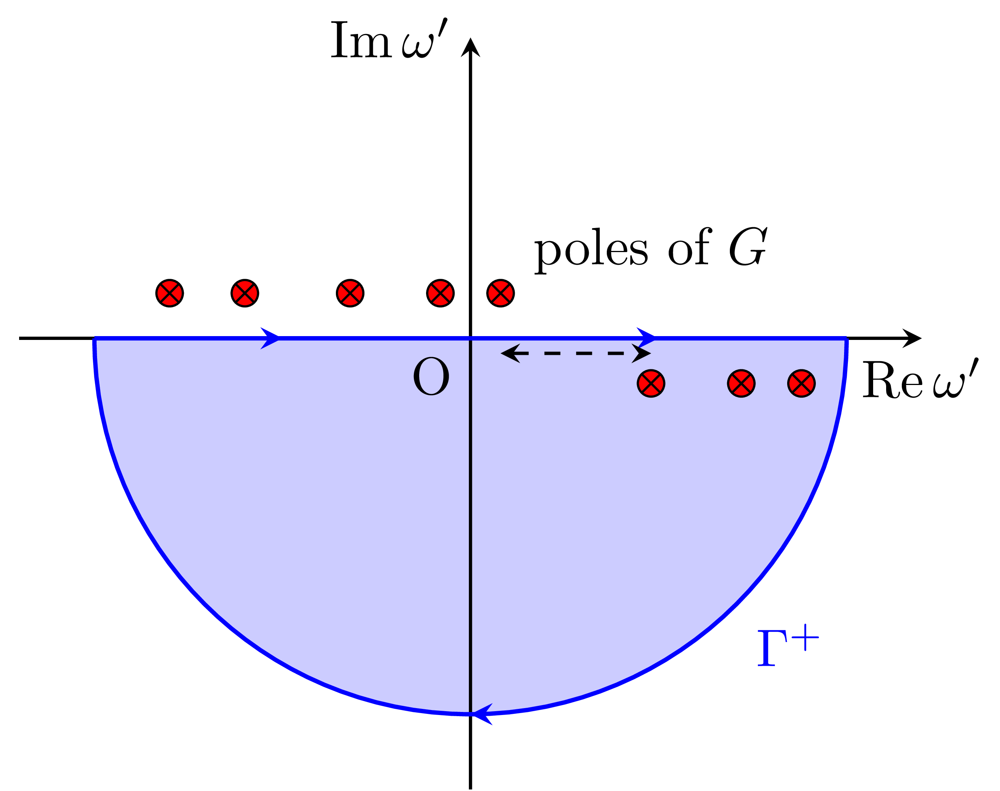

# $GW$ 近似

## $GW$ 近似
$GW$ 近似は、多体摂動論で系の電子状態を記述する方法である。
これまでの研究で、さまざまな系で $GW$ 計算が役に立つことが示されてきた。
電子間相互作用の効果をより正確に取り入れることで、標準的な密度汎関数理論（DFT）を改良する。
経験的なパラメータに頼らず、予言能力の高い方法としてよく知られている。

$GW$ 近似では、自己エネルギー $𝛴$ を
$$
𝛴(𝒓_1t_1,𝒓_2t_2) = iG(𝒓_1t_1,𝒓_2t_2)W(𝒓_1t_1^+,𝒓_2t_2),
\tag{W1}
$$
と書く。$G$ は一体 Green 関数、$W$ は遮蔽されたクーロン相互作用である。
$𝛴(𝒓_1t_1,𝒓_2t_2)$ のフーリエ表示 $𝛴(𝒓_1,𝒓_2;𝜔)$ は
$$
𝛴(𝒓_1, 𝒓_2; 𝜔) = \frac{i}{2\pi} \int d𝜔' G(𝒓_1,𝒓_2; 𝜔-𝜔') W(𝒓_1,𝒓_2,𝜔')e^{-iη𝜔'},
\tag{W2}
$$
である。$η$ は正の微小量。
::: info
$W$ は時間反転について対称（$W(𝜔) = W(-𝜔)$）なので、教科書によっては次の式も使われる。
$$
𝛴(𝒓_1, 𝒓_2; 𝜔) = \frac{i}{2\pi} \int d𝜔' G(𝒓_1,𝒓_2; 𝜔+𝜔') W(𝒓_1,𝒓_2,𝜔')e^{iη𝜔'}.
\tag{W3}
$$
:::

ここで
$$
G(𝒓_1, 𝒓_2; 𝜔) = \sum_n \frac{𝜙_n(𝒓_1) 𝜙_n^*(𝒓_2)}{𝜔  - 𝜀_n + iη \text{sgn}(𝜀_n - E_\mathrm{F})}
\tag{W4}
$$
> [!INFO]
> 導出は [Basic I](basic) を参照。

遮蔽されたクーロン相互作用 $W$ は、裸のクーロン相互作用 $v$ と誘電関数 $\epsilon$ で
$$
W(𝒓_1,𝒓_2,𝜔) = \int d𝒓_3 \epsilon^{-1}(𝒓_1,𝒓_3;𝜔) v(𝒓_3,𝒓_2).
\tag{W5}
$$
と書ける。略記すると $W(𝜔) = \epsilon^{-1}(𝜔)v$ である。
誘電関数は分極関数 $P$ と $\epsilon = 1 - vP$ で結ばれる。
$P$ を記述する近似の一つが乱雑位相近似（RPA）で、RPA では $P = Π$ とする。$Π$ は応答関数（密度相関関数）である。
相互作用のない系では $Π(𝒓_1t_1,𝒓_2t_2) = -iG(𝒓_1t_1,𝒓_2t_2)G(𝒓_2t_2,𝒓_1t_1)$ である（$Π$ は [Basic I](basic) の式 (P2) の $D$）。
フーリエ表示では
$$
Π(𝒓_1,𝒓_2; 𝜔) = -i \int \frac{d𝜔'}{2𝜋} G(𝒓_1,𝒓_2; 𝜔+𝜔') G(𝒓_2,𝒓_1; 𝜔')
\tag{W6}
$$

### $GW$ の意味
$GW$ 近似は、Hartree-Fock 近似の交換相互作用に、まわりの電子による遮蔽の効果を取り入れたものと理解できる。
$iGv$ が Fock の交換項を与えることに注意。
::: details $iGv$ の式
$$
\begin{align}
𝛴^\mathrm{x} (𝒓_1,𝒓_2) &≡ \frac{i}{2\pi} \int d𝜔' G(𝒓_1,𝒓_2; 𝜔-𝜔') v(𝒓_1,𝒓_2)e^{-iη𝜔'} \\
& = \sum_{n} 𝜙_n(𝒓_1)\frac{1}{|𝒓_1 -𝒓_2|}𝜙^*_n(𝒓_2) \\ &\qquad \times \frac{i}{2\pi} \int d𝜔' \frac{e^{-iη𝜔'}}{𝜔- 𝜔'- 𝜀_n + iη \text{sgn}(𝜀_n - E_\mathrm{F})} \\
& = -\sum_{n}^\mathrm{occ} 𝜙_n(𝒓_1)\frac{1}{|𝒓_1 -𝒓_2|}𝜙^*_n(𝒓_2)
\tag{W7}
\end{align}
$$
複素 $𝜔'$ 平面の下半面で周回積分を考える（図）。下半面には占有状態の極だけが入る。
$e^{-iη𝜔'} → 0$ なので、図の $Γ^+$ は積分に寄与しない。
したがって留数定理から、$𝜔'$ 積分は占有状態では「2𝜋i」、非占有状態では 0 になる。
その結果、状態 $n$ での $iGv$ の期待値は
$$
\begin{align}
\braket{𝜙_n|𝛴^\mathrm{x} (𝒓_1,𝒓_2) |𝜙_n}
 &= -\sum_{m}^\mathrm{occ} \int d𝒓_1 d𝒓_2 \\ &\qquad \times 𝜙^*_n(𝒓_1)𝜙_m(𝒓_1)\frac{1}{|𝒓_1 -𝒓_2|}𝜙^*_m(𝒓_2)𝜙_n(𝒓_2) .
\tag{W8}
\end{align}
$$
となり、Fock の交換項に当たる。
{ width=50% class="centered-image" }
:::

## $G_0W_0$ の方法

ふつう $GW$ 計算は、LDA/GGA への摂動の補正として使われる。
具体的には、LDA/GGA で得た固有値と固有関数を、摂動を受けない状態に選ぶ。
LDA/GGA の Kohn-Sham 方程式は、固有値と固有関数を $𝜀_n^0$、$\ket{𝜙^0_n}$ として
$$
\left(\frac{𝒑^2}{2m}  + V_\mathrm{H} + V_\mathrm{ext} + V_\mathrm{xc}^\mathrm{LDA}\right)\ket{𝜙^0_n} = 𝜀_n^0\ket{𝜙^0_n}
\tag{W9}
$$
と書ける。$V_\mathrm{H}$、$V_\mathrm{ext}$、$V_\mathrm{xc}^\mathrm{LDA}$ はそれぞれ、Hartree ポテンシャル、イオンによるポテンシャル、LDA/GGA の交換相関ポテンシャルである。

これから一体 Green 関数 $G_0$ を
$$
G_0(𝒓_1, 𝒓_2; 𝜔) = \sum_n \frac{𝜙^0_n(𝒓_1) 𝜙^{0*}_n(𝒓_2)}{𝜔  - 𝜀^0_n + iη \text{sgn}(𝜀^0_n - E_\mathrm{F})}.
\tag{W10}
$$
と計算する。$G_0$ を使って RPA で分極関数を計算し、遮蔽されたクーロン相互作用 $W_0$ を得る。
添字 $0$ は、摂動を受けない状態から計算した量であることを示す。

準粒子エネルギーは
$$
𝜀_n \simeq 𝜀_n^0 + Z_n \braket{𝜙_n^0 |𝛴(𝜀_n^0) - V_\mathrm{xc}^\mathrm{LDA}|𝜙_n^0},
\tag{W11}
$$
で決める。$Z_n$ はくりこみ因子で
$$
Z_n = \left( 1 - \left. \frac{\partial \varSigma(\omega)}{\partial \omega} \right|_{\omega = 𝜀_n^0} \right)^{-1}.
\tag{W12}
$$
である。

## Hedin の方程式

Green 関数 $G$ は、相互作用のない $G_0$ と、自己エネルギー $\varSigma$ を含む Dyson 方程式で結ばれる。

$$
\begin{aligned}
G(x_1, x_2) = G_0(x_1, x_2) &+ \int dx_3 dx_4 \\
&\times G_0(x_1, x_3) \varSigma(x_3, x_4) G(x_4, x_2)
\end{aligned}
\tag{H1}
$$

Hedin の方程式は、$\varSigma$ を、分極 $P$、遮蔽された相互作用 $W$、バーテックス $\Gamma$ とともに与える。

$$
\begin{aligned}
P(x_1, x_2) &= -i \int dx_3 dx_4  G(x_4, x_2) G(x_2, x_3) \Gamma(x_3, x_4, x_1) \\
W(x_1, x_2) &= v(x_1, x_2) \\
&\quad + \int dx_3 dx_4  v(x_1, x_3) P(x_3, x_4) W(x_4, x_2) \\
\varSigma(x_1, x_2) &= i \int dx_3 dx_4 \, G(x_1, x_4) \Gamma(x_4, x_2, x_3) W(x_1^+, x_3) \\
\Gamma(x_1, x_2, x_3) &= \delta(x_1, x_2) \delta(x_1, x_3) \\
&\quad + \int dx_4 dx_5 dx_6 dx_7 \frac{\delta \varSigma(x_1, x_2)}{\delta G(x_4, x_5)} \\
&\qquad \times G(x_4, x_6) G(x_7, x_5) \Gamma(x_6, x_7, x_3)
\end{aligned}
\tag{H2}
$$

$GW$ 近似は、$\Gamma$ の第 1 項 $\Gamma(x_1,x_2,x_3)=\delta(x_1,x_2)\delta(x_1,x_3)$ だけを残したものである（バーテックス補正を無視する）。

## $GW$ 近似についての既知の問題

$GW$ 近似は、標準的な密度汎関数理論（DFT）より正確に準粒子エネルギーを記述するが、いくつかの限界と課題がある。

1. **自己無撞着性**: $GW$ 計算で自己無撞着にするのは難しいことがある。実際には、多くの計算が自己無撞着でない方法（$G_0W_0$）を使い、$G$ と $W$ を DFT の軌道と固有値で計算する。これが結果の不正確さにつながることがある。

2. **出発点への依存**: $GW$ 計算の結果は、出発点、つまり軌道と固有値を作るのに使った DFT の汎関数の選び方に敏感なことがある。出発点が違うと準粒子エネルギーも違ってくる。

3. **計算の負荷**: $GW$ 近似は、Green 関数 $G$ と遮蔽されたクーロン相互作用 $W$ を計算する必要があるので、計算の負荷が大きい。大きな系や複雑な物質に使うのは難しい。

4. **バーテックス補正**: $GW$ 近似はバーテックス補正を無視する。電子間相互作用を正確に記述するには、これが重要なことがある。補正を入れると精度は上がるが、計算も複雑になる。

5. **強相関系での精度の限界**: 遷移金属酸化物や重い電子系のように電子相関の強い系では、$GW$ 近似は正確でないことがある。そのような場合は、動的平均場理論（DMFT）や $GW$+DMFT のような、より進んだ方法が要ることがある。

これらの課題はあるが、$GW$ 近似は物質の電子状態、とくに電子間相互作用が大きな役割を果たす系を調べるための、価値の高い道具である。

> [!IMPORTANT] 自己無撞着性の問題について
> 自己無撞着性と出発点への依存の問題は、自己無撞着な方法を入れることで克服される。ecalj の QSGW（quasiparticle self-consistent $GW$）は、これらの問題の解決の一つである。

> [!IMPORTANT] 計算の負荷の問題について
> ecalj は、大規模な並列計算ができる実装と GPU による加速を組み合わせ、扱える物質の範囲を広げている。
