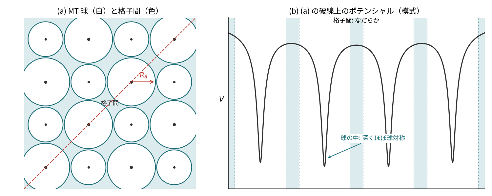
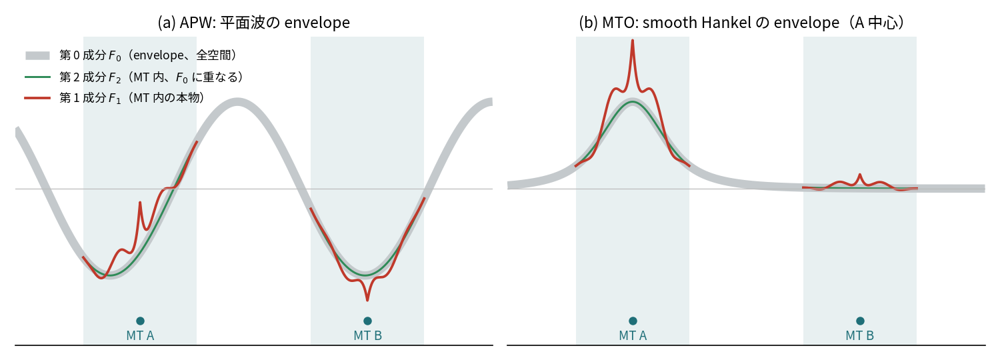
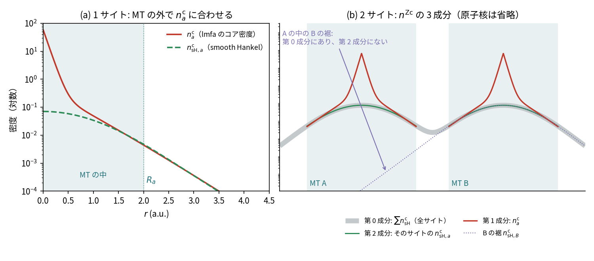

# PMT 法（APW と MTO の混合基底、DFT）

ecalj の `lmf` の一体問題の解き方。詳細と導出は
T. Kotani, H. Kino, H. Akai, [J. Phys. Soc. Jpn. **84**, 034702 (2015)](https://doi.org/10.7566/JPSJ.84.034702)。
最初の提案は Kotani and van Schilfgaarde, [PRB **81**, 125117 (2010)](https://doi.org/10.1103/PhysRevB.81.125117)。

- PMT = APW + MTO。全電子・フルポテンシャルの混合基底法で、二種類の augmented wave を同時に使う
  - APW（平面波の envelope）: 波動関数の広がった部分
  - MTO（原子中心の smooth Hankel の envelope）: 局在した部分（3d など）
  - 特殊なタイプとして局所軌道 Lo がある（実装や理論の上では、通常 MTO に属するものとして扱う）
- 定式化は「3 成分形式」（Soler–Williams の additive augmentation の形式を書き直したもの。J. M. Soler and A. R. Williams, [PRB **40**, 1560 (1989)](https://doi.org/10.1103/PhysRevB.40.1560)、[PRB **47**, 6784 (1993)](https://doi.org/10.1103/PhysRevB.47.6784)）。全エネルギーの最小化から Kohn–Sham 方程式と原子間力が素直に出る

## 予備知識: MT 空間分割（muffin-tin division of space）

単位胞 $\Omega$ を、原子 $a$ を中心とする重ならない球（MT 球、中心 $\mathbf R_a$、半径 $R_a$）と、その外の格子間（interstitial）に分ける。

- MT 球の中: 原子核の近くでポテンシャルが深く、ほぼ球対称。波動関数は原子のように速く振動し、ノードを持つ。そこで、動径方程式の解（部分波）$\times\,Y_L$ で表す
- 格子間: ポテンシャルは浅くなだらかで、波動関数は滑らか。平面波や smooth Hankel のような解析的な関数で十分に表せる

図 1 に模式図を示す。

図 1. MT 空間分割の模式図。(a) 2 種の原子が交互に並ぶ面での MT 球（白）と格子間（色）。半径は、隣の球と接する半径の 0.97 倍（既定）。
(b) (a) の破線（大きい原子を結ぶ対角線）に沿ったポテンシャル。球の中では原子核に向かって深く、格子間ではなだらか。
図は [`figures/pmt_mtdivision.py`](https://github.com/tkotani/ecalj/tree/main/ecaljdoc/theory/figures/pmt_mtdivision.py) で作る（数値は `pmt_mtdivision.dat`）。

この分割は、波動関数や密度を表すためのもので、ポテンシャルの形の近似ではない。
古い muffin-tin 近似（球の中は球対称、外は一定）と違い、PMT はフルポテンシャルで、球の中の非球対称の部分も格子間の変化もすべて扱う。
MT 半径は `[[spec]]` の `r` で与え、ふつうは隣の球とほぼ接するまでとる。ただし既定（`ctrlgenToml.py` の `--tratio=0.97`）では、接する半径より 3% 小さくしてある（上限と注意は [MT 半径の上限と偽の準位](../manual/mtradius.md)）。

## 三成分形式

3 成分形式は Soler–Williams の形式を書き直したものである。波動関数を基底関数の一次結合で表す。
基底関数は、エンベロープ関数を MT 内で augment したもの（MT 内をくり抜いて、原子的な波動関数に張り替えたもの）である。
§1 の MT 空間分割の上で、これを三つの成分の組として書く:

$$
F_i = F_{0i}(\mathbf r) \oplus \{F_{1i,a}(\mathbf r)\} \ominus \{F_{2i,a}(\mathbf r)\} \tag{1}
$$

ここで、$\oplus,\ominus$ はただの区切り。ただし、$F_i$ の加法は成分ごとに行う。また $F_i$ の乗法も、§3 以下で見るように成分ごとに行うことになる。

- 第 0 成分 $F_{0i}$: envelope（平面波、または smooth Hankel の Bloch 和）。全空間で解析的
- 第 1 成分 $F_{1i,a}$: MT 内の本物の関数（部分波の一次結合）
- 第 2 成分 $F_{2i,a}$: MT 内の $F_{0i}$ の低い $l$・低い振動の部分（$l\le l_{\max,a}$、$k\le k_{\max,a}$ の展開、式 4）。MT 内で第 0 成分のこの部分を打ち消す

式 (1) の添字: $i$ は基底関数の番号（APW なら $\mathbf G$、MTO なら $a$・$L$・$(R_{\rm SM},\epsilon)$ の組、Lo なら $a$・$L$）。
$L=(l,m)$ は角運動量の添字（$Y_L$ は実球面調和関数）。$(R_{\rm SM},\epsilon)$ は smooth Hankel のパラメータ（後述、§6・式 25）。
先頭の 0、1、2 が成分の番号。$a$ は MT（原子のサイト）の番号で、$\{\cdots\}$ はすべての $a$ についての組を表す。
第 1・第 2 成分の $\mathbf r$ は MT の中心 $\mathbf R_a$ から測り、$|\mathbf r|\le R_a$ でだけ定義する。添字の一覧は表 2（§11）。

APW と MTO の基底を、この三つの成分で図 2 に示す。

図 2. 式 (1) の 3 成分を、APW（a）と MTO（b）について示す。二つの MT 球（A、B）を通る 1 次元の切り口の模式図。
第 2 成分 $F_2$ は、MT 内の $F_0$ の成分のうち低い $l$・低い振動のもの（式 4 の展開）である。
幅の広い灰色は第 0 成分 $F_0$（全空間）、緑は $F_2$（MT 内。1 次元の図では $F_0$ と同じに描いたので重なる）、赤は第 1 成分 $F_1$（MT 内）。
$F_1$ は球面で $F_2$ と値・傾きが合う（後の条件 B）。MTO の $F_0$ は A 中心の smooth Hankel（式 25）で、B の中にある裾にも $F_1$、$F_2$ がある。
図は [`figures/pmt_basis.py`](https://github.com/tkotani/ecalj/tree/main/ecaljdoc/theory/figures/pmt_basis.py) で作る（数値は `pmt_basis.dat`）。

**Augmentationでできること**

Augmentation により、MT 内の波動関数は部分波 $\phi_{al},\dot\phi_{al}$ の一次結合となり、非常に良いものとなっている。

最近の実装では、部分波を決めるときの MT 端での対数微分値は、`lmfa` で計算した球対称原子のものに固定してしまう（ただし、部分波そのものまで球対称原子のものに固定すると、DFT の意味でいくらかエネルギー的に損をするので、$\phi,\dot\phi$ はいちいち MT 内のポテンシャルの球対称部分で解き直している）。従来は、対数微分値を部分 DOS の重心（center of PDOS）のエネルギーでの対数微分値としていたが、不安定であった。

一方、MT の外の波動関数は滑らかなので、envelope 関数（$F_0$）による表現で十分である。
さらに、envelope 関数を 0 とする局所軌道（Lo）も用いる。これにより、MT 内の波動関数の自由度は $\phi,\dot\phi$ に限定されず十分に大きくなり、MT 内のノードの数の変化も記述できる
（実際に Lo が要るものは、semicore や高い準位など限られる）。

波動関数は、式 (1) に対応して 3 成分表示で

$$
\psi_p = \sum_i \alpha^i_p F_i = \psi_{0p} \oplus \{\psi_{1p,a}\} \ominus \{\psi_{2p,a}\} \tag{2}
$$

実空間の関数への写像（augmentation）は

$$
\mathcal A[\psi_p] = \psi_{0p}(\mathbf r) + \sum_a \psi_{1p,a}(\mathbf r-\mathbf R_a) - \sum_a \psi_{2p,a}(\mathbf r-\mathbf R_a) \tag{3}
$$

で、その定義域となる関数空間の条件は次の二つ:

- (A) MT 内で $\psi_{2p,a}=\psi_{0p}$（厳密な条件。実際には次の (A′) に緩める）
- (A′) MT 内で $\psi_{2p,a}\approx\psi_{0p}$（低い $l$・低い周波数の部分が合えばよい）
- (B) MT 球面で $\psi_{1p,a}$ と $\psi_{2p,a}$ の値と傾きが一致

式 (1) の形式では 3 成分を自由に選んでよいように見えるが、実際にはこの二つの条件 (A′) と (B) を満たすものの集合だけを関数空間（$\mathcal A$ の定義域）として考えることになる。この関数空間は、加法や乗法（成分ごとの掛け算）について閉じている。$\mathcal A$ は、この 3 成分の関数空間の要素を 3 次元空間の関数へ射影する汎関数である。

(A′) は厳密な (A) $\psi_{2p,a}=\psi_{0p}$ を緩めたもの。第 2 成分は MT 内で展開する:

$$
F_{2i,a}(\mathbf r) = \sum_{k\le k_{\max,a},\,l\le l_{\max,a}} C^i_{akL} P_{akL}(\mathbf r),\qquad
F_{1i,a}(\mathbf r) = \sum_{kL} C^i_{akL} \widetilde P_{akL}(\mathbf r) \tag{4}
$$

$P_{akL}$ は Laguerre 多項式 $\times\, Y_L$（MTO の中心のサイト（頭の部分）では、展開関数にその smooth Hankel 自身も加える）。$\widetilde P_{akL}$ は $P_{akL}$ と球面で値・傾きが合う部分波 $\phi_{al},\dot\phi_{al}$ の一次結合。
切断の $k_{\max,a}$、$l_{\max,a}$ が入力の `kmxa`、`lmxa`。

(A′) は「$\approx$」を含むので、関数空間の定義としてはいくらか曖昧であり、定義としてはなくてもよい。関数空間は (B) だけで定められる（$\mathcal A[F]$ は MT 球面で値・傾きとも連続になる）。(A′) は、§3 の分離形の積が良い近似になるための条件である（式 8 の $(0-2)$ を小さくする）。

## 積の augmentation（分離形）

物理量は、成分をまたぐ交差項を作らずに、3 成分表示での積の定義に則り、成分ごとの積で求める:

$$
\mathcal A[F_i^*F_j] = F^*_{0i}F_{0j} + \sum_a F^*_{1i,a}F_{1j,a} - \sum_a F^*_{2i,a}F_{2j,a} \tag{5}
$$

重なり行列と運動エネルギー行列はこれから決まる:

$$
O_{ij} = \int_\Omega F^*_{0i}F_{0j} + \sum_a\int_{|\mathbf r|\le R_a}\left(F^*_{1i,a}F_{1j,a}-F^*_{2i,a}F_{2j,a}\right) \tag{6}
$$

$$
T_{ij} = \frac{1}{2m}\left[\int_\Omega \nabla F^*_{0i}\nabla F_{0j} + \sum_a\int_{|\mathbf r|\le R_a}\left(\nabla F^*_{1i,a}\nabla F_{1j,a}-\nabla F^*_{2i,a}\nabla F_{2j,a}\right)\right] \tag{7}
$$

(B) があるので、部分積分すれば $T_{ij}=\langle F_i|-\nabla^2/2m|F_j\rangle$ になる。

**分離形の誤差**

準局所的な演算子 $X(\mathbf r,\mathbf r')$ の行列要素を、$(0+1-2)X(0'+1'-2')$ の代わりに分離形 $0X0'+1X1'-2X2'$ で求める（$0,1,2$ は 3 成分、$'$ は $\mathbf r'$ の側）。差は恒等式

$$
(0+1-2)X(0'+1'-2')-(0X0'+1X1'-2X2')=(0-2)X(1'-2')+(1-2)X(0'-2') \tag{8}
$$

で与えられる。$(0-2)$ は (A) なら 0 で、(A′) では `lmxa`、`kmxa` の打ち切りによる高い $l$・速い振動の残り（振幅は小さく、$L$ ごとに MT 球面で最大）になる。
$(1'-2')$ は打ち切りにかかわらず収束する低エネルギーの部分で、MT 球面で値も傾きも 0 である。
したがって積 $\delta n_a(\mathbf r)=(0-2)_a(1'-2')_a$ は小さく、低い $L$ では $\int_{|\mathbf r|\le R_a}\delta n_a\,Y_L\approx 0$ とほぼ直交する。
誤差は `lmxa`、`kmxa` を変えて確かめられる。同じ考え方は、クーロン相互作用の電子密度にも少し修正して使える（§4）。

電子密度 $n$ の 3 成分表示では、各成分は同じ成分どうしの積の和になる:

$$
\begin{aligned}
n &= n_0(\mathbf r) \oplus \{n_{1,a}(\mathbf r)\} \ominus \{n_{2,a}(\mathbf r)\} \\
&= \sum_{ij}\rho_{ij}F^*_{0i}(\mathbf r)F_{0j}(\mathbf r) \;\oplus\; \Big\{\sum_{ij}\rho_{ij}F^*_{1i,a}(\mathbf r)F_{1j,a}(\mathbf r)\Big\}\\
&\qquad\ominus\; \Big\{\sum_{ij}\rho_{ij}F^*_{2i,a}(\mathbf r)F_{2j,a}(\mathbf r)\Big\},
\\
\rho_{ij} &= \sum_p^{\rm occ}\alpha^{i*}_p\alpha^j_p
\end{aligned} \tag{9}
$$

なお、実空間への写像 $\mathcal A$（式 3）は形式論のために導入したもので、実際の計算では使わない。
計算するのは式 (5) の右辺のような成分ごとの量（式 6、7、9、以下の Coulomb と交換相関も同じ）だけで、実空間の関数 $\mathcal A[\psi_p]$ を組み立てる必要はない。式 (5) の第 1、第 2 成分の加減は形式論であるが、物理的実態への写像を考えるときに有効である。

## Coulomb 相互作用

式は $e^2$、$m$ を残した形で書く。コードは Ry 単位（$\hbar=1$、$2m=1$、$e^2=2$）である。

**多重極変換**

電子密度の 3 成分表示（式 9）は、そのままではクーロンエネルギーを成分ごとに計算できない。第 1 成分と第 2 成分の多重極が違うと、その差が MT の外にもポテンシャルを作り、異なる MT や第 0 成分とつながるからである。そこで、物理的な密度 $\mathcal A[n]$ を変えずに、第 1 成分と第 2 成分の多重極をそろえるように 3 成分を書き換える。これが多重極変換で、変換のあとは格子間の静電ポテンシャルを第 0 成分だけから求められ、クーロンエネルギーを分離形（式 13）で扱えるようになる。

$\mathcal Y_L(\mathbf r)\equiv r^lY_L(\hat{\mathbf r})$ として、関数 $f$ の MT $a$ での $L$ 次の多重極を $Q_{aL}[f]\equiv\int_{|\mathbf r|\le R_a}\mathcal Y_L(\mathbf r)f(\mathbf r)\,d^3r$ と定める。$G_{aL}$ は $L$ 次の多重極が 1 になるように規格化したガウス関数である:

$$
G_{aL}(\mathbf r)=\frac{4\pi}{(2l+1)!!}\left(\frac{1}{\pi R_{{\rm G},a}^2}\right)^{3/2}\left(\frac{2}{R_{{\rm G},a}^2}\right)^l\mathcal Y_L(\mathbf r)\,e^{-r^2/R_{{\rm G},a}^2},\qquad Q_{aL'}[G_{aL}]=\delta_{LL'} \tag{10}
$$

$R_{{\rm G},a}$ は MT の中で十分小さくとる（コードでは $R_{{\rm G},a}=0.25R_a$ に固定）。
第 1 成分と第 2 成分の $L$ 次の多重極の差 $Q_{aL}[n_{1,a}-n_{2,a}]$ を持つガウス関数 $G_{aL}$ を、第 0 成分と第 2 成分の両方に足す:

$$
\mathcal M[n] = n_0 + \sum_{a\mathbf T L} Q_{aL}G_{aL}(\mathbf r-\mathbf R_a-\mathbf T)
\ \oplus\ \{n_{1,a}\}\ \ominus\ \Big\{n_{2,a}+\sum_L Q_{aL}G_{aL}(\mathbf r)\Big\} \tag{11}
$$

式 (11) の右辺の MT 内の成分（第 1、第 2 成分）は、$L$ を `lmxl`（既定は `lmxa` と同じ）までで打ち切っておく。
3 成分表示においては、式 (9) の $n$ と式 (11) の $\mathcal M[n]$ は別のものとして区別されている点に注意する。
$\mathcal A[\mathcal M[n]]=\mathcal A[n]$ なので、物理的には何も変えない（PAW の補償電荷にあたる）。
これで第 1 成分と第 2 成分の多重極がそろい、格子間の静電ポテンシャルは第 0 成分だけで正しくなる。

式 (11) の右辺の 3 成分を $\bar n=\mathcal M[n]=\bar n_0\oplus\{\bar n_{1,a}\}\ominus\{\bar n_{2,a}\}$ と書く。それぞれ

$$
\begin{alignedat}{2}
&\bar n_0 &&= n_0+\sum_{a\mathbf TL}Q_{aL}\,G_{aL}(\mathbf r-\mathbf R_a-\mathbf T),\\
&\bar n_{1,a} &&= n_{1,a},\\
&\bar n_{2,a} &&= n_{2,a}+\sum_L Q_{aL}\,G_{aL}(\mathbf r)
\end{alignedat}
\tag{12}
$$

である（$Q_{aL}=Q_{aL}[n_{1,a}-n_{2,a}]$）。

**Coulomb を分離形で**

$\bar n_{1,a}-\bar n_{2,a}$ は MT の中に閉じていて多重極を持たないので、それが作るポテンシャルは MT の外でゼロである。したがって MT の外のクーロンポテンシャルは $\bar n_0$ から正確に計算でき（多重極を取る $L$ の上限まで）、異なる MT をつなぐ項も出ない:

$$
\begin{aligned}
(n|v|m) &\equiv (\mathcal A[n]|v|\mathcal A[m]) = (\mathcal A[\bar n]|v|\mathcal A[\bar m])\\
&= \bar n_0\bullet v\bullet\bar m_0+(\bar n_1-\bar n_2)\circ v\circ(\bar m_1-\bar m_2)\\
&\qquad+\bar n_0\circ v\circ(\bar m_1-\bar m_2)+(\bar n_1-\bar n_2)\circ v\circ\bar m_0\\
&\simeq \bar n_0\bullet v\bullet\bar m_0 + \bar n_1\circ v\circ\bar m_1 - \bar n_2\circ v\circ\bar m_2
\end{aligned}
\tag{13}
$$

$\bullet$ は全空間での積分（周期系では単位胞あたりの量にする: $\mathbf r$ を単位胞、$\mathbf r'$ を全空間でとる）、 
$\circ$ は同じ MT 球の中だけの積分（全サイトの和をとる）。
クーロン相互作用は実空間の関数 $\mathcal A[n]$ で定義され、$\mathcal A[\bar n]=\mathcal A[n]$ と、式 (3) による $\mathcal A[\bar n]=\bar n_0+\sum_a(\bar n_{1,a}-\bar n_{2,a})$ を代入して展開すると 2〜3 行目になる。2〜3 行目は厳密で、$\simeq$ の右辺（分離形）は MT の中で $\bar n_0=\bar n_2$（厳密な条件 (A)）とおいたものである。
クーロン項の評価には、式 (13) の最後の式（分離形）を用いる。

式 (13) における近似を評価する。差は $(\bar n_0-\bar n_2)\circ v\circ(\bar m_1-\bar m_2)+(\bar n_1-\bar n_2)\circ v\circ(\bar m_0-\bar m_2)$ である。第 1 項に着目する（第 2 項も同じ）。
$\bar m_1-\bar m_2$ の多重極は、`lmxl` までのすべての $L$ で 0 である（式 11 で、$G_{aL}$ の多重極を 1 に規格化して $Q_{aL}[m_1-m_2]$ を足したため。`lmxl` より上の $L$ の成分は持たない）。したがって $v\circ(\bar m_1-\bar m_2)$ が作るポテンシャルは MT の外では 0 で、その $L$ は `lmxl` 以下である。ただし MT の中ではこのポテンシャルは 0 ではない。その大きさは多重極ではなく、MT の中での電荷の動径分布の違い（たとえば中心近くに局在した $G_{aL}$ と、$\bar m_1$ の分布の違い）で決まり、中心近くでは小さいとは限らない。一方、MT 端に近づけば 0 に近づくことは保証される。多重極が 0 なのでポテンシャルは MT の外に出ず、MT 球面で値も傾きも 0 になる（式 8 の $(1'-2')$ と同じ性質）。
一方、$\bar n_0-\bar n_2$ は (A′) のずれで、高い $L$ の成分が主である。$v$ は $L$ を保ち（回転で不変）、$v\circ(\bar m_1-\bar m_2)$ は $L\le$ `lmxl` の成分しか持たないので、$\bar n_0-\bar n_2$ のうち $L>$ `lmxl` の成分はこれと直交し、寄与しない。
寄与するのは $\bar n_0-\bar n_2$ の低い $L$ の成分だけで、それは $n_2$ が $n_0$ を再現しきれない部分（式 (4) の `kmxa` による打ち切り）である。したがって差は、その打ち切りに比例する項だけである。さらに $\bar n_0-\bar n_2$ は MT 球面の近くで大きく（§3 の分離形の誤差）、ポテンシャルのほうは MT 球面で値も傾きも 0 なので、積の積分はさらに小さくなる。

**コア電子密度**

コアの電子密度は、基本は frozen core（凍結したコア）で扱う。まずそれを説明する。なお GW 計算ではコア波動関数を生成して扱っているが、それは自己無撞着（sc）計算の電子密度には入れていない。

- 球対称の原子計算（`lmfa`）でコア密度 $n^{\rm c}_a(r)$ を求め、各原子に剛体として置く。
- MT の外へのしみ出しを扱うため、$|\mathbf r|>R_a$ で $n^{\rm c}_a$ を再現する smooth Hankel $n^{\rm c}_{{\rm sH},a}$（$l=0$ の 1 個。エネルギーと平滑化半径は `lmfa` と `lfoca`、`rfoca` で決まる）を作る。これで小さな MT が使える。
- 原子核 $-Z_a\delta(\mathbf r)$ と合わせて、コアと原子核の電荷を 3 成分で書く:

$$
n^{\rm Zc} = \sum_{a\mathbf T} n^{\rm c}_{{\rm sH},a}(\mathbf r-\mathbf R_a-\mathbf T)\ \oplus\ \{n^{\rm c}_a(\mathbf r)-Z_a\delta(\mathbf r)\}\ \ominus\ \{n^{\rm c}_{{\rm sH},a}(\mathbf r)\} \tag{14}
$$

第 0 成分はすべてのサイトの $n^{\rm c}_{{\rm sH},a}$ の和、第 1 成分は本物のコア密度と原子核、第 2 成分はそのサイトの $n^{\rm c}_{{\rm sH},a}$ である。図 3 に模式図を示す。

図 3. (a) 1 サイトの動径分布（対数目盛）。赤は `lmfa` のコア密度 $n^{\rm c}_a$、緑の破線は MT の外（$r>R_a$）で $n^{\rm c}_a$ に合わせた smooth Hankel $n^{\rm c}_{{\rm sH},a}$。MT の中では $n^{\rm c}_{{\rm sH},a}$ はなめらかで原点でも有限。(b) 二つの MT 球（A、B）を通る線上での式 (14) の 3 成分（原子核は省略）。幅の広い灰色は第 0 成分（全サイトの $n^{\rm c}_{\rm sH}$ の和）、緑は第 2 成分（そのサイトの $n^{\rm c}_{{\rm sH},a}$）、赤は第 1 成分（$n^{\rm c}_a$）。点線は B の裾で、MT A の中では第 0 成分には入るが第 2 成分には入らない。この裾も、第 0 成分を通してクーロンエネルギー（式 (13) の $\bar n_0\bullet v\bullet\bar m_0$）には入る。
図は [`figures/pmt_core.py`](https://github.com/tkotani/ecalj/tree/main/ecaljdoc/theory/figures/pmt_core.py) で作る（数値は `pmt_core.dat`）。

論文は「数個の smooth Hankel の一次結合」と書くが、コード（`corprm`）は 1 個である。

価電子の密度 $n$（式 9）と合わせた全電荷を $n^{\rm Zcv}=n^{\rm Zc}+n$ とし、式 (11) の多重極変換をかける。
$Q^{\rm Zc}_{aL}=Q_{aL}[n^{\rm c}_a-Z_a\delta-n^{\rm c}_{{\rm sH},a}]$、$Q^{\rm v}_{aL}=Q_{aL}[n_{1,a}-n_{2,a}]$ として、$\bar n^{\rm Zcv}=\mathcal M[n^{\rm Zcv}]$ の 3 成分は

$$
\begin{alignedat}{2}
&\bar n^{\rm Zcv}_0 &&= \sum_{a\mathbf T}n^{\rm c}_{{\rm sH},a}(\mathbf r-\mathbf R_a-\mathbf T)+n_0+\sum_{a\mathbf TL}(Q^{\rm Zc}_{aL}+Q^{\rm v}_{aL})\,G_{aL}(\mathbf r-\mathbf R_a-\mathbf T),\\
&\bar n^{\rm Zcv}_{1,a} &&= n^{\rm c}_a-Z_a\delta+n_{1,a},\\
&\bar n^{\rm Zcv}_{2,a} &&= n^{\rm c}_{{\rm sH},a}+n_{2,a}+\sum_L(Q^{\rm Zc}_{aL}+Q^{\rm v}_{aL})\,G_{aL}(\mathbf r)
\end{alignedat}
\tag{15}
$$

となる。コア密度は球対称なので、$Q^{\rm Zc}_{aL}$ は $L=0$ の成分だけを持つ（非球対称のコアは付録 B）。
$\mathcal A[n^{\rm Zc}]$ は MT の中でも外でも、すべてのサイトのコアと原子核を重ねたものになっている。

第 2 成分に $n^{\rm c}_{{\rm sH},a}$ を足すのは、コード（`locpot` の `rhol2`）と一致する。論文の式 (30) の $n^{\rm Zc}_{2,a}$ は、論文の式 (23) によりこれと同じものである（`locpot` のコメントは論文の式 (30) を誤植としているが、内容は同じ）。

隣の $n^{\rm c}_{{\rm sH},a'}$ の裾は、MT $a$ の中では第 0 成分に入ることになる。ただし第 2 成分はそのサイトの $n^{\rm c}_{{\rm sH},a}$ だけなので、隣の裾は第 2 成分に入らない。この裾は、MT の中の高い $l$ の成分と同じように、第 0 成分だけで扱われる部分になる。ただし高い $l$ の成分と違って、この裾は主に低い $L$ の成分なので、$v\circ(\bar m_1-\bar m_2)$ と結合しうる。そのため、クーロン相互作用の式 (13) の誤差の議論は、少し修正が必要ではある。コアの裾についてのこの注意は論文に無い。
既定では、$Z>8$ では `lfoca`=1 で上述の扱いであり、$Z\le 8$ では `lfoca`=0 でコアを MT の中に閉じ込め（$n^{\rm c}_{{\rm sH},a}=0$）、反復ごとに MT の中のポテンシャルで解き直す（凍結しない）。

コードとの対応（`corprm`、`mkrout`）: `lfoca`=1 では、コア密度 $n^{\rm c}_a$ とその smooth Hankel $n^{\rm c}_{{\rm sH},a}$ は `lmfa` で作ったものに固定する（凍結）。`lfoca`=0 では、`mkrout` が反復のたびに `getcor` で、そのときの MT の中の球対称ポテンシャルを使ってコアを解き直す（コアは MT の中に閉じ込めたまま緩和する）。どちらの場合もコア密度は球対称（$L=0$ だけ）である。

## 全エネルギーと Kohn–Sham 方程式

$$
\begin{aligned}
E_{\rm total} &= E^{\rm core}_{\rm k} + \sum_{ij}\rho_{ij}T_{ij} + E_{\rm es} + E_{\rm xc}[n^{\rm Zcv}],\\
E_{\rm es} &= \frac12\,(n^{\rm Zcv}|v|n^{\rm Zcv})
\end{aligned}
\tag{16}
$$

$$
E_{\rm xc}[n^{\rm Zcv}] = E_{\rm xc}[n^{\rm Zcv}_0] + \sum_a E_{\rm xc}[n^{\rm Zcv}_{1,a}] - \sum_a E_{\rm xc}[n^{\rm Zcv}_{2,a}] \tag{17}
$$

$E^{\rm core}_{\rm k}$ は コアの運動エネルギー（`lfoca`=1 の凍結したコアでは定数。`lfoca`=0 ではコアを解き直すたびに求め直す）、$T_{ij}$ は式 (7)。$E_{\rm es}$ は式 (13) の最後の式（分離形）で、$\bar n=\mathcal M[n^{\rm Zcv}]$ を使って評価する（原子核の自己相互作用の定数は除く）。
$n^{\rm Zcv}$ と $\bar n^{\rm Zcv}$ の各成分は式 (14)、(15)。第 0 成分は実空間のメッシュ（カットオフ `gmax`）で、MT の中は動径メッシュで計算する。
基底を固定し、規格化 $\sum_{ij}\alpha^{i*}_pO_{ij}\alpha^j_p=1$ を保って式 (16) を $\alpha^{i*}_p$ で変分すると、一般化固有値問題になる:

$$
\sum_j\left(H_{ij}-\epsilon_p O_{ij}\right)\alpha^j_p = 0,\qquad H_{ij}=T_{ij}+V_{ij} \tag{18}
$$

ここで $O_{ij}$ と $T_{ij}$ は式 (6)、(7) で、$V_{ij}=\langle F_i|V|F_j\rangle$ は 3 成分のポテンシャル $V$ と $F_i^*F_j$（式 5）の成分ごとの積の積分である（3 成分の関数どうしのこの積分を $V\cdot F_i^*F_j$ のように「$\cdot$」で書く）。$V$ は次のように決まる。
交換相関ポテンシャルは、式 (17) の $E_{\rm xc}$ を $n^{\rm Zcv}$ の各成分で汎関数微分したもの:

$$
v^{\rm xc}=v^{\rm xc}_0(\mathbf r)\oplus\{v^{\rm xc}_{1,a}(\mathbf r)\}\ominus\{v^{\rm xc}_{2,a}(\mathbf r)\} \tag{19}
$$

ポテンシャルは

$$
\begin{aligned}
V ={}& \bar n^{\rm Zcv}_0\bullet v\bullet{}+v^{\rm xc}_0\\
&\oplus\Big\{\sum_L\overset{\raise{-0.3em}{\scriptscriptstyle\bullet}}{Q}{}^{\rm v}_{aL}\mathcal Y_L(\mathbf r)+\bar n^{\rm Zcv}_{1,a}\circ w\circ{}+v^{\rm xc}_{1,a}\Big\}\\
&\ominus\Big\{\sum_L\overset{\raise{-0.3em}{\scriptscriptstyle\bullet}}{Q}{}^{\rm v}_{aL}\mathcal Y_L(\mathbf r)+\bar n^{\rm Zcv}_{2,a}\circ w\circ{}+v^{\rm xc}_{2,a}\Big\}
\end{aligned}
\tag{20}
$$

$$
\overset{\raise{-0.3em}{\scriptscriptstyle\bullet}}{Q}{}^{\rm v}_{aL}\equiv\frac{\partial E_{\rm es}}{\partial Q^{\rm v}_{aL}}
=\bar n^{\rm Zcv}_0\bullet v\bullet G_{aL}(\mathbf r'-\mathbf R_a)-\bar n^{\rm Zcv}_{2,a}\circ w\circ G_{aL}(\mathbf r') \tag{21}
$$

である（論文の式 32〜35）。記号 $\overset{\raise{-0.3em}{\scriptscriptstyle\bullet}}{Q}{}^{\rm v}_{aL}$ は、論文では $\mathcal Q^{\rm v}_{aL}$ と書いている（多重極 $Q^{\rm v}_{aL}$ と紛らわしいので変えた）。
$\bar n_0\bullet v\bullet$ は一方の変数だけを積分した $\mathbf r$ の関数。$w$ は MT 球面でゼロになる（Dirichlet 境界条件の）MT の中のクーロン核である:

$$
\begin{aligned}
&w(\mathbf r,\mathbf r')=e^2\sum_L\frac{4\pi}{2l+1}\,r_<^l\left(\frac{1}{r_>^{l+1}}-\frac{r_>^l}{R_a^{2l+1}}\right)Y_L(\hat{\mathbf r})Y_L(\hat{\mathbf r}'),\\
&r_<=\min(r,r'),\quad r_>=\max(r,r')
\end{aligned}
\tag{22}
$$

MT 球面での値は $\sum_L\overset{\raise{-0.3em}{\scriptscriptstyle\bullet}}{Q}{}^{\rm v}_{aL}\mathcal Y_L$ の項が受け持つ。静電エネルギーの MT の項 $\frac12\bar n^{\rm Zcv}_1\circ w\circ\bar n^{\rm Zcv}_1-\frac12\bar n^{\rm Zcv}_2\circ w\circ\bar n^{\rm Zcv}_2$ も $w$ で書け、動径メッシュで計算する。式 (20)、(21) の導出は付録 A。$w$ の定義（式 22）は論文に欠落しており、ここで補った。
$\overset{\raise{-0.3em}{\scriptscriptstyle\bullet}}{Q}{}^{\rm v}_{aL}$ は $E_{\rm es}$ をガウス関数の重み $Q^{\rm v}_{aL}$（式 15）で微分したもので、$\mathcal Y_L$ を掛けて第 1、第 2 成分に同じものを足す。
MT の中の密度とポテンシャル（$n_{1,a}$、$n_{2,a}$、$V_{1,a}$、$V_{2,a}$）は、どれも $L$ を `lmxl` までで打ち切る（既定は `lmxa` と同じ）。部分波の $l$ の上限は `lmxa` で、MT 内の行列要素は $l_1,l_2\le$ `lmxa` の部分波と $L\le$ `lmxl` のポテンシャルの組で作る。

コードとの対応（式 20〜22、`smves` と `locpot`。Ry 単位で $e^2=2$）: 第 0 成分と MT の中を次の順に結びつける。

1. `rhomom`: 各サイトの多重極 `qmom` $=Q^{\rm v}_{aL}+Q^{\rm Zc}_{aL}$ を作る。$Q^{\rm v}_{aL}=\int r^l(\rho_1-\rho_2)$、$L=0$ には $Q^{\rm Zc}$ として $-Y_0Z$ と `cofg` $=Y_0(q_{\rm c}-q_{\rm c,sH})$ を足す（`cofg` はコアの電荷のうち $n^{\rm c}_{\rm sH}$ に入らない分）。
2. `smves`（`vesgcm`、`ugcomp`）: 第 0 成分 $\bar n^{\rm Zcv}_0$（平面波で表した $n_0$、$n^{\rm c}_{\rm sH}$、ガウス関数）の静電ポテンシャル $\bar n_0\bullet v$ を作る。ガウス関数どうし、smooth Hankel どうしの異なるサイトの項は解析的に（Ewald 和で）求める。ここから二つの量が出る。`gpot0`$_{aL}=\int G_{aL}\,(\bar n_0\bullet v)$（式 21 の第 1 項）と、MT 球面での $\bar n_0\bullet v$ の $L$ 成分 `vval`$_{aL}$。平均ポテンシャルのずらし `vconst` は両方に同じだけ足す。
3. `locpot`: MT の中の第 1 成分 `rhol1` $=\rho_1+Y_0\rho_{\rm c}$（原子核 $-Z$ は Poisson を解くときに入れる）、第 2 成分 `rhol2` $=\rho_2+\sum_L$`qmom`$_L\,G_{aL}+Y_0\,n^{\rm c}_{\rm sH}$ を作る（式 15）。両者の電荷が等しいことを確かめる。
4. `poinsp(0, 0, rhol2)`: 第 2 成分を MT 球面で 0 の境界条件で解く。これが $\bar n_2\circ w$（式 22）。`gpotb`$_{aL}=\int G_{aL}\,(\bar n_2\circ w)$ を求め、`dEdQ`$_{aL}=$（`gpot0` $-$ `gpotb`）$R_a^l=\overset{\raise{-0.3em}{\scriptscriptstyle\bullet}}{Q}{}^{\rm v}_{aL}R_a^l$ とする（式 21）。
5. `poinsp(z, dEdQ, rhol1)`、`poinsp(0, dEdQ, rhol2)`: 境界値を `dEdQ` にして第 1、第 2 成分を解き直す。`poinsp` は境界値を同次解 $r^lY_L$ で合わせるので、解は $\bar n_{1(2)}\circ w+\sum_L\overset{\raise{-0.3em}{\scriptscriptstyle\bullet}}{Q}{}^{\rm v}_{aL}\mathcal Y_L$ になり、式 (20) の静電の部分そのものである。第 1 成分の静電ポテンシャルは $Y_0$`v1es` $-2Z/r$。
6. 部分波用のポテンシャル `v1out` は別に、`poinsp(z, vval, rhol1)` で MT 球面の値を `vval` に合わせて解く（§6）。
7. 解き直した第 2 成分で `gpotb` を求め直し、`gpot0` $-$ `gpotb` を `gaugm` に渡して、行列要素（式 24 の $\pi$ の多重極の項）に使う。

**MT 内の行列要素（1 中心の行列）**

式 (4) の展開係数 $C^i_{akL}$ を使うと、$O_{ij}$、$T_{ij}$、$V_{ij}$ は第 0 成分の積分と 1 中心の行列の和になる:

$$
\begin{aligned}
O_{ij} &= \int_\Omega F^*_{0i}F_{0j}+\sum_{akk'L}C^{i*}_{akL}\,\sigma_{akk'l}\,C^j_{ak'L},\\
T_{ij} &= \frac{1}{2m}\int_\Omega \nabla F^*_{0i}\nabla F_{0j}+\sum_{akk'L}C^{i*}_{akL}\,\tau_{akk'l}\,C^j_{ak'L},\\
V_{ij} &= \int_\Omega F^*_{0i}V_0F_{0j}+\sum_{akk'LL'}C^{i*}_{akL}\,\pi_{akk'LL'}\,C^j_{ak'L'}
\end{aligned}
\tag{23}
$$

1 中心の行列は、MT の中の積分（$|\mathbf r|\le R_a$）で

$$
\begin{aligned}
\sigma_{akk'l} &= \int\big(\widetilde P_{akL}\widetilde P_{ak'L}-P_{akL}P_{ak'L}\big),\\
\tau_{akk'l} &= \frac{1}{2m}\int\big(\nabla\widetilde P_{akL}\nabla\widetilde P_{ak'L}-\nabla P_{akL}\nabla P_{ak'L}\big),\\
\pi_{akk'LL'} &= \sum_M Q_{akk'LL'M}\,\overset{\raise{-0.3em}{\scriptscriptstyle\bullet}}{Q}{}^{\rm v}_{aM}\\
&\quad+\int\big(\bar n^{\rm Zcv}_{1,a}\circ w+v^{\rm xc}_{1,a}\big)\widetilde P_{akL}\widetilde P_{ak'L'}\\
&\quad-\int\big(\bar n^{\rm Zcv}_{2,a}\circ w+v^{\rm xc}_{2,a}\big)P_{akL}P_{ak'L'},\\
Q_{akk'LL'M} &= \int\big(\widetilde P_{akL}\widetilde P_{ak'L'}-P_{akL}P_{ak'L'}\big)\,\mathcal Y_M
\end{aligned}
\tag{24}
$$

である。$\sigma$、$\tau$ は $L=(l,m)$ のうち $l$ だけによる。$\pi$ の第 1 項は式 (21) の $\overset{\raise{-0.3em}{\scriptscriptstyle\bullet}}{Q}{}^{\rm v}_{aM}$ を通した多重極の寄与で、$Q_{akk'LL'M}$ は $\widetilde P\widetilde P-PP$ の $M$ 次の多重極である。
局所軌道 Lo（`pz` の 10 の位が 0 のもの）は、MT 端で値も傾きも 0 になるように作るので、第 1 成分だけを持つ（第 0、第 2 成分は 0）。Lo を含む行列要素は MT の項だけになる。
$O_{ij}$、$T_{ij}$ は、式 (23) の 1 中心の項（式 24）で、 $\widetilde P_{akL}$ の代わりに Lo の動径関数 $\times\,Y_L$ を使い、Lo の側の $P$ の項を 0 としたものである。
$V_{ij}$ では、Lo に第 0、第 2 成分が無いので、ポテンシャルを調和関数 $\mathcal Y_L$ の分だけずらす自由が無い。そのため式 (20) の $V_{1,a}$（MT 球面の値が $\overset{\raise{-0.3em}{\scriptscriptstyle\bullet}}{Q}{}^{\rm v}_{aL}R_a^l$）ではなく、MT 球面の値を実際の静電ポテンシャルの値（第 0 成分から決まる）に合わせたポテンシャルを使う。

コードとの対応:
- Lo の動径関数は `makusp` で作る。`pz` の 10 の位が 0 なら `lpz`=1 で、$\phi,\dot\phi$ を混ぜて MT 端の値と傾きを 0 にする。10 の位が 1 なら `lpz`=2 の extended Lo で、smooth Hankel の裾（envelope）を付け、動径関数は変えない。
- `m_augmat` の注釈のとおり、Lo の裾は他のサイトのまわりで展開しないので、Lo は 1 中心と 2 中心の項だけを持つ。$O$、$T$ は $L$ の打ち切りの誤差なしに求まる。
- Lo の $V$ の 1 中心の項は、MT の中の展開 $V_L(r)=V_{1,l}(r)+\frac{V^{\rm val}_L}{R^l}r^l$（$V^{\rm val}_L$ は MT 球面での静電ポテンシャルの $L$ 成分、コードの `vval`）で求める（`m_augmat` の注釈）。

## PMT の基底

基底は次の三種類:

| 種類 | envelope（第 0 成分） | 入力 |
| --- | --- | --- |
| APW | 平面波 $e^{i(\mathbf k+\mathbf G)\mathbf r}$ | カットオフ `pwemax`（Ry） |
| MTO | smooth Hankel $h_L$（式 25） | `rsmh`、`eh`（二組目は `rsmh2`、`eh2`）、`lmx` |
| Lo | 無し（MT の中だけ） | `pz` |

表 1. PMT の基底と入力のキー（`[[spec]]` と `[ham]`）。`pwmode` が平面波の扱いを選ぶ（[lmf](../manual/lmf.md)）。

smooth Hankel は、δ 関数の代わりにガウス関数を源にした Helmholtz 方程式の解:

$$
(\nabla^2+\epsilon)\,h_0(\mathbf r) = -4\pi g_0(\mathbf r),\quad g_0\propto e^{-r^2/R_{\rm SM}^2},\qquad h_L = \mathcal Y_L(-\nabla)h_0 \tag{25}
$$

$R_{\rm SM}\to0$ で普通の Hankel 関数 $e^{-\kappa r}/r$（$\epsilon=-\kappa^2$）になる。$R_{\rm SM}$ が有限なら $h_0$ は原点で発散しない。

- 部分波 $\phi_{al}$、$\dot\phi_{al}$ は、MT の中の実際のポテンシャルの球対称部分で動径方程式を解いて作る。このポテンシャルは、第 1 成分の電荷のつくる静電ポテンシャルを、MT 球面の値（第 0 成分から決まる）に合わせて解いたものに $v^{\rm xc}_{1,a}$ を足したもの（コードの `v1out`）で、式 (20) の第 1 成分 $V_{1,a}$ とは境界値が違う。部分波は基底の材料なので、変分の整合性には影響しない。MT 端での対数微分値は `lmfa` の球対称原子のものに固定する（§2 の注）。
- Lo の部分波も、MT 端での対数微分値を `lmfa` の値に固定して解く。
- MTO の $R_{\rm SM}$ と $\epsilon$ は簡単な規則でよい（$R_{\rm SM}=R_a/2$ など）
  - 足りない分は APW が補う。$\epsilon$ への全エネルギーの依存は弱く、APW を増やすほど弱くなる
  - フルポテンシャル LMTO の難題だった「MTO のパラメータの選び方」が実質的に無くなる
- 第 1 成分・第 2 成分の `lmxl`（既定は $l_{\max,a}$ = `lmxa`） より上は密度でも捨てる（成分どうしの積で $2l_{\max,a}$ まで出るが、固有関数をすでに切っているので意味が無い）

コードとの対応: `ctrlgenToml.py` が書く入力は `[ham]` の `readp = true` と `pnufix = true` である。`readp` で、`lmfa` が書いた `atmpnu.*` から価電子の $P$（対数微分値）と Lo の $P_z$ を読み（`m_lmfinit`）、`pnufix` で自己無撞着の反復の間それを固定する（`m_bndfp` で `pnunew` を呼ばない）。
`pnufix = false` のときは `pnunew` が $P$ を更新する。そこでは、Lo の無い $l$ は占有状態の重心のエネルギーで、semicore の Lo がある $l$ は価電子の $\phi$ をフェルミエネルギーで解く（論文の記述はこちら）。

## 注意すべき点

- **$O_{ij}$ の正定値性**
  - 式 (6) の最後の項は負なので、正定値でなくなりうる。
  - `kmxa` 〜5、`lmxa` 〜4 で普通は問題ない。
  - 小さな固有値は `oveps` で落とす。
- **第 2 成分の不定性（null vector）**
  - MT の中で第 0 成分と第 2 成分だけが残る基底の組み合わせは、$H$ にも $O$ にも寄与しない（幽霊）。
  - 基底を増やしすぎると、固有関数にとりついたり、0/0 の固有値が出たりして収束を壊す。
  - 実際には、密度の第 2 成分が大きくなりすぎて収束しなかった例がある。
  - 基底の数はほどほどにする。
- **コアとの直交性**
  - MT をとても小さくすると、波動関数がコアと直交しなくなって収束しない。
  - そのときはコアを Lo（`pz`）で表す。

## PAW との比較（要点）

同じ 3 成分形式で書くと、PAW は第 0 成分（擬波動関数 $\tilde\psi$）から射影子 $\tilde p_i$ で第 1・第 2 成分を決める方法:

$$
\psi = \tilde\psi \oplus \sum_i|\phi_i\rangle\langle\tilde p_i|\tilde\psi\rangle \ominus \sum_i|\tilde\phi_i\rangle\langle\tilde p_i|\tilde\psi\rangle \tag{26}
$$

- PAW は MT の中の擬波動関数を一意に決めなければならないので、擬ポテンシャルの選び方に結果がよる
  - 部分波を切ることによる幽霊状態にも注意が要る
  - その代わり null vector の問題は無い
- PMT（と LAPW）は、MT の中の第 0 成分を第 2 成分が打ち消すので、第 0 成分は MT の中で何でもよい
  - 平面波のカットオフは LAPW 並み（〜15 Ry、PAW は〜30 Ry）で済む

## 原子間力

**Harris エネルギー**

自己無撞着に達する前の入力密度 $n^{\rm in}$ が一粒子ポテンシャル $V=V[n^{\rm Zc}+n^{\rm in},\mathbf R_a]$（式 20 の $n$ を $n^{\rm in}$ にしたもの）を作り、その固有関数から出力密度 $n^{\rm out}$ が出る。frozen core での Harris エネルギーは $n^{\rm in}$ の汎関数として

$$
\begin{aligned}
E_{\rm Harris}&=E^{\rm core}_{\rm k}+E_{\rm B}-V[n^{\rm Zc}+n^{\rm in},\mathbf R_a]\cdot n^{\rm in}\\
&\quad+E_{\rm es}[n^{\rm Zc}+n^{\rm in},\mathbf R_a]+E_{\rm xc}[n^{\rm Zc}+n^{\rm in}],\\
E_{\rm B}&=\sum_p^{\rm occ}\sum_{ij}\alpha^{i*}_p\langle F_i|H^{\rm in}|F_j\rangle\alpha^j_p=\sum_p^{\rm occ}\epsilon_p,\\
H^{\rm in}&=-\frac{\nabla^2}{2m}+V[n^{\rm Zc}+n^{\rm in},\mathbf R_a]
\end{aligned}
\tag{27}
$$

である。$\mathbf R_a$ への依存は、$n^{\rm Zc}+n^{\rm in}$ を通したもののほかに、多重極変換と $\mathcal A$ を通して陽に入る（3 成分の関数として $n^{\rm Zc}+n^{\rm in}$ を固定しても、式 (15) と式 (21) の $G_{aL}(\mathbf r-\mathbf R_a)$ を通して $\mathbf R_a$ に依存する）。部分波（$\phi_{al}$、$\dot\phi_{al}$、Lo）は原子位置によらないとする。

**力**

原子の変位 $\delta\mathbf R_a$ による $E_{\rm Harris}$ の変化を求める。$E_{\rm B}$ を $\{F_i\}$ と $V$ の汎関数とみて、式 (18) の摂動から

$$
\begin{aligned}
\delta E_{\rm B}&=\sum_p^{\rm occ}\delta\epsilon_p=\sum_p^{\rm occ}\sum_{ij}\alpha^{i*}_p\left(\delta H_{ij}-\epsilon_p\delta O_{ij}\right)\alpha^j_p\\
&=\delta V\cdot n^{\rm out}+\delta E^{\rm Pulay}_{\rm B},\\
\delta E^{\rm Pulay}_{\rm B}&=\sum_p^{\rm occ}\sum_{ij}\alpha^{i*}_p\left(\delta H^F_{ij}-\epsilon_p\delta O^F_{ij}\right)\alpha^j_p
\end{aligned}
\tag{28}
$$

となる。ここで $\delta(V\cdot F_i^*F_j)=\delta V\cdot F_i^*F_j+V\cdot\delta(F_i^*F_j)$ を使った。$\delta H^F$、$\delta O^F$ は基底の変化 $\delta F_{0i}(\mathbf r)$ と $\delta C^i_{akL}$ から来る部分（Pulay 項）である。$E_{\rm es}+E_{\rm xc}$ は $\{n^{\rm in},\mathbf R_a\}$ の汎関数なので

$$
\begin{aligned}
\delta E_{\rm Harris}&=\delta E_{\rm B}-\delta(V\cdot n^{\rm in})+\delta(E_{\rm es}+E_{\rm xc})\\
&=\delta V\cdot(n^{\rm out}-n^{\rm in})+\delta E^{\rm Pulay}_{\rm B}+\left.\frac{\partial(E_{\rm es}+E_{\rm xc})}{\partial\mathbf R_a}\right|_{n^{\rm in}}\!\!\delta\mathbf R_a
\end{aligned}
\tag{29}
$$

右辺の三つの項は、自己無撞着でないこと（$n^{\rm out}\ne n^{\rm in}$）による項、Pulay 項、陽な依存の項である。
第 1 項には $\delta n^{\rm in}$ が要る。自己無撞着なら $\delta n^{\rm in}=\delta n^{\rm out}$ で決まるが、そうでないときは一意に決まらない。
そこで 3 成分表示で $\delta n^{\rm in}=0$ とする。物理的には、$n_{1,a}-n_{2,a}$ と $\mathbf R_a$ を中心とする frozen core が、$\mathbf R_a\to\mathbf R_a+\delta\mathbf R_a$ と一緒に剛体的に動くことを意味する。
このとき $\delta V$ は式 (20) の $\delta\bar n^{\rm Zcv}_0$ から求まり、$\delta\bar n^{\rm Zcv}_0$ は式 (15) から求める。$n^{\rm Zc}_0$ も式 (14) のとおり $\mathbf R_a$ に依存する。

## スカラー相対論

MT の中ではスカラー相対論（SR）近似を使う。SR の波動関数は大きい成分と小さい成分を持つ。大きい成分は格子間の非相対論（NR）の波動関数になめらかにつながり、小さい成分は格子間では無視できる。MT の中の物理量は SR の波動関数で計算する。

基底の第 1 成分 $F_{1i,aL}$ を二成分 $\{g_{1i,aL}(r),f_{1i,aL}(r)\}$ に置き換える。$g$ が大きい成分、$f$ が小さい成分（どちらも動径関数 $\times\,r$）で、SR の動径方程式の解である。$f$ はおおよそ $\frac{1}{2Mc}\frac{dg}{dr}$（$c$ は光速、$M$ は相対論的な質量）。
$F_{0i}$、$F_{2i}$ は NR の場合と同じで、条件 (B)（MT 球面で値と傾きが合う）は大きい成分 $g_{1i,aL}$ に課す。
第 1 成分の積は

$$
\begin{aligned}
&F^*_{1i,aL}(r)F_{1j,aL}(r)\ \to\ \gamma_l(r)\,g^*_{1i,aL}(r)g_{1j,aL}(r)+f^*_{1i,aL}(r)f_{1j,aL}(r),\\
&\gamma_l(r)=1+\frac{l(l+1)}{\big(2M(r)c\,r\big)^2},\qquad 2M(r)c=c-\frac{V(r)-\epsilon}{c}
\end{aligned}
\tag{30}
$$

に置き換える（Ry 単位。$V(r)$ は原子核の $-2Z/r$ を含む球対称のポテンシャル、$\epsilon$ は部分波のエネルギー）。
$\gamma_l$ の項は、Dirac 方程式の小さい成分の角度部分を $j=l\pm\frac12$ で平均したときに出る $l(l+1)g^2/(2Mcr)^2$ である。
これで密度 $n$、$O_{ij}$ などが求まり、SR 近似の全エネルギーになる。
変わるのは式 (24) の $\widetilde P_{akL}\widetilde P_{ak'L}$（と $\nabla$ 付きのもの）で、大きい成分どうしの積に $\gamma_l$ を掛けたもの（式 30）に小さい成分どうしの積も加えたものと読む。$\pi$ の中の第 1 成分の密度 $n_{1,a}$ も同じ。
スピン軌道相互作用も同じように第 1 成分に入れ、スピンの非対角の寄与になる。

コードとの対応: 動径方程式の解 `rseq` は規格化を $\int\big(g^2(1+\frac{l(l+1)}{(2Mcr)^2})+f^2\big)dr=1$ でとる（`tmcr` $=2Mcr$）。部分波の積 `makusp` も $\gamma_l\,g g+f f$ で作る。エネルギーの違う関数どうし（$\phi$ と Lo など）の積では、$\gamma_l$ は二つのエネルギーでの値の平均をとる。
論文の付録 D は置き換えを $g^*g+(\frac{1}{2mc})^2f^*f$ と書いているが、これは論文の誤り（$f$ の定義にすでに $\frac{1}{2mc}$ が入っていて係数が二重になり、$\gamma_l$ も抜けている）。コードは正しく、バグではない。式 (30) はコードに合わせた。

## 添字と記号のまとめ

| 記号 | 意味 | 初出 |
| --- | --- | --- |
| $i, j$ | 基底関数の番号（APW の $\mathbf G$、MTO の $a$・$L$・$(R_{\rm SM},\epsilon)$、Lo の $a$・$L$）。$(R_{\rm SM},\epsilon)$ は smooth Hankel のパラメータ（式 25） | 式 (1) |
| 0, 1, 2 | 成分: 0 = envelope（全空間）、1 = MT 内の本物、2 = MT 内の envelope の低 $l$・低振動の部分 | 式 (1) |
| $a$ | MT（原子のサイト）。中心 $\mathbf R_a$、半径 $R_a$ | §1、式 (1) |
| $p$ | 固有状態（波動関数 $\psi_p$）、固有値 $\epsilon_p$ | 式 (2)、(18) |
| $\alpha^i_p$ | 波動関数の係数 $\psi_p=\sum_i\alpha^i_pF_i$ | 式 (2) |
| $L=(l,m)$ | 角運動量。$Y_L$ は実球面調和関数、$\mathcal Y_L(\mathbf r)=r^lY_L(\hat{\mathbf r})$ | 式 (1) |
| $k$ | MT 内の動径の展開の次数（$P_{akL}$ の多項式の次数） | 式 (4) |
| $k_{\max,a}$, $l_{\max,a}$ | 第 1・第 2 成分の展開の切断（`kmxa`、`lmxa`） | 式 (4) |
| $C^i_{akL}$ | 基底 $i$ の、MT $a$ での展開係数 | 式 (4) |
| $P_{akL}$, $\widetilde P_{akL}$ | MT 内の展開関数（多項式 $\times Y_L$）と、球面で値・傾きが合う部分波の組 | 式 (4) |
| $\phi_{al}$, $\dot\phi_{al}$ | 部分波とそのエネルギー微分 | §2、§6 |
| $\rho_{ij}$ | 密度行列 $\sum_p^{\rm occ}\alpha^{i*}_p\alpha^j_p$ | 式 (9) |
| $\Omega$ | 単位胞 | §1 |
| $\mathbf T$ | 格子の並進ベクトル | 式 (11) |
| $\mathbf G$ | 逆格子ベクトル（APW、実空間メッシュ） | 式 (1) |
| $\bullet$, $\circ$ | 全空間での積分（周期系では単位胞あたり）、同じ MT 球の中だけの積分 | 式 (13) |

表 2. このページの添字と記号。

## 付録 A: 静電ポテンシャルの導出（式 20、21）

**MT の項では $v$ を $w$ に替えてよい**

MT の中では $v=w+\Delta$ と分けられる:

$$
\Delta(\mathbf r,\mathbf r')=e^2\sum_L\frac{4\pi}{2l+1}\frac{r^lr'^l}{R_a^{2l+1}}Y_L(\hat{\mathbf r})Y_L(\hat{\mathbf r}') \tag{A1}
$$

$\Delta$ は多重極どうしの積なので、$\bar n_1\circ\Delta\circ\bar n_1-\bar n_2\circ\Delta\circ\bar n_2$ は第 1、第 2 成分の多重極の 2 乗の差になる。多重極変換（式 11）のあとでは両者の多重極は `lmxl` まで一致しているので、これは 0 である。したがって静電エネルギーは

$$
E_{\rm es}=\frac12\,\bar n_0\bullet v\bullet\bar n_0+\frac12\,\bar n_1\circ w\circ\bar n_1-\frac12\,\bar n_2\circ w\circ\bar n_2 \tag{A2}
$$

と書ける（$\bar n=\mathcal M[n^{\rm Zcv}]$、式 15。原子核の自己相互作用の定数は除く）。式 (13) の $\circ v\circ$ と同じものである。

**変分**

コアは凍結しているので、変わるのは価電子の部分だけである。式 (12) より $\delta\bar n_0=\delta n_0+\sum_{a\mathbf TL}\delta Q_{aL}G_{aL}(\mathbf r-\mathbf R_a-\mathbf T)$、$\delta\bar n_{1,a}=\delta n_{1,a}$、$\delta\bar n_{2,a}=\delta n_{2,a}+\sum_L\delta Q_{aL}G_{aL}(\mathbf r)$ で、多重極の変化は $\delta Q_{aL}=\int_{|\mathbf r|\le R_a}\mathcal Y_L(\delta n_{1,a}-\delta n_{2,a})$ である。式 (A2) に代入すると

$$
\begin{aligned}
\delta E_{\rm es}={}&(\bar n_0\bullet v)\cdot\delta n_0+\sum_a(\bar n_{1,a}\circ w)\cdot\delta n_{1,a}-\sum_a(\bar n_{2,a}\circ w)\cdot\delta n_{2,a}\\
&+\sum_{aL}\overset{\raise{-0.3em}{\scriptscriptstyle\bullet}}{Q}{}^{\rm v}_{aL}\int_{|\mathbf r|\le R_a}\mathcal Y_L\,(\delta n_{1,a}-\delta n_{2,a}),\\
\overset{\raise{-0.3em}{\scriptscriptstyle\bullet}}{Q}{}^{\rm v}_{aL}={}&\bar n_0\bullet v\bullet G_{aL}(\mathbf r'-\mathbf R_a)-\bar n_{2,a}\circ w\circ G_{aL}(\mathbf r')
\end{aligned}
\tag{A3}
$$

となる。$G_{aL}$ は $\bar n_0$ と $\bar n_2$ の両方に入るので、$\overset{\raise{-0.3em}{\scriptscriptstyle\bullet}}{Q}{}^{\rm v}_{aL}$ には二つの項が出る（式 21。$\bullet$ は周期的な像の和を含む）。
式 (A3) を成分ごとに読むと、静電ポテンシャルは第 0 成分 $\bar n_0\bullet v$、第 1 成分 $\bar n_{1,a}\circ w+\sum_L\overset{\raise{-0.3em}{\scriptscriptstyle\bullet}}{Q}{}^{\rm v}_{aL}\mathcal Y_L$、第 2 成分 $\bar n_{2,a}\circ w+\sum_L\overset{\raise{-0.3em}{\scriptscriptstyle\bullet}}{Q}{}^{\rm v}_{aL}\mathcal Y_L$（$\ominus$ の側）である。
これに式 (17) から来る交換相関ポテンシャル $v^{\rm xc}$（式 19）を足したものが式 (20) である。

## 付録 B: オープンコア（非球対称のコア）への拡張（案）

4f 電子を占有を固定したコア（オープンコア）として扱う場合の改造の案。いまのコードはコア密度を球対称（$L=0$）とし、多重極・Poisson・交換相関もそれを前提にしている。4f の占有行列 $n_{mm'\sigma}$ を与えて非球対称のコアにするには、次のところを直す。

- **コア密度**: 4f の動径関数 $R_{4f}(r)$ と占有行列から
  $n^{\rm c}_{aL\sigma}(r)=|R_{4f}(r)|^2\sum_{mm'}n_{mm'\sigma}\,C_{mLm'}$（$C$ は実球面調和関数の Gaunt 係数、$L$ は偶数で $l\le 6$）を作り、ほかのコアの球対称の密度に足す。$R_{4f}$ は `lmfa` の原子計算から、占有は入力で与える。
- **式 (14)、(15)**: 第 1 成分のコアが $L>0$ の成分を持つ。4f は MT の中に収まるとし、$n^{\rm c}_{\rm sH}$ は $L=0$ のままにすれば、$L>0$ の多重極は $Q^{\rm Zc}_{aL}=Q_{aL}[n^{\rm c}_{a,L}]$ になる。そのサイトの `lmxl` は 6 以上にする（そうでないと 4f の非球対称の部分が密度の打ち切りで落ちる）。
- **frozen core（§4）との関係**: 4f を `lfoca`=0 のように反復ごとに解き直すと、`getcor` が球対称のポテンシャルで解くので非球対称にならない。オープンコアの 4f は凍結（`lfoca`=1 の扱い）にし、動径関数と占有を固定する。

コードで直すところ（案）:
- `rhomom`（`pvrhom`）: いまは `qmom(1)` にだけコアの寄与（$-Y_0Z$、`cofg`）を足している。$L>0$ に $\int r^l n^{\rm c}_{a,L}$ を足す。
- `locpot`: `rhol1(:,1,:)` に $Y_0\rho_{\rm c}$ を足しているところを、コア密度の全 $L$ 成分 $\rho_{{\rm c},L}$ を `rhol1(:,L,:)` に足すようにする（スピンごと）。そうすれば `poinsp` と `vxcnsp` は変えずに、静電と交換相関の両方に非球対称のコアが入る。`xcor` $=\int\rho_{\rm c}V$ も全 $L$ の和にする。
- コアの運動エネルギー $E^{\rm core}_{\rm k}$: 動径関数を固定するなら占有の向きによらないが、二重数えの項（$\int n^{\rm c}V$）は全 $L$ でとる。
- 対称性: 非球対称のコアはサイトの対称性を下げる。`symrhoat` の対称化で $L>0$ の成分が消えないように、占有行列と両立する対称操作だけを使う。
- 価電子の $f$: 価電子の $f$ の部分波が占有された 4f に落ち込まないように、価電子の $f$ は 5f（$P_f=5.x$）にするか、$f$ を価電子から外す。
- 原子間力（§9）: 4f の向きは結晶の座標で固定し、原子と一緒に剛体的に動くとすれば、いまの $\delta n^{\rm in}=0$ の扱いがそのまま使える。
- GW: コアの交換に使うコアの波動関数（GW では生成して使う）も、4f は $m$ ごとの占有で作る。

