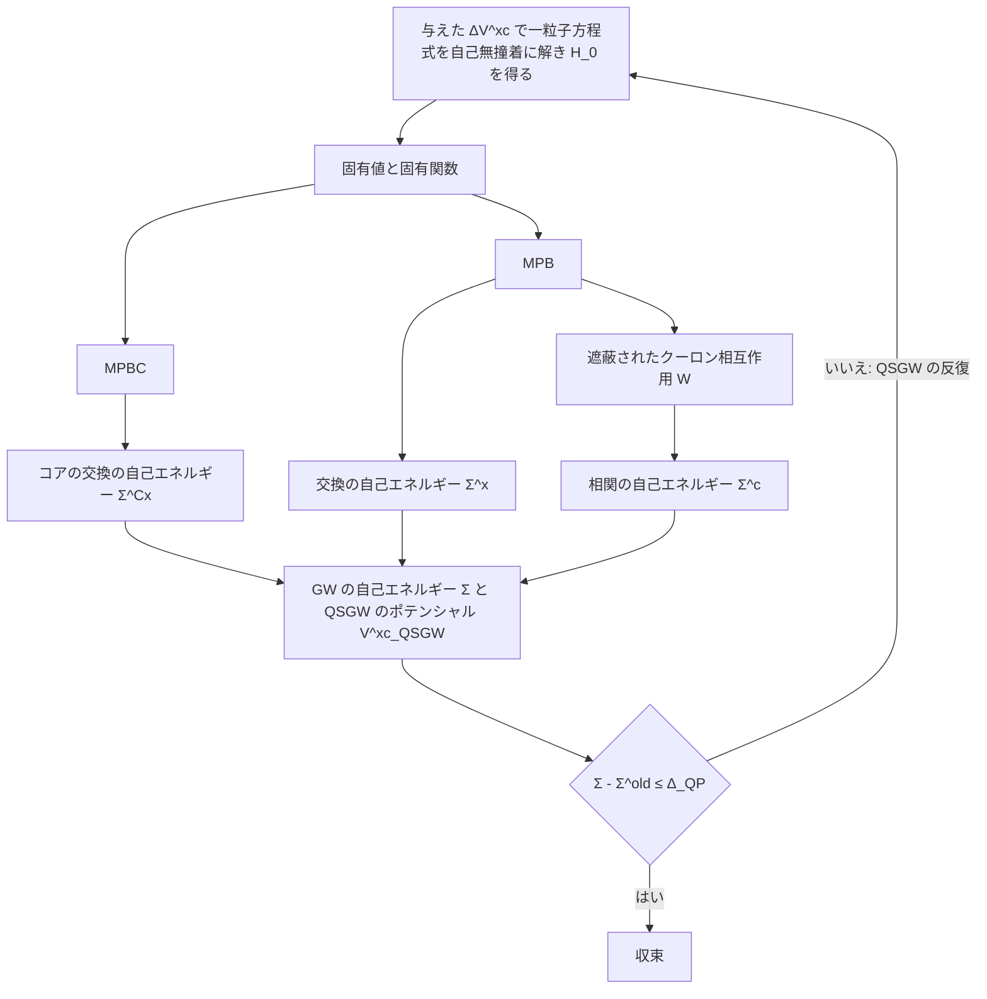

# Quasiparticle self-consistent $GW$（QSGW）

> **主な文献。** [1] M. Obata, T. Kotani, T. Oda, "Efficient implementation of the quasiparticle self-consistent $GW$ method on GPU",
> Comput. Mater. Sci. **260**, 114190 (2025), [doi:10.1016/j.commatsci.2025.114190](https://doi.org/10.1016/j.commatsci.2025.114190)（オープンアクセス）。
> その第 2 節が、ecalj の QSGW の定式化とアルゴリズムの、いちばん新しく簡潔な説明である（下の流れ図はその図 1。
> 図にあるプログラム名は当時のもので、いまは `hgw` が $\Sigma^{\rm x}$、$W$、$\Sigma^{\rm c}$ を一度の実行で計算し、`hsfp0_sc` が $\Sigma^{\rm Cx}$ を計算する）。

> **[1] からの変更。** いまのコードは [1] に従っているが、次の変更がある（詳細と日付はリポジトリの `Changes.md`）。
> - **Σ のなまし**（2026-09）: ガウスのなまし（`esmr`）を、幅 `t_sigmaw`（K、2026-11-14 から必須）の Fermi-Dirac の核に置き換えた。
>   $\Sigma^{\rm x}$、実軸の極の部分 $R^{\rm c}$、虚軸の部分 $I^{\rm c}$ のすべてで使う。古い `esmr` は `ctrlg_update.py` が同じ幅の `t_sigmaw` に変換する。
>   `wcsmear = true`（既定）では、極の部分は $W^{\rm c}$ を一つのエネルギーで評価する（[1] の 3 点の内挿）代わりに、この核で積分する。
>   [kBT](../manual/kBT) を参照。
> - **χ0 のなまし**（2026-06〜09）: 必須のキー `[gw] t_tetrakbt` で選ぶ。0 は [1] の四面体法（T = 0）、T > 0 は有限温度の四面体法、
>   −T は Im χ0 を Fermi-Dirac の幅でなます。
> - **プログラム**: $W$ と $\Sigma^{\rm x}$、$\Sigma^{\rm c}$ は `hgw` の一度の実行で計算する（W はファイルでなくメモリに置く）。`hsfp0_sc` は $\Sigma^{\rm Cx}$ を計算する。
> - **GPU の精度**（2026-06〜09）: `gwsc --prec=tf32|fp32|fp64`。[1] のすべてを TF32 で行う `--mp` は、$W$ を壊すことがあった（誘電行列の条件数が悪い）。
>   いまの `--mp` は `--prec=tf32` の意味で、$\Sigma^{\rm c}$ の最後の積だけを低い精度で行う。GPU は複数のランクで共有できる（`-np2`）。[GPU 版](../manual/ecaljgpu) を参照。
> - **$\tilde\Sigma$ の内挿**（2026-09、開発中）: `gwsc --mlo` は、$\Delta V^{\rm xc}$ を MTO で内挿する代わりに、$\tilde\Sigma$ を MLO の表示で持つ。[MLO-gwsc](../manual/mlo_gwsc) を参照。
> - **GW の結果を変えたバグの修正**（2026-06〜09）: $\Sigma^{\rm c}$ の極の項のビン分け、有限温度での $\Sigma^{\rm Cx}$ のフェルミ準位、
>   反強磁性の対称性を使う QSGW（`symgrpaf`）、LDA+U の出発点（`idu`）。

QSGW（quasiparticle self-consistent $GW$）法は、物性物理と物質科学で物質の電子状態を計算する、進んだ計算手法である。
一粒子（準粒子）ハミルトニアン $H^0$ を繰り返し更新することで、標準的な $GW$ 近似を改良する。
従来の密度汎関数理論（DFT）の計算より正確な準粒子エネルギーとバンド構造を与える。

QSGW の主な特徴:
- 自己無撞着な方法である。
- 電子状態の予言の精度が高い。
- 半導体、絶縁体、金属を含む、広い範囲の物質に使える。
::: warning
QSGW は一粒子 Green 関数を直接は更新せず、一粒子ハミルトニアンを通して更新する。
一粒子 Green 関数を直接更新する方法は自己無撞着 $GW$ として知られているが、バーテックス補正を無視するため、精度の低い方法であることも知られている。
:::

$$
H_0 = H_{\text{DFT}} + V^\mathrm{QSGW}_\text{xc} - V^\mathrm{LDA/GGA}_{\text{xc}}
\tag{Q1}
$$
ここで
$$
H_{\text{DFT}} = -\frac{\hbar^2}{2m}\nabla^2 + V_{\text{ext}} + V_{\text{H}} + V^\mathrm{LDA/GGA}_{\text{xc}}
\tag{Q2}
$$
- $-\frac{\hbar^2}{2m}\nabla^2$: 運動エネルギーの項
- $V_{\text{ext}}$: 外部ポテンシャル
- $V_{\text{H}}$: Hartree 項（電子間のクーロン相互作用）
- $V_{\text{xc}}$: 交換相関ポテンシャル

QSGW では、一粒子ハミルトニアンを次の式で作る。
$$
\begin{align}
  \widetilde{𝛴}^\mathrm{c}_{nm}(𝐤) &
  = \Braket{\Psi_{𝐤n} | 
  {\rm Re}\left[
  {\frac{ {\varSigma}^{\rm c}(\varepsilon_{𝐤n}) + {\varSigma}^{\rm c}(\varepsilon_{𝐤m}) }{2}}
\right]  |{\Psi_{𝐤m}} }
\tag{Q3}
\end{align}
$$

## 流れ図

この流れ図は、$GW$ の自己エネルギー $𝛴$ と QSGW のポテンシャル $V^\mathrm{xc}_\mathrm{QSGW}$ を得る手順を示す。
一粒子方程式を解いて $H^0$ を得て、その固有値と固有関数を求めるところから始まる。
次に、コアの交換の自己エネルギー $𝛴^\mathrm{Cx}$、交換の自己エネルギー $𝛴^\mathrm{x}$、相関の自己エネルギー $𝛴^\mathrm{c}$ の計算に分かれ、それらを合わせて $GW$ の自己エネルギー $𝛴$ と QSGW のポテンシャル $V^\mathrm{xc}_\mathrm{QSGW}$ を得る。
条件 $| 𝛴 - 𝛴^\mathrm{old}| ≤ Δ_\mathrm{QP}$ を満たすまで、この反復を続ける。
